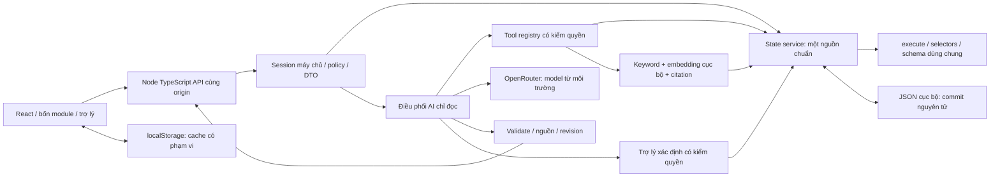
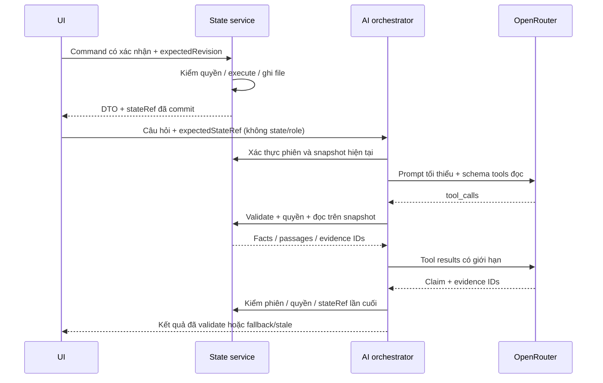

# Kế hoạch tích hợp AI — Phase 6.1

> Hiện trạng Phase 6.4: đã cải tiến UX/context/clarification và điều hướng nguồn. Xem [ai-ux-verification.md](ai-ux-verification.md) để biết kết quả 300 tests, các giới hạn browser/semantic và trạng thái mới nhất. Mô tả phase trước dưới đây được giữ làm lịch sử.

> Hiện trạng Phase 6.3: pipeline RAG đã được bổ sung; xem [triển khai](ai-rag-implementation.md) và [đánh giá](ai-rag-evaluation.md). Local E5 chưa provision được trong môi trường thực thi nên runtime hiện dùng BM25, không tuyên bố semantic đã hoạt động. Các mô tả phase cũ dưới đây là lịch sử.

> Cập nhật Phase 6.2: đã triển khai backend/tools theo [ai-openrouter-implementation.md](ai-openrouter-implementation.md). Tài liệu này giữ thiết kế tại Phase 6.1; trạng thái triển khai và khác biệt thực tế nằm trong báo cáo mới. Phase 6.3/semantic RAG chưa triển khai.

Ngày khảo sát: 10/11/2026. **Chỉ phân tích và thiết kế; chưa triển khai backend, chưa gọi LLM, chưa cài dependency.** Nguồn chỉ dẫn Phase 6.1 thực tế là [prompts/61.md](../prompts/61.md); repository không có `prompts/prompt6.1.md`. Không thực hiện Phase 6.2.

## 1. Phạm vi và tài liệu bàn giao

Giữ cả bốn phân hệ, dữ liệu tổng hợp, SAP mô phỏng, giao diện tiếng Việt và mọi quy tắc nghiệp vụ xác định. OpenRouter tương lai chỉ diễn giải câu hỏi, chọn công cụ đọc và diễn đạt câu trả lời từ bằng chứng. AI không quyết định định mức, tính tồn, duyệt, phân bổ tủ hoặc tạo PO.

Đã đối chiếu [AGENTS.md](../AGENTS.md), [proposal.md](../proposal.md), [requirements.md](requirements.md), [architecture.md](architecture.md), [data-model.md](data-model.md), [excel-alignment-report.md](excel-alignment-report.md), [demo-verification.md](demo-verification.md), mã nguồn và kiểm thử hiện có. Các phần “dự kiến/chưa triển khai” trong tài liệu cũ không được dùng thay hiện trạng mã nguồn.

| Tài liệu Phase 6.1                                               | Nội dung quyết định                                                   |
| ---------------------------------------------------------------- | --------------------------------------------------------------------- |
| [ai-tool-registry.md](ai-tool-registry.md)                       | Công cụ đọc, input/output, quyền và ánh xạ hàm hiện có                |
| [ai-rag-design.md](ai-rag-design.md)                             | Chunk, embedding cục bộ, truy xuất hybrid, vòng đời nguồn và citation |
| [ai-security-design.md](ai-security-design.md)                   | Phiên máy chủ, phạm vi dữ liệu, bí mật, injection và giới hạn bảo mật |
| [ai-implementation-checklist.md](ai-implementation-checklist.md) | Thứ tự triển khai tương lai, tiêu chí nghiệm thu và kiểm thử          |

Quy tắc “không external LLM APIs” trong AGENTS áp dụng cho ứng dụng hiện hành. Yêu cầu cụ thể mới cho phép **lập kế hoạch** dùng OpenRouter; không được diễn giải thành quyền gọi API trong Phase 6.1. Trước triển khai thực tế phải đồng bộ quy tắc dự án cho ngoại lệ OpenRouter phía máy chủ, dữ liệu tổng hợp và công cụ chỉ đọc. SAP thật vẫn ngoài phạm vi.

## 2. Hiện trạng đã kiểm tra

| Thành phần thực tế                                | Hoạt động và hệ quả tích hợp                                                                                                                                                                                                                     |
| ------------------------------------------------- | ------------------------------------------------------------------------------------------------------------------------------------------------------------------------------------------------------------------------------------------------ |
| `package.json`, `vite.config.ts`, `tsconfig.json` | React 19, TypeScript, Vite, Zod, Vitest/jsdom; chưa có backend, SDK LLM, embedding runtime hoặc proxy API. Node tại máy khảo sát: 26.9.0.                                                                                                        |
| `src/domain/types.ts`, `schema.ts`                | `State.schemaVersion = 2`; collection dùng chung, một `Account.role`/tài khoản. Không có các entity/service class chi tiết như một số sơ đồ kế hoạch cũ.                                                                                         |
| `src/domain/commands.ts`                          | `execute(input, actorId, command, operationId)`: clone, quyền/quy tắc, ledger, audit, operations, tăng revision và `assertState`. TypeScript `Command` chưa phải runtime schema cho HTTP.                                                        |
| `src/domain/selectors.ts`                         | Các phép đọc và tính toán dùng chung cho bốn module; một số hàm như `stock`, `availableLockers`, `issued` không tự nhận actor. Phải bổ sung adapter kiểm quyền trước khi công khai qua API/tools.                                                |
| `src/store/store.ts`, `migrations.ts`             | `DemoStore` lưu **JSON State trực tiếp**, không phải envelope có `savedAt/seedVersion`. Khóa `vinmec-admin-demo:state:v1` chứa schema v2; migrate v1→v2 giữ IDs/ledger/giá. Ghi storage thành công rồi mới publish state.                        |
| `src/main.tsx`, `src/app/context.tsx`             | Một store từ localStorage, React dùng `useSyncExternalStore`; actor ở `asa-demo-account`, mặc định `hc`. `storage` event khóa tab cũ và yêu cầu reload; không phải giao dịch đa tab.                                                             |
| `src/domain/assistant-routing.ts`, `assistant.ts` | `interpret` và `answerQuery` thuần, 15 intent, không network. Trả `Answer` với status/evidence/suggestions; lệnh ghi chỉ mở biểu mẫu.                                                                                                            |
| `src/features/assistant.tsx`, `src/app/App.tsx`   | Drawer dùng chung, mount theo actor; tối đa 30 câu hỏi và mã ngữ cảnh trong `sessionStorage`, khóa `asa-demo-chat:v1:<accountId>`. Dựng lại mọi đáp án bằng state/quyền hiện tại; không lưu đoạn trả lời. Độ trễ 120 ms chỉ để hiển thị loading. |
| `src/domain/assistant-documents.ts`               | `retrievePassages`: lọc qua `searchDocuments`, so từ/cụm, chấm điểm và lấy tối đa 3 mục. Chưa có embedding, vector index, BM25 hay LLM.                                                                                                          |
| `src/features/documents.tsx`                      | TXT/MD UTF-8 tối đa 200 KB; DOCX là văn bản mẫu mô phỏng, không parser DOCX/PDF thật. Reader kiểm version/ACL trước hiển thị.                                                                                                                    |
| `src/adapters/sap.ts`                             | `MockSapAdapter.searchProducts/createOrderReference`, cục bộ và đồng bộ. Trạng thái PO lấy từ `State.orders`, không có API SAP get-status.                                                                                                       |

**Lớp dịch vụ của cả bốn module hiện nằm trong command/selector dùng chung**, không có thư mục `src/services/`. Các đường dẫn dưới đây là hiện có:

| Module    | Model                                                         | Hàm đọc/quy tắc phải giữ                                                                                   | Command đang được UI sử dụng                                     |
| --------- | ------------------------------------------------------------- | ---------------------------------------------------------------------------------------------------------- | ---------------------------------------------------------------- |
| Đồng phục | `Sku/Lot/Movement/UniformRequest/Issuance`                    | `stock`, `issued`, `committed`, `employeesFor`, `requestsFor`, `eligibleSku`, `normalizeSize`              | `uniform.*`, `sku.save`, `stock.adjust`, `approve`               |
| Tài liệu  | `DemoDocument/DocumentSection`                                | `canReadDocument`, `documentFor`, `searchDocuments`, `retrievePassages`; `documentHasPii`                  | `document.create/update/mask/review/publish/revoke/version/sign` |
| Tủ đồ     | `Locker/LockerEvent`                                          | `availableLockers`, `lockerStatus`, `canReadLocker`, `lockerEventsFor`                                     | `locker.save/allocate/transfer/release`                          |
| Mua sắm   | `Purchase/PurchaseLine/Order/Receipt/Mapping/SupplierProduct` | `purchasesFor`, `purchaseReport`, `linkedPurchases`, `shortageRows`, `shortlist`, `reserveCap`, `nextRole` | `purchase.*`, `mapping.confirm`, `receipt`, `approve`            |

Giữ nguyên tính tồn từ ledger trừ reservation; quota gồm đã cấp và cam kết; trả hàng không hoàn quota; FIFO/giá lịch sử; ngoại lệ có lý do và bước Lãnh đạo; reserve `floor(activeEmployees × reserveRatio × reserveSets)`; đủ các bên duyệt mới tạo PO mô phỏng; nhận từng phần tăng kho một lần. Không dùng tài liệu hoặc LLM làm rule engine.

## 3. Quyết định về nguồn dữ liệu

Máy chủ không đọc được localStorage của trình duyệt. Đọc seed trên backend trong khi UI tiếp tục ghi localStorage sẽ tạo hai bộ tồn, hồ sơ và tài liệu khác nhau.

| Phương án                                        | Nhất quán sau thao tác UI                                    | Quyền và độ tin cậy                                                                                                                                             | Chi phí                 | Quyết định                                                   |
| ------------------------------------------------ | ------------------------------------------------------------ | --------------------------------------------------------------------------------------------------------------------------------------------------------------- | ----------------------- | ------------------------------------------------------------ |
| Backend có seed riêng                            | Sai ngay sau lần ghi đầu                                     | Không đại diện state người dùng đang xem                                                                                                                        | Thấp                    | Loại                                                         |
| Gửi toàn bộ snapshot/role từ browser mỗi câu hỏi | Gần thời điểm gửi, vẫn có race                               | Client sửa được account, ACL, ledger; schema hợp lệ không chứng minh nguồn gốc                                                                                  | Thấp                    | Loại khỏi chế độ AI có kiểm soát quyền                       |
| Bridge browser có giới hạn                       | Snapshot cùng revision/hash giúp coherence trong một browser | Server giữ identity và ACL chuẩn, chỉ nhận DTO allowlist; dữ liệu động vẫn bị giả mạo. Không thể cho đổi ACL/content hợp lệ từ client mà vẫn tin snapshot tùy ý | Trung bình              | Chỉ là phương án demo không đáng tin, không đề xuất mặc định |
| **State service có thẩm quyền trên Node**        | UI/modules/tools đọc cùng một state đã commit                | Session và ACL được kiểm trên state máy chủ; client không tự đổi role/state                                                                                     | Vừa, tái sử dụng domain | **Khuyến nghị**                                              |

Bridge nếu bắt buộc giữ browser làm nguồn chuẩn: chụp snapshot ngay trước query, giới hạn schema/kích thước/TTL, server bỏ accounts/roles/ACL/original, giao với quyền và corpus chuẩn của server, kiểm revision ở UI trước nhận kết quả, gắn nhãn “Dữ liệu do trình duyệt cung cấp, chưa được máy chủ xác thực”. Không dùng bridge cho câu trả lời về tài liệu vừa cập nhật/thu hồi nếu chưa có commit máy chủ. HMAC do server ký sau khi nhận dữ liệu tùy ý **không** chứng minh dữ liệu đúng. Bridge không đạt đầy đủ mục tiêu quyền + dữ liệu mới của đề xuất.

Khuyến nghị dịch chuyển **ranh giới lưu trữ**, giữ rule engine và hành trình nghiệp vụ. Khi online, Node có một `State` chuẩn trong RAM và file JSON cục bộ riêng; localStorage chỉ là cache DTO đã lọc và tùy chọn giao diện. Không đồng bộ hai nguồn ghi hai chiều. Chế độ demo offline cũ vẫn giữ nguyên localStorage/rule engine, chạy tách biệt và luôn ghi rõ RBAC mô phỏng; không được âm thầm chuyển sang offline khi server lỗi.

## 4. Kiến trúc tối thiểu đề xuất

Một process Node, `node:http`, `fetch`, `AbortController`, `crypto`, `fs`, Zod hiện có. `tsx` là dependency chạy TypeScript dự kiến; embedding thêm `@huggingface/transformers` ở bước sau, một worker CPU nếu cần tránh chặn event loop. Không cần Express, LangChain, PostgreSQL, Redis, Docker, vector database hoặc cloud service mới.

Dev: giữ Vite offline hiện tại ở 5173; online dùng origin riêng 5174, proxy `/api` sang Node loopback 8080. Bản build online do Node chỉ phục vụ `dist/` qua allowlist cùng origin 8080. Không phục vụ gốc dự án, `.env`, JSON state, credentials hoặc model cache. Không thêm CORS mở. Đây là cấu hình tương lai, chưa thay `vite.config.ts`.

### State service và persistence

1. Đọc/migrate/validate file máy chủ khi startup. Chỉ tạo seed tổng hợp khi chưa có state; dữ liệu hỏng phải dừng ghi và cho phục hồi, không reseed ngầm.
2. Hàng đợi ghi duy nhất, một process/instance. Request từ biểu mẫu có `operationId`, `expectedRevision`; actor lấy từ session. Runtime schema discriminated union cho từng `Command`; không nhận `actorId/role` từ payload.
3. Kiểm quyền API rồi gọi `execute`. Kiểm operation replay trước stale-revision; metadata máy chủ ràng buộc operation với principal + hash payload để cùng ID/khác payload bị từ chối. `State.operations` hiện chỉ là mảng ID, chưa cung cấp ràng buộc này.
4. Ghi envelope máy chủ gồm `workspaceId`, `State` và metadata idempotency vào tệp tạm cùng filesystem, fsync/rename rồi publish RAM. Nếu lỗi giữ state cũ; không báo thành công. Envelope này là **đề xuất mới**, không phải format localStorage hiện có. Một lần commit cùng chứa ledger/audit/state/idempotency.
5. Trả revision và DTO đã lọc. Không giữ lock ghi trong khi chờ OpenRouter/embedding. Cache/index là dữ liệu dẫn xuất, có thể dựng lại.
6. `workspaceId` là epoch mới khi reset/thay bộ dữ liệu; `revision` chỉ tăng trong epoch. Không so revision đơn lẻ vì reset hiện đưa revision về seed. Cả UI/tool/citation dùng tuple `(workspaceId, revision)`.

`DemoStore.reset(actorId)` hiện không tự kiểm quyền; UI đang chặn. Endpoint reset/import tương lai phải kiểm `sysadmin` trên máy chủ và xác nhận qua ứng dụng; không công khai method này trực tiếp.

### Chuyển dữ liệu đang có mà không mất lịch sử

Không upload snapshot khi chat. Có đường chuyển dữ liệu do **người vận hành máy chủ đáng tin** thực hiện: xuất JSON từ demo cũ → xác nhận toàn bộ là tổng hợp → kiểm schema/migration/invariant/FK và xem diff → sao lưu file máy chủ → import một lần khi workspace chưa có giao dịch, hoặc tạo workspace mới có xác nhận thay thế. Account/role/ACL phải được đối chiếu cấu hình máy chủ; JSON không tự cấp quyền hay credential. Không trộn seed, không “last-write-wins”.

Giữ bản localStorage cũ tại origin offline để rollback có chủ ý. Online dùng namespace mới theo workspace/account/policy; không hydrate toàn bộ `State` cũ. Không lưu document text, original, lời đáp LLM hay token phiên vào localStorage. Nếu buộc dùng cùng origin cũ, phải có bước xuất/xóa dữ liệu cũ được xác nhận; server auth không thể làm các bản sao cũ trong browser trở thành bí mật.

Các view online là DTO, **không giả làm `State` đầy đủ**: lọc mất dòng/lô sẽ làm selector tồn/quota/báo cáo sai. Backend tính trên state đầy đủ rồi chỉ trả field/tổng được phép. Refactor các feature đọc `s.*` sang read facade; thay `act` thành async, trả Promise tới form/confirmation và chỉ đóng/toast sau commit. `Modal` hiện đã `await onSubmit`, nhưng callback phải trả/await Promise thực. Kiểm từng call site, không thay toàn bộ API đồng bộ bằng Promise rồi bỏ qua lỗi.

### API dự kiến

| Endpoint                                                       | Hợp đồng                                                                                                         |
| -------------------------------------------------------------- | ---------------------------------------------------------------------------------------------------------------- |
| `POST /api/session`, `GET /api/session`, `DELETE /api/session` | Đăng nhập demo có credential do operator cấp, lấy principal chuẩn, kết thúc phiên; không phải chọn role tùy ý    |
| `GET /api/views/:view`                                         | DTO theo module, bộ lọc có giới hạn, quyền trước đọc; không có endpoint trả toàn bộ state                        |
| `GET /api/state/ref`                                           | Workspace/revision/policy fingerprint của phiên; hỗ trợ revalidate/focus và polling khoảng 2 giây                |
| `POST /api/commands`                                           | Biểu mẫu đã xác nhận; schema + quyền + expectedRevision; AI không có đường dispatch endpoint này                 |
| `POST /api/demo/reset`                                         | Chỉ operator/sysadmin được xác thực, xác nhận và epoch mới                                                       |
| `POST /api/assistant/query`                                    | Câu hỏi ≤500 ký tự, ngữ cảnh route/turn có giới hạn, `expectedStateRef`, `requestId`; không snapshot/role/secret |
| `GET /api/documents/:id/passages/:chunkId`                     | Kiểm session/ACL/version/hash/hiệu lực lại; không lấy href hoặc nội dung do model cung cấp                       |
| `GET /api/assistant/status`                                    | Chỉ báo ready/degraded/disabled và retrieval mode; không config, key hay stack trace                             |

## 5. Dùng `.env` hiện có

Đã kiểm tra an toàn rằng `.env` có hai giá trị không trống, không in/copy khóa và không sửa `.env`. Hiện Vite dùng cơ chế env mặc định; không thấy `loadEnv`, `dotenv`, `import.meta.env` hoặc code OpenRouter trong app. Biến không có tiền tố `VITE_` không tự được đưa vào client theo mặc định của [Vite](https://vite.dev/guide/env-and-mode). Không đổi `envPrefix`, không `define` toàn bộ `process.env`, không import config máy chủ vào bundle.

Backend tương lai nạp file gốc dự án bằng cơ chế `--env-file=.env` của [Node](https://nodejs.org/api/cli.html#--env-filefile), trước module config; nếu file không có vẫn phải khởi động chế độ deterministic theo policy rõ ràng. Script cụ thể có thể dùng biến thể `--env-file-if-exists=.env` và TypeScript launcher `tsx`; chỉ đọc `process.env.OPENROUTER_API_KEY` và `process.env.OPENROUTER_MODEL`. Không yêu cầu khóa khác, không tên alias, không giá trị model mặc định. Biến hệ thống có ưu tiên hơn file theo Node; status chỉ báo nguồn cấu hình và hợp lệ, không hiện giá trị bí mật.

API key chỉ vào header Authorization của request máy chủ tới `https://openrouter.ai/api/v1/chat/completions`. `model` luôn lấy đúng `OPENROUTER_MODEL`; thiếu/không hợp lệ thì tắt LLM, giữ fallback. Đã thêm `.env`/`.env.*` vào `.gitignore`, giữ ngoại lệ template `.env.example` không chứa secret. Thư mục hiện không có Git repository hoạt động (`git status` báo không có repo), nên chưa thể xác minh lịch sử hoặc việc file từng được track. Ignore không gỡ secret từng được commit; kiểm index/lịch sử trong repo thật khi bàn giao, không tự tuyên bố sạch lịch sử.

Metadata công khai của model đang cấu hình ghi nhận text output, `tools`, `tool_choice`, `response_format` và structured outputs. Đây chỉ là khảo sát [endpoint metadata](https://openrouter.ai/api/v1/models/openai/gpt-4.1-mini/endpoints), không chứng minh khóa/credit/provider thực tế dùng được; URL là bằng chứng khảo sát, không phải model hardcode cho triển khai. Chưa kiểm tra bằng inference. Khi chạy, tra metadata theo giá trị môi trường và dùng `provider.require_parameters=true` để tránh route bỏ qua tham số; xem [provider routing](https://openrouter.ai/docs/guides/routing/provider-selection).

Nếu tools không được hỗ trợ: dùng deterministic router + adapter đọc an toàn, có thể cho chính model đã cấu hình diễn đạt từ evidence nếu text generation được xác minh; gắn nhãn `deterministic-routing`. Nếu chỉ thiếu structured outputs: JSON thường + Zod, tối đa một sửa lỗi trong ngân sách; lỗi tiếp thì deterministic. Không tự đổi model hoặc dùng danh sách model fallback; đổi model cần người vận hành thay `OPENROUTER_MODEL` có xác nhận. Chat model không được dùng thay embedding model.

## 6. Điều phối và độ mới câu trả lời

Đề xuất ban đầu: không streaming; tối đa 3 completion, 2 vòng tools, 6 tool calls mỗi câu hỏi, xử lý tool tuần tự. Deadline toàn lượt 30 giây, mỗi upstream tối đa 12 giây và luôn nằm trong deadline còn lại. Một query hoạt động/phiên, tối đa 2 upstream đồng thời/process; hàng đợi có giới hạn. Đặt `temperature=0` nếu hỗ trợ để giảm biến thiên, không hứa LLM xác định.

Snapshot được chốt ở đầu lượt. Nếu bất kỳ commit, reset, ACL/ngày demo hay phiên thay đổi trước trả lời, không hiển thị kết quả cũ; hủy lượt và dựng fallback đọc mới nếu quyền còn hợp lệ, hoặc trả `stale/unavailable`. UI hủy/ẩn answer cũ ngay khi nhận commit, đổi account hoặc ref mới; reload/focus/poll kiểm lại ref. Trong khoảng mạng trễ không thể bảo đảm thu hồi tức thì trên mọi tab; không quảng cáo khả năng xóa dữ liệu đã được người dùng nhận.

History hiện tính lại đồng bộ mọi lượt; không được thay bằng gọi LLM lại 30 lượt mỗi render/revision. Chỉ sinh một lượt mới khi người dùng gửi, lưu câu hỏi/context IDs như hiện tại; các lời đáp LLM chỉ ở RAM, gắn stateRef/principal. Khi ref đổi, ẩn nội dung cũ và cung cấp “Tra cứu lại” có tác dụng; deterministic fallback an toàn có thể dựng lại từ state mới. Nội dung hội thoại trước không được coi là evidence hiện hành.

## 7. Giới hạn, chi phí và log

Ngân sách cấu hình máy chủ dự kiến: 12.000 token input tối đa/completion, 800 token output/completion, tối đa 6 passage, tool output tổng ≤16 KB, body query ≤16 KB; luôn cắt theo context của model thực tế và encoder phù hợp, không xem số ký tự là token. Endpoint nhập tài liệu giữ giới hạn 200 KB/file hiện tại và giới hạn tổng workspace. Không gửi full state, raw document hoặc original.

Tổng usage của mọi completion, kể cả lựa chọn tools, repair và lần lỗi có usage, vào ledger riêng: request/generation ID, model từ config, số token, cost, latency, outcome, fallback reason. Chuẩn hóa `prompt_tokens/completion_tokens` và cost từ [OpenRouter usage accounting](https://openrouter.ai/docs/cookbook/administration/usage-accounting); thiếu cost phải là `unknown`, không phải 0. Giá lấy metadata mới có TTL; dự toán và chi phí provider báo về được ghi riêng. Request timeout có thể đã bị tính phí: giữ reservation chưa đối soát, không tự retry vô hạn.

Đề xuất để xác nhận: trần 0,03 USD/câu hỏi và 5 USD/ngày cho workspace; reserve worst-case trước upstream, chặn lượt mới khi vượt trần/không có giá đáng tin và dùng fallback. Counter/usage journal cục bộ được lưu qua restart, không đặt trong state nghiệp vụ hoặc chia sẻ với model. Giới hạn provider/account vẫn cần cấu hình riêng; counter ứng dụng không thay kiểm soát chi tiêu của OpenRouter.

Log allowlist chỉ gồm mã lỗi chuẩn, correlation ID ngẫu nhiên, tool name, thời lượng, revision và usage. Không body/header, key/cookie, prompt, passage, original, tên nhân viên hay raw provider error. Mọi lỗi hiển thị tiếng Việt và phân biệt `llm` / `deterministic` cùng `hybrid` / `keyword`.

## 8. Rủi ro và cổng quyết định

| Rủi ro                                               | Cách xử lý / giới hạn                                                                                             |
| ---------------------------------------------------- | ----------------------------------------------------------------------------------------------------------------- |
| Chuyển store sync sang API ảnh hưởng bốn module      | Làm state/read facade trước AI; kiểm regression nguyên vòng phê duyệt, giá/ledger, reset và migration             |
| Role picker/ACL từ browser bị giả                    | Credential demo do operator cấp, session máy chủ; scope từ state máy chủ, không payload client                    |
| Policy hiện tại rộng và có record nhiều dòng         | Giữ ý nghĩa nghiệp vụ, bổ sung projection theo dòng/field; xem security design. Không công khai raw State         |
| LLM bịa hoặc nguồn không đủ                          | Claims có evidence IDs, kiểm số liệu bằng facts, tài liệu chỉ diễn giải có nguồn; lỗi về extractive/deterministic |
| Embedding không cài/tải được hoặc native runtime lỗi | Keyword mode được gắn nhãn, không gọi là semantic/hybrid; không coi RAG semantic đã hoàn tất                      |
| Một JSON file, một process                           | Phù hợp demo một workspace; không HA, không nhiều worker hoặc ghi từ nhiều máy; restart mất session               |
| Hạ tầng sandbox chặn cổng                            | Chạy lại ở máy cho phép localhost trước nghiệm thu; không bỏ qua bằng server/ảnh giả                              |

Thứ tự 5 tuần và các quyết định cần xác nhận nằm trong [checklist](ai-implementation-checklist.md). Chưa có yêu cầu xác nhận nào cần thiết để hoàn tất bộ tài liệu này; mọi lựa chọn chưa duyệt được đánh dấu cho **giai đoạn triển khai tương lai**.
