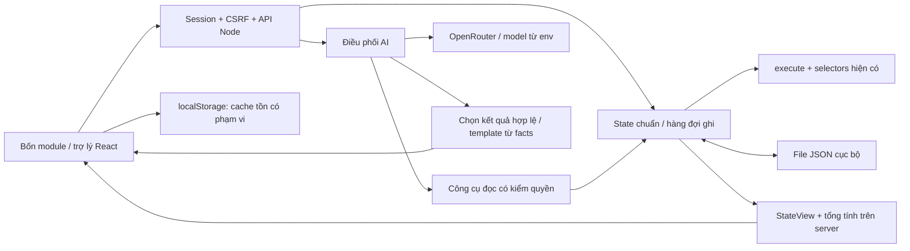

# Tích hợp OpenRouter và công cụ ứng dụng — Phase 6.2

> Hiện trạng Phase 6.4: đã cải tiến UX/context/clarification và điều hướng nguồn. Xem [ai-ux-verification.md](ai-ux-verification.md) để biết kết quả 300 tests, các giới hạn browser/semantic và trạng thái mới nhất. Mô tả phase trước dưới đây được giữ làm lịch sử.

> Hiện trạng Phase 6.3: pipeline RAG đã được bổ sung; xem [triển khai](ai-rag-implementation.md) và [đánh giá](ai-rag-evaluation.md). Local E5 chưa provision được trong môi trường thực thi nên runtime hiện dùng BM25, không tuyên bố semantic đã hoạt động. Các mô tả phase cũ dưới đây là lịch sử.

Ngày triển khai: 10/11/2026. Thực hiện [prompts/62.md](../prompts/62.md) trên ứng dụng hiện có và kiến trúc Phase 6.1. **Không triển khai Phase 6.3**: retrieval vẫn là từ khóa, chưa embedding/chunk index/hybrid ranking.

## 1. Kết quả và cách chạy

Backend Node.js/TypeScript đã có OpenRouter transport, tool calling, session/quyền, State service dùng chung, kiểm đầu ra và deterministic fallback. UI bốn module hiện có được giữ, thêm adapter online; không dựng lại ứng dụng hoặc tạo dataset riêng cho AI.

```bash
# Build giao diện offline, giao diện online và backend
npm run build

# Chỉ cần trên máy mới; không ghi đè credential đã có
npm run provision:accounts

# Chạy backend và bản build online
npm run server
```

Mở `http://127.0.0.1:8080`. Mã demo riêng từng account ở `.local/online/access-codes.json`, chỉ người vận hành đọc; không phải khóa OpenRouter. Lượt triển khai này đã provision file với quyền hạn chế, không in mã hoặc API key. Máy mới phải provision trước chạy server. Nếu credential đã tồn tại, lệnh provision từ chối ghi đè.

Dev online: chạy backend bằng `npm run server`, terminal khác chạy `npm run dev:online`, mở `http://127.0.0.1:5174`. `/api` được proxy tới Node 8080. Chế độ offline cũ vẫn ở `npm run dev`/5173 hoặc `npm run preview`/4173, sử dụng localStorage và trợ lý xác định. Không tự chuyển nguồn ghi khi mạng lỗi.

**Giới hạn máy hiện tại:** các lần chạy server/browser bị chặn mở cổng localhost (`EPERM`). Vì vậy các URL/lệnh là cách vận hành trên máy cho phép localhost; không tuyên bố trình duyệt hay inference thật đã chạy thành công ở môi trường này.

## 2. Dùng `.env` hiện có

`npm run server` build TypeScript phía máy chủ bằng Vite SSR rồi chạy:

```text
node --env-file-if-exists=.env dist-server/index.js
```

Node đọc file `.env` gốc trước entry. `server/openrouter.ts::configFromEnv` chỉ dùng đúng `OPENROUTER_API_KEY` và `OPENROUTER_MODEL`. Thiếu/rỗng/cấu hình sai có thông báo tên biến an toàn lúc startup và `AI_CONFIG` fallback; không có model mặc định, không yêu cầu key khác. Đổi `OPENROUTER_MODEL` rồi khởi động lại server, không sửa source.

API key chỉ vào header Authorization của request Node tới OpenRouter. Không `VITE_`, không đưa config vào React, response hoặc logs. Đã kiểm native loader báo hai biến hiện diện mà không in giá trị. `.env`/`.env.*`, `.local/`, các thư mục build/test report được ignore. Working tree không có Git HEAD hoạt động, nên không thể xác minh lịch sử tracked/commit; ignore không chứng minh lịch sử sạch.

Không thêm dependency. Tái sử dụng Vite SSR để bundle backend TypeScript thay `tsx` dự kiến; runtime dùng Node built-ins và Zod đã có. Không thêm SDK LLM, dotenv, database, Redis, Docker hoặc embedding runtime.

## 3. Nguồn dữ liệu hiện hành



`StateRepository` lưu một envelope ở `.local/online/state.json`: workspace ID, canonical State schema v2 và metadata operation gồm actor/hash payload. Một queue ghi gọi `execute` hiện có, ghi file tạm/fsync/rename thành công rồi mới publish state. Ghi lỗi giữ state cũ. Replay đúng operation trả ref hiện tại; khác actor/payload hoặc trùng operation của dữ liệu cũ bị chặn. Command stale bị 409; reset chỉ sysadmin đã xác thực, có xác nhận và workspace ID mới.

Các trang không gửi snapshot hoặc role lên chat. Command UI và tool cùng truy cập repository này. Issuance, nhận PO và cấp tủ đã được kiểm trong test bằng command thật; tool/fallback sau đó đọc các giá trị mới. Các phép quota/tồn/reserve/FIFO/giá lịch sử/phê duyệt/PO/receipt vẫn ở domain engine, không do LLM tính.

`StateView` là DTO có discriminator `readModel`, giữ hình dạng entity để tái sử dụng UI nhưng không phải State chuẩn. Server tính stock/quota/shortage/approval/headcount trên state đầy đủ trước project. Selector đọc DTO dùng các tổng này; `execute/assertState` từ chối DTO. Không tính kho từ một ledger đã bị lọc mất dòng. Form/callback đã trả hoặc await Promise, chỉ toast/đóng sau commit, không ghi optimistic localStorage.

Online localStorage chỉ có cache ref/tồn đã được phép, tách namespace và origin; không chứa token, câu trả lời, document text hoặc original. SessionStorage giữ câu hỏi/context IDs tối đa 30 lượt như trước; answer chỉ ở RAM, gắn workspace/revision. Commit, đổi phiên hoặc ref mới làm ẩn answer cũ; retry là thao tác người dùng, không tự gọi lại cả history. Poll khoảng 2 giây và focus giúp tab nhận ref mới, không phải bảo đảm thu hồi tức thì trên mọi máy.

### Dữ liệu demo cũ

Server lần đầu khởi tạo từ cùng `createSeed` tổng hợp mà ứng dụng dùng; sau đó không reseed khi khởi động. Tất cả module online dùng dataset này, không chỉ AI. LocalStorage offline và thay đổi cũ được giữ nguyên tại origin cũ; không tự upload hoặc merge vào server.

Muốn giữ các giao dịch offline hiện có: Quản trị mở Thiết lập → **Xuất JSON dữ liệu tổng hợp**, kiểm dữ liệu là synthetic, dừng server rồi chạy:

```bash
npm run import:online -- /duong-dan/synthetic-state.json --confirm-synthetic
```

Chỉ operator có quyền OS thực hiện import. Migration v1→v2 giữ ID/ledger/giá; không thêm seed mới. Kiểm role/account mapping với bộ account đã cấp; không nhận credential/role tùy ý từ JSON. Import tạo backup `state.json.backup` và workspace epoch mới. Không chạy CLI import trong lúc server còn hoạt động; file repository hỗ trợ một process, chưa có coordination nhiều process. Bản export online là `authorized-read-view`, không phải backup chuẩn và bị từ chối nếu dùng làm dữ liệu nhập. Không có HTTP endpoint xuất raw State toàn viện.

## 4. Danh mục 17 công cụ

Mỗi entry có tên ổn định, mô tả, schema Zod strict, result có kiểu/status/ref/evidence, kiểm phạm vi và giới hạn dòng. Tên không hỗ trợ hoặc arguments sai bị chặn. Không có tool ghi.

| Nhóm      | Công cụ                                                                                                                                                              |
| --------- | -------------------------------------------------------------------------------------------------------------------------------------------------------------------- |
| Hỏi rõ    | `clarify_question`, `resolve_employee`                                                                                                                               |
| Đồng phục | `find_uniform_product`, `search_uniform_inventory`, `check_uniform_eligibility`, `get_employee_issuance_history`, `get_uniform_request_status`, `get_uniform_policy` |
| Mua sắm   | `get_purchase_requests`, `get_purchase_order_status`, `get_goods_receipts`, `get_supplier_candidates`                                                                |
| Tủ đồ     | `search_available_lockers`, `get_locker_assignments` (có lịch sử theo from/to được phép)                                                                             |
| Tài liệu  | `search_internal_documents`, `get_document_metadata`, `get_document_passages`                                                                                        |

Tìm SKU khác với productId/code; chuẩn hóa 2XL→XXL, XXXL→3XL theo hàm hiện có. Tên trùng trả candidates trong phạm vi và dừng chọn tool phụ thuộc. Không có bản ghi/ngoài quyền cùng trả unavailable; stock đúng SKU nhưng lượng 0 vẫn trả 0. PO/phiếu nhận luôn có parent PR được phép; không gọi SAP thật. Đối sánh chỉ gợi ý và đọc mapping đã xác nhận.

## 5. Tool calling và grounding

Transport dùng [OpenRouter Chat Completions và tools](https://openrouter.ai/docs/guides/features/tool-calling): `model` từ env, assistant `tool_calls`, kết quả `role=tool` với đúng `tool_call_id`, hội thoại có câu hỏi trước và context đã resolve. Metadata capabilities/giá được kiểm với TTL; `require_parameters=true`, policy `data_collection=deny`, không tự đổi model hoặc nới policy khi route thiếu.

Tối đa 3 completion, 2 vòng tool, 6 tool calls/lượt; một lượt đang chạy/phiên, 2 lượt/process, khoảng 20 query/phút/phiên. Deadline 30 giây, upstream request tối đa 12 giây, metadata 5 giây, output 800 token/completion; body model có giới hạn bảo thủ 18.000 UTF-8 byte, tool output tổng 16 KB. Không dùng ký tự tiếng Việt như số token. Chọn byte cap thay tokenizer/12.000-token dự kiến để không thêm dependency.

Model chọn tool/arguments từ câu hỏi thường, không cần người dùng dùng đúng regex. Sau tool, model trả JSON chọn các `resultIds` hiện có. Backend chỉ dựng nội dung và fact/evidence card từ kết quả đã kiểm; không hiển thị lời văn/số liệu tự do của model. Đây là lựa chọn chủ ý của Phase 6.2: có NLU và tool orchestration bằng LLM, nhưng chưa có tóm tắt tài liệu tự do. Kết quả có mode `llm` nghĩa là AI chọn công cụ/kết quả, không phải mọi câu chữ do model tự sinh.

Sau đọc tài liệu, tool round tiếp chỉ cho lấy passage bằng evidence IDs đã cấp; nguồn không được mở rộng sang tra nhân viên hoặc công cụ khác. Prompt injection không thể đổi identity, lấy key, gọi URL hay dispatch command. Structured output/JSON thường đều phải parse và kiểm IDs; sai format/nguồn thì fallback. Không tự sửa/retry trả phí vô hạn.

Nguồn tài liệu vẫn dùng `retrievePassages/searchDocuments` hiện có: published, đúng version/ngày/ACL trước retrieval; metadata và passage có thể kiểm lại. Không index original/nháp/thu hồi/hết hạn, không gọi đó là semantic retrieval. Phase 6.3 chưa bắt đầu.

## 6. Session, quyền và phạm vi demo

Server cấp session ngẫu nhiên qua cookie HttpOnly/SameSite=Strict sau credential demo riêng/account; hash scrypt và salt nằm ngoài static root. POST/DELETE cần Origin allowlist và CSRF của phiên. Browser chọn account chỉ mở bước đăng nhập, không tự cấp role; `asa-demo-account`, `actorId`, role hoặc snapshot do client gửi không thay principal.

Kiểm account còn active trên server trước mỗi request/tool và trước trả lời; state ref thay đổi hoặc logout giữa lượt làm answer bị chặn. Quyền self/khoa/nhóm rộng dùng selector hiện có, thêm projection dòng/field. Employee không nhận dòng của đồng nghiệp trong request nhóm. Tài liệu có ACL độc lập với `isWide`; sysadmin không tự đọc hợp đồng hạn chế. Quản lý tài liệu vẫn có editor/original để rà soát như nghiệp vụ cũ, không đưa original vào tool retrieval.

PR/PO có nhiều nguồn mà principal chỉ được xem một phần được **giữ ngoài read view**: dữ liệu hiện chưa có attribution receipt theo khoa/người, nên không suy tỷ lệ hoặc hiển thị tổng của phần bị che. Đây là cách xử lý bảo thủ thay cho phương án partial-PR trong kế hoạch ban đầu. Giá/catalog và các tổng tồn/quân số demo được cấp cho các view nghiệp vụ hiện hành; `isWide` vẫn khá rộng như prototype cũ, chưa phải ma trận quyền bệnh viện được phê duyệt.

Online có entry/build riêng, không import seed và dùng hướng dẫn trình diễn chung thay hardcode hồ sơ/câu trả lời hạn chế. Vite dev online chặn đường dẫn env/state/server/seed/tài liệu nguồn; bản chạy Node chỉ phục vụ dist-online, chặn dotfile/traversal và đường dẫn ngoài root. API không log body/header/key/prompt/passage; lỗi provider được chuẩn hóa, không echo raw message/metadata.

Đây vẫn là demo cục bộ: một JSON/process, credential demo do operator giữ, không SSO/MFA, không audit chống sửa đổi/HA hay chứng nhận bảo mật sản xuất. Người có quyền OS vẫn đọc/sửa được file. Không đưa dữ liệu thật vào ứng dụng.

## 7. Fallback và chi phí

Thiếu config, model không hỗ trợ tools, outage, timeout, 401/402/429, tool/JSON sai hoặc budget/context limit đều có fallback xác định trên **cùng state máy chủ và cùng projection**, không trên một seed/cache AI khác. UI phân biệt “AI chọn công cụ” và “Tra cứu xác định (dự phòng)”. Mất backend hoàn toàn báo chưa đối chiếu được; không ghi browser riêng hoặc bịa một câu trả lời LLM.

Usage lấy từ [OpenRouter response](https://openrouter.ai/docs/cookbook/administration/usage-accounting), cộng các lượt đã thử, token và cost nếu provider trả. Thiếu cost hoặc request chưa biết đã bị tính phí thì cost là unknown, không 0. Ledger cục bộ reserve worst-case từ metadata, giới hạn đề xuất đã áp dụng 0,03 USD/lượt và 5 USD/ngày UTC, giữ qua restart. Bản này chỉ lưu sổ ngày hiện hành, chưa có lịch sử/retention 7 ngày. Sau lỗi 429 có cooldown theo Retry-After; không âm thầm dùng model khác.

## 8. Các file chính

| Khu vực          | File/thay đổi                                                                                                                                          |
| ---------------- | ------------------------------------------------------------------------------------------------------------------------------------------------------ |
| Backend          | `server/{index,http,app,state,commands,auth,views,openrouter,assistant,tools,usage,errors}.ts`                                                         |
| Kết nối frontend | `src/online/{OnlineApp,client,protocol,demo-scenarios}`, `src/online-main.tsx`, Context/App và drawer trợ lý                                           |
| Domain           | `types` tách State/StateView/ReadState; selectors đọc aggregate DTO; guard cấm ghi DTO. Giữ công thức/state machines cũ                                |
| Bốn module       | Callback async/confirmation; template hiển thị mode online; export synthetic JSON cho chuyển dữ liệu offline                                           |
| Build/QA         | `vite.config.ts`, `vite.server.config.ts`, `vite.e2e.config.ts`, `playwright.online.config.ts`, scripts npm, `scripts/qa.mjs`, TS include server/tests |
| Kiểm thử mới     | `server/integration.test.ts`, `src/test/online.test.tsx`, `tests/e2e/{online.spec,online-server}.ts`                                                   |
| Quy tắc/tài liệu | AGENTS cho phép ngoại lệ OpenRouter server-only theo yêu cầu người dùng; README, limitations, architecture/data-model và tài liệu này                  |

## 9. Kiểm chứng

Kết quả cuối được ghi sau lượt `npm run test:qa` ở `output/qa/summary.json`; báo cáo phân biệt suite offline và online, passed/failed/blocked/notExecuted. CI/mock transport không dùng `.env` key để gọi API trả phí. API test chạy handler thật với repository temp/session/command/tools; chỉ OpenRouter transport được fake. RTL kiểm loading, cancellation, answer invalidation, retry operation ID và confirmation async.

Playwright có 48 ca offline + 6 ca online (desktop/mobile), backend/state/quyền/UI thật; test server có fake OpenRouter ở ranh giới transport và workspace tạm, không endpoint bật mock trong runtime thật. Các ca online kiểm inventory sau UI commit/reload, forged localStorage role và đổi credential, provider fallback/no-write. Không giả toàn ứng dụng bằng route.fulfill.

Lượt QA cuối: **2026-11-10T16:20:23.980Z–2026-11-10T16:20:45.862Z**. Kết quả được thực thi, không suy từ discovery:

| Kiểm tra                                     | Kết quả cuối                                                                                         |
| -------------------------------------------- | ---------------------------------------------------------------------------------------------------- |
| TypeScript, gồm backend và E2E               | Qua, exit 0                                                                                          |
| Build offline / online / backend SSR         | Cả ba qua, exit 0                                                                                    |
| Vitest + React Testing Library               | **225 qua, 0 thất bại, 0 bỏ qua**, 18 tệp                                                            |
| Playwright discovery                         | 48 ca offline + 6 ca online; không phải kết quả thực thi                                             |
| Playwright workflows                         | Cả hai suite bị chặn khi mở webServer; **54 ca chưa thực thi**, 0 journey/screenshot xác minh        |
| Native `.env` loader                         | Hai biến đúng tên hiện diện; không in giá trị                                                        |
| Startup/backend bind                         | Chưa mở được 8080; probe trực tiếp trả `EPERM 127.0.0.1:8080`                                        |
| Quét API key trong source/docs/build/reports | Không thấy giá trị key; bundle online cũng không có tên hai biến môi trường hoặc đáp án seed hạn chế |

`npm run test:qa` trả **exit 1 / incomplete** vì browser bị chặn, dù unit/TypeScript/build qua. Cần chạy lại trên máy cho phép HTTP localhost và Chromium trước trình diễn. **Chưa xác minh live inference, credit hoặc provider route thực tế**; normal suite dùng mock OpenRouter, không gọi API trả phí.

Nút xóa hội thoại online gọi endpoint xóa context của phiên trên server, tăng conversation revision để ngăn request cũ khôi phục context sau xóa; không đổi state nghiệp vụ. Các test bổ sung bao phủ StrictMode stop/start polling, context clear, operation provenance, migration tài khoản cũ có tập con hợp lệ và vòng đời citation khi draft/publish.
