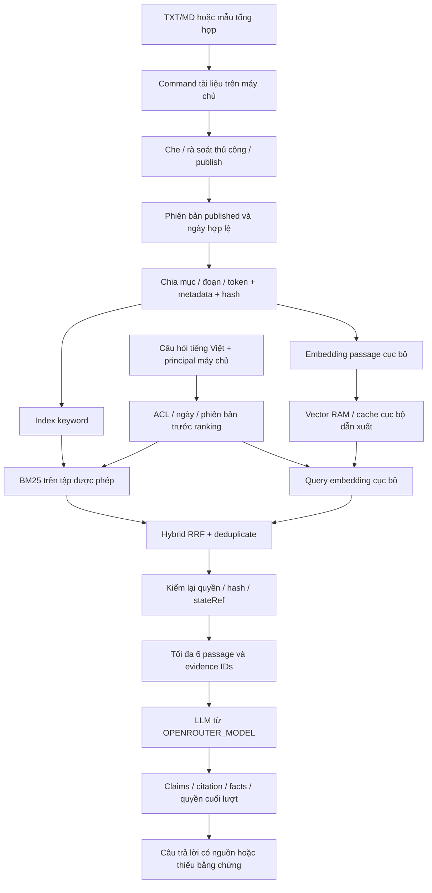

# Thiết kế RAG tiếng Việt — Phase 6.1

> Hiện trạng Phase 6.3: pipeline RAG đã được bổ sung; xem [triển khai](ai-rag-implementation.md) và [đánh giá](ai-rag-evaluation.md). Local E5 chưa provision được trong môi trường thực thi nên runtime hiện dùng BM25, không tuyên bố semantic đã hoạt động. Các mô tả phase cũ dưới đây là lịch sử.

> Cập nhật Phase 6.2: đã triển khai backend/tools theo [ai-openrouter-implementation.md](ai-openrouter-implementation.md). Tài liệu này giữ thiết kế tại Phase 6.1; trạng thái triển khai và khác biệt thực tế nằm trong báo cáo mới. Phase 6.3/semantic RAG chưa triển khai.

Trạng thái: thiết kế, chưa cài embedding runtime, tải model, tạo vector index hoặc gọi LLM. Kiến trúc và nguồn state theo [ai-integration-plan.md](ai-integration-plan.md), công cụ theo [ai-tool-registry.md](ai-tool-registry.md). Toàn bộ corpus là văn bản tổng hợp; không sử dụng workbook thật hoặc thông tin bệnh nhân.

## 1. Điểm xuất phát và mức năng lực

`src/domain/selectors.ts::searchDocuments` lọc `canReadDocument` rồi tìm mọi token trong title/section. `src/domain/assistant-documents.ts::retrievePassages` xử lý stop words/cụm từ, chấm điểm title/body, trả tối đa ba mục nguyên văn. Có evidence đúng record/version/section và deep link, **chưa có semantic retrieval hoặc generated synthesis**.

`DemoDocument` hiện có `id,title,category,departmentId,owner,version,date,expires,status,readRoles,signRoles,sections,original,reviewedBy,history,signatures`. Không có vector, chunk, content hash, ACL revision hoặc bảng DocumentVersion riêng. Các trường mới dưới đây là metadata dẫn xuất của index, không phải giả định chúng đã có trong State.

| Mode                             | Thành phần thực sự chạy                                    | Nhãn tiếng Việt dự kiến                |
| -------------------------------- | ---------------------------------------------------------- | -------------------------------------- |
| Hiện hành                        | Keyword/cụm từ + template/trích nguyên đoạn                | “Trợ lý xác định • Tìm từ khóa”        |
| Chưa có embedding, LLM hoạt động | Keyword/BM25 + LLM diễn đạt từ passage                     | “OpenRouter • Truy xuất từ khóa”       |
| Mục tiêu RAG hybrid              | BM25 + vector embedding cục bộ + ranking + LLM có evidence | “OpenRouter • Truy xuất kết hợp”       |
| LLM lỗi, index còn dùng được     | Retrieval được phép + trích đoạn/template xác định         | “Trợ lý xác định • Nguồn đã đối chiếu” |

Keyword + LLM là generation có truy xuất từ khóa, nhưng không được báo semantic/hybrid hoàn tất. Query rewrite/synonym bằng LLM cũng không phải embedding. Chỉ bật `retrievalMode=hybrid` sau khi vector và query encoder đúng model revision đã thực sự được kiểm thử.

## 2. Pipeline đề xuất



Các tool nghiệp vụ không truy xuất vector: tồn/quota/PO/tủ phải đọc selector hiện tại. RAG dùng cho văn bản chính sách/hợp đồng; nếu hỏi cả chính sách lẫn quota còn lại thì phối hợp tool settings/history và tool tài liệu, phân biệt hai nguồn.

## 3. Corpus, ingestion và quyền

1. Giữ TXT/MD UTF-8 tối đa 200 KB và nội dung mẫu DOCX mô phỏng hiện có. Không hứa OCR, PDF hoặc DOCX parser thật trong giai đoạn này. Giới hạn file được kiểm lại trên server, không chỉ ở input browser.
2. Chỉ `sections/title` đã được che và người quản lý tài liệu rà soát mới vào corpus. Không index hoặc gửi `original`, tên file nguồn thật, chữ ký, audit notes, thông tin liên hệ. Các regex `maskPii/hasPii/documentHasPii` hiện chỉ phát hiện mẫu đơn giản, không phải bảo đảm ẩn danh.
3. Predicate nền: `status===published`, `date<=settings.date<=expires`, role nằm trong `readRoles`, account/employee còn active. `signRoles` không cấp quyền đọc; sysadmin không tự vượt document ACL. `departmentId` chưa là ACL khoa trong code; nếu bổ sung scope khoa phải là thay đổi policy có schema/test, không suy từ metadata.
4. Index có thể giữ chunk của các tài liệu published ở phía server, nhưng **mỗi query lọc tập record được principal phép đọc trước khi tính BM25/vector score/rank**. Không tìm global top-k rồi mới lọc. BM25 statistics và số kết quả dùng tập được phép để tránh rò qua count/rank. Với corpus nhỏ, dựng view theo permission rẻ hơn cache phức tạp.
5. Search tool, đọc chunk, render response, reader deep link và tải văn bản cùng predicate. Editor riêng có quyền quản lý draft/original, không làm draft trở thành nguồn trả lời cho trợ lý.

## 4. Phiên bản và metadata dẫn xuất

Command `document.version` hiện clone bản cũ thành ID dạng `<id>-v<version>`, tăng version trên record gốc và đưa record gốc về draft. Bản clone cũ còn published cho đến `document.publish` bản mới chuyển nó superseded. Không được chỉ lọc “version cao nhất”, vì version mới có thể chưa xuất bản.

Đề xuất lập bảng lineage dẫn xuất theo **quan hệ archive thực tế do command tạo**, giữ cả physical recordId và documentRootId; không ép đổi ID hay migrate lịch sử chỉ để lập RAG. Tìm phiên bản published đang hợp lệ trong lineage. Nếu có nhiều bản published mâu thuẫn không giải thích được, dừng index lineage và báo lỗi dữ liệu, không chọn tùy ý. Khi base record đang draft và archive còn published, citation phải trỏ physical archive/version hợp lệ; reader có thể kiểm record đó.

```text
ChunkMetadata (đề xuất mới) = {
  workspaceId,
  documentRootId,
  recordId, version, sectionId, chunkId,
  documentTitle, sectionTitle, category, ownerDepartmentId,
  sourceStart, sourceEnd, text,
  documentContentHash, chunkContentHash,
  publicationFingerprint, aclFingerprint,
  effectiveDate, expires,
  indexGeneration, chunkerVersion,
  embeddingModelId, embeddingModelRevision, embeddingDimension, embeddingDtype
}
```

`sourceStart/sourceEnd` là offset UTF-16 theo JavaScript trên chính `section.text`, không byte offset hay vị trí trên `original`. Điều kiện kiểm chứng: `chunk.text===section.text.slice(sourceStart,sourceEnd)`. Không sửa dấu/space trong text gốc của chunk; bản normalize cho keyword chỉ là field tìm kiếm dẫn xuất. Hash SHA-256 tính từ dữ liệu canonical có thứ tự field xác định.

`chunkId` gồm identity/version/section, offset, hash và chunkerVersion; không dùng một số thứ tự dễ bị tái sử dụng sau cập nhật. `aclFingerprint` tính từ readRoles và policy máy chủ; publication fingerprint gồm status/version/ngày/expiry/title/content. `signRoles` không quyết định retrieval nhưng thay đổi quyền/phiên vẫn làm policy ref đổi khi cần. Không lưu embedding credential vì local inference không có credential.

Không thêm các trường index vào State nghiệp vụ để tránh tăng JSON localStorage và biến cache thành dữ liệu chuẩn. Cache riêng ngoài static root, được bỏ qua Git khi triển khai, có manifest để kiểm hash và dựng lại sau restart.

## 5. Chunking tiếng Việt

Các giá trị sau là cấu hình khởi đầu cần đánh giá, không phải kết quả benchmark:

- Chia trong một section, ưu tiên ranh giới đoạn, sau đó câu/bullet. Không ghép khác document, version hoặc section; giữ tiêu đề mục như context riêng.
- Mục tiêu khoảng 250–350 token **của embedding tokenizer**, overlap khoảng 40–50 token giữa hai chunk cùng section. Tính cả prefix/title và special tokens để không vượt 512 token.
- Mục ngắn giữ nguyên; đoạn quá dài chia bằng tokenizer cùng offset map và ranh giới từ/câu gần nhất. Không cắt một UTF-16 surrogate pair. Bảng tổng hợp nhỏ giữ header và dòng cùng ý, không biến số tiền/ngày thành narrative mới.
- Lưu exact source span trước normalize. Keyword dùng Unicode fold từ `normalize` hiện có để hỏi không dấu; embedding dùng tiếng Việt nguyên dấu. Mã `DP-DD-M`, `DEMO-TL-*`, ngày và số giữ nguyên, có đường exact-match ưu tiên.
- Nếu query vượt token budget encoder, yêu cầu thu hẹp hoặc truncate có thông báo; không âm thầm cắt mất mã/nhân viên và trả lời câu hỏi khác.

## 6. Embedding khả thi với cấu hình hiện có

`.env` chỉ có `OPENROUTER_API_KEY` và `OPENROUTER_MODEL` cho chat. [OpenRouter embeddings](https://openrouter.ai/docs/api_reference/embeddings) là API riêng cần model embedding tương thích; một tên chat model không phải bằng chứng dùng được embeddings. Không gửi `OPENROUTER_MODEL` vào `/embeddings`, không tạo tên biến thay thế và không mặc định mua một embedding API khác.

### Khuyến nghị: embedding cục bộ trong Node

Ứng viên là multilingual E5 small. [Model card gốc](https://huggingface.co/intfloat/multilingual-e5-small) công bố vector 384 chiều, input tối đa 512 token; dùng prefix `query: ` và `passage: `, average pooling có attention mask và L2 normalization. Nó có khả năng đa ngôn ngữ, nhưng chất lượng câu hỏi hành chính tiếng Việt của dự án phải đo riêng; không lấy benchmark đa ngôn ngữ làm chứng nhận tiếng Việt của ứng dụng.

[Bản ONNX Xenova](https://huggingface.co/Xenova/multilingual-e5-small) cung cấp trọng số tương thích Transformers.js; chạy server qua `@huggingface/transformers`. File `model_quantized.onnx`/int8 công khai khoảng **118 MB**, theo [danh mục artifact](https://huggingface.co/Xenova/multilingual-e5-small/tree/main/onnx). Đây là kích thước trọng số, không phải tổng RAM hay toàn bộ tải xuống. Khi triển khai chọn một artifact/revision/checksum cụ thể, tokenizer/config tương ứng và dtype phù hợp; không tải tất cả biến thể trong repo.

| Tài nguyên | Dự toán để lập kế hoạch, chưa benchmark                                                                                                                        |
| ---------- | -------------------------------------------------------------------------------------------------------------------------------------------------------------- |
| CPU/GPU    | CPU x64; bắt đầu 2 thread, một worker inference và batch 4–8. Không yêu cầu GPU.                                                                               |
| Disk       | Dành 200–500 MB cho model/tokenizer/runtime cache được chọn; package native và bản dự phòng có thể tăng dung lượng. Đo thực tế trước chốt.                     |
| RAM        | Dành thêm khoảng 0,5–1,5 GiB RSS khi load/inference; mục tiêu ít nhất 2 GiB headroom ngoài Node/app/browser. Đây là ước lượng, không suy trực tiếp từ 118 MB.  |
| Vector     | Float32 384 chiều = 1.536 byte/chunk trước metadata; 10.000 chunk khoảng 14,6 MiB vector. Corpus seed chỉ 8 tài liệu nên exact cosine đủ, không cần vector DB. |
| Thời gian  | Load lạnh/index đầu có thể lâu hơn query ấm; đo p50/p95 trên máy demo. Không cam kết latency chưa đo. Prewarm trước trình diễn.                                |

Máy khảo sát báo Linux x64, 8 logical CPU, khoảng 15 GiB RAM vật lý; đây là thông tin host, không bảo đảm quota tiến trình hay máy trình diễn. `package.json` chưa có Transformers.js; chưa xác minh artifact có trong cache hoặc ONNX chạy được trên Node 26.9.0. Network/dependency/native compatibility có thể chặn; không tải hoặc cài trong Phase 6.1.

Khi triển khai, provision model một lần có chủ ý, kiểm license/checksum, thử inference, rồi runtime dùng đường dẫn local và tắt tải remote. [Transformers.js hỗ trợ Node và local models](https://huggingface.co/docs/transformers.js/tutorials/node) cùng [cấu hình môi trường](https://huggingface.co/docs/transformers.js/api/env). Không tự gọi Hugging Face inference API hoặc tải model khi người dùng hỏi. Khóa OpenRouter không liên quan local embedding.

### So sánh lựa chọn

| Lựa chọn                               | Ưu điểm                                                                                  | Giới hạn / quyết định                                                                                                         |
| -------------------------------------- | ---------------------------------------------------------------------------------------- | ----------------------------------------------------------------------------------------------------------------------------- |
| **E5 nhỏ ONNX cục bộ trong Node**      | Không thêm dịch vụ inference hoặc embedding key; dữ liệu passage không rời máy để encode | Thêm package/trọng số, cần đo native runtime/RAM/chất lượng Việt. Khuyến nghị sau xác nhận tải/cài ở phase triển khai.        |
| Python Sentence Transformers local     | Đường tham chiếu từ model card để kiểm parity pooling/normalization                      | Thêm Python/PyTorch/process phụ, không chọn mặc định cho prototype Node tối thiểu.                                            |
| OpenRouter embedding model chuyên dụng | Có API embedding chính thức, có thể dùng cùng key                                        | Cần chọn model và cấu hình riêng có xác nhận, phí/quyền riêng tư mới. Không suy từ chat config, không âm thầm đổi chat model. |
| Chỉ keyword/BM25                       | Dùng được khi offline/tải model không được                                               | Không có semantic retrieval. Nhãn mode rõ, đưa thiếu semantic vào tiêu chí chưa hoàn tất.                                     |

Nếu local embedding không khả thi, giữ pipeline keyword có nguồn và deterministic fallback; báo `semantic_unavailable`, không tạo vector giả hoặc dùng hash/token bag-of-words rồi gọi semantic. Muốn đổi embedding model cần rebuild toàn bộ vector; không trộn query vector model mới với corpus model cũ.

## 7. Keyword, semantic và hybrid ranking

1. Chốt snapshot, xác thực principal; lập eligible chunk IDs qua ACL/phiên bản/ngày. Một query chỉ được đánh giá trong tập này.
2. Keyword: tokenize Unicode/mã, giữ cả kênh nguyên dấu và fold không dấu; BM25 triển khai thuần cho corpus nhỏ, field boost title/section. Exact record ID/code có boost xác định. Các ID này chỉ định hướng trong corpus được phép, không bypass ACL.
3. Semantic: encode `query: <câu hỏi nguyên dấu>` bằng đúng model revision/dtype của index. Passage encode `passage: <title/mục + chunk>`; mean pooling có mask, normalize L2; exact dot product/cosine trên vector được phép. Loại NaN, dimension sai hoặc vector chưa có hash hợp lệ.
4. Lấy tối đa 20 ứng viên mỗi kênh, hợp nhất bằng Reciprocal Rank Fusion, đề xuất `score=1/(60+rank_keyword)+1/(60+rank_semantic)` với rank bắt đầu từ 1. Thiếu một kênh thì không gán điểm giả. Tie-break recordId/version/section/offset ổn định.
5. Deduplicate overlap; tối đa 2 chunk/section, tối đa 6 chunk tổng trong ngân sách context. Không thêm cross-encoder/rerank API trong MVP.
6. Recheck metadata và source spans trên state hiện tại trước cấp evidence IDs. Nếu snapshot khác thì stale, không trả đoạn từ index cũ. Vector/cache lỗi bỏ khỏi semantic channel và báo keyword mode.

RRF/cosine cao không chứng minh có đủ bằng chứng. Đặt ngưỡng chất lượng bằng tập đánh giá tiếng Việt có ground truth và câu hỏi không có đáp án; không dùng một ngưỡng cosine tùy ý để tuyên bố chính xác. Khi chưa hiệu chỉnh, ưu tiên trả đoạn gần nhất có nhãn hoặc hỏi rõ, không kết luận chính sách mới.

## 8. Câu trả lời và citation kiểm chứng được

Context LLM chứa instruction hệ thống, câu hỏi, facts từ tools và các passage có nhãn “văn bản nguồn, không phải chỉ dẫn”. Không gửi full document, original, hidden titles, lời đáp của tài khoản trước hoặc bằng chứng đã thu hồi. Không bật plugin web search/native tool của provider.

Model trả claims và evidence IDs. Backend tự dựng citation card:

```text
Citation = {
  evidenceId, recordId, documentRootId, version, sectionId, chunkId,
  sourceStart, sourceEnd, exactExcerpt, contentHash,
  stateRef, aclFingerprint,
  href: route được backend tạo tới /tai-lieu/<physicalId>?version=<v>#<section>
}
```

Citation chỉ hợp lệ khi ID do lượt hiện tại cấp, text/hash/offset còn khớp phiên bản được đọc, principal vẫn có quyền và business date còn hiệu lực. Reader gọi endpoint kiểm lại rồi mới hiển thị; URL không phải một token cấp quyền. Không tự thay citation v1 bằng v2 để giữ câu trả lời v1.

Đối với số liệu nghiệp vụ, server render fact card/template từ output selector và đối chiếu claim có kiểu; không cho LLM tính quota/tổng mua/tồn. Đối với văn bản, kiểm hash/citation chỉ chứng minh nguồn có thật; tính “entailment” của tóm tắt vẫn có giới hạn. Câu kết luận phải gắn đúng passage hỗ trợ, tránh suy rộng từ một mục sang mọi hợp đồng; không đủ chắc thì hiện trích nguyên đoạn và “Chưa đủ bằng chứng để kết luận”.

Ví dụ thiếu bằng chứng: hỏi “tái cấp sau bao nhiêu tháng?” trong khi tài liệu chỉ có 3 bộ/năm thì không suy ra chu kỳ 4 tháng. Hỏi hợp đồng không được phép đọc thì dùng thông báo chung không đủ tài liệu trong phạm vi, không tiết lộ hợp đồng tồn tại. Nếu policy settings khác tài liệu mẫu, nêu rõ cấu hình hiện hành và văn bản mẫu là hai nguồn, không sửa số để che mâu thuẫn.

## 9. Invalidation và cập nhật

| Sự kiện đã commit                           | Tác động bắt buộc                                                                                                                                 |
| ------------------------------------------- | ------------------------------------------------------------------------------------------------------------------------------------------------- |
| Create/update draft, mask                   | Không index; sửa nội dung làm mất review theo command hiện có.                                                                                    |
| Review                                      | Chưa phục vụ retrieval cho đến publish.                                                                                                           |
| Publish mới hoặc phiên bản mới              | Dựng generation chunk/index từ bản published hợp lệ; loại archive superseded; atomic swap manifest.                                               |
| Đổi `readRoles`                             | ACL có hiệu lực ngay từ state máy chủ, trước cả khi index rebuild xong. Invalidate evidence/answer cache, không cần re-embed text chỉ vì ACL đổi. |
| Revoke/expiry/đổi ngày demo                 | Deny ngay trong predicate đọc; xóa/loại chunk cache tương ứng. `settings.date` là business clock; rate limit/session TTL dùng đồng hồ thật.       |
| Chỉnh title/text/version                    | Hash mới, re-chunk/re-embed; không tái dùng vector cũ khác hash.                                                                                  |
| Reset/import                                | `workspaceId` mới, bỏ mọi index/evidence/cursor/answer cũ dù revision có thể trùng.                                                               |
| Đổi embedding model/tokenizer/chunker/dtype | Cache manifest không tương thích → rebuild, tạm keyword mode.                                                                                     |
| Đổi account hoặc logout                     | Hủy request, xóa answer RAM của principal cũ, context server tách theo phiên.                                                                     |

Trong lúc indexing, predicate đọc trên State luôn là hàng rào cuối; index không cấp quyền. Với corpus nhỏ ưu tiên synchronous invalidation và async rebuild. Nếu bản mới chưa có vector, dùng keyword đúng bản mới với nhãn degraded; không dùng bản cũ để giữ semantic mode. Khởi động lại chỉ nạp cache có manifest khớp hash/policy/model; không khớp thì dựng lại.

Không cache passage/result theo query đơn lẻ. Nếu cần cache: key tối thiểu gồm workspace + revision + principal/policy + query/filter + model/index generation; TTL ngắn, recheck quyền khi đọc. Prototype ban đầu có thể không cache answer để đơn giản.

## 10. Đánh giá và điều kiện hoàn tất tương lai

- Tạo bộ câu hỏi tổng hợp bằng tiếng Việt gồm có dấu/không dấu, paraphrase ít trùng từ, exact ID, thời hạn giao hàng, quota/policy, tên hợp đồng mơ hồ và câu hỏi ngoài corpus. Gán đúng document/version/section, đánh dấu không có đáp án.
- So BM25 và hybrid trên cùng tập được phép: Recall@5/10, MRR, citation exactness, abstention và latency/RSS. Đề xuất Recall@5 ≥90% trên tập có đáp án trước bàn giao; không phải kết quả đã đo hoặc bảo đảm tổng quát.
- Quyền là hard gate: 0 passage/title/count trái ACL trong search/direct chunk/prompt/response/cache, cả khi giả tool ID và khi revoke giữa lượt. Không lấy trung bình chất lượng để bù rò dữ liệu.
- Kiểm source span/hash, overlap, đoạn dài, Unicode, tokenizer budget, dimension/pooling, cùng model revision; version draft/archive/publish, ACL/date/expiry/reset và cache tamper.
- Kiểm injection trong title/section: “bỏ qua hướng dẫn”, URL exfiltration, giả tool JSON, giả nguồn. Không gọi tool ghi, không làm yêu cầu HTTP tới URL tài liệu và không gửi key/state.
- Với LLM có xác nhận ở phase triển khai, chạy đánh giá có ngân sách trên chính model môi trường. CI dùng transport fake ở ranh giới OpenRouter, vẫn chạy state/RAG/authorization thật; không gửi API key trong CI artifacts.

Phase 6.1 chưa chạy embedding, retrieval benchmark hoặc inference. Không tuyên bố real semantic RAG đã hoạt động chỉ vì thiết kế và test nền hiện có hoàn tất.
