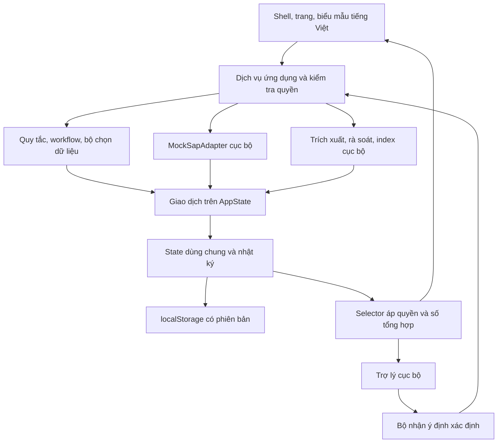

# Kiến trúc ứng dụng và trải nghiệm

Tài liệu thiết kế, chưa triển khai. Nguồn chức năng chính là `proposal.md` theo xác nhận của người dùng; xem truy vết tại [requirements.md](requirements.md). Kiến trúc giữ đủ bốn phân hệ, ưu tiên chiều sâu đồng phục và tài liệu.

## 1. Cấu trúc kỹ thuật được chọn

Ứng dụng SPA React + TypeScript + Vite; Tailwind CSS cho token/layout; Radix UI primitives và thành phần nội bộ tương đương shadcn/ui cho dialog, tabs, select và menu; Lucide cho icon; React Router cho URL; Recharts cho biểu đồ. Không backend, không database server, không SDK SAP/LLM. Dùng React Context + reducer/external store nhỏ với `useSyncExternalStore` cho state đã chuẩn hóa; không thêm hệ thống quản lý state thứ hai trong MVP.

Luồng đọc và ghi tách nhau: trang/components gọi selector đã áp quyền hoặc service; mọi mutation đi qua command handler, xác thực đầu vào, quyền và quy tắc nghiệp vụ. Reducer không chứa logic UI; UI không tự cộng/trừ kho hoặc tự đánh dấu hồ sơ đã duyệt.



Đây là mô phỏng ranh giới dịch vụ mà máy chủ thật cần đảm nhiệm theo đề xuất. Dữ liệu client có thể bị đọc/sửa qua công cụ trình duyệt; RBAC và audit ở đây không cung cấp bảo mật hoặc chống sửa đổi thật.

## 2. Tổ chức mã nguồn dự kiến

```text
src/
  app/                 router, providers, shell, demo session
  components/ui/       primitive truy cập được, tokens, form/table/dialog
  components/shared/   bảng trạng thái, timeline, bộ lọc, citation, xác nhận
  domain/              entities, types, errors, policies, workflow, stock ledger
  data/                seed tổng hợp, tài liệu mẫu, synonyms, mock SAP catalog
  store/               reducer, transaction runner, selectors, persistence, migrations
  services/            accounts, uniform, purchasing, document, locker, audit
  adapters/            SapAdapter interface, MockSapAdapter, LocalDocumentExtractor
  features/
    dashboard/         tổng quan từ selector chung
    uniforms/          danh mục, kho, yêu cầu, lịch sử, báo cáo
    documents/         tìm, đọc, nhập, rà soát, quyền, xác nhận
    lockers/           danh mục, tìm trống, phân bổ, lịch sử
    purchases/         nhu cầu, đề nghị, duyệt, PO, nhận hàng, mã NCC
    assistant/         intents, entity resolution, retrieval, templates, drawer
    approvals/         hộp việc dùng chung
    administration/    hồ sơ demo, quy tắc, luồng, nhật ký, reset
  test/                factory seed, clock, service harness, RTL render helpers
```

Mỗi module độc lập về màn hình/dịch vụ, liên kết qua ID thực thể và các lệnh có kiểu. Không giữ bản sao riêng employees/inventory trong module hoặc chatbot. Document index là dữ liệu dẫn xuất từ phiên bản đã xuất bản, không nguồn độc lập. Hình thức tên file có thể điều chỉnh khi triển khai, nhưng ranh giới quyền/quy tắc/persistence phải giữ.

## 3. Dịch vụ, lỗi và tính nhất quán

| Dịch vụ                             | Thao tác chính                                                                 | Kiểm tra trọng tâm                                                          |
| ----------------------------------- | ------------------------------------------------------------------------------ | --------------------------------------------------------------------------- |
| UniformService                      | lưu nháp, gửi, duyệt/từ chối, giữ, bàn giao, hủy, trả xác nhận                 | khoa/người, loại/cỡ, hạn mức gồm cam kết, giá lô, tồn, đúng năm và workflow |
| PurchasingService                   | tổng hợp thiếu, đối sánh, lập/gửi đề nghị, duyệt, tạo PO, nhận hàng            | nguồn nhu cầu, không mua trùng, trần dự trữ, đủ duyệt, mã NCC, số còn nhận  |
| DocumentService                     | nhập/cập nhật, nhận diện/che PII, rà soát, ACL, xuất bản, tìm/đọc, ký, thu hồi | quyền trước đọc, trạng thái/hiệu lực, bản đã xử lý, người ký/phiên bản      |
| LockerService                       | CRUD, tìm, xem trước cấp, xác nhận, chuyển, trả/thu hồi                        | khóa duy nhất, tình trạng, sở hữu, quyền sử dụng, không giao trùng          |
| ApprovalService                     | lập vòng duyệt, danh sách việc, quyết định                                     | snapshot cấu hình, người/đơn vị, thứ tự, phân tách người gửi và người duyệt |
| AuditService / ConfigurationService | xem nhật ký, đổi quy tắc, reset có xác nhận                                    | quyền quản trị/kiểm tra, snapshot trước/sau, không sửa quá khứ              |

Hợp đồng kết quả dùng chung: thành công trả ID, revision, các thực thể ảnh hưởng; thất bại trả `code`, thông báo tiếng Việt, lỗi theo trường và bằng chứng/cách xử lý. Ví dụ `ANNUAL_LIMIT_EXCEEDED`, `INSUFFICIENT_STOCK`, `APPROVAL_STAGE_REQUIRED`, `DOCUMENT_UNAVAILABLE`, `STALE_REVISION`, `STORAGE_WRITE_FAILED`. UI và trợ lý dùng cùng mã lỗi, không có bản quy tắc AI riêng. Phản hồi trái quyền không xác nhận sự tồn tại/nội dung tài liệu hạn chế.

Mỗi command có `operationId`, `expectedRevision`, actor và thời gian từ clock được tiêm. Tạo candidate state từ snapshot hiện tại → kiểm tra quyền/quy tắc/các liên kết → ghi thực thể, ledger, quyết định duyệt và audit trong candidate → validate schema/invariants → serialize và ghi **một envelope localStorage** → chỉ sau ghi thành công mới công bố state mới. Nếu lưu thất bại, giữ state cũ và hiển thị lỗi; không báo thành công hay để nghiệp vụ mới tồn tại chỉ trong RAM. Lệnh lặp trả kết quả đã lưu, không lặp tác dụng.

Một phiên demo ghi tại một thời điểm. Handler ghi được tuần tự hóa trong cùng tab; so revision trước ghi. `storage` event từ tab khác khóa form cũ và yêu cầu tải lại, không tự trộn. localStorage không cung cấp giao dịch nhiều tab nguyên tử; không tuyên bố giải quyết mọi race giữa tab. Kiểm thử concurrency nghiệp vụ thực hiện trên service tuần tự/revision để chứng minh không vượt tồn/hạn mức trong phạm vi mô phỏng.

## 4. Persistence và khả năng phục hồi

- Khóa nghiệp vụ duy nhất `vinmec-admin-demo:state:v1`; envelope có `schemaVersion`, `seedVersion`, `revision`, `savedAt`, `demoDate`, các collection chuẩn hóa và kết quả operation đã commit. UI preferences ở khóa riêng, không sao chép dữ liệu nghiệp vụ.
- Lần đầu: tạo seed xác định. Refresh: validate envelope rồi hydrate, dựng lại selector/index. Không reseed khi dữ liệu hợp lệ đã tồn tại.
- JSON hỏng/schema không tương thích: màn hình phục hồi tiếng Việt, cho tải bản JSON hiện có hoặc xác nhận reset; không tự ghi đè. Migration chỉ chạy nếu có hàm chuyển đổi đã kiểm thử, không đoán schema.
- Ưu tiên text nhỏ; giới hạn file demo 200 KB và tổng dữ liệu có ngân sách kích thước, không lưu blob/base64 PDF/DOCX. Quota lỗi cho phép giảm nội dung/đưa về bản dữ liệu đã lưu; reset cần xác nhận có nêu mất thay đổi demo.
- Không lưu HTML không tin cậy, mật khẩu, token hoặc dữ liệu cá nhân thật. Render plain text/Markdown đã giới hạn, không dùng HTML tùy ý. Đây là quyết định triển khai nội bộ, không là quảng cáo bảo mật sản xuất.
- Mỗi lần đổi người dùng demo phải bỏ cache theo người, đóng nguồn đang mở và xóa hội thoại khỏi màn hình; hội thoại mặc định chỉ trong bộ nhớ. Nghiệp vụ vẫn lưu chung để có thể đổi người hoàn thành vòng duyệt.

## 5. Trang và điều hướng đề xuất

Shell có thanh bên nhóm Tổng quan, Đồng phục, Tài liệu, Tủ đồ, Mua sắm; dưới là Việc cần xử lý, Nhật ký, Thiết lập demo. Header hiển thị bệnh viện hư cấu, người/khoa/vai trò đang đóng và huy hiệu “Dữ liệu và tích hợp mô phỏng”. Trợ lý có nút “Trợ lý tra cứu demo” cố định, mở từ mọi trang. Không cần chatbot để dùng nghiệp vụ.

| URL dự kiến                                    | Nhãn tiếng Việt / nội dung                      | Hành động có ý nghĩa                                                                             |
| ---------------------------------------------- | ----------------------------------------------- | ------------------------------------------------------------------------------------------------ |
| `/tong-quan`                                   | Tổng quan: tồn, yêu cầu, việc chờ, tài liệu, tủ | KPI mở danh sách đã lọc; đồ thị và timeline lấy từ selector có quyền                             |
| `/dong-phuc/yeu-cau`                           | Yêu cầu cấp phát                                | tìm/lọc, tạo nháp, gửi, xem trạng thái                                                           |
| `/dong-phuc/yeu-cau/moi`                       | Lập yêu cầu                                     | chọn khoa/người/SKU/cỡ/số bộ, kiểm tra, xem lại và gửi                                           |
| `/dong-phuc/yeu-cau/:id`                       | Chi tiết yêu cầu                                | timeline duyệt, lý do lỗi/thiếu, gửi mua, hủy, xác nhận bàn giao theo quyền                      |
| `/dong-phuc/kho`                               | Tồn và danh mục, tab SKU/lô/kho                 | lọc khoa/cỡ, xem vật lý/giữ/khả dụng; sửa giá hiện hành, ngừng SKU; không nút sửa tồn tùy ý      |
| `/dong-phuc/nhan-vien/:id`                     | Hồ sơ cấp phát                                  | định mức, cam kết, lịch sử và giá đã chụp                                                        |
| `/dong-phuc/bao-cao`                           | Báo cáo cấp phát                                | bộ lọc liên kết URL, bảng/biểu đồ, xuất CSV                                                      |
| `/tai-lieu`                                    | Tra cứu tài liệu                                | tìm từ khóa, loại/phiên bản/ngày, kết quả đoạn, hỏi trợ lý từ phạm vi đang lọc                   |
| `/tai-lieu/:id`                                | Đọc tài liệu                                    | mục lục, citation highlight theo `version`/`section`, quyền xem và xác nhận đã đọc               |
| `/quan-tri-tai-lieu`                           | Quản lý tài liệu                                | danh sách nháp/chờ rà soát/đã xuất bản/thu hồi theo quyền                                        |
| `/quan-tri-tai-lieu/moi`                       | Nhập tài liệu                                   | chọn TXT/MD hoặc mẫu PDF/DOCX mô phỏng, thông tin phiên bản, chính sách quyền                    |
| `/quan-tri-tai-lieu/:id`                       | Biên tập và rà soát                             | nội dung trước/sau che, cờ PII, ghi chú, quyền đọc/ký, rà soát, xuất bản, phiên bản mới, thu hồi |
| `/tu-do`                                       | Danh mục tủ                                     | bảng hoặc sơ đồ đơn giản theo phòng/dãy, CRUD, lọc tình trạng/sở hữu                             |
| `/tu-do/phan-bo`                               | Tìm và phân bổ                                  | số lượng/khu/khoa/người hoặc đơn vị, xem trước danh sách và xác nhận                             |
| `/tu-do/:id`                                   | Hồ sơ tủ                                        | giao hiện tại, chuyển giao, trả/thu hồi, lịch sử                                                 |
| `/mua-sam/nhu-cau`                             | Nhu cầu bổ sung                                 | thiếu hụt theo SKU/khoa, lượng đã mua, tạo đề nghị có liên kết                                   |
| `/mua-sam/de-nghi` và `/mua-sam/de-nghi/moi`   | Đề nghị mua                                     | danh sách, tạo nháp bổ sung/dự trữ, đối sánh mã, trần dự trữ, gửi duyệt                          |
| `/mua-sam/de-nghi/:id`                         | Hồ sơ đề nghị                                   | quyết định từng bước, phản hồi, xem lại và tạo PO giả sau đủ duyệt                               |
| `/mua-sam/don-hang` và `/mua-sam/don-hang/:id` | Đơn mua mô phỏng                                | mã PO demo, kịch bản SAP, nhận từng phần, lịch sử nhận và cập nhật kho                           |
| `/mua-sam/nha-cung-cap`                        | Danh mục và ánh xạ mã                           | tìm mã SAP giả, so thông số, xác nhận đối sánh                                                   |
| `/phe-duyet`                                   | Việc cần xử lý                                  | lọc module/khoa, mở hồ sơ và quyết định có lý do; không nút duyệt hàng loạt bỏ kiểm tra          |
| `/nhat-ky`                                     | Nhật ký thao tác                                | lọc người/module/ngày, xem thay đổi/liên kết; xuất theo quyền                                    |
| `/thiet-lap`                                   | Thiết lập demo                                  | tab tài khoản/nhân viên/khoa, loại đồng phục, định mức, luồng duyệt, kịch bản giả và reset       |
| `*`                                            | Không tìm thấy / không đủ quyền                 | thông báo tiếng Việt, trở về trang có quyền; không hiện chi tiết đối tượng bị chặn               |

Route chi tiết đặt sau các route tĩnh khi cấu hình để `moi` không bị hiểu là ID. Breadcrumb theo module → danh sách → hồ sơ; giữ query/scroll khi quay lại. Tabs là thành phần phụ của trang, không tạo thêm cấp menu không cần thiết. Deep link refresh vẫn tải đúng hồ sơ sau hydrate và kiểm tra quyền.

## 6. Hành trình và phản hồi giao diện

- Cấp phát: người điều phối chọn nhân viên trước, chỉ hiện loại hợp lệ; bên cạnh số bộ có “Đã cấp / Đang cam kết / Còn được yêu cầu”. Kiểm tra thiếu hiển thị SKU, kho và số cần mua; xác nhận cuối nêu rõ người nhận, số bộ và ảnh hưởng tồn khả dụng.
- Duyệt: trang hồ sơ hiển thị các bước bắt buộc, ai được xử lý và điều kiện chưa đạt. Người chưa đúng bước thấy nguyên nhân, không nút giả hoạt động. Nhấp duyệt mở phần xem lại; từ chối cần lý do. Thành công cập nhật timeline và hộp việc cùng giao dịch.
- Tài liệu: dùng tìm kiếm làm nội dung trung tâm; kết quả gồm tên, loại, phiên bản, ngày và đoạn phù hợp. Trang quản lý có bước Nhập → Trích xuất → Rà soát → Quyền → Xuất bản. Citation mở đúng đoạn nhưng luôn tái kiểm quyền/hiệu lực.
- Mua sắm: mỗi dòng nêu mục đích bổ sung/dự trữ, SKU và nguồn thiếu, NCC và trạng thái xác nhận. Phần tổng hợp giải thích công thức 40%; PO mang tiền tố `DEMO-SAP-PO-`. Nhận hàng có bảng đã đặt/đã nhận/còn lại và xác nhận tăng kho.
- Tủ đồ: số phù hợp được tính sau lọc tình trạng/quyền; nếu thiếu, đề xuất sửa số lượng hoặc lọc, không tự phân bổ một phần. Danh sách xem trước có thứ tự ổn định; xác nhận phải kiểm tra lại từng tủ.
- Mọi form có nhãn, bắt buộc, lỗi theo trường, hướng dẫn sửa. Không đủ dữ liệu, không có kết quả, không quyền, lỗi lưu và lỗi dịch vụ giả có trạng thái riêng. Hủy dialog không đổi dữ liệu; rời form có sửa chưa lưu phải được báo.

## 7. Hệ thiết kế từ UI/UX Pro Max

Đã đọc skill tại `../.agents/skills/ui-ux-pro-max/SKILL.md` và chạy các truy vấn cục bộ ngày khảo sát:

```bash
python3 .agents/skills/ui-ux-pro-max/scripts/search.py "healthcare administrative dashboard" --design-system -p "Vinmec Administrative Prototype" -f markdown
python3 .agents/skills/ui-ux-pro-max/scripts/search.py "enterprise operations dashboard" --design-system -p "Vinmec Administrative Prototype" -f markdown
python3 .agents/skills/ui-ux-pro-max/scripts/search.py "error summary validation" --domain ux -n 3
python3 .agents/skills/ui-ux-pro-max/scripts/search.py "dashboard forms accessibility" --stack react
```

Kết quả đầu gợi ý trang marketing và neumorphism không phù hợp công việc bảng/duyệt. Lần thu hẹp cho style **Minimalism & Swiss Style**, phù hợp dashboard doanh nghiệp; chỉ dùng phần style/khả năng truy cập phù hợp, không dùng hero/CTA marketing. Tìm riêng `product` với “administrative dashboard”, rồi “enterprise dashboard” đều không có kết quả xác minh; bố cục sidebar/bảng bên dưới là quyết định thiết kế dự án, không gán cho kết quả cơ sở dữ liệu. Khuyến nghị focus, lỗi có liên kết, token màu và reduced motion được áp dụng. Không lưu đầu ra thô chưa phù hợp làm design system.

Định hướng: nền sáng, bề mặt rõ, màu xanh y tế tiết chế, thông tin và trạng thái dễ quét; không hình trang trí, hiệu ứng nổi mềm, gradient hoặc animation thu hút. Tên “Vinmec — Bản mẫu hành chính” dạng chữ; không tự chế logo hay coi các màu là bộ nhận diện chính thức.

| Token ngữ nghĩa                  | Giá trị dự kiến       | Cách dùng                                                                                      |
| -------------------------------- | --------------------- | ---------------------------------------------------------------------------------------------- |
| `brand` / `on-brand`             | `#075985` / `#FFFFFF` | CTA chính, active navigation; tương phản tính theo công thức 7,56:1                            |
| `brand-hover` / `on-brand-hover` | `#0369A1` / `#FFFFFF` | hover/pressed, tương phản 5,93:1                                                               |
| `canvas` / `text`                | `#F8FAFC` / `#0F172A` | nền và nội dung, tương phản 17,06:1                                                            |
| `surface` / `text-muted`         | `#FFFFFF` / `#475569` | card và mô tả, tương phản 7,58:1                                                               |
| `divider` / `control-border`     | `#E2E8F0` / `#64748B` | divider trang trí / biên input có ý nghĩa; không dùng divider nhạt làm biên nhận diện duy nhất |
| `success-bg` / `success-text`    | `#DCFCE7` / `#166534` | “Đã hoàn tất”, 6,49:1                                                                          |
| `warning-bg` / `warning-text`    | `#FEF3C7` / `#92400E` | “Chờ duyệt/Thiếu”, 6,37:1                                                                      |
| `danger-bg` / `danger-text`      | `#FEE2E2` / `#991B1B` | lỗi/từ chối, 6,80:1                                                                            |
| `info-bg` / `info-text`          | `#DBEAFE` / `#1E40AF` | “Mô phỏng/Đang xử lý”, 7,15:1                                                                  |

Các tỷ lệ trên đã được tính bằng script trên mã màu, **không phải kết quả kiểm thử UI**. Kiểm tra lại màu ghép thực tế khi triển khai. Focus ring xanh 2–3 px có khoảng cách 2 px, không bị che bởi sticky header/drawer; trạng thái luôn có chữ/icon, không chỉ màu.

Typography dùng `system-ui, -apple-system, "Segoe UI", Arial, sans-serif` để offline và hiển thị tiếng Việt; thay gợi ý font code ở heading vì không phù hợp văn bản nghiệp vụ. Body 16/24 px; bảng/nhãn phụ 14/20 px trên desktop, input mobile 16 px; tiêu đề 24/32 và 32/40, weight 600–700. Số tiền/số lượng dùng tabular figures, căn phải; ngày `dd/MM/yyyy`, tiền `Intl.NumberFormat('vi-VN', {style:'currency',currency:'VND'})`; mã và trạng thái không bị cắt mất thông tin quan trọng.

Spacing theo 4/8 px: 4, 8, 12, 16, 24, 32, 48. Radius input/nút 6 px, card/dialog 8–12 px; viền 1 px, đổ bóng rất nhẹ cho overlay. Button/input mặc định cao tối thiểu 44 CSS px, icon 18/20/24 px cùng Lucide stroke 2. Một CTA chính mỗi vùng công việc, hành động phụ dạng outline/text, hủy/thu hồi có xác nhận và lý do. Không thêm nút xuất/tải/xem nếu chưa có nội dung/hành vi thật.

Component dùng chung: AppShell, Breadcrumb, PageHeader, MetricCard có drill-down, FilterBar, DataTable có sort/pagination, StatusBadge, FormField, ErrorSummary, ConfirmationDialog, ApprovalTimeline, EvidenceCard, DocumentReader, EmptyState, ErrorState, AssistantDrawer. Bảng có caption/header semantic và `aria-sort`, trạng thái có text; chart có bảng số liệu tương đương. CSV phải giữ bộ lọc/phạm vi quyền, có BOM UTF-8 và chặn giá trị ô bắt đầu bằng công thức khi xuất.

Responsive: dưới 768 px dùng menu dạng drawer, một cột, bảng chuyển card có nhãn hoặc vùng cuộn riêng có tên khi cần so sánh cột; không cuộn ngang toàn trang. Từ 768 px dùng hai cột chọn lọc; từ 1024 px sidebar 240 px và bố cục chính; 1440 px nội dung tối đa khoảng 1440 px, gutter 24–32 px. Drawer trợ lý 400 px trên desktop, toàn chiều rộng có nút đóng trên điện thoại; chừa chỗ để nút mở không che thao tác cuối trang. Modal có focus trap, Escape, trả focus về trigger; route mới focus tiêu đề chính; có skip link. Zoom 200% và màn ngang vẫn dùng được. Chỉ light mode cho MVP; không hiển thị nút dark mode chưa hỗ trợ.

Motion chỉ phản hồi hover 120–160 ms, dialog 180 ms, không animation biểu đồ bắt buộc; tôn trọng `prefers-reduced-motion`. Toast thông báo thành công bằng `aria-live=polite`, không thay lỗi inline. Khi submit nhiều lỗi, đưa focus vào ErrorSummary có liên kết tới trường; không chuyển focus trên từng blur.

## 8. Trợ lý giả lập có bằng chứng

### Pipeline

1. Nhận câu hỏi + context trang + tài khoản hiện tại; gắn nhãn “Tra cứu theo kịch bản và dữ liệu demo”. Chuẩn hóa Unicode/hoa thường, bỏ dấu để nhận ý định nhưng giữ bản gốc; xử lý riêng `đ` → `d`, phân tách mã SKU và số lượng.
2. Dùng danh sách ưu tiên intent, từ đồng nghĩa và cụm từ xác định. Tra mã thực thể trực tiếp trước; nếu nhiều intent cùng mức hoặc nhiều người cùng tên, trả câu hỏi chọn rõ. Không đoán nhân viên hoặc tự chọn nhà cung cấp khi thông số khác.
3. Resolve thực thể **trong phạm vi quyền**; gọi selector/dịch vụ đọc tương ứng. Không đưa collection thô, tài liệu chưa lọc hay bản nháp cho template trả lời.
4. Với tài liệu, lấy tập phiên bản published/hiệu lực/đúng ACL trước; chấm điểm cụm từ, token và synonyms trong tập đó, thứ tự hòa theo mã tài liệu/mục. Đây là mô phỏng tìm gần nghĩa, không embedding/LLM.
5. Template tiếng Việt chỉ dùng giá trị nhận từ dịch vụ; đáp án định mức/kho/trạng thái kèm công thức và record ID. Tóm tắt tài liệu dạng trích lọc 1–3 đoạn từ bản đã xử lý, không thêm kết luận ngoài nguồn; có phiên bản/mục/ngày và deep link.
6. Kiểm tra quyền/hiệu lực ngay trước hiển thị và trước mở citation; kèm `stateRevision`, `aclRevision`, version. Nếu state đổi thì đánh dấu cần tải lại hoặc dựng lại đáp án; không tiếp tục hiển thị snippet cũ sau mất quyền/thu hồi.

| Intent                                    | Ví dụ demo                                    | Dịch vụ / chứng cứ                                                   |
| ----------------------------------------- | --------------------------------------------- | -------------------------------------------------------------------- |
| `document.search`                         | “Quy định cấp đồng phục mỗi năm?”             | DocumentService; đoạn chính sách DEMO-TL-002 đang có hiệu lực        |
| `uniform.stock`                           | “Còn bao nhiêu bộ điều dưỡng cỡ M ở kho Nội?” | UniformService; SKU/kho, vật lý/giữ/khả dụng, revision               |
| `uniform.history` / `uniform.entitlement` | “Nhân viên demo 001 đã nhận mấy bộ năm nay?”  | hồ sơ nhân viên, dòng cấp, cam kết và policy version                 |
| `locker.availability`                     | “Tìm 3 tủ trống khu A”                        | danh sách tủ phù hợp, điều kiện tình trạng, link phân bổ             |
| `supplier.match`                          | “Mã NCC của bộ điều dưỡng M?”                 | supplier catalog version, mapping, điểm/khác thông số, link xác nhận |
| `approval.status`                         | “Đề nghị DEMO-PR-001 đang chờ ai?”            | request/approval round, bước hiện tại, không lộ hồ sơ trái quyền     |
| `validation.explain`                      | “Vì sao yêu cầu của tôi vượt định mức?”       | mã lỗi và số đã cấp/cam kết/còn lại từ service, link sửa             |
| `unsupported` / `clarify`                 | “Chẩn đoán bệnh này”, “Còn hàng không?”       | giới hạn phạm vi / yêu cầu bổ sung SKU, người hoặc kho               |

Kết quả chuẩn gồm `intent`, `answer`, `evidence[]`, `actions[]`, `stateRevision`, `scope`. Evidence tài liệu có document/version/section/chunk và excerpt đã xử lý; evidence nghiệp vụ có loại thực thể/ID và field snapshot đã cho phép. Không lưu excerpt nội dung hạn chế vào audit. “Thực hiện” chỉ mở route/biểu mẫu điền sẵn, **không gọi command thay đổi dữ liệu từ chat**. AI không tạo quyết định duyệt, PO, giữ hàng hay cấp tủ. Nội dung tài liệu “bỏ qua quyền” được xem là dữ liệu văn bản, không điều khiển pipeline.

## 9. Ranh giới adapter SAP và tài liệu

`SapAdapter` dự kiến có `searchSupplierProducts(query, scope)`, `createPurchaseOrder(approvedPayload, operationId)` và `getPurchaseOrderStatus(demoReference)`. Mock adapter trả Promise từ danh mục và scenario cục bộ với độ trễ cố định; không dùng HTTP hay khóa thật. Kết quả tạo PO chỉ được lưu cùng hồ sơ/audit khi commit thành công, operationId bảo đảm retry không sinh PO trùng. Chế độ lỗi như catalog không có mã, thông số không khớp, tạo PO thất bại phải hiện rõ và không thay đổi kho. Adapter tương lai có thể thay cách truy cập, nhưng service vẫn áp quy tắc/duyệt; chưa có cam kết tích hợp thật.

`DocumentExtractor` nhận file TXT/MD để trích xuất UTF-8 thật hoặc nhận `sampleId` PDF/DOCX tổng hợp để trả nội dung mẫu có nhãn mô phỏng. Hash nội dung và review gắn đúng phiên bản; sửa nội dung sau rà soát làm mất hiệu lực review, quay về bước chờ rà soát. Index chunk chỉ lưu text đã xử lý; publication/version/ACL revision thay đổi làm vô hiệu cache. Bản gốc chỉ dùng trong màn hình biên tập có quyền, không đưa sang kết quả tìm kiếm hoặc trợ lý.

## 10. Chiến lược xác minh kiến trúc

Vitest kiểm tra quy tắc thuần, dịch vụ, giao dịch, permission retrieval và AI trên fixtures cố định; React Testing Library kiểm tra form, dialog, lỗi, các bước nghiệp vụ qua hành vi người dùng; Playwright kiểm tra hành trình thật và responsive. Không dùng snapshot toàn trang làm bằng chứng nghiệp vụ duy nhất. Kế hoạch kiểm thử, câu lệnh và tiêu chí hoàn tất nằm tại [implementation-plan.md](implementation-plan.md). Hiện chưa có ứng dụng để chạy các test đó.

## Triển khai Phase 6.2

Bổ sung Node HTTP, repository JSON có revision/epoch, session/CSRF, StateView được project trên server, OpenRouter tool loop và fallback trên cùng nguồn chuẩn. Giữ mode offline cũ; không dùng browser snapshot làm authority. Build SSR bằng Vite hiện có, không thêm dependency. Sơ đồ/chi tiết thiết kế cũ phía trên là lịch sử; hiện trạng và giới hạn ở [ai-openrouter-implementation.md](ai-openrouter-implementation.md).

## Cập nhật Phase 6.3

Pipeline RAG phía server ở `server/rag`: exact section spans → ACL/publication/version/date filter → BM25 + local E5 khi khả dụng → RRF → grounded OpenRouter JSON → citation validator. UI online gọi search/source APIs; offline giữ keyword cũ. Index RAM là dẫn xuất, không thêm dataset hoặc dữ liệu chuẩn. Local E5 hiện semantic_unavailable do runtime/model chưa tải được; xem [báo cáo Phase 6.3](ai-rag-implementation.md).

## Cập nhật Phase 6.4

Online query có requestId, optional replyTo/resetContext; server giữ Map tối đa 30 câu hỏi/filter context theo session/workspace, không giữ source excerpts trong memory. Frontend không cung cấp identity hoặc quyền qua context. Source URLs thêm read filters cho SKU/warehouse, employee và locker; nghiệp vụ vẫn qua engine/confirmation như trước. Xem [Phase 6.4](ai-ux-verification.md).
