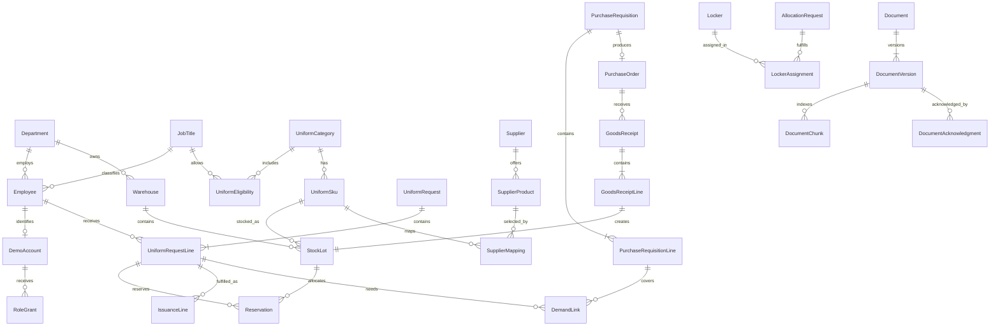

# Mô hình dữ liệu, trạng thái và quy tắc xác định

Mô hình dữ liệu tổng hợp dùng chung, lưu localStorage. Nguồn chức năng: `proposal.md` đã được người dùng xác nhận và [requirements.md](requirements.md). Phần 1–9 giữ mô hình logic từ phase lập kế hoạch; các tên thực thể logic có thể được gộp thành mảng/thuộc tính trong code. Phần 10 mô tả schema vật lý **đã triển khai ở phase 4.5** và thay thế các chi tiết kế hoạch cũ khi khác nhau. Bằng chứng workbook và giả định bổ sung ở [excel-alignment-report.md](excel-alignment-report.md).

Bổ sung seed phase 5: tủ có hai tòa (A tầng 1/2, B tầng 3), không đổi IDs/số tủ/quân số hoặc số trống 37. Một mapping SKU-2-2 được để trống để người mua xác nhận trong kịch bản; còn 21 mapping được xác nhận. Không đổi schema v2, không chuyển dữ liệu đã lưu sang seed mới; chỉ reset có xác nhận mới nạp thay đổi seed. Hướng dẫn kịch bản chứa ID tham chiếu và kiểm tra điều kiện qua selector, không là nguồn dữ liệu nghiệp vụ thứ hai. Chi tiết [demo-data.md](demo-data.md).

## 1. Quy ước chung

- ID ổn định; hồ sơ/nhân viên có tiền tố `DEMO-`, SKU có ID riêng. Mã nghiệp vụ tách khỏi ID, không dùng tên người làm quan hệ. Triển khai dùng mảng thực thể trong State, tham chiếu bằng ID.
- Mọi số lượng là số nguyên không âm, dòng giao dịch phải > 0; uniform unit là `bộ`. Một SKU = một loại đồng phục + một biến thể giới tính + một cỡ + một bộ; không cộng áo và quần như hai bộ. Excel có cái/đôi nhưng chưa có quy đổi, nằm ngoài phạm vi cấp bộ hiện tại.
- Tiền là integer VND an toàn trong giới hạn số JavaScript, không float, không tỷ giá/VAT. Ngày nghiệp vụ `YYYY-MM-DD`, thời điểm ISO UTC; quy đổi năm/ngày bằng `Asia/Ho_Chi_Minh`, không phụ thuộc timezone của máy chạy test.
- Thực thể có `id`, `createdAt`, `updatedAt`, `revision`, `isDemo: true`. Record lịch sử bất biến và cấu hình có version; tham chiếu dữ liệu hiện tại qua ID, đồng thời lưu snapshot những field cần tái hiện lịch sử.
- Master data đã được sử dụng chỉ archive/inactive; xóa cứng chỉ bản nháp/danh mục chưa được tham chiếu, có xác nhận. Không cascade xóa lịch sử, quyết định hay ledger.
- Input schema được validate khi nhận command và hydrate; enum trong code có nhãn tiếng Việt trong UI. Không dùng chuỗi tự do cho trạng thái nghiệp vụ.

## 2. Các quan hệ chính



Các liên kết đa hình như ApprovalInstance/AuditEvent luôn có `entityType` và `entityId`; validator xác nhận ID tồn tại và đúng loại. Không dùng quan hệ biểu đồ trên để suy ra quyền đọc; quyền là phép kiểm tra riêng.

## 3. Tổ chức, người dùng và cấu hình

| Thực thể             | Trường trọng tâm                                                                                                                      | Ràng buộc                                                                                                                       |
| -------------------- | ------------------------------------------------------------------------------------------------------------------------------------- | ------------------------------------------------------------------------------------------------------------------------------- |
| Hospital             | `id, code, displayName, isDemo`                                                                                                       | một viện hư cấu trong bộ demo                                                                                                   |
| Department           | `hospitalId, code, name, active`                                                                                                      | code duy nhất; quân số tính từ Employee active, không nhập số tổng độc lập                                                      |
| Employee             | logic: mã, tên demo, khoa, chức danh, hoạt động; physical: `id, name, departmentId, job, gender, active`                              | giới tính nam/nữ/chưa cập nhật; không suy từ tên; chuyển khoa/chức danh chỉ đổi hiện tại, không lịch sử                         |
| JobTitle             | `code, label, active`                                                                                                                 | bác sĩ/điều dưỡng/kỹ thuật viên/hành chính; khác RoleGrant                                                                      |
| DemoAccount          | `employeeId, label, active`                                                                                                           | giả lập chọn tài khoản, không mật khẩu/SSO thật                                                                                 |
| RoleGrant            | `accountId, role, scope: self/department/hospital, departmentIds[]`                                                                   | quyền hợp từ role nhưng luôn có phạm vi đối tượng; không tự vượt DocumentAccessPolicy                                           |
| UniformPolicyVersion | `version, annualSets=3, yearBasis=calendar, timezone, reserveRatio=0.40, reserveSetsPerEmployee=1, reserveRounding=floor, activeFrom` | tỷ lệ [0,1], annualSets nguyên dương, snapshot khi gửi; rule engine dùng số cấu hình, không phân tích tài liệu để ra quyết định |
| WorkflowDefinition   | `type, version, orderedStages[{key, role, scopeRule, distinctActor}], active`                                                         | đồng phục 2 bước, mua 3 bước, tủ 1 bước theo mặc định; có thể sửa danh sách hợp lệ trong thiết lập demo                         |
| ApprovalInstance     | `entityType/id, round, definitionSnapshot, requesterId, currentStage, status`                                                         | một vòng mở cho một hồ sơ; snapshot bất biến sau gửi                                                                            |
| ApprovalDecision     | `instanceId, stageKey, actorId, decision, reason, decidedAt`                                                                          | một quyết định kết thúc mỗi bước/vòng; từ chối cần lý do; người gửi không tự duyệt và actor không dùng lại giữa các bước        |

Thêm khoa/nhân viên hoặc chỉnh trạng thái hoạt động là thao tác quản trị demo có xác nhận và audit. Không cho ngừng tài khoản là người duyệt duy nhất mà không cảnh báo các vòng bị kẹt; thay người trong phạm vi vai trò không sửa quyết định đã có. Cấu hình workflow thiếu vai trò/người đủ quyền bị chặn trước gửi.

## 4. Đồng phục và kho

| Thực thể                   | Trường trọng tâm                                                                                                                                                             | Ràng buộc                                                                                                                                               |
| -------------------------- | ---------------------------------------------------------------------------------------------------------------------------------------------------------------------------- | ------------------------------------------------------------------------------------------------------------------------------------------------------- |
| UniformCategory            | `code, name, active`                                                                                                                                                         | ví dụ bộ bác sĩ/điều dưỡng/kỹ thuật viên/hành chính                                                                                                     |
| UniformEligibility         | `jobTitleId, categoryId`                                                                                                                                                     | cặp duy nhất, cấu hình cho phép một chức danh nhiều loại khi cần                                                                                        |
| UniformSku                 | physical: `id, code, name, category, gender, size, price, minStock, active`                                                                                                  | category+gender+size chuẩn hóa duy nhất; không đổi category/gender/size của SKU đã tạo, giá hiện tại không sửa giá lịch sử                              |
| Warehouse                  | `code, departmentOwnerId, allowedDepartmentIds, name, active`                                                                                                                | tồn luôn gắn kho; kho trung tâm có thể phục vụ nhiều khoa                                                                                               |
| StockLot                   | `skuId, warehouseId, receivedOn, unitPurchasePriceVnd, sourceReceiptLineId`                                                                                                  | giá mua lô bất biến; seed cũng có chứng từ nhận giả                                                                                                     |
| StockMovement              | `lotId, type, quantitySigned, sourceType/id, operationId, occurredOn`                                                                                                        | tăng từ nhận/trả hợp lệ; giảm từ bàn giao; ledger bất biến, không sửa tay số dư                                                                         |
| UniformRequest             | `requestNo, departmentId, warehouseId, requesterId, status, quotaYear, policySnapshot, approvalInstanceId`                                                                   | một khoa và kho nguồn; người nhận cùng khoa khi gửi, quyền và master data kiểm lại khi xác nhận                                                         |
| UniformRequestLine         | `requestId, employeeId, skuId, quantity, employeeSnapshot, skuSnapshot`                                                                                                      | một dòng/employee/SKU; tổng nhiều SKU/loại vẫn chung định mức; duplicate bị chặn thay vì lặng lẽ bỏ                                                     |
| EntitlementCommitment      | `requestLineId, employeeId, quotaYear, quantity, status`                                                                                                                     | active từ gửi hợp lệ đến bàn giao/hủy/từ chối; chuyển consumed khi có issuance trong cùng giao dịch                                                     |
| Reservation                | `requestLineId, lotId, quantity, unitPriceSnapshotVnd, status`                                                                                                               | active chỉ sau duyệt cuối; FIFO theo receivedOn, lotId; có thể tách nhiều lô cho một dòng                                                               |
| Issuance / IssuanceLine    | `requestId, handedOverBy, recipientConfirmed, issuedOn`; dòng `employeeId, skuId, warehouseId, lotId, quantity, unitPurchasePriceSnapshotVnd, departmentSnapshot, quotaYear` | chỉ từ reservation active; nhiều lô tạo nhiều dòng cùng requestLine; giá/danh mục lúc cấp bất biến                                                      |
| UniformReturn / ReturnLine | `issuanceId, sourceIssuanceLineId, quantity, condition, reason, confirmedBy, date`                                                                                           | chỉ lượng chưa trả, serviceable mới được tăng kho lô theo giá gốc; hàng hỏng vào lịch sử loại bỏ, không tồn khả dụng; không giảm số đã cấp theo hạn mức |

Kho không có số dư tùy ý chỉnh trực tiếp. Số vật lý là tổng `quantitySigned` của ledger; số giữ là tổng reservation active; số khả dụng = vật lý − giữ, tính theo lô rồi tổng theo SKU/kho. Nếu cache số dư để tăng tốc, cache phải tái tạo/kiểm tra được từ ledger và không là nguồn ghi thứ hai.

### Luồng yêu cầu đồng phục

| Trạng thái trước                                | Lệnh hợp lệ                                                 | Trạng thái sau / tác dụng                                                                                         |
| ----------------------------------------------- | ----------------------------------------------------------- | ----------------------------------------------------------------------------------------------------------------- |
| `draft`                                         | lưu/sửa; gửi sau kiểm tra nhân viên, loại, hạn mức          | đủ tồn → `pending_approval`, thiếu → `waiting_stock`; tạo commitment; không giữ/giảm kho                          |
| `waiting_stock`                                 | tạo nhu cầu mua, hủy; kiểm tra lại và gửi duyệt khi đủ hàng | mua không tự đổi trạng thái; gửi lại → `pending_approval` và giữ commitment hiện có, không tạo đôi                |
| `pending_approval`                              | duyệt bước đầu                                              | giữ trạng thái, tăng bước duyệt; không đổi tồn                                                                    |
| `pending_approval` ở bước cuối                  | xác nhận duyệt và giữ hàng nguyên hồ sơ                     | `reserved`; đủ tồn và điều kiện mới tạo reservation toàn bộ và decision cuối trong một giao dịch                  |
| `pending_approval` ở bước cuối, vừa thiếu hàng  | thử duyệt                                                   | trả lỗi, giữ trạng thái/bước hiện tại, không ghi decision cuối/giữ một phần; cho tạo nhu cầu bổ sung từ thiếu mới |
| `reserved`                                      | thủ kho xác nhận bàn giao                                   | `issued`; giảm vật lý và active reservation cùng lượng, commitment chuyển consumed, ghi issuance và audit         |
| `pending_approval`                              | người được phân công từ chối                                | `rejected`; giải phóng commitment, kết thúc vòng duyệt                                                            |
| `draft/waiting_stock/pending_approval/reserved` | người có quyền xác nhận hủy và lý do                        | `cancelled`; giải phóng commitment/reservation một lần; không biến thành sự kiện nhận hàng                        |
| `rejected`                                      | sửa thành nháp và gửi vòng mới                              | giữ lịch sử vòng cũ, kiểm tra quy tắc hiện hành và chụp snapshot mới                                              |
| `issued`                                        | trả đồng phục có xác nhận                                   | request vẫn `issued`, thêm return record; không có lệnh hủy để tự hoàn kho                                        |

Chưa hỗ trợ bàn giao một phần yêu cầu đồng phục. Nháp có thể xóa có xác nhận; hồ sơ đã gửi chỉ hủy. Từ `reserved` không sửa trực tiếp dòng, phải hủy/lập lại; khi thay đổi nhân viên/khoa/chức danh làm hồ sơ không còn hợp lệ, hướng dẫn hủy/lập lại thay vì đổi lịch sử. Trước bàn giao kiểm tra `quotaYear` bằng năm hiện tại; qua năm phải hủy và gửi hồ sơ năm mới.

### Công thức định mức

`issued(e,y)` = tổng số bộ trên IssuanceLine của người e/năm y, gồm cả hàng đã trả sau cấp. `committed(e,y)` = tổng commitment active trên hồ sơ đã gửi, chờ hàng, chờ duyệt hoặc giữ. Kiểm tra gửi mới:

```text
issued(e,y) + committed(e,y, loại trừ chính hồ sơ đang gửi lại) + requested(e) <= annualSets
```

Cộng tất cả dòng/ngành hàng của một người trước kiểm tra, không kiểm từng dòng độc lập. Kiểm lại khi duyệt cuối/bàn giao dưới snapshot hạn mức của hồ sơ, tính cam kết khác và không cộng bản thân hai lần. Hạ cấu hình chỉ áp hồ sơ/vòng mới; hồ sơ cũ giữ snapshot, nhưng hồ sơ mới vẫn tính cả cam kết cũ và có thể không còn hạn mức. Không có nút “AI ngoại lệ” bỏ qua quy tắc. Nếu cần chính sách ngoại lệ trong tương lai phải có rule/duyệt riêng ngoài MVP.

Ví dụ stock tách biệt: ban đầu vật lý 10, giữ 2, khả dụng 8; duyệt thêm 3 → 10/5/5; bàn giao 3 → 7/2/5, hoặc hủy trước giao → 10/2/8. Nộp hồ sơ/đề nghị mua/PO không tự thay ba số này.

## 5. Mua sắm và SAP giả lập

| Thực thể                          | Trường trọng tâm                                                                                                                                | Ràng buộc                                                                                                                      |
| --------------------------------- | ----------------------------------------------------------------------------------------------------------------------------------------------- | ------------------------------------------------------------------------------------------------------------------------------ |
| Supplier / SupplierProduct        | mã/tên demo, active; supplierId, supplierCode, description, specs, category, sizes, unit, priceVnd, catalogVersion                              | mã duy nhất trong NCC; không thông tin liên hệ/ngân hàng thật                                                                  |
| SupplierMapping                   | `skuId, supplierProductId, status:suggested/confirmed, differences[], confirmedBy/At, reason, catalogVersion`                                   | mapping suggested không dùng để gửi mua; khác tên/thông số phải xác nhận có lý do; đổi catalog/specs làm mất hiệu lực xác nhận |
| PurchaseRequisition               | `number, requesterId, supplierId, status, policySnapshot, headcountSnapshot, reserveLimitSnapshot, approvalInstanceId`                          | tách khỏi UniformRequest, có mục đích và vòng duyệt riêng; tất cả dòng cùng NCC                                                |
| PurchaseRequisitionLine           | `requisitionId, skuId, warehouseId, purpose:shortage/reserve, quantity, mappingId, supplierId, supplierCodeSnapshot, unitPriceSnapshotVnd`      | mỗi dòng có giá/mã được người mua xác nhận; đổi dòng sau gửi phải về nháp/vòng mới                                             |
| DemandLink                        | `requisitionLineId, uniformRequestLineId, quantity, status`                                                                                     | nhiều dòng nhu cầu có thể gom mua; tổng lượng liên kết không vượt phần thiếu chưa được đáp ứng hoặc cam kết mua                |
| PurchaseOrder / PurchaseOrderLine | `requisitionId, supplierId, demoSapReference, adapterScenario, operationId, status, createdBy/At`; dòng giữ quantity, price và mapping snapshot | một PO/một NCC cho một đề nghị được duyệt trong MVP; không gộp nhiều đề nghị để thay trần; trạng thái SAP luôn nhãn giả        |
| GoodsReceipt / GoodsReceiptLine   | `poId, receiptNo, confirmedBy/At, operationId`; dòng `poLineId, receivedQuantity, warehouseId, lotId`                                           | nhiều lần nhận theo PO; mỗi dòng tạo lô và movement đúng một lần                                                               |
| AdapterOperation                  | `operationId, type, payloadHash, scenario, resultRef, status`                                                                                   | cùng operationId/payload trả cùng kết quả; khác payload với ID cũ bị chặn                                                      |

### Mục đích mua và chống tổng hợp trùng

Phần thiếu gốc tại một thời điểm = max(0, lượng chờ cấp chưa giữ − lượng khả dụng tương ứng). Khi tổng hợp nhiều yêu cầu cùng SKU/kho, phân bổ khả dụng tạm tính theo thời điểm gửi rồi ID; không để mỗi yêu cầu cùng trừ hoặc cùng dùng lại toàn bộ khả dụng. Sau đó trừ lượng đã có DemandLink hoạt động trên đề nghị đã gửi/chờ duyệt/được duyệt/PO chưa hoàn thành và phần hàng đã nhận thực sự tăng tồn. Phải phối hợp với số tồn hiện tại, **không vừa trừ hàng đã nhận khỏi thiếu vừa trừ lại cùng DemandLink như hàng đang mua**. Mỗi demand slice có trạng thái cam kết mua/đã nhận/đã hủy, không cộng số tổng độc lập.

Nháp chưa cam kết mua, nên trước gửi phải tính lại phần thiếu để chống hai nháp gửi lần lượt cùng nhu cầu. Hủy/từ chối đề nghị trước PO giải phóng DemandLink; PO có hàng đã nhận không được xóa/hủy để giải phóng giả. Hồ sơ đồng phục đã liên kết PO không được hủy âm thầm: hiển thị PO và số đã đặt; trong MVP yêu cầu hủy đề nghị chưa có PO trước, hoặc giữ hàng đã mua thành tồn chung nếu PO đã phát sinh, có audit và không tự hủy PO. Lượng mua không có nguồn thiếu hợp lệ bắt buộc là `reserve`.

`headcountSnapshot` = số Employee.active của toàn viện khi gửi; không lấy số tài khoản và không đếm hai lần người có nhiều vai trò. `reserveLimitSnapshot = floor(headcount × reserveRatio × reserveSetsPerEmployee)`. Tổng quantity dòng `reserve` trên một đề nghị ≤ giới hạn; dòng `shortage` có liên kết được xác minh không chiếm trần này. 120 × 0,4 × 1 = 48; 123 × 0,4 × 1 = 49. Giá trị snapshot không thay khi quân số đổi sau gửi; đổi dòng/vòng gửi phải tính lại. Quy tắc “mỗi lần” không có trần cộng dồn năm; đây là giả định công khai, không khẳng định ngăn lách nhiều lần mua trong sản xuất.

### Chuyển trạng thái mua và nhận hàng

```text
Đề nghị: draft → pending_approval → approved → ordered
                         ↘ rejected → draft (vòng mới)
           draft/pending/approved → cancelled (chưa có PO)
PO: created → partially_received → received
```

Gửi tạo vòng Hành chính → Tài chính → Lãnh đạo. Kiểm tra mọi dòng cùng supplierId của đề nghị và có mapping hợp lệ; nếu mua từ nhiều NCC thì người mua tách đề nghị trước gửi, vẫn kiểm tra chống liên kết thiếu trùng. Sau `approved`, người mua xác nhận tạo PO qua mock adapter; lỗi giữ đề nghị `approved`, không ghi PO một nửa. Tạo PO chỉ chụp lượng/giá/mã và không đổi kho. PO không được sửa số lượng đã duyệt. Mỗi lần nhận phải 0 < q ≤ ordered − tổng đã nhận, đúng SKU/kho, người có quyền; nhận partial và lần cuối đều tạo GoodsReceipt/lot/movement/audit một commit. Không có nút “nhập kho” thứ hai cộng lại sau receipt. PO đã nhận đủ không nhận thêm; hủy PO sau đặt hoặc trả NCC nằm ngoài demo nâng cao và không có nút giả.

## 6. Tài liệu, quyền và vòng đời index

| Thực thể               | Trường trọng tâm                                                                                                                                                                                       | Ràng buộc                                                                                                    |
| ---------------------- | ------------------------------------------------------------------------------------------------------------------------------------------------------------------------------------------------------ | ------------------------------------------------------------------------------------------------------------ |
| Document               | `code, title, category, ownerDepartmentId, currentPublishedVersionId, archived`                                                                                                                        | mã duy nhất; tài liệu bị thu hồi không hiện trong danh sách đọc thông thường                                 |
| DocumentVersion        | `documentId, versionLabel, issuedOn, effectiveFrom/To, sourceKind, sourceName, originalText, sanitizedSections[], contentHash, status, reviewedBy/At, reviewHash, publishedBy/At, revokedBy/At/reason` | bản nháp, processing, review_required, reviewed, published, superseded, revoked; original không vào index    |
| DocumentAccessPolicy   | `documentId, versionId, readRoles[], readDepartments[], readAccountIds[], acknowledgeAccountIds[], acknowledgeRoles[], editAccountIds[], aclRevision`                                                  | đọc theo kết hợp scope đã chọn; acknowledgment phải đồng thời đọc; không mặc định mở cho quản trị demo       |
| DocumentSection        | `versionId, sectionId, heading, ordinal, sanitizedText`                                                                                                                                                | ID mục ổn định trong phiên bản; nội dung có thể truy vết sau xử lý                                           |
| RedactionFinding       | `versionId, sectionId, spanStart/End, kind, detection:rule/manual, action:mask/remove/keep, rationale, reviewedBy`                                                                                     | PII tổng hợp, tọa độ theo text gốc; cho giữ chỉ khi có lý do rà soát, không tự bỏ cờ                         |
| DocumentChunk          | `versionId, sectionId, chunkId, sanitizedText, sourceOffsets, contentHash, indexRevision`                                                                                                              | chỉ từ phiên bản đủ điều kiện, phân đoạn theo mục và độ dài; không chứa originalText                         |
| DocumentAcknowledgment | `versionId, accountId, labelSnapshot, acknowledgedAt, operationId`                                                                                                                                     | unique version/account, kiểm tra quyền đọc/ký và hiệu lực trước xác nhận                                     |
| RetrievalEvidence      | `documentId, versionId, sectionId, chunkId, excerpt, contentHash, aclRevision, stateRevision`                                                                                                          | dạng DTO tạm; render lại phải tái kiểm quyền/hiệu lực; không lưu hội thoại có đoạn riêng tư vào localStorage |

Quyền đọc được diễn giải rõ: cần account active, quyền module, phiên bản published/còn hiệu lực, và một grant read được khớp; nếu grant giới hạn department thì department đó cũng phải khớp. Các bộ lọc tìm kiếm chỉ thu hẹp tập đã có quyền, không mở rộng. Quyền edit/rà soát là quyền riêng cho màn quản lý, không làm bản nháp lọt vào retrieval. Phương thức đọc bằng ID/chunk và tải văn bản cũng gọi cùng predicate. Đối tượng không tồn tại hoặc trái quyền dùng thông báo chung.

Luồng: nhập → xử lý/trích xuất cục bộ → `review_required` → xử lý mọi finding và xác nhận rà soát → `reviewed` → xác nhận ACL/ngày hiệu lực/xuất bản → `published` + tạo chunk từ bản sanitized. Người quản lý tài liệu demo có thể rà soát rồi xác nhận xuất bản riêng, không tự xuất bản ngay khi chọn file. Nếu nội dung hoặc chính sách xử lý thay đổi, `reviewHash` không khớp và phải rà soát lại.

Phiên bản mới được biên tập riêng, phiên bản cũ còn phục vụ đến khi bản mới xuất bản có hiệu lực. Tại thời điểm đó, chuyển bản cũ `superseded`, thay `currentPublishedVersionId`, xóa chunk cũ và dựng chunk mới cùng commit; không có hai phiên bản hiện hành cho cùng tài liệu. Chỉ xuất bản bản bắt đầu hiệu lực không muộn hơn ngày demo trong MVP; có thể chuẩn bị bản tương lai nhưng chưa index. Hết hạn kiểm tra theo clock mỗi truy xuất, không chỉ khi seed. Thu hồi hoặc đổi ACL bump revision, loại index/cache tương ứng, xóa/invalidate đoạn đã hiện trong assistant; citation cũ không vượt kiểm tra lại. Chứng nhận đã đọc cũ vẫn nằm trong lịch sử quyền quản lý nhưng không tự được tính cho phiên bản mới.

## 7. Tủ đồ và phân bổ

| Thực thể          | Trường trọng tâm                                                                                                                               | Ràng buộc                                                                                            |
| ----------------- | ---------------------------------------------------------------------------------------------------------------------------------------------- | ---------------------------------------------------------------------------------------------------- |
| LockerLocation    | `code, roomLabel, zone, aisle, allowedDepartmentIds[], eligibleJobTitleIds[]`                                                                  | tạo mới cấu trúc khu demo, không sao chép người/ghi chú từ workbook                                  |
| Locker            | `locationId, number, ownerDepartmentId, condition:good/broken/lock_issue, active, noteDemo`                                                    | unique location+number; tình trạng vật lý khác trạng thái sử dụng                                    |
| AllocationRequest | `requesterId, beneficiaryType:employee/department, employeeIds[]/departmentId, filters, quantity, status, proposedLockerIds[], confirmedBy/At` | một người nhận cho một tủ, hoặc một đơn vị nhận nhiều tủ; số người phải khớp số tủ nếu loại employee |
| LockerAssignment  | `lockerId, beneficiaryType, employeeId/departmentId, allocatedBy, startedOn, endedOn, endReason, allocationRequestId`                          | exclusive OR employee/department; một assignment active/tủ, tối đa một active/nhân viên              |
| LockerEvent       | `lockerId, type:assign/transfer/return/reclaim/condition_change, from/to, actorId, date, reason`                                               | lịch sử append-only, tham chiếu assignment và operation                                              |

Trạng thái hiển thị được tính: inactive/hỏng/khóa lỗi → “Không thể cấp”; tốt + assignment active → “Đang dùng”; tốt + không assignment → “Trống”. Đơn vị sở hữu không tự đổi khi chuyển người/đơn vị sử dụng. Nếu tủ đang dùng bị ghi hỏng, vẫn giữ assignment hiện tại và gắn cảnh báo xử lý, không tự trả/khôi phục trống.

Yêu cầu phân bổ `draft → proposed → allocated` hoặc `cancelled`; xem trước không giữ tủ. Selector lọc đúng quyền/khu/tình trạng rồi sort location.code, aisle, number theo số, id, lấy đủ số yêu cầu. Không đủ thì trả `availableCount` và lý do, không tự cấp ít hơn. Xác nhận kiểm tra lại toàn bộ tủ/người và ghi tất cả assignment/event/audit nguyên tử. Chuyển giao đóng assignment cũ và mở mới trong một giao dịch; trả/thu hồi đóng active assignment với lý do; lặp thao tác không đóng/mở hai lần. Không chuyển giao cho người inactive, người đang có tủ hoặc đơn vị ngoài quyền. Ngừng/xóa tủ đang có assignment bị chặn, cần kết thúc cấp trước.

## 8. Nhật ký, cấu hình demo và hội thoại

`AuditEvent`: id, operationId, actorId/roleSnapshot, module, entityType/id, action, occurredAt, reason, changedFields với trước/sau đã giới hạn. Lưu thay đổi nghiệp vụ thành công cùng giao dịch; từ chối/lỗi hiển thị qua kết quả có cấu trúc, có thể ghi sự kiện kiểm tra bị chặn riêng nếu lưu được nhưng không được phát sinh decision/stock giả. Không ghi raw document, PII gốc hay đoạn bị hạn chế vào audit chung. Nhật ký mặc định chỉ người có quyền xem, theo khoa/module; bản mẫu không chống chỉnh sửa từ DevTools.

`DemoSettings`: `demoDate='2026-11-10'`, currentPolicyVersion, workflow versions, SapScenario, extractorLimits, seedVersion. Clock cố định hỗ trợ demo lặp được; thay ngày demo là thao tác quản trị có xác nhận và không tự di chuyển ngày lịch sử. Operation counter có seed, không dùng random để quyết định kết quả. `AssistantMessage` là state tạm theo phiên tài khoản: câu hỏi, structured intent, record/citation IDs, rendered revision; không là nguồn dữ liệu nghiệp vụ và bị xóa khi đổi tài khoản. Cho gửi lại câu hỏi khi số liệu đổi.

## 9. Bộ dữ liệu tổng hợp dự kiến từ phase 1

Phần này ghi lại kế hoạch ban đầu, không phải số lượng/ID seed hiện hành; xem phần 10. UI luôn hiện cảnh báo demo. Không tái sử dụng danh tính, ngày cấp hay nội dung ghi chú cá nhân từ workbook.

| Nhóm          | Kế hoạch seed có liên kết                                                                                                                                                    |
| ------------- | ---------------------------------------------------------------------------------------------------------------------------------------------------------------------------- |
| Tổ chức       | Bệnh viện Minh An — dữ liệu demo cho bản mẫu Vinmec; 6 khoa: Khám bệnh 30, Nội 25, Ngoại 20, Dịch vụ điều dưỡng 15, Hành chính 15, Tài chính 15; tổng 120 Employee active.   |
| Người/vai trò | Mã DEMO-NV-001…120, tên Nhân viên demo nnn; chức danh phù hợp khoa. Khoảng 10–12 account gắn các nhân viên này để diễn vai trò; không thêm nhân viên “ẩn” ngoài quân số.     |
| Đồng phục     | 4 category × S/M/L/XL = 16 SKU, eligibility rõ; 2 kho: trung tâm thuộc Hành chính, kho Nội thuộc Nội; lô gắn SKU/kho/giá và chứng từ nhập seed.                              |
| NCC           | 3 NCC demo; danh mục có mã khớp hoàn toàn, gần đúng có khác chất liệu và trường hợp không tìm thấy. Mapping đã xác nhận và chưa xác nhận để kiểm thử.                        |
| Tủ            | 3 phòng demo A/B/C, 2 dãy/phòng, 10 tủ/dãy = 60 tủ; 20 assignment active, 3 tủ hỏng/khóa lỗi không có assignment, 37 trống dùng được. Tất cả số hiển thị tính lại từ record. |
| Hồ sơ         | Nháp, chờ hàng, chờ duyệt, đã giữ, đã cấp; đề nghị mua/PO/receipt có đầy đủ quyết định trước đó; audit và ledger khớp trạng thái, không seed hồ sơ mồ côi.                   |

Các kịch bản seed bắt buộc tách người/SKU khi cần để không cộng cam kết nhầm:

1. DEMO-NV-001 thuộc Nội, điều dưỡng, đã cấp 2 bộ năm 2026, chưa cam kết. Lịch sử lấy từ lô giá 260.000 VND/bộ, đã hết lô. Tạo thêm 1 được, thêm 2 bị chặn.
2. SKU điều dưỡng M ở kho trung tâm có lô 4 bộ × 280.000 và 6 bộ × 300.000; request của DEMO-NV-002 đã duyệt giữ 2 ở lô đầu. Vật lý 10, giữ 2, khả dụng 8. Ledger trước đó có nhận 2 ở lô lịch sử và cấp 2 cho NV-001, sau đó nhận 4+6; không dùng opening balance tách rời giá/lịch sử.
3. DEMO-NV-003 có chức danh bác sĩ, còn hạn mức 3, yêu cầu 2 bộ bác sĩ XL ở kho không có SKU này. Hồ sơ chờ hàng và commitment 2, chưa có mua cam kết; mua bổ sung 2 có liên kết, nhận hàng rồi quay lại duyệt/cấp.
4. Đề nghị dự trữ tạo mới để thử biên 48/49 trên 120 người. Không seed một PR49 trái quy tắc là hồ sơ đã được duyệt.
5. Một PO demo riêng 10 bộ đã đủ duyệt để thử nhận 6 rồi 4; nguồn tồn của SKU này được giữ riêng khỏi fixture 10/2/8 trên, hoặc test dựng fixture riêng. Tất cả stock từ PO/receipt phải có movement/lô đúng số.

### Tài liệu tiếng Việt dự kiến

Mỗi tài liệu sẽ có 3–6 mục, khoảng 300–700 từ, tác giả/đơn vị demo, ngày, version, hiệu lực và đoạn quy trình tìm kiếm được. Bảng sau là **đặc tả seed tương lai**, không tuyên bố đã có tài liệu/index hoặc câu trả lời AI thực thi.

| Mã          | Nội dung / phiên bản dự kiến                        | Quyền và đoạn cần tìm được                                                                                                                                                              |
| ----------- | --------------------------------------------------- | --------------------------------------------------------------------------------------------------------------------------------------------------------------------------------------- |
| DEMO-TL-001 | Quy định hành chính nội bộ, v1, 01/01/2026          | Toàn viện; gửi yêu cầu theo khoa, xem tiến độ và trách nhiệm người xử lý.                                                                                                               |
| DEMO-TL-002 | Chính sách cấp đồng phục, v2, 01/07/2026            | Toàn viện; mục 2 nêu “Định mức mặc định là 3 bộ cho mỗi nhân viên trong một năm dương lịch”; mục 3 hướng dẫn yêu cầu, duyệt, bàn giao. Bản v1 superseded dùng kiểm thử không retrieval. |
| DEMO-TL-003 | Quy trình mua sắm, v1, 01/03/2026                   | Hành chính/Mua sắm/Tài chính/Lãnh đạo; mục dự trữ nêu 40% quân số, một bộ/người, làm tròn xuống; tách PR/duyệt/PO/nhận hàng.                                                            |
| DEMO-TL-004 | Hợp đồng NCC Đồng Phục A hư cấu, v1, 01/02/2026     | Chỉ Mua sắm/Tài chính có grant; mã hàng, chất liệu, thời hạn giao 10 ngày làm việc và nghiệm thu giả. Không số tài khoản/điện thoại thật.                                               |
| DEMO-TL-005 | Quy định cấp và trả tủ, v1, 01/01/2026              | Toàn viện; mục giao nhận yêu cầu xác nhận, tủ hỏng không được cấp; mẫu biên bản trả/thu hồi.                                                                                            |
| DEMO-TL-006 | Hướng dẫn bàn giao hành chính, v1, nháp chờ rà soát | Quản lý tài liệu; chứa nhãn tên demo/điện thoại giả để tìm, che và loại đoạn; chưa được index.                                                                                          |
| DEMO-TL-007 | Thông báo quy trình cũ, v1, đã thu hồi              | Lịch sử quản lý, không người dùng thông thường/AI; dùng kiểm tra citation cũ không còn hiệu lực.                                                                                        |

Đoạn định mức trong tài liệu giải thích cấu hình mặc định, không là code. Nếu quản trị đổi quy tắc demo, UI/trợ lý định mức dẫn cấu hình hiệu lực hiện tại và ghi rõ tài liệu là văn bản chính sách mẫu; không sửa âm thầm nội dung tài liệu hoặc dùng đoạn mẫu làm kết quả tính khác cấu hình.

## 10. Các invariant phải kiểm tra

1. Mọi FK tồn tại/đúng loại; Employee–Department–Request và scope đúng; không hardcode tổng viện, số tủ trống hay số cấp vào dashboard.
2. Theo từng lot: `physical >= 0`, `reserved >= 0`, `reserved <= physical`. Tổng reservation active đúng số request reserved chưa bàn giao; movement có nguồn duy nhất và dấu đúng.
3. Không duplicate decision trong cùng bước/vòng, không bỏ bước/tự duyệt; mutation cuối và audit/ledger cùng revision commit.
4. Mỗi commitment tham chiếu hồ sơ mở hoặc đã consumed; một quantity không vừa active commitment vừa counted issuance; request bị hủy/từ chối không giữ quota/stock.
5. Giá issuance bằng snapshot lô đã cấp; không phụ thuộc currentPrice; tổng chi phí báo cáo = Σquantity × historical unit price.
6. Lượng nhận theo PO line ≤ lượng đã đặt, mỗi receipt movement đúng một lần; PO từ approved PR; DemandLink không cam kết trùng phần thiếu.
7. Mỗi doc có tối đa một published version hiện hành; index chỉ chứa sanitized chunk hợp lệ; ACL/hiệu lực được kiểm tra mỗi đọc, kể cả chat và deep link.
8. Một assignment active/tủ và tối đa một active/nhân viên; không cấp tủ lỗi; giao đơn vị không đồng thời giao cá nhân; ownership không bị đổi ngầm.
9. Cùng fixture/clock/input/actor cho kết quả nghiệp vụ và thứ tự AI giống nhau; scenario lỗi do cấu hình, không xác suất.
10. Hydrate/commit không hợp lệ bị chặn với lỗi khôi phục; lỗi lưu không công bố state nghiệp vụ mới. Những invariant này là mục tiêu của Vitest và các hành trình trong [implementation-plan.md](implementation-plan.md).

## 10. Schema vật lý v2 — triển khai phase 4.5

Nguồn chính xác về trường là `src/domain/types.ts`, schema validate tại `src/domain/schema.ts`, command tại `src/domain/commands.ts`. `State` chứa các mảng dùng chung: departments, employees, accounts, skus, lots, movements, uniforms, issuances, supplierProducts, mappings, purchases, orders, receipts, documents, lockers, lockerEvents, audits; thêm settings, operations, readNotifications, revision và sequence. Không tạo bảng Excel hay nguồn chatbot riêng. `uniforms[].reservations/decisions/stages` và `purchases[].decisions/stages` là cấu trúc lồng, không phải collection riêng. Stock giữ/commitment và lịch sử gần nhất được selector tính từ hồ sơ/ledger.

| Mô hình / trường mới                   | Kiểu và hành vi                                                                                                                                                                                                                      |
| -------------------------------------- | ------------------------------------------------------------------------------------------------------------------------------------------------------------------------------------------------------------------------------------ |
| `State.schemaVersion`                  | literal `2`; khóa localStorage vẫn `vinmec-admin-demo:state:v1` để tìm và chuyển dữ liệu cũ                                                                                                                                          |
| `Employee.gender`                      | `male / female / unspecified`; sửa qua thiết lập nhân viên, không suy từ tên hoặc chức danh                                                                                                                                          |
| `Sku.gender`, `SupplierProduct.gender` | `male / female / unisex`; SKU cùng category/gender/size chuẩn hóa không trùng. Category, gender, size bất biến khi sửa SKU; giá/ngưỡng/active có thể sửa                                                                             |
| `Sku.size`                             | Một cỡ chữ XS/S/M/L/XL/XXL/3XL hoặc số nguyên 1–99; trim/uppercase, `2XL→XXL`, `XXXL→3XL`. Chuỗi nhiều cỡ/số lượng bị từ chối. Cỡ số là khả năng biểu diễn, không xác nhận bảng quy đổi thực tế                                      |
| `Purchase.context`                     | `{budgetName, budgetCode, budgetDepartmentId, purchaseMonth}`: chuỗi, tùy chọn bằng chuỗi trống. Khoa không trống phải có FK; tháng không trống phải `YYYY-MM`. Mặc định đề nghị mới lấy khoa nguồn/người lập và tháng của ngày demo |
| `Order.context`                        | Snapshot context PR lúc tạo PO; không suy metadata cho chứng từ cũ và không thay khi cấu hình/giá danh mục đổi                                                                                                                       |

Eligibility dùng cùng `eligibleSku` ở UI và service: nhân viên/SKU active, chức danh trùng category, SKU dùng chung hoặc gender khớp. Đây là cấu hình demo công khai, chưa phải chính sách giới tính được workbook chứng minh. Nhân viên chưa cập nhật gender vẫn chọn được hàng dùng chung. Mapping NCC phải cùng category, gender và cỡ chuẩn hóa; khác chất liệu vẫn cần người xác nhận có lý do theo luồng cũ.

Yêu cầu giữ `quantity` gốc. Lượng đã cấp/ngày cấp đọc từ issuances theo request/employee/SKU; không nhập tay vào dòng yêu cầu. Ngày gần nhất là max ngày cấp mọi năm, không tạo quy tắc thời gian chờ. Liên kết `PurchaseLine.sourceRequestId → UniformRequest.id` và `Order.purchaseId → Purchase.id` phục vụ panel PR/PO có kiểm tra phạm vi. Không nhập lại mã chứng từ.

Báo cáo mua lọc tập `purchasesFor(actor)` theo khoa hạch toán/tháng dự kiến/ngân sách. Giá trị đề nghị = Σ dòng lượng × giá chụp (gồm nháp, nhãn rõ); giá trị nhận = Σ PO dòng received × giá PO. Đây là tổng hợp hồ sơ, không phải kế toán hay kiểm tra hạn mức ngân sách. Quota vẫn 3 bộ/năm mặc định; dự trữ vẫn floor(quân số active × 40% × 1). Đơn vị vẫn bộ, không quy đổi cái/đôi.

Migration tại `src/store/migrations.ts` validate v1 trước, thêm employee.gender=`unspecified`, SKU/NCC.gender=`unisex`, context PR/PO trống rồi validate v2 và invariant. Chỉ sau khi ghi localStorage thành công mới công bố state chuyển đổi. Giữ nguyên IDs, quan hệ, ghi chú, giá lịch sử, ledger, hồ sơ, audit, cấu hình và operation IDs. Không thêm seed mới hoặc chuẩn hóa/ghép các SKU cũ âm thầm. JSON lỗi/version không hỗ trợ/lỗi ghi giữ bản gốc, hiện recovery và đường dẫn tải JSON/reset có xác nhận. Reset có chủ ý mới nạp seed v2 đầy đủ.

Seed hiện hành: 120 nhân viên, 6 khoa, 21 tài khoản, 22 SKU và 44 mã NCC demo, 60 tủ, 8 tài liệu. Giữ ID cũ và thêm XS nữ, XXL nữ/nam, 3XL dùng chung và cỡ 40 nam. NV004 đã nhận 3 bộ, NV031 đã nhận 2; nurse M giữ baseline 10 vật lý/2 giữ/8 khả dụng; female XXL thiếu hàng; có 2 PR (một pending, một ordered), 1 PO received và 1 receipt hoàn tất. Các hồ sơ mở rộng được dựng bằng chính command nghiệp vụ để bảo đảm duyệt/ledger/giá khớp. Mọi mã, tên và giá được sinh hư cấu, không import workbook.

## State và read view — Phase 6.2

Canonical State schema v2 và khóa localStorage offline không đổi. TypeScript thêm StateData, StateView/ReadState và ReadModel với stock/quota/shortage/approval/ref tính trên server. Read view không phải nguồn ghi và bị execute/assertState từ chối. Online envelope có workspaceId, State và operation actor/payload hash; reset/import tạo epoch mới. Không thêm entity AI-only hoặc embedding state; xem [triển khai](ai-openrouter-implementation.md).

## Cập nhật Phase 6.3

`State.documents` và lifecycle command được giữ nguyên. Chunk/index là metadata dẫn xuất ở RAM, không ghi vào State/localStorage: physical/root document IDs, version/section, source offsets, text hash, publication/ACL fingerprints và encoder identity. `Evidence` bổ sung các field citation tùy chọn; business evidence/offline vẫn tương thích. Reader online recheck exact chunk/version trước highlight. Xem [Phase 6.3](ai-rag-implementation.md).
