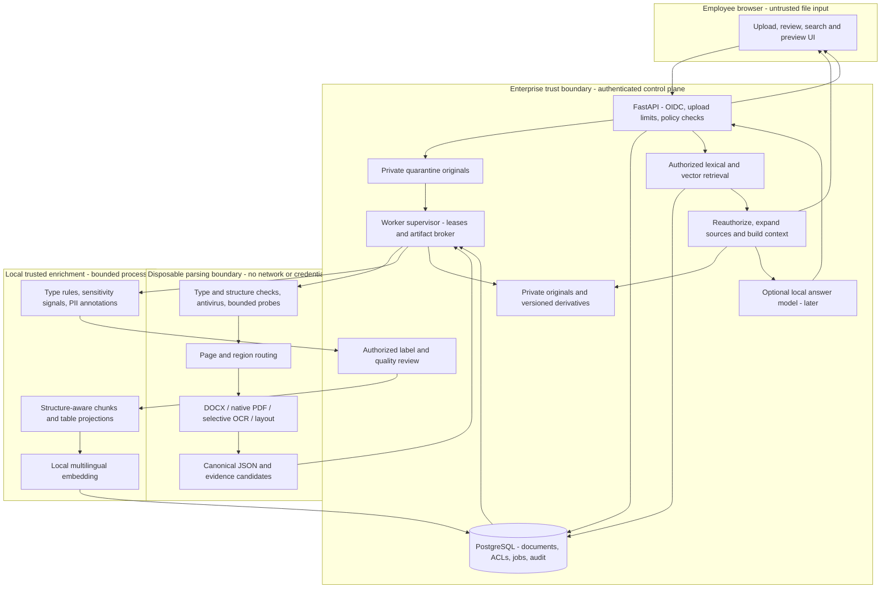

# Deliverable 1 — Recommended architecture

## Decision and boundaries

Use a modular Python service, a separate durable worker supervisor, PostgreSQL, and private blob storage. Keep the parser and model adapters replaceable. Do not introduce a vector database cluster, orchestration platform, or model server for the MVP. The application should demonstrate upload → local extraction → structured content → authorized search with working source previews before it adds generative answers.

Docling is a useful starting adapter because its document model carries hierarchy, tables, layout, and provenance. Retain its original output for debugging, but publish an application-owned schema so a library upgrade cannot silently change retrieval or citation semantics. [Docling document model](https://docling-project.github.io/docling/concepts/docling_document/).

The review edge is a policy gate, not necessarily a manual action for every document. Trusted source labels can satisfy it; uncertain sensitivity, conflicts, and unacceptable extraction cannot. There is deliberately no external AI edge. Antivirus and parser isolation are complementary: passing a malware scan does not make a parser input safe. OWASP recommends layered format, storage, and content controls, while OCRmyPDF explicitly disclaims malware protection. [Upload guidance](https://cheatsheetseries.owasp.org/cheatsheets/File_Upload_Cheat_Sheet.html), [OCRmyPDF security](https://ocrmypdf.readthedocs.io/en/latest/pdfsecurity.html).

## Components and ownership

| Component | Responsibility | Trust and permissions |
| --- | --- | --- |
| Browser/UI | Upload progress, processing state, label review, evidence inspection, authorized search | No database keys or storage credentials; no client-supplied tenant authority. Vietnamese UI for the proposed application. |
| FastAPI control plane | Validate identity, enforce quotas, stream bounded upload, create document/version/job, serve authorized results | Uses an application DB role subject to RLS; cannot execute parsers in its request process. |
| Quarantine | Receive opaque bytes before format approval | Private, encrypted, UUID object keys; no direct public links or inline previews. |
| Supervisor | Lease jobs, stage one input, invoke sandbox, validate output, persist artifacts and outcomes | Can reach approved DB/blob endpoints; owns credentials outside parser namespaces. |
| Disposable sandbox | Inspect/render/parse hostile PDFs and DOCX; run OCR | Non-root, read-only root, no capabilities, no network, no secrets, bounded CPU/RAM/PIDs/time/temp storage; input read-only and one output directory. |
| Classification/PII module | Separate document type, handling policy, and entity annotations | Local execution; outputs are proposals unless backed by trusted label authority. |
| Canonical artifact store | Original bytes, extractor output, normalized JSON, page rasters, review amendments | Version-specific artifacts with hashes; access checked through API. |
| Indexer | Generate chunks, table rows, lexical projections and vectors | Only approved active rendition; index is as sensitive as its content. |
| Search/context service | Apply permissions, fuse lexical/vector results, expand authorized context, cite evidence | Never loads unauthorized content into rerankers or answer models. |
| Reviewer | Resolve label conflicts, lower sensitivity under policy, validate uncertain critical facts | Separate review capability; every override carries actor, reason, previous/new values. |

The sandbox may emit malicious HTML/JSON or escape strings; the supervisor treats all output as untrusted, enforces the schema and size limits, and never evaluates emitted code. Do not mount the container engine socket in a worker. One rootless container per job is a starting boundary; a dedicated worker VM adds separation from the DB and API host. A container shares a kernel, so its configuration and patching remain part of the security argument.

## Five distinct data layers

| Layer | Contents | Default audience and purpose |
| --- | --- | --- |
| Original | Unmodified PDF/DOCX and original hash | Document custodians and explicitly entitled original readers; evidentiary source. |
| Raw extraction | Text, layout, OCR, tables, model candidates, document metadata | Same or stricter scope than original; recovery and extraction correction. |
| Sanitized rendition | Approved masking or pseudonymization plus transformation manifest | Only readers granted that rendition; still confidential unless independently approved otherwise. |
| Search indexes | Chunks, titles, lexical terms, vectors, numeric cells | Same rendition and permission scope as their sources. No public embedding endpoint. |
| Retrieved content | Snippets, parent context, cited cells, eventual answer | Caller-specific view, current authorization, current version and current policy. |

For the MVP, a document reader can read its full local rendition and original. A user entitled only to a future redacted rendition receives no raw-index search access. This avoids implementing incomplete field-level masking as if it were field-level authorization. Later, build a separate approved sanitized rendition and its own text, headings, summaries, numeric projections, and embeddings. Never search a raw index for a redacted-only caller and mask the result afterward: hit existence, ranking, totals, titles, and vector behavior can disclose facts.

## Sensitivity and disclosure policy

Document type and sensitivity are independent. A contract can be public; a general memo can be restricted. Content classifiers cannot know business intent, contractual duties, or whether publication has been approved. Use trusted upstream labels and explicit reviewer decisions as authority; use keywords, identifiers, NER, metadata, and local models to raise warnings or recommend higher handling.

Unknown is a distinct classification value with **effective handling = restricted**. Unknown documents may be processed locally, but only designated intake custodians and users independently entitled to restricted intake can inspect or search them. Upload ownership alone must not confer a restricted clearance. Conflicting labels use the stricter handling pending review. Machine predictions never lower an approved label. Retain both proposed and effective values rather than losing the uncertainty in a single enum.

All external AI/OCR/embedding/translation/reranking calls are disabled for every label in the MVP, including public. A later exception must be an explicit enterprise policy with provider, endpoint, region, purpose, allowed labels/renditions, approved data terms, retention, subprocessors, and expiration. Recheck that policy at dispatch and immediately before sending each request. Masking does not authorize disclosure of a confidential contract. Docling exposes a remote-service opt-in, but network denial and approved model prefetching are still required. [Offline and remote-service options](https://docling-project.github.io/docling/usage/advanced_options/).

## Retrieval security prepared during ingestion

Establish OIDC identity and server-resolved tenant, group membership, department, clearance and purpose. Document ACLs are authoritative relational records, not editable upload metadata. A chunk inherits document grants and may add restrictions; it cannot grant more access than its document. Parent sections, table summaries, captions and generated fields inherit the intersection of all supporting source permissions. Never combine mixed-access rows into a broader summary.

Use PostgreSQL RLS plus explicit service policy checks. A request sets trusted identity context transaction-locally; missing context denies access. The runtime role must be neither table owner, superuser, nor `BYPASSRLS`; apply `FORCE ROW LEVEL SECURITY` and test underlying tables, joins, functions, views and the actual production connection pool. A shared DB login plus caller-settable session variables is not protection from a fully compromised API: the API remains trusted and must not expose SQL or an arbitrary context-setting endpoint. [PostgreSQL row security](https://www.postgresql.org/docs/current/ddl-rowsecurity.html).

Authorize inside both keyword and vector candidate queries before text leaves the DB, then reauthorize expansions and immediately before model dispatch/response. Metadata filters describe candidates but do not establish identity or permission authority. With ANN, an index may visit denied rows internally and filtering can reduce recall; database enforcement must still prevent those rows being returned. Start with exact distance search over authorized records. If moving to HNSW, benchmark filtered recall and iterative scans; strict tenant isolation may require partitioned indexes or separate databases. [pgvector filtering and multitenancy](https://github.com/pgvector/pgvector#filtering).

Revocation has a defined linearization point: an ACL update increments `permission_epoch` and commits before acknowledging the change. Search/context requests recheck the epoch before releasing buffered content. Do not stream sensitive generated tokens in the pilot. Bytes already sent to a user cannot be recalled. Cache keys include tenant, principal/effective grants, rendition, content/index generation and permission epoch; disable answer caches initially.

## Citations, previews and hostile document instructions

PDF citations reference immutable document version, physical page number, section/element IDs and bounding boxes; tables include stable table/cell IDs. DOCX citations use OOXML part, paragraph/run/table/cell locators. DOCX has no stable intrinsic pagination: page numbers are null until a separately versioned renderer creates a preview, and that preview's pages must be labeled as rendered pages.

Serve safe raster page previews through an authenticated API with authorization on every request and `Cache-Control: private, no-store`. Escape text and sanitize any generated HTML tables; never embed user-provided links, scripts or active PDF content directly. Original download is a separate capability, served as an attachment. Do not issue long-lived original presigned URLs: such URLs can be reused until expiry and are bearer capabilities outside ordinary per-request application revocation. [S3 presigned URL behavior](https://docs.aws.amazon.com/AmazonS3/latest/userguide/using-presigned-url.html).

Retrieved document content is data, even if it claims to be system instructions. The future answer service receives bounded evidence in a separate context field, has no arbitrary tools/network/secrets, accepts citations only to supplied source IDs, and abstains when evidence is insufficient. Delimiters and injection detectors help but do not guarantee resistance; authorization and restricted tool privileges are the hard boundaries. [OWASP prompt-injection guidance](https://cheatsheetseries.owasp.org/cheatsheets/LLM_Prompt_Injection_Prevention_Cheat_Sheet.html).

## Starting deployment and operations

Planning envelope: one approved Linux environment with 8 vCPU, 32 GiB RAM, encrypted SSD and encrypted backups; one parsing job at a time with up to four threads, while API/DB have separate resource reservations. A second sandbox can be enabled only after peak-memory measurements. This is a pilot resource budget, not a published minimum or throughput benchmark. Prefer a dedicated worker VM when confidential production data begins.

Use the organization's existing private object storage if available; otherwise an encrypted filesystem behind a storage adapter is adequate for the controlled single-host pilot. An S3-compatible API does not establish residency or security approval. Store keys separately from data, use workload credentials, TLS, restore drills, disk-space alerts and metadata-only monitoring. Database operators remain in the trusted computing base because searchable plaintext/numeric projections exist inside the DB.

Track processing health, unknown-label backlog, OCR routing, extraction warnings, retry counts, permission denials, deletion backlog and cost estimates. Never log text, page images, entities, user queries, original filenames, passwords, model prompts, embeddings or presigned URLs. Retention, legal holds, deletion and restore fencing are defined in [the processing pipeline](03-processing-pipeline.md).
