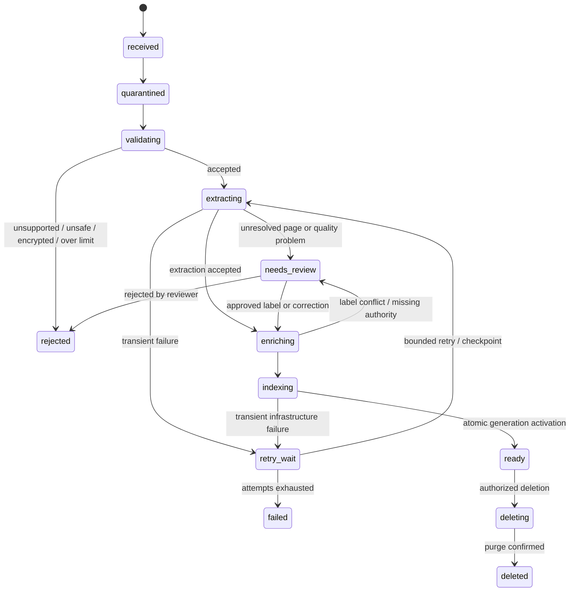

# Deliverable 3 — Detailed processing pipeline

## State and publication contract

Document processing state is separate from sensitivity and review state. An unknown sensitivity value is not a parser failure. A failed replacement version must not destroy a still-authorized searchable previous version.

The diagram is simplified: jobs can retry the recorded stage, not only extraction; cancellation/deletion can interrupt every nonterminal state. Processing phases belong to a version; deletion tombstones the logical document and all versions. `ready` means an index generation is complete and published for its authorized readers. It never means public or low sensitivity. In the MVP, unresolved extraction warnings that affect required content prevent publication; partial indexing is a later explicit product option with visible coverage warnings.

## A. Intake, validation, quarantine

1. Verify OIDC session, upload capability, tenant membership, department assignment and quota. Generate opaque document/version/storage identifiers server-side. Treat the original filename as sensitive display metadata; normalize it, reject path components, and never use it as a filesystem path or object key.
2. Stream bytes into private encrypted quarantine; enforce the body limit while receiving, not after reading the file into RAM. Calculate SHA-256 locally. Keep deduplication tenant-scoped and permission-aware; identical bytes do not imply identical ACLs or a right to disclose that another employee uploaded them.
3. Finalize the immutable object and verify size/hash. Commit document version and queued job together in PostgreSQL. On DB failure, a reconciler removes unreferenced quarantine objects after a grace period. On incomplete upload, no searchable document exists. Idempotency keys are scoped to tenant + actor + endpoint, tied to request digest, and do not expose another caller's result.
4. Run malware scanning and format/structure probes inside bounded processes. Content signatures/MIME are hints, not acceptance. A DOCX must be a valid allowed OOXML ZIP package with expected content types, document part and relationships. A PDF must parse as a supported PDF with bounded object/content expansion. Detect OLE/encrypted Office containers and macro content masquerading as DOCX.
5. Check PDF encryption, password requirements, signatures, embedded attachments, JavaScript/launch actions and XFA/portfolio structures. Reject encrypted/password/certificate-protected inputs for MVP with a specific error. Do not strip protection automatically or accept passwords in logs/job payloads. A future authorized decryption flow would use a short-lived secret channel and retain a separate derivative.
6. Reject macros, active/OLE content, embedded packages and external relationships in the initial DOCX policy; do not fetch images, templates, hyperlinks, DDE targets or linked files. Document links can be retained as escaped text only. Reject OOXML path traversal, absolute paths, symlinks, duplicate ZIP names, encrypted entries, excessive expansion and XML DTD/entities. No automatic legacy DOC/RTF/office conversion in the MVP.
7. An unavailable scanner, exceeded scan limit, stale signature database beyond policy, parser crash or ambiguous polyglot result is not an accepted file. Hold/reject it with a stable error and safe operator information. Scan rules and detection versions are recorded without source text.

Layered intake guidance comes from [OWASP](https://cheatsheetseries.owasp.org/cheatsheets/File_Upload_Cheat_Sheet.html); XML resource attacks and remote resource behavior require explicit constraints independent of MIME validation. [Python XML security](https://docs.python.org/3/library/xml.html). PDF rewriting is not sanitization. [OCRmyPDF security](https://ocrmypdf.readthedocs.io/en/latest/pdfsecurity.html).

Initial limits below are project defaults to tune, not library guarantees:

| Limit | Initial value and behavior |
| --- | --- |
| Uploaded bytes | 50 MiB/file; streamed `413` if exceeded |
| PDF pages | 300; preflight itself has resource limits |
| DOCX pages | Do not trust `docProps` count; bound ZIP/XML/media complexity instead |
| DOCX package | At most 5,000 entries; 250 MiB total uncompressed; 20 MiB/XML part; 100:1 expansion ratio; enforce cumulative streamed counters |
| Page rendering | Up to 300 DPI and 40 million pixels/page; excessive dimensions fail/review rather than allocate first |
| Decompression | Bounded streams and decoded-image allocations inside sandbox; validate size before large raster allocation where supported |
| Worker resources | 4 CPU threads, 8 GiB RAM, 128 PIDs, 2 GiB temporary output per job; disk and memory enforced by runtime |
| Timeouts | Probe 30 s/file; extraction 120 s/page and 45 min/job; supervisor watchdog kills process group |
| Output | 100 MiB canonical JSON; 1 million elements/cells cumulative; 20 million normalized characters; bounded schema validation |
| Fairness | Initially one active parser; per-tenant concurrency 1; daily page quota and global queue age alert |

Reject unusually large legitimate documents with a useful explanation; administrators can create a reviewed policy profile rather than silently bypassing limits.

## B. Page/region routing for PDFs

Probe each page cheaply using native glyph geometry and a bounded low-resolution render. Collect visible non-whitespace characters, Unicode plausibility, replacement/control-character fraction, repeated glyph patterns, native text bounding boxes, effective image coverage, text density, orientation and estimated text-like regions from local layout/text detection. PDF `/Producer` and `/Creator` may suggest an export tool but can be absent, spoofed or rewritten; they cannot prove an original Word/DOCX source or recover its original structure. PDF's visual instructions are not an authoritative semantic document tree. [pypdf extraction discussion](https://pypdf.readthedocs.io/en/stable/user/extract-text.html).

Candidate routing heuristics, to calibrate on development data:

| Observed condition | Candidate route | Important exception |
| --- | --- | --- |
| At least 80 visible characters, printable ratio ≥0.98, replacement/control ratio ≤0.01, consistent text geometry | Native digital text candidate | A few clean lines can coexist with a scanned appendix on the same page. |
| Image covers ≥70% of page with fewer than 30 useful native characters and detected text-like regions | OCR candidate | A full-page photo/chart or blank scan should not become invented text. |
| Clean native text plus uncovered text-like image regions | Hybrid region route | OCR only uncovered regions; do not assume images contain no text. |
| Present text layer has implausible text, invisible glyphs, duplicated lines or render mismatch | Suspect OCR/native layer | Compare visual OCR; retain both alternatives and require review on disagreement. |
| Little native text and no reliable text-like region | Blank/figure/unknown candidate | Store the page and coverage decision; uncertainty may require review. |

These thresholds are features for routing, not universal correctness probabilities or confidentiality rules. Image coverage uses a clipped union of image regions, accounting for transformations and overlap, rather than summing image areas. Native character count excludes invisible/off-page text where detectable. A coarse image-only indicator must never skip a region that contains a relevant scanned clause.

Route each page as native, OCR, hybrid, blank or unresolved; document format summary is derived from these routes. Within hybrid pages, merge candidate text geometrically and in reading order. Suppress duplicates only when spatial overlap and normalized text agreement support it. Never globally deduplicate repeated payment clauses or identical values in different table cells.

## C. Extraction branches

**DOCX:** parse styles, body order, numbered lists, headers/footers, native table grids and relationships. Preserve OOXML part and element locators; extract embedded images locally if allowed and OCR them only when they plausibly contain document text. Include a declared policy for tracked changes: default to current visible/final body, preserve separate revision/comment annotations and warnings, and send ambiguous legal revisions to review. Do not accidentally index deleted revision text as current obligations. Inspect text boxes, footnotes/endnotes and nested tables; if the adapter cannot extract them, record unsupported coverage and block automatic publication of affected content. No fabricated page numbers. [python-docx table limitations](https://python-docx.readthedocs.io/en/latest/user/tables.html).

**Simple born-digital PDF:** use native text blocks with coordinates. Infer reading order and heading candidates conservatively; source font size alone is not a section hierarchy. A clean one-column page may use the inexpensive fast path. Multi-column content, complex tables, overlapping objects, ambiguous order or table references invoke the layout adapter. Native tables use geometry/rules or Docling table models, never a whitespace split as authoritative cell structure.

**Scanned PDF:** render bounded pages, correct clear rotation/deskew while preserving the inverse transform, run Tesseract `eng+vie`, combine word boxes with local layout/table recognition, and preserve page crop/raster provenance. Keep raw OCR output and selected canonical text. Test a higher-quality language model or PaddleOCR on failing regions before considering a VLM. Do not improve OCR by silently rewriting amounts, dates or names.

**Hybrid PDF:** run native extraction on all candidate regions, OCR missing/low-quality regions, then align/merge them in a common page coordinate system. A selectable hidden OCR layer can be wrong; selectable text is not proof of reliable native extraction. Keep extractor choices and disagreement warnings per element, not just per document.

**Unsupported/special cases:** reject legacy DOC, macro Office, ZIP uploads, XFA/portfolios and arbitrary images initially with clear reupload instructions. Standard PDF form fields can be captured as key/value evidence when the pinned adapter supports them, while preserving the visual page. Complex handwriting, stamps covering key text, uncertain signature roles and illegible financial values enter review. Preserve original signed PDFs byte-for-byte; page renders and structured derivatives do not replace the original or establish signature validity.

## D. Normalization, classification and review

Normalize text to NFC in an immutable canonical extraction revision; preserve raw text and a raw-to-canonical offset map. Keep paragraphs, lists, heading paths, reading-order edges, tables/cells, key/value pairs and relationships. Save native extractor JSON alongside our canonical JSON. HTML/Markdown are derived views, not the storage authority. Table cell merges, source references and policy dependencies live in JSON.

Run document type rules on local extracted features. Strong template matches can propose `contract`, `report`, `policy`, `financial_record`, `administrative`, `general` or `other`; abstain as `unknown` for conflicts/low evidence. If training a classifier later, use held-out calibration: an initial suggested acceptance threshold is calibrated top-class probability ≥0.85 and margin ≥0.20. Uncalibrated rule scores cannot satisfy a probability threshold. A wrong type routes an optional enrichment incorrectly; it must never lower sensitivity or expand access.

Resolve sensitivity from trusted source/owner policy and reviewer authority. Maintain claimed, predicted and approved labels independently. PII or secret markers may escalate effective handling, and no detected PII is not evidence that the document is public. Unknown/conflicting labels remain restricted until resolved. A reviewer can override a label using an `If-Match` revision, reason code, authority and optional restricted note; sensitive downgrade requires the configured approver, with two-person approval for restricted-to-public as an initial policy choice. Machine reprocessing retains approved decisions and can raise a new conflict.

Confidence values retain engine scale and calibration identity. Docling's own documentation advises using quality grades and notes its table score is not implemented; do not treat a displayed number as a validated table confidence. [Docling confidence](https://docling-project.github.io/docling/concepts/confidence_scores/).

Quality gates:

- Engine `poor`/`fair` grades, normalized visual/native disagreements >10%, missing required regions, invalid table geometry or an unknown confidence on a critical table trigger review. The 10% disagreement is a proposed routing threshold, not a benchmark finding.
- A calibrated project quality estimate ≥0.90 may support automatic noncritical acceptance only after calibration exists. Until then, use engine grades, deterministic coverage checks and reviewer spot checks; do not invent a calibrated score.
- A numeric/date contract fact needs exact evidence, deterministic validation and either reviewer confirmation or a separately validated field-acceptance rule. Set the target precision before automation; low confidence/ambiguous candidates are `unknown` or `ambiguous`, not guessed values.
- Table validity requires nonoverlapping anchored cells, valid row/column spans, preserved blank cells, identified header associations and exact source locators. A structurally valid grid can still contain incorrect OCR.

## E. Optional contract extraction

Run this after a confident/confirmed contract type and only if enabled for that version. Failure of this optional stage does not block basic document search if canonical content is accepted; expose enrichment status separately. Start with deterministic template fields and clause boundaries, then measure whether local model candidates add value.

Extract title/number, parties/roles, effective/expiration dates, obligations, value/currency, renewal and termination clauses, signatories, and appendix/table links as independent evidence-backed candidates. Keep clause text as quoted evidence rather than manufacturing a legal interpretation. Signatory role can be a role label adjacent to a signature block; `signature_block_detected` does not mean `legally_signed`.

Every non-null field links to an immutable source element, exact span or table cell and page/OOXML locator. Validate date parse ambiguity (`03/04/2026`), Vietnamese/English number separators, currency context and totals using decimal arithmetic, not floating point. Preserve original strings. Different currencies, exclusions, taxes and conditional obligations cannot be summed without matching scope. Expiration before effective date triggers review but does not automatically change either date. Missing effective date cannot be filled with the signature date. Conflicting amendments remain competing candidates pending review.

## F. PII protection and permitted renditions

Detect names, contacts, addresses, national IDs, bank/account data, employee IDs, company-specific secret identifiers and potentially patient/health identifiers using local NER + context-aware regex/checks + protected dictionaries. Use bilingual context words such as `CCCD`, `CMND`, `số tài khoản`, employee or patient labels; format matches are candidates, not proof of identity or legal validity. English NER does not solve Vietnamese person/address detection. Use Vietnamese NER or review for those documents. [Presidio language extension](https://github.com/data-privacy-stack/presidio/blob/main/docs/analyzer/languages.md), [detection limits](https://presidio.dataprivacystack.org/faq/).

Annotations store entity type, span, detector, raw score, version, source reference and proposed action. Do not put raw entity values in ordinary logs/audit. Keep party names and monetary amounts in the authorized local raw rendition so useful searches remain possible. A sensitivity policy can restrict a whole document or region independent of PII spans.

Masking changes a display. Irreversible redaction removes data from a released derivative; it requires independent inspection of hidden text, metadata, images, attachments and OCR layers. A black rectangle is not adequate redaction. Reversible pseudonymization uses random vaulted tokens, or keyed tenant-scoped HMAC tokens for approved deterministic linking plus an encrypted reverse mapping. An unkeyed hash of a low-entropy ID is vulnerable to guessing; even keyed deterministic tokens leak equality/frequency. Key rotation, collision handling and mapping access must be explicit. No cross-tenant global pseudonyms.

If a sanitized rendition is needed, compute it from immutable raw content, preserve offset/source maps, validate transformations and build its own indexes. Its reviewers and readers must be authorized separately; audit original access and token reidentification. Do not promise external safety from automated masking: missed OCR text, handwriting, business secrets, linked entities and false negatives remain.

## G. Chunking, embedding and atomic indexing

Use heading/clause boundaries and paragraph grouping, targeting 200–350 E5 tokenizer tokens of body text with a hard **480 tokens for the entire contextualized passage**, including model prefix, headings and repeated table headers. Reserve the remainder of the model's 512-token input for special tokens. Enforce by the actual pinned tokenizer and reject silent truncation. Split long clauses at sentence/subclause boundaries and retain parent ID. Optional overlap is 30–50 tokens within one section and security scope; never cross an ACL boundary. [E5 limits and prefixes](https://huggingface.co/intfloat/multilingual-e5-small).

Index tables with: (1) deterministic caption/schema/header representation, (2) row or small row-group passages that repeat hierarchical headers, units and relevant footnotes, (3) typed numeric/date/identifier cells in SQL, and (4) full-table JSON for authorized expansion. Embed a full table only if it fits; do not truncate large financial tables. A generated table description is optional derived evidence and cannot override cell values. Record which rows/cells support every projection. A row with inherited merged headers can repeat those labels in search text without duplicating anchored numeric facts.

Construct local embeddings for the selected rendition only. Batch by token budget and record model/revision/dimension/normalization and input hash. Candidate retrieval combines authorized lexical, exact identifier/numeric and vector results using RRF (initial constant 60). PostgreSQL FTS is a baseline ranker, not BM25. Retrieve top 40 per channel, deduplicate by evidence/parent, and return 10 initially; tune using retrieval tests.

Build a new `index_generation` in staging; verify complete chunk/embedding counts, source links, schema and permissions. In one transaction, compare source and permission epochs, set generation published, and update the document's active version/generation. If epochs changed, rerun the policy gate. Previous active content remains available only under current permissions. Crashed/stale workers cannot publish using an expired lease token.

## H. Failures, retries, modifications and deletion

Persist jobs and stage checkpoints in PostgreSQL. Atomically lease with `FOR UPDATE SKIP LOCKED`, commit the short claim transaction, then work outside it. Use a 60-second lease renewed every 15 seconds, fencing token and a recovery sweeper; do not hold a DB transaction open throughout OCR. A fencing token is compared on every checkpoint/publication so a stalled worker cannot overwrite a newer attempt. At-least-once execution is expected. [PostgreSQL queue locking semantics](https://www.postgresql.org/docs/current/sql-select.html).

| Failure | Treatment |
| --- | --- |
| Temporary DB/storage outage, safe network timeout | Retry recorded stage after 5 s, 30 s, 120 s + jitter; max 3 retries after initial attempt |
| Worker death | Reclaim expired lease, use verified checkpoint; job gets a new fencing token |
| OOM, page timeout | One deterministic fallback: lower concurrency/limit raster size without losing text; rerun failed region only; then review/fail |
| Parser malformed input, malware, unsupported encryption/format | Permanent rejection; no blind retry loop |
| Low extraction quality | Alternate local engine once, then review; no automatic cloud escalation |
| Model files missing/incompatible, scanner not healthy | Infrastructure hold/retry; no on-demand download from a parsing job |
| Cancel/delete/relabel during processing | Check tombstone/epochs at checkpoints and publication; stop work, discard unpublished output |

The unique stage output key includes tenant, document version, extraction revision, parser/model/config digest and stage. A correction creates a new extraction revision instead of mutating cited text. Re-embedding creates a new embedding generation; do not compare vectors from incompatible models/dimensions.

Permission changes do not require waiting for re-embedding: live ACL evaluation blocks access immediately at commit. Invalidate search/answer/preview caches and context requests by epoch. New content versions are processed separately. ACL removal, department changes, identity revocation and group membership changes all use live or appropriately short-lived identity state; restricted searches must not rely on a stale day-long group claim.

Deletion is two phases. First commit a tombstone and increment permission epoch so no retrieval, preview, expansion or stale worker can return the content. Then idempotently purge vectors, chunks, table projections, raw/normalized outputs, crops, thumbnails, sanitized renditions, pseudonym maps, temp files and original object versions. A versioned object store delete marker alone does not purge previous versions. [S3 versioning](https://docs.aws.amazon.com/AmazonS3/latest/userguide/Versioning.html).

Proposed retention defaults need business approval: incomplete/quarantined rejected uploads 7 days, sandbox temp at job end with a 24-hour crash sweeper, superseded unheld artifacts 30 days, backups up to 35 days, content-free audit metadata 1 year. Accepted originals follow the enterprise records schedule, not an arbitrary developer TTL. A legal hold blocks physical purge and is reported as such; it does not restore ordinary search access after deletion. Physical purge target is 24 hours for online stores, with backup expiry tracked separately. Use a deletion ledger outside restored snapshots and reconcile it **before serving a restored DB/index**. Never claim instantaneous deletion from immutable backups or cryptographic erasure without a compatible per-object key design.
