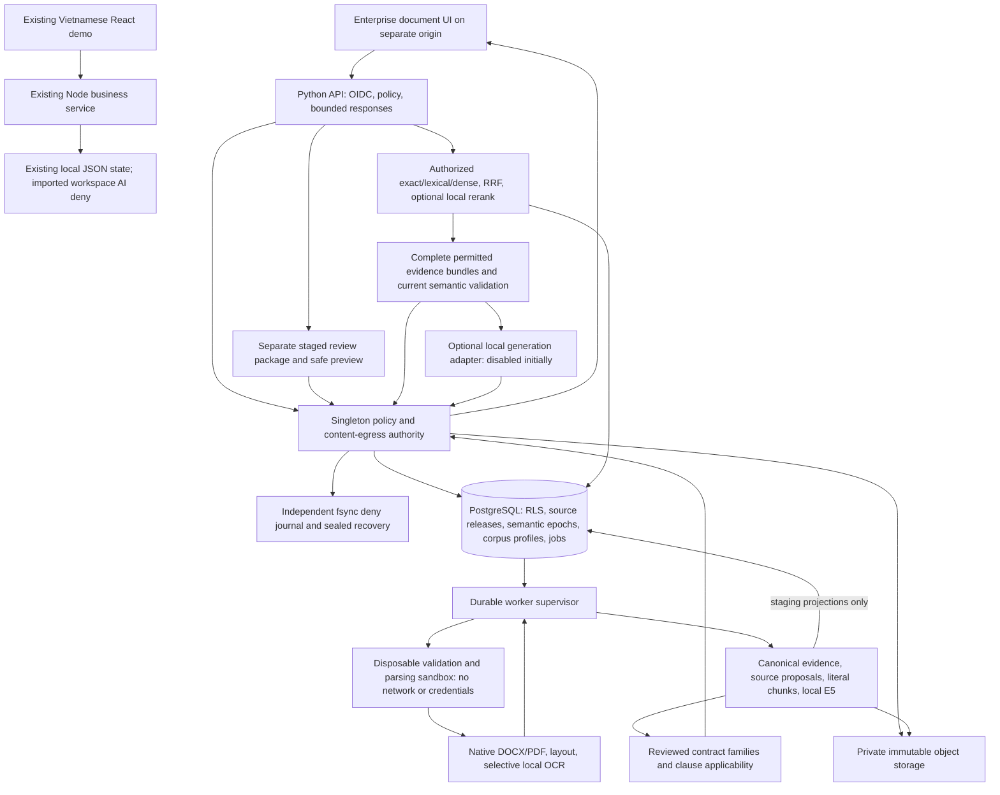

# Architecture review and recommended design

Reconciled revision 2.2.0, 2026-11-16. Design only. The independent HR01–HR14 audit is preserved; dispositions and contracts are linked in [reconciliation](reconciliation/finding-disposition.md). Evidence labels used throughout: **R** = repository observation; **V** = externally verified documented capability; **D** = design decision; **H** = hypothesis requiring evaluation; **B** = unresolved business/operational approval. A library feature is not a measured quality result.

## Audit scope and current reality

The audit covers `proposal.md`, `AGENTS.md`, the eight `ragplan/1` deliverables, their README, original request, source/cost/verification records, schema definitions and synthetic examples. It also considers the application requirements, architecture, data-model and implementation plans in `docs/`, the Phase 6.1–6.4 AI integration/security/tool/RAG plans and subsequent verification reports, workbook-import policy, historical prompts, and current source/test configuration. Historical instructions and reports are compared with code rather than treated as current implementation evidence.

Direct source anchors:

| Repository evidence | Finding / implication |
| --- | --- |
| `package.json`, `src/online/`, `server/{http,app,state,auth,assistant,tools}.ts` | R: React/Vite offline and online clients plus a Node server exist. Python/PostgreSQL enterprise ingestion does not. |
| `server/state.ts:81`, `server/assistant.ts:281`, `docs/workbook-import.md` | R: workbook presence or sticky envelope policy blocks external AI before provider access. Do not copy imported data into any new corpus. |
| `server/rag/chunks.ts:72` | R: source offsets are JavaScript UTF-16; chunks are bounded by UTF-8 bytes. This differs from the earlier enterprise code-point/token design. |
| `server/rag/retrieval.ts:32,96,172` | R: local BM25-like lexical scoring, RRF and an in-memory exact-vector adapter exist; semantic candidates use an initial cosine cutoff 0.78. This is not evidence of calibrated support confidence. |
| `server/rag/embeddings.ts`, `scripts/provision-rag-model.mjs` | R: optional local ONNX E5 adapter verifies assets and rejects oversized inputs. Runtime is not listed as installed in `package.json`; inference readiness was not tested in this task. |
| `server/rag/generation.ts`, `server/rag/evaluation.ts` | R: citation/numeric/lexical generation guards and a small synthetic evaluator exist. They do not establish semantic entailment, enterprise isolation or scan quality. |
| `src/domain/commands.ts:956`, `src/domain/selectors.ts:198` | R: demo versioning uses record cloning/lineage and business-date eligibility; document read roles are distinct from sign roles. |
| `ragplan/1/{04-data-model,08-implementation-handoff}.md` | R: useful enterprise abstractions, but schema/API/SQL requirements are incomplete and the handoff incorrectly assumes there is no application repository. |
| `git status`, baseline `f01a2af` | R: a usable Git repository exists; earlier statements about missing Git are stale. No history-wide secret audit is claimed. |

The four administrative modules remain one consistent demo dataset. The enterprise document corpus has a separate, explicit authority; it must never become a second writer for uniforms, purchases or lockers. LocalStorage continues to serve the existing offline demo. Confidential enterprise documents never persist in browser localStorage.

## Findings classified by severity and later repair cost

Severity: Critical = confidentiality/integrity boundary or unusable core contract; High = major correctness/availability risk; Medium = bounded quality/maintenance risk. Later cost: **XL** = schema/corpus/security-boundary rebuild, **L** = multi-module migration/reindex or release blocker, **M** = contained adapter/pipeline change, **S** = configuration/documentation correction. These are relative engineering estimates, not monetary quotations. Existing controls are credited; missing details are not misreported as proven vulnerabilities.

| ID | Severity / later cost | Contradiction, gap or rewrite risk | Resolution / status |
| --- | --- | --- | --- |
| F01 | Critical / XL | Greenfield Python handoff conflicts with existing Node business authority and demo persistence. | D: separate document bounded context; no replacement of four modules; explicit namespace and migration bridge. A01/A07 approval pending. |
| F02 | Critical / XL | Synthetic OpenRouter permission could be misapplied to imported workbook or confidential enterprise data. | D: separate origins/data roots/credentials; enterprise egress denied, sticky workspace deny remains. Never route enterprise evidence through existing assistant transport. |
| F03 | Critical / XL | Old source refs use code points; live citations use UTF-16; normalization map is only named, not specified. | D: immutable raw/NFC spaces, interval maps and explicit legacy conversion; no offset reuse. C03/C04. |
| F04 | Critical / XL | Publication pointer on a document cannot atomically express several renditions and several model indexes. | D: immutable source release/member + separate C13 complete corpus serving membership; C12 legal composition and C14 semantic acceptance are separate heads. One complete model space per serving profile. |
| F05 | Critical / XL | ACLs/epochs described, but entity aliases, relations, typed facts and aggregate existence could bypass scope. | D: every observation has source dependencies; entity search begins with authorized observations. No readable global alias registry. C06, S04. |
| F06 | High / L | Source versions, extraction corrections and embedding rebuilds can be conflated; latest ordinal need not be effective version. | D: separate immutable IDs; explicit valid-time and release policy, no automatic legal precedence. C02. |
| F07 | High / L | Prior search response has one generation ID although results may span many documents. | D: snapshot includes corpus/auth epochs and a list of document/release/generation tuples. C08. |
| F08 | Critical / XL | Rechecking an epoch then writing a response leaves a revocation race. | D: HR03 replaces the DB-lock-only argument with S05 singleton policy/egress serialization, synchronous bounded enqueue, sealed recovery and no HA; envelope approval A09 and actual fault tests required. In-flight bytes remain irrevocable. |
| F09 | High / L | Lease-token narrative lacks monotonic epoch, stage dependency identity and stale blob-writer handling. | D: monotonic fencing, attempt-scoped immutable artifact keys, SQL CAS and adoption manifest. C09. |
| F10 | High / L | Durable object storage and SQL are not a distributed transaction; accepted upload/checkpoint can reference absent bytes. | D: staged upload, verified finalize, DB registration/outbox, orphan reconciliation and retention roots. C09/C10. |
| F11 | High / XL | Table merges, cross-page continuation, footnotes and signature/appendix roles lack a unified relation/dependency contract. | D: anchored cells, segment graph, inherited-header evidence, signature observations; unknown continuation blocks trusted aggregates. C03/C05. |
| F12 | High / XL | Cross-document entity normalization/resolution is absent from detailed schema. Name equality may merge distinct people/parties. | D: mention/observation/entity/link decisions; exact issuer-scoped identifiers, reversible reviewed links; never merge solely by folded name. C05/C06. |
| F13 | High / L | Chunk-level narrowing is promised but dependency conjunction and security-safe parent expansion are not explicit. | D: document/rendition scope only at launch; reject fine-grained publications until projection tests exist. Preserve dependency relation now. |
| F14 | High / L | No API distinction between unvalidated extraction candidate and trusted contract fact. | D: status + validation + evidence mandatory; unknown/ambiguous stay null; typed predicates use accepted facts only. C05. |
| F15 | High / L | Fixed cosine or RRF score can become an invented answerability threshold. | D: no dense cutoff in baseline; calibrated support model is separate, disabled until validation; initially evidence excerpts and deterministic fact templates. |
| F16 | High / L | Vietnamese PII recognizer/model is not selected; English defaults are insufficient. | D: bilingual patterns/dictionaries now, human privacy review mandatory; VnCoreNLP candidate experiment with license gate. No automatic safe-release promise. |
| F17 | High / L | Deletion lacks explicit invalidation for shared entities, relation edges, caches, retained jobs, failed artifacts and restored key vaults. | D: reverse dependency graph plus purge manifest; observations removed, entity disappears when no permitted evidence remains. C10. |
| F18 | High / L | Historical docs mix design, old test counts and runtime readiness. | D: source precedence and evidence ledger; all new results explicitly marked measured/not executed. |
| F19 | High / L | Five-week/320-hour schedule predates additional contracts and representative evaluation. | D: gate-based phases; staffing/time remain estimates, no five-week production commitment. |
| F20 | High / L | Eight CPU/32 GiB plan is not demonstrated on the earlier approximately 15 GiB host observation. | D: approved deployment envelope and load gate; larger models run serial experiments, never concurrent by assumption. |
| F21 | High / L | Exact-vector scans scale linearly; 100 docs/day indefinitely accumulates millions of chunks. | D: capacity math, authorized-candidate timings, upgrade triggers and partition-compatible keys. |
| F22 | High / L | New BM25 engine may introduce global term-statistics and RLS leakage or weaker ACL consistency. | D: FTS baseline; BM25 challenger must prove scoped stats/filtering, licensing and deletion; no blind global top-k. |
| F23 | High / L | Unsupported DOCX parts/revisions or misleading PDF hidden text can silently omit legally important content. | D: coverage inventory with required region accounting, literal alternatives and review gate. |
| F24 | High / L | Model upgrades and quantization may alter scoring/tokenization without correct reindex/calibration invalidation. | D: embedding-space identity includes all assets/pooling/prefix/dtype; dual rebuild, no mixed spaces. |
| F25 | Medium / M | No retrieval/reranking extension interfaces; deferring sophisticated methods may force payload changes. | D: typed channels and score domains, provenance, sparse/multivector adapter boundary now. |
| F26 | Medium / M | Global hash/near-dedup may leak upload existence or collapse legitimate duplicate clauses and independent ACLs. | D: permission-safe tenant dedup; extraction reuse only with private ownership/refcounts; physical reuse disabled first. |
| F27 | High / L | Redaction geometry/text-offset mapping and pseudonym vault lifecycle lack enough detail. | D: separate rendition transformation map; whole-artifact independent validation; no redacted-only release at launch. |
| F28 | High / L | Job/output/time limits do not specify queue fairness, output cardinalities and model concurrency together. | D: explicit process budgets, tenant admission, limits and circuit behavior in S07. |
| F29 | High / L | Sensitive query logs, evaluation manifests and entity fingerprints may themselves disclose content. | D: metadata allowlist, private detailed evaluations, keyed opaque digests and scrubbed reports. |
| F30 | High / L | Contract comparison could silently treat draft/amendment/signature date as current legal truth. | D: C12 independently active original/amendment/appendix instruments, reviewed clause effects/effective intervals and authorized composition; conflicts/unknown precedence never become ordinal wins. |
| F31 | High / L | Large original downloads cannot guarantee immediate midstream revocation; presigned URLs bypass live checks. | D: separate export capability, bounded short-lived streaming authorization, no presigned URL in search. S05. |
| F32 | Medium / M | API errors/cursors/idempotency retention and HTTP concurrency semantics were only sketched. | D: bounded APIs, opaque actor-bound cursor, If-Match, stable errors and request digests. C08/C09. |

Critical design findings have explicit revised contracts below; **they are not implemented fixes**. F01–F32 retain the severity/cost of implementing the wrong pattern, not the status of 32 open architectural defects. Approval and validation dependencies gate particular decisions/exposures; they do not universally prevent implementation. The [readiness register](rag-readiness-assessment.md#historical-finding-reconciliation) maps every finding to residual work.

## Final architecture

D: pilot topology is one policy/egress API process on one approved host, one SQL primary, separate durable worker/sandbox, no automatic failover or rolling API overlap (S05/C16). Worker cannot commit policy or publication; everything visible crosses the authority gate. A second content reader must fail startup.

D: `services/enterprise-rag/` is the future document application root; Python 3.12/FastAPI/Pydantic v2/SQLAlchemy/Alembic/psycopg; PostgreSQL 18 and pgvector 0.8.x compatibility baseline, exact active package/model patch/digests frozen through P00 before use. No orchestration framework is required. React components may be reused, but the enterprise entry point has a separate origin, session, cache namespace and no imported-workbook route. If deployment later uses one public origin, reverse proxy only `/api/enterprise-rag/v2/*` to this API; it verifies OIDC independently and rejects browser-supplied identity headers. The Node demo does not impersonate enterprise users. Start with a new synthetic corpus; a one-way legacy synthetic importer is an optional separately scoped branch, not a prerequisite. No live dual writes or business-state replication.

D: initial dependency set = pypdfium2 for probe/render, pdfplumber for digital geometry fallback, Docling standard layout for complex PDF, python-docx plus explicit safe OOXML parser, Tesseract `vie+eng`, local E5-small, PostgreSQL FTS `simple`, exact identifier/accepted-cell search, exact dense vectors, RRF. Preserve parser-native JSON alongside the application-owned graph. Use a mature Draft 2020-12 validator in implementation; this task does not replace that with a homemade validator.

D: implement the reranking interface and plan an early bounded local cross-encoder comparison; baseline production profile is `reranker=none`. Promote BGE-reranker-v2-m3 only if E04 quality and CPU gates pass. Missing challenger assets/results block that promotion, not baseline coding or a baseline release that meets its own quality/security gates. BGE-M3 dense, neural sparse and multivector representations are similarly evaluated early when baseline misses identify their value; schemas support channel-specific immutable representations from the start.

## Expensive decisions and downstream consistency

| Decision | Explicit choice | Downstream consistency check |
| --- | --- | --- |
| ADR01 canonical authority | Immutable application-owned graph + raw artifacts; SQL projections carry canonical hash | Parser upgrades do not change citation meaning; old generation resolves old revision. |
| ADR02 physical evidence | PDF physical page/regions and invertible transforms; OOXML parts/runs, rendered preview separate | OCR, PII boxes, table cells and previews share one coordinate convention. |
| ADR03 identity | Logical doc, source version, extraction, rendition, generation, release are distinct | A re-embed changes generation/C13 serving profile, never source version or C12 legal precedence; C14 semantic epoch handles fact retraction separately. |
| ADR04 chunk identity | SHA-256 canonical manifest includes tenant/version/extraction/rendition/chunker/source intervals/text | Content-correct IDs change on correction; ACL changes use live auth, not mandatory vector rebuild. |
| ADR05 entity authority | Source-bound mentions and reversible link decisions | PII/alias search, conflict resolution, deletion and ACL all traverse evidence. |
| ADR06 publication | Complete source release plus independent corpus membership; singleton-gated CAS/semantic/deny/root checks | One source instrument replaces coherently; multiple co-applicable instruments compose through C12. One corpus model profile switches only after complete shadow validation. |
| ADR07 isolation | Trusted OIDC context + relational grants + RLS; no application-role bypass | FTS, dense, typed filters, expansion and citation endpoints use same predicate. |
| ADR08 transformations | Separate approved rendition and explicit source map; no mask-after-retrieval | Hidden raw facts cannot affect sanitized search; dependencies support future scope narrowing. |
| ADR09 asynchronous work | Durable jobs, monotonic fence, immutable attempt output and validated checkpoint | At-least-once work never becomes duplicate publication; stale blob uploads remain orphans. |
| ADR10 deletion | Singleton fsync deny journal visible before SQL acknowledgement; semantic roots, fenced GC and sealed restore | Old workers, old generations, entity links and backups cannot silently resurrect sources. |
| ADR11 representations | Versioned model-space registry and channel interfaces | E5/BGE/sparse/multivector changes rebuild projections, without replacing canonical corpus. |
| ADR12 confidence | Rank scores, extraction scores and support estimates have distinct types | No RRF/cosine probability; abstention and citation support are independently evaluated. |

## Capacity and operational assumptions

H: pilot target 1,000 documents / 10,000 pages / about 80,000 child chunks; 100 documents/day at ten pages/document, ten simultaneous searches, 50 logged-in users. At that assumed daily growth, a year adds roughly 2.92 million chunks. A 384-dimensional float32 vector alone takes 1,536 bytes: 80,000 vectors take about 117 MiB, one million about 1.43 GiB, excluding row/index/text/WAL/backup overhead. Do not confuse model weight size with peak RSS.

D: start one parser at 4 CPU/8 GiB max, E5 inference 2 threads/2 GiB budget, DB 8 GiB allocation including shared buffers and bounded query work; API/supervisor/OS/reserve consume remaining 14 GiB on an 8-vCPU/32-GiB approved host. Caps include child processes; actual RSS is measured. Avoid sum-of-per-query `work_mem` exhaustion. Search prioritization throttles parser CPU. Local reranker/BGE experiments evict other model processes and run serially under the same total memory limit.

D: trigger capacity review at 100,000 authorized chunks per broad query, 70% sustained host memory, disk 70%, search p95 >2 s or queue age >30 min. First measure/tune indexes and admission. Then add a worker VM or approved tenant partitions/HNSW only after filtered recall/isolation experiments. Exact baseline remains the correctness oracle. Storage sizing measures actual rasters/raw JSON and 35-day backup growth; page counts alone are insufficient.

## Reconciled state boundaries and readiness

HR01 adds a separate staged-review policy; HR02 independent instruments and reviewed applicability; HR04 whole-corpus serving profiles; HR06 monotonic semantic revisions. HR03/HR05 choose a strict but deliberately single-authority serving envelope with live deny journal and sealed recovery. HR07–HR09 specify Unicode/compiler/slot/packing contracts. HR10 adds active semantic/evidence roots with publication/GC fencing. HR11/HR12/HR14 add bounded work/fairness/review circuits and actual-role measurement gates. HR13 defines alternative sufficient bundles and numeric complete-answer coverage. The [disposition register](reconciliation/finding-disposition.md) records each review recommendation, compatibility and residual evidence; no original finding is erased.

**Architecture approval: CONDITIONAL GO**, subject to acceptance of service/tenant/review authority and singleton availability envelope (A01/A02a/A03/A09), plus independent re-review of the corrected contracts. **Synthetic prototyping: GO** in an isolated, separately authorized implementation task. **Staged implementation: CONDITIONAL GO** with P00 materialized schema/API specs and consumer-specific gates. **Confidential-data integration: NO-GO** until real authority/data/records approvals and actual policy/transport/journal/sandbox/recovery tests. **Production deployment: NO-GO** until enabled-scope quality, operations, browser and load gates pass. A10/A11 ratify utility/review commitments before those acceptance claims, not before unrelated engineering.

These are corrected design contracts, not implemented fixes or a claim of global immediate revocation. Multi-process/HA serving is explicitly deferred; it needs a new fenced protocol. Missing long-document/RLS/review/model measurements block their support/SLO claims, not every module. The existing stack and sound F01–F32 decisions remain; targeted reconciliation removes the specified counterexamples without adding another database, broker, vector service or external model. [Readiness](rag-readiness-assessment.md) owns the detailed gate classification; [remaining decisions](reconciliation/remaining-decisions.md) records recommendations, with no consent inferred from this task.

## Final re-review correction boundaries — contract2.2.0

The preserved [re-review](review/re-review.md) found four partial HR closures and RR01–RR05; its NO-GO applies to the reviewed2.1 blueprint. The corrected contracts now separate staged review from published semantic/policy mutation (C11), bind applicability to complete family membership heads (C12), distinguish command and journal-record identity with SQL outcome recovery (C16), and express GC availability/claims separately from artifact processing state (C06/C16). Literal sketches never freeze accepted entity aliases. Corpus prewarm precedes the short cutover gate; expiry remains final-admission semantics with the stated suspension limit. These are bounded state/API repairs inside ADR03/05/06/10/11, not new infrastructure. See the [final correction register](reconciliation/final-corrections.md) for exact counterexamples, files and remaining tests.

Architecture freeze is CONDITIONAL GO on A01/A02a/A03/A09 and materialized P00 contracts, synthetic prototyping GO, staged implementation CONDITIONAL GO on consumer gates, and production NO-GO. No owner approval or runtime result is created by resolving these documentation defects.
