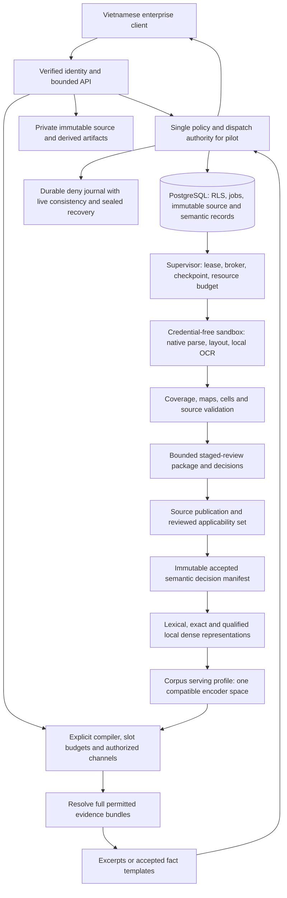

# Independent alternative and architecture selection

Date: 2026-11-16. These are design alternatives, not approved implementation changes. The comparison assumes Vietnamese/English, confidential documents, a small team, CPU-first operation, no external enterprise inference, and preservation of the existing administrative application's shared data/localStorage behavior.

## Start from requirements, not the selected libraries

The hard requirements are trustworthy current source access, safe upload/processing, complete-enough document fidelity, explainable evidence, controlled review/corrections, and recoverable revocation/deletion. None requires RRF, a VLM, global entity resolution, or a general generator. Semantic VI/EN retrieval is a valuable pilot capability, but its quality must be demonstrated independently of the document vault.

Three independent decisions follow:

1. Originals and immutable source evidence are the durable authority; lexical/dense/semantic projections are replaceable.
2. Source publication, legal applicability, semantic acceptance and corpus retrieval serving are different state machines. A single document pointer should not silently act as all four.
3. Policy, journal visibility and actual content egress must share an explicit failure model. More replicas are not an automatic availability improvement when they break revocation semantics.

## A. Existing proposed architecture, unchanged

The revision-2 design uses isolated Python API/worker/sandbox, PostgreSQL RLS/jobs/FTS/pgvector, immutable artifacts, local E5 hybrid with RRF, accepted facts/entities, review, release manifests and a DB advisory-lock response barrier. Generative answers and fine-grained sanitized audiences are off. This is a credible base stack, but HR01/HR02/HR04/HR06 leave workflow and identity incompatibilities; HR03/HR05 leave security failure semantics incomplete.

The original revision-1 plan is not separately scored as a live alternative because revision 2 explicitly supersedes it. Its lighter five-week schedule and single-generation pointers cannot be assumed to remain requirements.

## B. Independent reference-first document vault

Use one isolated document application per approved enterprise trust boundary, with PostgreSQL, encrypted private artifact storage, durable SQL jobs and one sandbox worker. Distinct legal tenants can have separate databases and keys if their administrative trust differs; departments within one organization can use one tenant and server-side ABAC.

Initial capability is bounded upload, staged source review, independently published immutable source documents, explicit relationships, structured exact identifiers, FTS and source navigation. Ordinary users receive excerpts; money/date templates require reviewed facts. Rich neural NER, cross-document entity profiles, dense search and rerankers are optional projections added only when a measured task requires them. There is no launch promise of semantic cross-language quality before an encoder qualifies.

Amendments/appendices remain separate active source documents. A reviewed contract-family/applicability manifest references them, records effective intervals and states unresolved precedence. It never creates a synthetic consolidated original. Reviewer access is a distinct bounded capability; ordinary reader predicates stay publication-only.

For a single-host pilot, all policy mutations, publication commands and content dispatch pass through one explicit singleton authority in the application. It owns live deny-journal state and serializes mutation/dispatch locally in addition to DB transactions. Worker roles can stage but cannot independently publish or change rights. Restart stays closed until journal/current identity/key state reconcile. HA and multiple content-egress processes are deliberately unsupported until a fenced multi-process protocol exists. This is a proposed correction that must be validated, not a claim that a local mutex alone solves every fault.

Advantages: smallest serving model footprint and fewer derived lifecycle paths, clear source/review semantics, easier operator reasoning. Weaknesses: weaker semantic/cross-language recall until dense retrieval is added; more reviewer work and poorer free-text discovery. It cannot meet the full bilingual semantic pilot merely by relabeling FTS as semantic.

## C. Recommended hybrid: preserve the stack, repair the state boundaries

Keep A's useful canonical fidelity, local selective OCR/layout, parent/child/table projections, typed exact facts and measured E5 hybrid path. Take B's explicit review/applicability boundaries and a deliberately constrained policy/dispatch authority. Add corpus serving and semantic manifests before durable schema freeze. This is a targeted repair, not a new microservice fleet.

The existing Node business workspace stays outside this diagram. No business dual writes, imported-workbook corpus, external AI transport or production SAP integration is introduced.

### Required state boundaries

| Proposed contract | Meaning and constraints |
| --- | --- |
| `ReviewPackage` | Exact tenant/document/version/extraction, bounded safe source/candidates, current reviewer entitlement, review revision and scan/preview status. Cannot become an ordinary retrieval source before publication. |
| `SourceRelease` | One immutable source/extraction/rendition publication and its provenance. Replacing a consolidated source differs from adding an amendment/appendix. |
| `ApplicabilitySet` | Reviewed collection of independently published source members and clause/obligation-scope relationships; valid time and unresolved precedence explicit. Current answers require all their supporting permissions. No legal precedence inferred automatically. |
| `SemanticManifest` | Exact accepted facts, scopes, relation/link/review decisions and dependencies. A correction produces a new manifest or monotonic semantic epoch; affected answers/filters revalidate before dispatch. |
| `ServingProfile` | Compatible query encoder, representation/model/tokenizer/chunker/compiler/fusion/packing identities and complete eligible-member mapping. Shadow indexes are not automatically serving. ACLs remain live. |
| `DispatchPermit` / authority contract | Defines policy epoch, deny visibility, not-after time, evidence/semantic dependencies, completion/abort and uncertain-permit handling. For a single-process pilot, every mutator and egress path uses the singleton authority. No multi-replica strictness claim follows from DB locks alone. |

These are proposed interface names, not generated schemas. P00 must decide exact shapes and transaction rules. A simpler amendment-as-separate-document rule is acceptable if it meets the promised current-obligation workflows. The costly mistake is silently treating an incremental amendment as a full replacement.

### Model migration without silent mixed spaces

Keep serving profile A active while building B against a recorded corpus snapshot. Reconcile content publications/deletes/corrections that occur during the build; completeness is against the cutover's eligible membership, not the initial snapshot alone. Validate same-source maps, accepted semantic manifest, exact lookup parity and qualified retrieval quality. Switch the serving-profile pointer in a bounded transaction under the selected policy protocol. In-flight A queries retain the A encoder/profile until completion or expiry; access checks remain current. Rollback requires the old complete profile and current tombstones/rights, never restored deleted membership.

Representations may need membership outside today's single release-member generation pointer, or a coordinated all-member release switch. Choose one explicit schema; do not write both interpretations into different modules. If dual encoders/indexes cannot fit the host, schedule a labeled lexical-only maintenance migration rather than assuming free overlap.

## Comparison against ten criteria

Qualitative assessments are architectural reasoning, not measured scores or benchmarks.

| Criterion | A: proposed unchanged | B: reference-first vault | C: corrected hybrid |
| --- | --- | --- | --- |
| Correctness | Rich evidence, but review/current amendment/fact snapshots incomplete. | Narrower behavior and explicit source/applicability semantics; less semantic discovery. | Rich evidence with explicit review, applicability and semantic state; strongest defensible design after corrections. |
| Security | Strong intended controls; transport/journal failure model incomplete. | Simpler derived surface, separate review; singleton envelope limits scaling and still needs fault proof. | Same minimized authority plus A's RLS/sandbox/dependency controls; HA remains separately gated. |
| Retrieval quality | Potentially useful E5/FTS/exact/RRF; unmeasured and compiler/budget gaps. | Exact/FTS useful for identifiers and literals; semantic/cross-language weakness acknowledged. | Same measured hybrid candidates, explicit compiler/slot allocation/bundle gates; no invented performance gain. |
| Document fidelity | Good canonical/source/table contracts. | Same immutable originals/maps, narrower automatic enrichment. | Preserve A's fidelity and add canonical character/retention compatibility. |
| VI/EN support | Local multilingual candidates and bilingual review; actual quality unknown. | Native/OCR/text in both; cross-language search not promised initially. | Qualify actual VI/EN/cross-language profile before full pilot; raw/exact slice can proceed sooner. |
| CPU/RAM efficiency | Many planned enrichments plus OCR/E5 compete; exact scope cost unknown. | Lowest model serving footprint; review labor replaces some compute. | Use only qualified models, streaming pages and bounded jobs; dual-index/encoder migration explicitly reserved. |
| Maintainability | Many modules, useful adapters; hidden shared state interpretations cause churn. | Fewer active models/projections, explicit domain state; less feature richness. | More explicit contracts, same basic services; slightly higher early design cost reduces cross-module ambiguity. |
| Implementation complexity | Full feature set with unresolved integration work deferred into coding. | Smallest first slice; cannot satisfy full semantic scope without later additions. | Moderate targeted schema/policy changes before integration; not a general redesign. |
| Expected rework risk | L–XL for HR01/HR02/HR04/HR06 once persisted. | Low for narrow source search, medium when adding semantic/entity features. | Lowest for approved full scope if proposed boundaries and fault contracts are validated early. |
| Long-term operations cost | DB/store/worker plus models/reviews; real cost unmeasured. | Lower compute/upgrade burden, potentially higher manual discovery/review cost. | Similar core infrastructure to A, explicit operator/runbook state; no new search cluster/GPU by default. |

## Selection and migration justification

Select **C, the corrected hybrid**, subject to approval of the concrete contract changes and validation gates. A wholesale switch to a separate vector database, agent framework or VLM-first stack is unjustified. B is preferable only if product accepts a narrower exact/lexical pilot and explicitly postpones semantic discovery. A unchanged is not preferable because its contract counterexamples are independent of model quality.

No enterprise corpus has yet been implemented, so the migration cost now is chiefly P00 contract/schema design and focused fault spikes. After implementation, the same changes affect stored release identity, RLS paths, index serving, facts, citations and recovery. That difference justifies targeted changes now. Preserve existing Node code and all original architecture documents; adoption requires a separately authorized implementation task.
