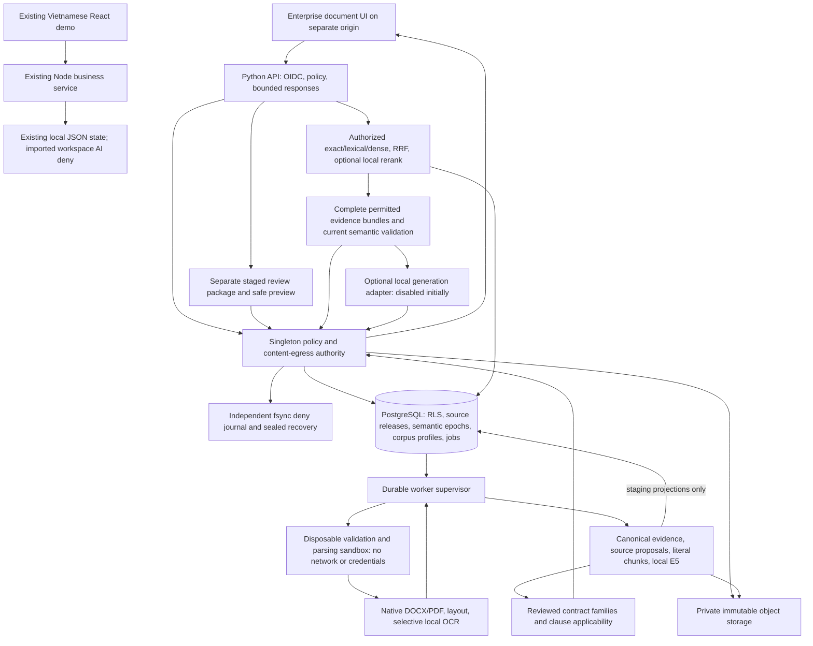

# Final implementation specification — Enterprise RAG

**Authoritative consolidated blueprint. Contract 2.2.0. Consolidated 2026-11-16. Design status: staged implementation CONDITIONAL GO; production NO-GO.**

This document is the sole implementation authority for the proposed enterprise document service. It consolidates the original plans, the HR01–HR14 reconciliation, RR01–RR05 corrections, and the latest independent hostile review. The contracts are specified behavior, not implemented controls or measured results. This documentation task authorizes no production coding, data import, deployment, dependency installation, external inference, or new audience for existing records.

A fresh implementation session should use this document and [IMPLEMENTATION_README.md](IMPLEMENTATION_README.md). Historical references below provide rationale and audit evidence; implementing the baseline does not require choosing among historical alternatives. Missing organizational decisions remain explicit gates. Missing runtime evidence is produced by the implementation phase that owns the control.

## Navigation

1. [Authority, scope, and corrected decisions](#authority-and-scope)
2. [System architecture and deployment](#system-architecture)
3. [End-to-end ingestion and retrieval execution](#pipeline-execution)
4. [Complete C01–C16 data, API, and lifecycle contracts](#data-contracts)
5. [S01–S09 security and dispatch contracts](#security-contracts)
6. [Algorithm defaults and optional features](#algorithm-contracts)
7. [I01–I27 exact invariants](#exact-invariants)
8. [Modules, migrations, phases, and rollback](#implementation-contracts)
9. [Evaluation, E01–E17, and reporting](#evaluation-contracts)
10. [T01–T14 and security acceptance](#acceptance-matrix)
11. [Failure and race walkthroughs](#failure-contracts)
12. [A01–A11 approvals and bounded open work](#approvals)
13. [Corrected synthetic examples](#corrected-examples)
14. [Decision traceability](#decision-traceability)
15. [Source inventory](#source-inventory)
16. [Completeness and staged GO/NO-GO](#completeness-assessment)

<a id="authority-and-scope"></a>

## Authority and scope

**MUST** means mandatory for the enabled consumer; **SHOULD** means an explicitly recommended implementation practice; **optional/experimental** means disabled until its own approval and promotion evidence; **deferred/rejected for launch** means it is outside the baseline. A proposed numerical default is implementable in synthetic experiments but is not an owner-ratified service promise. No historical statement that a library supports Vietnamese establishes this system's quality.

Precedence used in consolidation:

1. The current user instructions and [AGENTS.md](../AGENTS.md) bind data handling and authorized work.
2. The [final hostile review of 2.2.0](2/review/final-review.md) supplies FR01 and the final clarity/integration corrections. It finds RR01–RR05 design-resolved, with approvals and runtime gates pending.
3. [Final corrections](2/reconciliation/final-corrections.md), the 2.2.0 substantive contracts, invariants, and decision packet supply the accepted technical repairs.
4. The 2.1 re-review and original hostile reports supply counterexamples and test obligations, not competing runtime protocols.
5. Revision-1 plans, schemas, examples, estimates, source registers, and prompts are history. Their compatible provenance, fidelity, and local-processing requirements are retained here; their old APIs, IDs, state machines, and readiness claims are superseded.

No organizational approval is recorded. “Accepted correction” means accepted technical disposition, not owner acceptance of an audience, topology, availability risk, retention schedule, or production system. A rejection of A01/A02a/A03/A09 reopens the affected boundary; there is no automatic fallback to another historical alternative.

### Binding project boundaries

- Preserve the four administrative modules' shared business data and existing offline localStorage behavior. The existing Node service stays the sole online business-state writer. The new document service has a separate authority and persistence.
- All fixtures, demos, automated tests, traces, examples, and shared reports use synthetic data. Real uniform/locker workbook records remain in their explicitly authorized local workspace, outside source, fixtures, bundles, this corpus, public reports, and external APIs. Do not inspect/copy/reset that workspace as part of RAG setup.
- Keep its sticky OpenRouter deny across reset/import/clone/migration. The limited existing Phase 6.2 server-side permission for authorized synthetic OpenRouter data does not authorize any enterprise document inference. The enterprise service has no provider credential or transport route. No other external LLM API and no real SAP API.
- Enterprise extraction, OCR, embeddings, translation, reranking, rewriting, optional VLM/generation, and evaluation remain local inside approved boundaries, for every label. Masking and a public label do not grant egress.
- The enterprise UI and errors are Vietnamese; every visible control must have an implemented action/status/error flow. Confidential enterprise content, credentials, and response caches never persist in browser localStorage or service-worker/offline caches.
- Business logic, authorization, lifecycle transitions, query budgets, and baseline answer templates are deterministic. Mock RBAC provides no real security assurance.

### Consolidated repairs and rejected interpretations

| Decision | Mandatory final interpretation | Superseded interpretation |
| --- | --- | --- |
| HR01 | Exact safe staged review packages and separate reviewer role/predicate; search stays publication-only | Widening ordinary evidence reads to unpublished rows |
| HR02 / RR02 | Originals/amendments/appendices are independent instruments; accepted applicability binds the complete registered membership revision/hash | Latest-upload legal precedence; an amendment replaces the whole original; omitted new M2 leaves S1 current |
| HR03 / RR05 | Singleton policy writer/content egress, local gate through actual bounded synchronous enqueue; expiry at final gated admission with stated suspension limitation | SQL advisory lock alone fences HTTP; zero wall-time expiry lateness; global recall or HA guarantee |
| HR04 / RR05 | One complete corpus profile and compatible query space; prewarm outside gate, short guarded CAS | Per-document encoder switching; dimension equality proves compatibility; partial B is complete |
| HR05 / RR03 | Independent live fsynced deny journal, typed record identities, SQL immutable operation outcomes, sealed uncertainty/recovery | SQL rollback clears deny; unique operation means only one ledger record; HTTP expiry repeats a mutation |
| HR06 / RR01 | Separate published semantic-review route, append-only semantic decisions/epoch, current projections, stale-buffer discard; literal-only sketches | Published retraction requires an expired staged package; accepted alias remains static vector truth |
| HR07–HR09 | Prehash Unicode domain, deterministic fair candidate allocation and explicit safe VI/EN content-OR compiler | NFC alone admits SQL text; unnamed context-token units; all-question FTS AND |
| HR10 / RR04 | Separate artifact processing/GC states; dependency roots and exact tombstone/retention claims | TTL overrides active evidence; purger has arbitrary paths or tombstone-only cleanup for live-document old R1 |
| HR11–HR14 | Streaming/charged budgets and fairness, measured RLS/churn, OR-of-AND gold with coverage floors, measured review circuit | Long scans automatically complete; all-abstain passes; humans have unlimited infallible capacity |

FR01 is corrected in the maintained example in this document: decoded `If-Match` includes the quotation characters, and `Idempotency-Key` is a UUID. Historical fixtures are preserved as audit inputs and must not be copied as conforming requests. “Extraction-byte corrections” require new extraction/package; semantic corrections do not. A09/A05 **must explicitly accept** the slower recovery envelope; they have not accepted it. Mandatory internal family invalidation on authorized deletion is specified below, independently of authority to approve replacement legal trust.

Trace: [final hostile review](2/review/final-review.md), [dispositions](2/reconciliation/finding-disposition.md), [changelog](2/reconciliation/architecture-changelog.md).

<a id="system-architecture"></a>

## System architecture

The mandatory baseline is a separate Python enterprise document context, an isolated worker supervisor and disposable parser boundary, one PostgreSQL primary with RLS/FTS/pgvector, private immutable artifacts, a singleton mutation/egress authority, and its independent journal. PostgreSQL jobs replace an external broker. No Kafka, consensus cluster, dedicated vector database, general agent framework, GPU fleet, or additional external model is selected.

Current repository behavior is a Node/React prototype; prior demo tests do not establish a Python enterprise service, trusted identity, database isolation, source fidelity, or model readiness. Preserve that separation in code, acceptance reports, and UI claims.

### Components and topology



D: pilot topology is one policy/egress API process on one approved host, one SQL primary, separate durable worker/sandbox, no automatic failover or rolling API overlap (S05/C16). Worker cannot commit policy or publication; everything visible crosses the authority gate. A second content reader must fail startup.

D: `services/enterprise-rag/` is the future document application root; Python 3.12/FastAPI/Pydantic v2/SQLAlchemy/Alembic/psycopg; PostgreSQL 18 and pgvector 0.8.x compatibility baseline, exact active package/model patch/digests frozen through P00 before use. No orchestration framework is required. React components may be reused, but the enterprise entry point has a separate origin, session, cache namespace and no imported-workbook route. If deployment later uses one public origin, reverse proxy only `/api/enterprise-rag/v2/*` to this API; it verifies OIDC independently and rejects browser-supplied identity headers. The Node demo does not impersonate enterprise users. Start with a new synthetic corpus; a one-way legacy synthetic importer is an optional separately scoped branch, not a prerequisite. No live dual writes or business-state replication.

D: initial dependency set = pypdfium2 for probe/render, pdfplumber for digital geometry fallback, Docling standard layout for complex PDF, python-docx plus explicit safe OOXML parser, Tesseract `vie+eng`, local E5-small, PostgreSQL FTS `simple`, exact identifier/accepted-cell search, exact dense vectors, RRF. Preserve parser-native JSON alongside the application-owned graph. Use a mature Draft 2020-12 validator in implementation; this task does not replace that with a homemade validator.

D: implement the reranking interface and plan an early bounded local cross-encoder comparison; baseline production profile is `reranker=none`. Promote BGE-reranker-v2-m3 only if E04 quality and CPU gates pass. Missing challenger assets/results block that promotion, not baseline coding or a baseline release that meets its own quality/security gates. BGE-M3 dense, neural sparse and multivector representations are similarly evaluated early when baseline misses identify their value; schemas support channel-specific immutable representations from the start.

### Capacity and operating assumptions

H: pilot target 1,000 documents / 10,000 pages / about 80,000 child chunks; 100 documents/day at ten pages/document, ten simultaneous searches, 50 logged-in users. At that assumed daily growth, a year adds roughly 2.92 million chunks. A 384-dimensional float32 vector alone takes 1,536 bytes: 80,000 vectors take about 117 MiB, one million about 1.43 GiB, excluding row/index/text/WAL/backup overhead. Do not confuse model weight size with peak RSS.

D: start one parser at 4 CPU/8 GiB max, E5 inference 2 threads/2 GiB budget, DB 8 GiB allocation including shared buffers and bounded query work; API/supervisor/OS/reserve consume remaining 14 GiB on an 8-vCPU/32-GiB approved host. Caps include child processes; actual RSS is measured. Avoid sum-of-per-query `work_mem` exhaustion. Search prioritization throttles parser CPU. Local reranker/BGE experiments evict other model processes and run serially under the same total memory limit.

D: trigger capacity review at 100,000 authorized chunks per broad query, 70% sustained host memory, disk 70%, search p95 >2 s or queue age >30 min. First measure/tune indexes and admission. Then add a worker VM or approved tenant partitions/HNSW only after filtered recall/isolation experiments. Exact baseline remains the correctness oracle. Storage sizing measures actual rasters/raw JSON and 35-day backup growth; page counts alone are insufficient.

### Independent authorities and commit boundaries

| State | Authoritative representation | Required serialization / invalidation |
| --- | --- | --- |
| Original source | Durable immutable bytes/hash and registered source version | Storage finalize/verify before SQL registration; no distributed object/SQL transaction assumed |
| Accepted extraction | Immutable canonical JSON/hash, coverage, physical maps; atomically imported SQL projections | Prehash validation; text changes create new extraction identity |
| Publication | Immutable source release and current instrument pointer | Singleton gate, head locks, expected revisions/fence, complete representations, roots, commit/checkpoint |
| Legal currentness | Complete membership head + reviewer-approved applicability manifest + live acceptance | Membership changes invalidate/replace set in same transaction, even without an old dependency edge |
| Semantic trust | Append-only events, monotonic epoch and acceptance intervals | Synchronous projection/dependency invalidation; current epoch at response release |
| Retrieval representation | Complete corpus revision and one serving profile/space | Exact eligible membership equality; atomic head CAS; source identity remains independent |
| Access | Current server identity/grants/labels/purpose + live journal deny | RLS plus service overlay before candidate content and again at resolver/model/dispatch; local gate orders Ack |
| Work | SQL stage key, DB-time lease/fence, verified immutable attempt/checkpoint | Worker stages only; expired worker cannot adopt/publish, including before reclaim |
| Destruction | Durable deny/tombstone + dependency/hold/records roots + GC claim | Exact storage-version claims, physical absence receipts, no purging-to-live |

All visible mutations use the lock order **singleton gate → tenant serving/semantic/lifecycle heads → families by UUID → documents by UUID → job/target rows**. Workers never call the authority while holding SQL locks. Long extraction, model loading/prewarm, index builds, and physical deletion run outside the gate. Outbox notifications do not supply live deny or semantic safety.

<a id="pipeline-execution"></a>

## End-to-end execution

### Ingestion and review

1. **Admit and register.** Verify server identity/upload capability and intake/review/disk quotas. Stream at most 50 MiB into opaque private quarantine, compute hash, finalize and verify storage. Commit source/version/job/idempotency/outbox together; acknowledge only after durable registration. Original filename is protected display metadata, never a path. Identical bytes do not merge logical documents, grants, or retention. A failed SQL registration leaves private staging for fenced orphan reconciliation.
2. **Validate in isolation.** Sniff content and enforce PDF/OOXML structural allowlists, expansion/page limits, active-content and encryption rejection, then completed clean malware scan with accepted policy/signature freshness. Scanner timeout, limit, stale definitions, or unavailability holds intake. Parser/model runtime has no network/DNS/secrets. The trusted broker validates all emitted paths/ownership/manifests/hashes/cardinalities; scan success does not make bytes or parser output trusted.
3. **Inventory and route.** Account for every required PDF page/text-like region or DOCX content part. Native PDF glyph geometry is compared with visible rendering; metadata cannot prove an original Word source. Use clipped image-union coverage and region-level native/OCR/hybrid/blank/unresolved routing. Clean text elsewhere must not hide a scanned clause or appendix on the same page. Router thresholds are versioned hypotheses, not factual confidence or handling authority.
4. **Extract with physical provenance.** Native pypdfium2/pdfplumber for straightforward PDF, Docling for complex layout/table regions, selective Tesseract `vie+eng` for scans. Preserve candidate alternatives and exact crop/rotation/deskew transforms. DOCX uses python-docx plus bounded OOXML traversal of body, lists, numbering, headers/footers, textboxes, notes, nested tables, images, comments and revisions. Current-visible body is current evidence; deleted revisions remain separate annotations. Unsupported required parts block automatic publication. A rendered DOCX page is only a labeled derivative.
5. **Checkpoint bounded work.** Render/process one page/region plus bounded transform scratch, upload/verify/checkpoint, release scratch/resources, yield each page or 120 seconds. Precharge the cumulative 2,700-second budget across all attempts/alternates; no retry resets it. Max four execution failures. Low quality gets one alternate conventional pass then review, never string averaging or guessed digit correction. Long 200/300-page documents are bounded processing/review intake until qualified for automatic completion.
6. **Accept canonical evidence.** Validate unicode-pg-v1 before RFC8785/hash/import; retain raw diagnostics. Validate coverage, graph acyclicity, exact source intervals/transforms, table occupancy/header/continuation and manifests. Required unsupported/unresolved coverage blocks publication unless an authorized explicit waiver is allowed; it cannot manufacture an accepted unreadable number. Partial publication has no launch contract. Freeze accepted bytes/maps; SQL is their verified projection.
7. **Classify and enrich.** Type rules route optional contract enrichment; sensitivity follows trusted labels/business authority with unknown effectively restricted, machine escalation only. Preserve claimed/proposed/approved/effective values and separate quality/type/sensitivity status. Bilingual patterns/dictionaries/NER create PII and entity mentions; no detection result grants disclosure. Normalize issuer-scoped IDs, dates/Decimal/currency with exact maps; unknown/ambiguous stays null. Names alone never merge people. Optional enrichment failure can leave general source search usable, with no accepted facts from the failed branch.
8. **Review exact subjects.** Before publication, separately provisioned reviewers inspect only a current C11 package bound to exact source/candidates/scan/safe preview/revision. Uploader visibility does not grant inspection. Canonical-backed staged semantics need both staged and semantic authority; preliminary raw candidates cannot create accepted fact trust. After publication, use the distinct `/published-reviews` exact-source route with current review plus all-source read/history capability. Semantic correction appends observations/events; only extraction-byte correction creates a new extraction/package.
9. **Build representations.** Raw document-level rendition only initially. Build source-mapped hierarchy/clause/table children, literal context and literal sketches; accepted aliases stay in the live semantic exact channel. Lexical-only chunking requires no model. Hybrid uses actual pinned E5 tokenizer/counts/finite normalized vectors and exact input/space identity. Staging is invisible. A generation cannot mix extraction or embedding spaces; independent representation manifests permit later qualified channels.
10. **Publish atomically.** Only the singleton can adopt a complete source release, update the full current corpus membership, invalidate/rebind affected family sets, and commit roots/epochs/audit/outbox/outcome. Validate DB-time fence and expected source/policy/semantic/profile heads. A new publication supplies the currently serving space, even while shadow B catches up. A late worker, denied source, failed replacement, missing blob, or incomplete manifest cannot replace an allowed current release. Fsync its authority checkpoint before a successful visible-mutation acknowledgement.

### Retrieval, evidence, and response

1. Verify current identity/session/tenant/purpose and bounded query/filters. Resolve the immutable serving profile and pin the complete response snapshot, source/semantic/family heads and conservative expiry. The caller cannot choose tenant, encoder, system prompt, SQL or parser/model endpoint. No cross-tenant aggregate is supported.
2. Resolve an indexed **request-transaction-local** authorized eligible-source relation under actual RLS; subtract the current independent journal-deny set before selecting candidate text/values. Plan at most three deterministic slots with the same scope/time/filters. Retain identifiers, negation and conditions; ambiguous identity or excess required slots requests clarification/partial.
3. Per slot, run accepted exact identifier/fact tier ≤20, vi-en-or-v1 lexical ≤40, and compatible dense ≤40. Lexical-only is an honest initial profile; an encoder failure degrades across the entire eligible corpus with an explicit lexical label. No fixed cosine cutoff, global denied top-k followed by filtering, cross-space score, or fabricated embedding.
4. Merge variants within a channel, one vote/chunk/channel; fuse with RRF60 per slot. Admit ≤120 unique IDs fairly round-robin across slot ordinals, preserving every shared slot membership; one slot has ≤100 candidates. Deterministically deduplicate overlapping same-source coverage while preserving distinct clauses/cells/conflicts/qualifiers. Optional reranker can reorder authorized admitted IDs only; it cannot repair a dropped candidate or grant rights.
5. Resolve/recheck each source, header, unit, footnote, parent, decision and cross-document dependency. Pack complete permitted AND bundles, OR across alternatives, within ≤10 seeds/two-per-parent (third only for required-slot completion), parent 900/total 2,400 unicode-scalar-v1 packing tokens including metadata. Top_k displays hits independently. An oversized required qualifier yields partial/insufficient, not a cut obligation.
6. EvidenceGate verifies slot coverage, exact current typed facts, units/currency/party/conditions, conflicts and applicability. Complete current legal answers additionally require the selected set pointer and exact current full membership revision/hash plus every source/decision permission, including exclusions. Pending/conflicting/inaccessible members cannot produce a complete legal claim; generic insufficient exposes no hidden names/counts. Independently authorized quotations remain references with unknown applicability.
7. Generate Vietnamese excerpts or deterministic fact templates with backend-resolved evidence IDs/hash/span/cell and accepted fact IDs; legal claims carry set/effect/decision refs. No free synthesis or calibrated probability is enabled. Relevant text and a resolvable locator alone do not prove claim support. Missing due-condition/unknown total cannot be filled from another scope or installment.
8. Buffer the response. Under the singleton gate, use fresh current SQL identity/auth/source/semantic/profile/dependency/family checks plus live deny/readiness/incarnation and expiry, then actual synchronous non-yielding bounded enqueue. SQL/commit/journal/send uncertainty seals. No stale reusable permit, deferred callback, or token streaming. Prior enqueued bytes may arrive after Ack. Original downloads use separate capability and fresh bounded blocks.
9. Maintain only content-free allowlisted events/audit/metrics; no sensitive localStorage, query/prompt/content logs, or initial answer cache. Reauthorize every evidence/preview/citation/replay. Root retained citations and active semantics until explicit expiration/withdrawal; use tombstone/GC/recovery contracts for lifecycle.

Pipeline traces: [original fidelity requirements](1/03-processing-pipeline.md), [accepted algorithm decisions](2/rag-algorithm-decisions.md), and the C/S/W contracts reproduced below. The original one-pointer publication, broad original access, per-job retry budget, and pre-send-epoch-only language are superseded by these contracts.

<a id="data-contracts"></a>

## Complete data, API, and lifecycle contracts

The following C01–C16 definitions are normative in this specification. Shared nouns and exact enums are retained to make existing decision/test IDs usable. These are implementation targets; P00 must materialize maintained schemas/OpenAPI/DDL and their negative/round-trip tests. Historical schema 1.0.0 is not a validator for them. Normative source: [2.2.0 contracts C01–C16](2/rag-data-contracts.md), with the final-review corrections explicitly integrated here.

## C01 Common types and invariants

`Id=uuid`; `Hash=64 lowercase hex`; `Instant=RFC3339 UTC`; `LocalDate=YYYY-MM-DD`; `Decimal=string matching -?(0|[1-9][0-9]*)(\.[0-9]+)?`, range compatible with numeric(38,10); `Epoch=nonnegative bigint`, serialized as a decimal string in JSON to avoid JavaScript precision loss. `schema_version` is exactly `2.2.0` in initial canonical contracts. ISO currency is a validated 3-letter code; units use a controlled vocabulary plus literal source string. Unknown precision/currency/date is null, never a guessed default. Evidence/PII text is NFC in the C04 supported scalar domain; original bytes and raw extraction remain immutable. Invalid raw code units stay in protected binary diagnostic artifacts, never SQL text/JSONB.

Global invariants:

1. Tenant IDs are never supplied as authority by the caller. Every tenant-owned FK includes tenant ID; version/rendition/extraction FKs also include their ownership ancestors where needed.
2. Logical document IDs survive replacements. Source versions, extraction revisions, renditions, generations and releases are immutable identities. Facts and citations name all relevant identities.
3. No published content exists without accepted coverage, policy authorization, required artifacts, resolvable source evidence and a complete release manifest.
4. Derived text/fields/vectors/entities/relations inherit the conjunction of supporting scopes. A grant on an entity/summary cannot grant access to its sources.
5. Ranks, cosine, logits, engine scores, probabilities and human approvals are distinct types. Unknown score/calibration is null.
6. All text spans are zero-based half-open Unicode code-point intervals within a named immutable element text. API clients convert to UTF-16 for JavaScript; never reinterpret integers silently.
7. At most one active source release per logical document/instrument. Independent original/amendment/appendix instruments have separate documents in a contract family (C12); current applicability composes their releases, never an upload ordinal. All ordinary retrieval requires published source evidence; staged review is a separate authority (C11); published semantic review has its own mutation capability and uses ordinary source-read policy, never a staged package. Historical access is explicit.
8. No plaintext content, source filename, query, entity values, embeddings or model prompts in ordinary logs/metrics/audit. IDs and keyed private digest references can still be sensitive.
9. Deletion/revocation takes precedence over all worker checkpoints, parent expansions, citation access and release publication.
10. Schema-valid does not mean semantically correct, malware-free, PII-free or legally executed. Semantic/security checks remain separate.

## C02 Document identity and publication

Ownership chain:

`tenant → document → source_version → extraction_revision → rendition → index_generation`; a `release` selects **one source version and extraction revision** and maps each included rendition to a complete generation bundle. Release members record the complete initial generation as provenance; serving selects a complete generation through the corpus profile mapping (C13), rather than treating that initial pointer as the only possible model representation. Each bundle declares `profile=lexical-v2|hybrid-v2`: lexical-v2 requires complete chunks/lexical/source maps and has no dense-space requirement; hybrid-v2 additionally requires a complete dense embedding space. The early synthetic vertical slice may publish lexical-v2 honestly. The full bilingual pilot requires hybrid-v2 gates; it cannot call lexical-only completion semantic success. Query-time encoder failure on a valid hybrid generation may return labeled lexical degradation. Optional sparse/multivector representations have separate readiness and manifests. A generation cannot mix extraction revisions or incompatible embedding spaces. A release can publish raw now and an independently approved sanitized rendition later, in one pointer switch; adding a rendition creates a new immutable release.

`authority_revision` advances in SQL for every authority-controlled visible mutation (including review/assignment/decision/package and head changes), with its committed value fsynced into the independent C16 authority checkpoint before acknowledgement; this detects snapshot rollback even if auth/semantic/corpus heads happened not to change. `document_revision` is the optimistic metadata/publication/published-review revision; `auth_epoch` is tenant-wide and advances on any authorization-affecting change; `corpus_epoch` advances on publication/tombstone/search-eligibility changes. `semantic_epoch` advances on every accepted fact/link/relation/applicability acceptance, correction or retraction (C14); `permission_epoch` is per document for tracing/checks. `corpus_revision` (tenant-local nonnegative bigint serialized as Epoch) identifies a complete immutable serving membership revision (C13), distinct from `corpus_epoch`, which is a broad audit/churn counter. Each lives in transactional SQL, not only a token or cache. Membership, clearance, department and purpose changes advance tenant auth epoch. Clock-driven expiration is also checked at query/release time; no scheduler must run for expiration to take effect.

Source versions are revisions of **the same instrument**, with fields `ordinal, source_sha256, source_artifact_id, created_at, asserted valid_from/valid_to, valid_time_basis=unknown|source|reviewed, recorded_at, supersedes_version_id|null`. A document has `instrument_kind=general|original|amendment|appendix|replacement` and optional reviewed family membership. Incremental amendments and separate appendices MUST be new documents, never replacement versions. `/documents/{id}/versions` rejects a declared instrument-kind change or nonconsolidated amendment with 422 `INSTRUMENT_REQUIRES_NEW_DOCUMENT`; uncertain consolidation enters review and cannot replace the source. `ordinal` is ingestion order only. Former `relation=amendment|appendix` source versions require a reviewed split/mapping, not an automatic converter. Full replacement legal effect is also a C12 decision, not implied by the source pointer.

Publication transaction is issued only by the singleton authority (S05); workers can propose, never independently publish. Under its gate, lock tenant serving/semantic/lifecycle heads, affected families then documents in UUID order, then job lease; assert nondeleted/no journal deny, expected active release/document/semantic/profile revisions, unexpired worker fence, coverage/review/policy and artifact hashes. Insert source release + members, retire previous release of **that instrument**, validate dependent applicability sets or invalidate them to `invalidated` and queue a review, update C13 complete membership, CAS pointers, advance document/corpus and relevant semantic epochs, append roots/outbox/audit; commit. Any mismatch aborts. New release requires representations for the current serving space before becoming searchable. Previous valid source remains until commit; no incomplete or mixed-space publication. A pinned old applicability set that names a now-retired release must be rebound to an accepted equivalent clause map in this transaction, or becomes invalid; it does not confer general history access. Staging/extraction/index builds do not hold the gate. A worker assigned an older ordinal cannot replace a later release without an explicit reviewed rollback command.

## C03 Canonical document and physical provenance

Canonical envelope required fields: `schema_version, tenant_id, document_id, version_id, extraction_id, producer, source_artifact_id, source_sha256, normalization, coverage, pages, elements, tables, relations, warnings, manifest_sha256`. `producer` contains adapter/package/model/tokenizer/config/build digests and run ID; unavailable model is null. `manifest_sha256` hashes the RFC 8785 canonical JSON envelope with that hash field omitted. Blob manifests and SQL projection hashes must match. Canonical JSON is the extraction authority; SQL rows are atomically imported projections.

Elements: `element_id, kind, parent_id|null, ordinal, text, raw_text_ref, text_sha256, heading_level|null, language=vi|en|mixed|unknown, source_refs[], confidence, warnings[]`. Kinds include paragraph, heading, clause, list_item, table, cell, figure, caption, footnote, signature_block, form_field, revision_annotation and unknown_region. Parent/reading-order graphs must be acyclic; each child has at most one structural parent, relation edges may be many-to-many. Document/root is a structural element, not fabricated extracted text. Element IDs are unique within extraction, stable only within that extraction; cross-revision alignment uses a separate evidence-backed relation.

Coverage inventory: each PDF physical page and detected text-bearing region or DOCX content part has `region_id, source_locator, required, state=extracted|confirmed_blank|nontext|needs_review|unsupported, candidate_ids[], decision_id|null`. Every required unit must be accepted or explicitly waived by an authorized reviewer with reason and preserved source. Waiving a critical unreadable amount cannot create an accepted numeric fact. Required unsupported/needs_review units block default publication. No invisible “partial success”; future partial publication requires separate API/product contract and is disabled initially.

PDF source refs require: version/extraction/element IDs, `medium=pdf`, one-based `physical_page`, `bbox=[x0,y0,x1,y1]`, `page_size_pt=[w,h]`, `coordinate_system=upright_cropbox_top_left_pt`, `transform_to_original_pdf`, optional `span`, `table_id/cell_ids`. Boxes must be finite, ordered and within the upright visible CropBox. `transform_to_original_pdf` is a six-number affine `[a,b,c,d,e,f]`: original PDF x=`a*x+c*y+e`, y=`b*x+d*y+f`; original frame explicitly bottom-left unrotated PDF user space. For an unrotated 612×792 page the map is `[1,0,0,-1,0,792]`. Store CropBox/MediaBox/Rotate and renderer revision. OCR raster coordinates use a separate pixel→upright-page transform and its inverse; deskew/crop/tiling must compose invertibly. Four box corners are transformed, not only two. Non-affine warps require a versioned dense map and block automated exact-region release until supported.

DOCX refs require `medium=docx`, `physical_page=null`, `bbox=null`, `part`, namespace-aware `path` by indexed expanded XML names, `paragraph_id|null`, `run_ranges[]`, `table_path|null`, and code-point span. Paths are resolved against the stored immutable OOXML package; externally supplied XPath is never evaluated. Include headers/footnotes/endnotes/textboxes/embedded-image parts explicitly. A rendered DOCX preview has `preview_artifact_id, renderer_revision, rendered_page, rendered_bbox, source_alignment_id`; it never replaces source-part provenance or pretends intrinsic DOCX pages exist.

Signature observation: `region_source_ref, adjacent_role_refs[], claimed_name_refs[], visual_mark_state=present|absent|uncertain, pdf_signature_field_ref|null, cryptographic_validation=not_performed|unknown`. No boolean `legally_signed`. Preserve original PDF bytes; optional future cryptographic validation has its own trust-chain/timestamp/revocation report and does not rewrite extraction evidence.

Table contract: `table_id, element_id, row_count, column_count, segments[], cells[], omitted_positions[], footnote_element_ids[], caption_element_ids[], continuation_decisions[]`. Cell fields: `cell_id, anchor_row, anchor_column, row_span, column_span, kind=header|data|blank, text, header_cell_ids[], source_refs[], typed_candidate_ids[]`. Anchor cell stored once; no overlapping anchored occupied positions; unoccupied positions explicitly omitted, not confused with blank. Header/footnote relations cannot cycle. Cross-page segments retain each physical locator and repeated header observations. A logical row/amount crossing pages gets a reviewed merge relation; no merge from column-count equality alone. Typed value dependencies include row label, column header, units, currency, qualifier and literal cell; arithmetic uses logical cell identity, never repeated render cells.

## C04 Normalization and offsets

Keep (a) original bytes, (b) extractor raw Unicode strings, (c) NFC canonical strings, (d) search-only folded/segmented strings, and (e) contextual/rendition projections separate. Every transform names input/output hash and revision. NFC canonicalization must not replace OCR digits or rewrite spelling. Dehyphenation/whitespace repair is a separate reviewed transform, never an invisible NFC operation.

Mapping entries are ordered interval relations `{raw:[start,end], canonical:[start,end], operation=identity|compose|expand|delete|insert|replace}` in Unicode code points; intervals may be many-to-many. Mappings cover all input/output positions and retain empty intervals for insert/delete. NFC may reorder combining marks: map an entire enclosing normalization cluster many-to-many; cluster intervals are monotone, but individual character correspondence inside a cluster need not be. Do not assert per-character monotonicity. Inverse source resolution uses the smallest enclosing contributing raw interval, not a guessed per-character function. Run/glyph/word locator maps then translate raw intervals to OOXML or page geometry. Reading-order reordering is represented by element order/relations, not a fake monotone text map.

Canonical domain `unicode-pg-v1`: UTF-8 Unicode scalar values, NFC; reject U+0000, unpaired surrogates, C0 controls except TAB/LF/CR, C1 controls U+007F–009F and Unicode noncharacters. Validate **all strings**, including JSON keys/metadata/locators, before canonical acceptance, RFC8785 hashing or SQL import. Bidi/zero-width format characters are preserved with review warnings and safe visible rendering where relevant; they are not silently erased. Invalid input yields permanent quality violation `CANONICAL_TEXT_UNSUPPORTED` and `awaiting_review`, preserving original/raw bytes; it is not a transient SQL retry. A reviewer may approve a **new** mapped extraction with U+FFFD replacement and `replace` interval operation plus reason; ambiguous critical facts remain null until independently source-confirmed. Never strip/replace after hashing. SQL database encoding MUST be UTF8. The percentage-control heuristic is routing only, never acceptance. See [PostgreSQL constraints](https://www.postgresql.org/docs/18/datatype-json.html).

Worked normalization: raw `A\u0301😀B` has four code points, canonical `Á😀B` has three, JS UTF-16 length four. Maps: raw `[0,2)`→canonical `[0,1)` compose, `[2,3)`→`[1,2)` identity, `[3,4)`→`[2,3)` identity. Canonical emoji `[1,2)` maps to JS UTF-16 `[1,3)` and original `[2,3)`. A PII annotation must use the canonical interval and resolve the full contributing raw cluster. UTF-8 bytes are yet another unit. No slicing within a surrogate pair or combining cluster when painting redaction regions.

Legacy importer: verify `section.text.slice(sourceStart,sourceEnd)` and legacy hash first; reject surrogate-interior boundaries. Convert prefix UTF-16 length to code-point positions on the exact old text, then apply raw→NFC interval map, producing a new extraction/chunk ID and `legacy_ref` observation. Legacy citation URLs remain handled by the demo; enterprise never silently retargets them. Search folding uses lowercase + diacritic removal + explicit `đ→d`, only in search projection; no folded offsets accepted as evidence.

## C05 Fields, entities and relationships

Field contract: `field_id, field_key, field_type, status=known|unknown|ambiguous|not_applicable, value, raw_literal_refs[], candidates[], evidence_ids[], validation=unreviewed|rule_accepted|human_accepted|rejected, rule_revision|null, reviewer_decision_id|null, applicability, qualifiers[]`. Persisted observation envelope adds tenant/document/version/extraction/rendition identity, `recorded_at` and `supersedes_field_id|null`; value payload examples below omit only that shared envelope. Known needs non-null typed value and nonempty exact evidence; other statuses require null value. Ambiguous candidates carry their own value/evidence. Acceptance/retraction is an immutable semantic event; observation validation records its original assessment, while current trust comes from C14 at the pinned semantic epoch. Accepted fact predicates require current acceptance + known + rule_accepted/human_accepted and a rule explicitly approved for that field/domain. A missing total must not be filled from a first installment. Date parsing locale and ambiguous day/month alternatives are recorded. Payment scope includes `party_role, obligation_kind, currency, tax_basis, installment_id, due_condition, valid_time`; conflicts compare matching scopes, not every monetary number. Recorded-time intervals derive from immutable observations and their supersession decisions, distinct from asserted valid-time; corrections never overwrite transaction history.

Strict field-value union (all object keys listed are required, with explicit null where stated): `text:{text}`; `identifier:{type,issuer,country|null,normalized,literal}`; `date:{date,calendar:"gregorian",locale,basis:"source"|"reviewed"}`; `money:{amount:Decimal,currency}`; `quantity:{amount:Decimal,unit}`; `entity:{entity_id,role,observation_ids[]}`; `obligation:{debtor_entity_id|null,creditor_entity_id|null,action_text,amount_field_id|null,due_date_field_id|null,due_condition_text|null,condition_evidence_ids[],exception_evidence_ids[]}`; `clause:{clause_element_id,clause_kind,qualifier_element_ids[]}`; `reference:{target_kind:"element"|"table"|"version",target_id,relation_id}`. Multi-value fields are arrays of independently status/evidence-bearing Field records, never one ungrounded free array. Candidate shape is `{value:<same union>,evidence_ids[],confidence,reason_code}`. `applicability` is `{status:"unknown"|"accepted"|"conflicting",valid_from:LocalDate|null,valid_to:LocalDate|null}`; only when status=accepted do null bounds mean explicitly reviewed unbounded applicability, otherwise null means unknown. Qualifier entries are `{kind,element_id,evidence_ids[]}`. Date/amount keys cannot masquerade as text to bypass typed checks.

Mentions: `mention_id, extraction_id, rendition_id, element_id, canonical_span, entity_type, detector_manifest_id, confidence, normalized_candidates[], source_refs[]`. Entity types include PERSON, ORGANIZATION, ADDRESS, PHONE, EMAIL, NATIONAL_ID, EMPLOYEE_ID, PATIENT_ID, BANK_ACCOUNT, CONTRACT_ID and CUSTOM_SECRET. A mention is an observation, not proof that a national identifier is valid or a legal party is identical.

Normalization profile per type: phone E.164 only if country known; email domain case/IDNA normalization with original local-part preserved; contract/employee IDs preserve issuer-specific punctuation/leading zeros unless explicitly approved profile says otherwise; dates have locale/basis; money Decimal + currency; Vietnamese party/person names NFC and whitespace-normalized, accents retained. Search aliases may fold accents but cannot become equality authority. Each normalization has version and source-span interval mapping, including tokens inserted by word segmentation; protected original values stay in private artifacts.

Entity registry: opaque tenant-scoped `entity_id, entity_type, created_at, state`. `entity_observations` bind entity to mention/accepted identifier or reviewed alias. Identifier key is keyed tenant-scoped digest of `(type,issuer,country,normalization_revision,value)` and is not a public API field. Automatic person/party linkage requires same validated issuer-scoped identifier and no conflicting type/identity; name similarity creates `proposed` link only. Link decisions record left/right observations, method, confidence type, reviewer/reason and superseded decision. Undo links never mutates historical mentions. Rebuild affected entity projections through dependencies. No name-only automatic merge, no cross-tenant entity IDs and no count of inaccessible aliases.

Relation: `relation_id, subject_ref, predicate, object_ref, status, evidence_ids[], dependencies[], valid_time, extractor_manifest_id, decision_id|null`. References are typed entity/element/field/version IDs, not unqualified strings. Predicates include party_to, owes, refers_to, appendix_of, amendment_of, replaces, supersedes, header_of, continuation_of, signature_role and contradicts_candidate. Neural relationship suggestions remain unreviewed until accepted. Both endpoints and all evidence must belong to the tenant and valid source revision; reviewed cross-document relations include both documents in dependency checks and purge.

PII annotation: mention reference + `action=retain_authorized|mask_proposed|redact_proposed|pseudonymize_proposed, policy_id, review_state`. No raw value in audit. A sanitized rendition manifest lists source spans/regions removed, transformed text map, renderer/exporter revision, policy approval and independent inspection. Random pseudonyms default per rendition; deterministic tenant-HMAC tokens only for approved purpose, key revision and vaulted reverse map; rotate by rebuilding rendition/index and revoking old mappings.

## C06 Relational schema and indexes

All tables below are normative migration targets. `T` means `tenant_id uuid NOT NULL`, part of the primary key and every FK. `I` means `id uuid NOT NULL`; PK `(T,I)` unless a composite key is given. All timestamps are `timestamptz`, text columns have explicit API/DB length checks, and all JSONB fields validate against a named strict 2.2.0 shape during write. Content tables ENABLE and FORCE RLS. Migration owner is separate from runtime roles. No runtime TRUNCATE/DDL/BYPASSRLS/owner privilege. Every FK is indexed on the referencing side unless already covered.

| Table | Required columns beyond common key; nullable marked `?` | Constraints and required indexes |
| --- | --- | --- |
| tenants | issuer text, organization_key text, authority_revision bigint, auth_epoch bigint, corpus_epoch bigint, semantic_epoch bigint, corpus_revision bigint, active_serving_profile_id?, policy_revision uuid, external_ai_blocked boolean default true | UNIQUE(issuer,organization_key); epochs ≥0. |
| principals | issuer_subject text, active boolean, identity_revision bigint | UNIQUE(T,issuer_subject); active identity server-resolved. |
| groups; memberships | groups: external_key text; memberships PK(T,principal_id,group_id), valid_from, valid_to?, revision | Principal/group FKs; btree(T,group_id,principal_id), validity ordering. |
| principal_attributes | PK(T,principal_id), clearance enum, department_id?, allowed_purposes text[], identity_epoch | FK principal; only trusted IdP/provisioner writes. |
| documents | title text≤512, instrument_kind enum, custodian_id, department_id?, approved_label?, effective_label, permission_epoch, document_revision, active_release_id?, deleted_at?, hold_revision bigint | FK custodian; btree(T,deleted_at), custodian; label unknown→restricted check. Active release FK includes doc. |
| source_versions | document_id, ordinal int, source_artifact_id, source_sha256 char(64), bytes bigint, mime enum, valid_from?, valid_to?, valid_time_basis, recorded_at, supersedes_version_id? | UNIQUE(T,document_id,ordinal), UNIQUE(T,document_id,id); bytes>0/≤50MiB; scoped supersedes FK; date order when known. |
| extraction_revisions | document_id, version_id, canonical_artifact_id?, canonical_hash?, schema_version, producer_manifest_id, state, coverage_status | UNIQUE(T,document_id,version_id,id); btree(T,version_id,state); immutable after accepted/rejected. |
| artifacts | document_id, version_id, extraction_id?, kind, storage_key text, storage_version?, sha256, bytes, producer_manifest_id?, state=staged/verified/adopted/purged, attempt_id? | UNIQUE(T,storage_key,storage_version) with nulls not distinct; btree(T,document_id,state); key opaque; verified size/hash. |
| artifact_gc; gc_claims | C16 separate GC state live/gc_pending/purging/purged and exact tombstone/retention claims; artifact processing state above is unchanged | One GC row/artifact, composite ownership, one active claim, revision/root/hold fences; claim manifests bind exact storage versions. |
| authority_operations | operation_id, command_digest, idempotency_scope_digest, digest_key_revision, kind, result_ref, committed_authority_revision, head_manifest | UNIQUE(T,operation_id), UNIQUE(T,idempotency_scope_digest); immutable outcome in mutation transaction; retained for ledger lifetime. |
| artifact_dependencies | PK(T,derived_artifact_id,source_artifact_id), dependency_kind | Both artifact FKs; reverse btree(T,source_artifact_id); no dependency cycles. |
| classification_decisions | document_id, version_id, dimension, proposed_value, effective_value, authority, previous_decision_id?, evidence_json, reviewer_id?, second_reviewer_id?, reason_code, recorded_at | Append-only; btree(T,document_id,dimension,recorded_at); downgrade requires approved authority; reviewers distinct when required. |
| review_decisions | document_id, version_id, extraction_id?, rendition_id?, subject_type/id, outcome, expected_revision, actor_id, reason_code, recorded_at | FKs to target; unique idempotency reference; immutable, restricted notes artifact optional. |
| document_grants | document_id, subject_kind=principal/group, principal_id?, group_id?, action enum, valid_from, valid_to?, revision | XOR subject fields; FKs; UNIQUE grant natural key with nulls not distinct; indexes(T,document_id,action),(T,principal_id),(T,group_id). |
| renditions | document_id, version_id, extraction_id, kind=raw/sanitized, transformation_manifest_id?, effective_label, state | UNIQUE(T,document_id,version_id,extraction_id,id); raw no weaker label than doc, sanitized requires approval before future enable. |
| rendition_grants | rendition_id, subject_kind, principal_id?, group_id?, action, validity | Same XOR/FK/unique rules as doc grants; raw explicit capability, sanitized absent at launch. |
| elements | document_id, version_id, extraction_id, rendition_id, kind, parent_id?, ordinal int, text text, text_sha256, source_json, confidence_json, quality_state | UNIQUE(T,rendition_id,id); parent FK within rendition; btree(T,rendition_id,parent_id,ordinal); text ≤1Mi code points per element. |
| coverage_regions | extraction_id, source_locator_json, required boolean, state, selected_candidate_id?, review_decision_id? | btree(T,extraction_id,state); no unaccounted required unit in accepted extraction. |
| source_maps | extraction_id, element_id, input_hash, output_hash, map_artifact_id, mapping_kind, revision | UNIQUE(T,extraction_id,element_id,mapping_kind,revision); verified map artifact. |
| tables | rendition_id, element_id, row_count int, column_count int, segments_json, continuation_state | UNIQUE(T,rendition_id,id); counts>0, ≤100k total cells/table; FK element. |
| table_cells | rendition_id, table_id, element_id, anchor_row/column int, row_span/column_span int, kind, text, source_json | UNIQUE(T,table_id,anchor_row,anchor_column); spans>0 and in bounds; occupancy validated before commit; btree(T,table_id,anchor_row). |
| cell_headers | PK(T,table_id,cell_id,header_cell_id) | Same table/rendition FKs, no self edge; inverse index header. |
| field_candidates | document_id, version_id, extraction_id, rendition_id, field_key, field_type, status, value_json?, validation, rule_revision?, decision_id?, applicability_json, qualifiers_json, recorded_at, supersedes_field_id? | Known⇔nonnull; accepted⇒known+evidence; same-tenant/source supersession FK, no cycles; btree(T,rendition_id,field_key,validation),(T,recorded_at). |
| accepted_fact_values | field_id, rendition_id, accepted_at_epoch, retracted_at_epoch?, acceptance_event_id, normalized_identifier?, identifier_key?, decimal_value numeric(38,10)?, currency?, unit?, date_value?, entity_id?, scope_key, valid_from?, valid_to? | One typed field per field_type; accepted field/source FK plus C14 current-event predicate on every read; immutable acceptance interval; partial indexes(T,identifier_key),(T,currency,decimal_value),(T,date_value),(T,entity_id). |
| mentions | rendition_id, element_id, start_cp int, end_cp int, entity_type, detector_manifest_id, confidence_json, normalization_json | 0≤start<end≤element CP length; btree(T,rendition_id,element_id); composite FK. |
| entities | entity_type, state, created_at | No search-reader direct enumeration; opaque UUID only. |
| entity_observations | entity_id, rendition_id, mention_id?, field_id?, identifier_key?, alias_value?, decision_id?, state | At least one source mention/field; btree(T,entity_id),(T,identifier_key); content scoped through observation source, not entity alone. |
| entity_link_decisions | left_observation_id, right_observation_id, method, status, previous_decision_id?, reviewer_id?, reason_code, recorded_at | Same tenant FKs; no auto name-only accepted link; immutable. |
| relations | subject_kind/id, predicate, object_kind/id, status, valid_from?, valid_to?, producer_manifest_id, decision_id? | Typed endpoint validation with deferred trigger; indexes(T,subject_kind,subject_id),(T,object_kind,object_id). |
| evidence_units | document_id, version_id, extraction_id, rendition_id, element_id, start_cp?, end_cp?, table_id?, cell_id?, source_json, text_sha256 | Span XOR whole-cell reference, or explicit whole-region kind; same ownership FKs; btree(T,rendition_id,element_id). |
| evidence_dependencies | PK(T,owner_kind,owner_id,evidence_id) | Typed owner resolution, FK evidence; reverse(T,evidence_id,owner_kind,owner_id); authoritative auth/purge dependencies. |
| sensitive_annotations | mention_id, policy_id, proposed_action, review_state, decision_id? | FK mention; btree(T,review_state); no ordinary-audit raw values. |
| pseudonym_mappings | key_revision, purpose_id, token, rendition_id, encrypted_vault_artifact_id | UNIQUE(T,key_revision,purpose_id,token); separate role/KMS; optional no rows at launch. |
| embedding_spaces | model_id, model_revision, tokenizer_hash, weights_hash, runtime_digest, dtype, dimension int, pooling, normalization, query_prefix, passage_prefix, config_hash | UNIQUE(T,config_hash); all identity fields immutable; dimensions whitelist 384/1024 initially. |
| index_generations | document_id, version_id, extraction_id, rendition_id, profile enum, chunker_profile_hash, lexical_profile_hash, embedding_space_id?, state, expected_counts_json, manifest_artifact_id | Composite ownership FK; UNIQUE(T,rendition_id,id), UNIQUE(T,id,embedding_space_id); hybrid requires space+complete vectors, lexical has no required dense channel. |
| chunks | generation_id, rendition_id, parent_element_id, chunk_kind, text, text_sha256, contextualized_text, projection_map_json, tokenization_status, token_count int?, tokenizer_hash?, lexical_original tsvector, lexical_folded tsvector, chunk_hash char(64) | UNIQUE(T,generation_id,chunk_hash), UNIQUE(T,generation_id,id); computed status requires count/hash; count≤480 for E5 input; hybrid publication requires computed; GIN each tsvector, btree(T,generation_id,parent_element_id); projection map preserves every source range. |
| chunk_embeddings_e5 | PK(T,generation_id,chunk_id), embedding_space_id, input_hash, embedding vector(384) | FK(T,generation_id,chunk_id)→chunks(T,generation_id,id); FK(T,generation_id,embedding_space_id)→index_generations(T,id,embedding_space_id); finite/nonzero unit norm checked; btree(T,generation_id); no ANN initially. |
| chunk_embeddings_bge | Same as E5, vector(1024) | Optional challenger migration only; never compare to 384-space; same RLS. |
| representation_manifests | generation_id, channel_kind, model_space_id?, artifact_id, state, count | UNIQUE(T,generation_id,channel_kind,model_space_id) nulls not distinct; sparse/multivector later via adapters. |
| releases | document_id, version_id, extraction_id, ordinal bigint, state=published/retired, expected_permission_epoch, policy_revision, semantic_epoch_at_publication, published_at | UNIQUE(T,document_id,id); UNIQUE(T,document_id,ordinal); source/extraction ownership FKs. |
| release_members | PK(T,release_id,rendition_id), generation_id | Composite FKs ensure release/extraction and generation/rendition ownership; one complete bundle/member. |
| processing_jobs | document_id, version_id, extraction_id?, stage, status, priority smallint default0, attempt int, max_attempts int, available_at, lease_owner?, lease_epoch bigint, lease_expires_at?, heartbeat_at?, config_hash, input_manifest_hash, stage_key char(64), error_code?, revision bigint, cancel_requested boolean | UNIQUE(T,stage_key); ready partial index(status,available_at,priority,id); expired running lease index; running requires lease fields; max_attempts=4. |
| job_checkpoints | job_id, lease_epoch, stage_unit_key, artifact_manifest_id, input_hash, config_hash, complete boolean | UNIQUE(T,job_id,stage_unit_key,input_hash,config_hash); adopter verifies artifacts/fence, never trusts old expiry. |
| idempotency_records | principal_id, endpoint_key, operation_key, request_digest, result_reference, expires_at | PK(T,principal_id,endpoint_key,operation_key); mismatched digest→409; result subject to current auth. |
| outbox_events | aggregate_kind/id, event_type, aggregate_revision, payload_refs_json, created_at, delivered_at? | UNIQUE(T,aggregate_kind,aggregate_id,aggregate_revision,event_type); pending index; IDs only. |
| deletion_operations | document_id, journal_sequence bigint, requested_at, tombstoned_at?, online_purge_state, hold_state, backup_expiry_at?, last_error_code? | UNIQUE(T,document_id); journal sequence verified before serving restored DB. |
| purge_items | deletion_id, target_kind, target_id/key, storage_version?, state, attempt, verified_at? | Unique target per deletion; idempotent; storage key is protected operator metadata. |
| audit_events | event_id, actor_id?, actor_kind, action, target_kind/id, request_id, outcome, reason_code, auth_epoch, corpus_epoch, timestamp | Append-only runtime INSERT only, no raw source data; btree(T,timestamp),(T,target_id,timestamp). |

The tenant root is the exception to common `(T,I)`: `tenants.id` is the tenant UUID. Memberships/relation tables use the explicit composite keys shown. SQL CHECK/enum declarations must preserve the exact state vocabularies in C01–C16; API lengths apply at SQL writes too. `producer_manifests` are immutable artifact records (`kind=producer_manifest`) with dependency/model/license digests, referenced above. `policy_id/revision`, purpose IDs and department IDs refer to trusted configuration tables with tenant-composite keys and validity. `document.active_release_id` cyclic FK is DEFERRABLE INITIALLY DEFERRED; ownership UNIQUE keys permit that FK. Other typed-polymorphic references use a deferred integrity trigger plus strict domain validation; they are not arbitrary unchecked JSON pointers. Bulk import performs semantic checks within one staging transaction before adoption.

Internal state enums: extraction `staged|extracting|awaiting_review|accepted|rejected|failed`; rendition `staged|approved|rejected|retired`; generation `staged|building|validated|published|retired|failed`. Canonical text/maps are frozen on acceptance; publication status changes do not rewrite immutable payloads. Source-version processing states and job states use C09; generation publication follows C02. Both leased and running jobs require owner/epoch/expiry/heartbeat, terminal jobs carry no live lease. Reject unsupported enum transitions in domain and transaction write predicates.

Role contract: `rag_migrator` owns schema; `rag_api` can perform approved routes under RLS; `rag_reader` SELECTs only authorized active content; `rag_worker` writes job-scoped staging through constrained functions; `rag_purger` only assigned C16 tombstone or retention GC claim manifests/receipts through constrained functions; no general content read/write or arbitrary storage deletion; `rag_audit_writer` inserts; `rag_vault` separate reidentification. SQL policy helpers are in locked `authz` schema, fixed search_path, no dynamic SQL, execute revoked from PUBLIC. Narrow SECURITY DEFINER helpers may read policy tables under a dedicated nonlogin owner, return only boolean for current verified context and must have dedicated leak/recursion tests. No generic privileged SQL function or caller-chosen tenant/principal setter is exposed by API. The API itself remains trusted; RLS is not protection from a fully compromised identity-setting service.

Combined authorization predicate `can_read_evidence(ctx,e,action,now)` = active trusted principal + tenant membership + live identity epoch + nondeleted/no current journal-deny document + active published source release/member selected through C13 (or explicit historical capability) + document action grant + rendition action grant + approved effective handling clearance + allowed department/purpose + all dependency scopes. For raw renditions compute handling as the stricter of live document handling and stored rendition label; a later escalation therefore blocks access immediately without rewriting immutable extraction/embedding content. SQL RLS enforces SQL-resident identity/grants/source/semantic/ownership state. The independent uncommitted journal cannot be queried by PostgreSQL RLS: the trusted service additionally subtracts the authority's current deny-source set **inside candidate SQL before selecting text**, using parameterized request-local source IDs/temporary relation, and rechecks it at resolver/model-input/final enqueue boundaries. No direct client SQL/storage access is permitted. Do not claim SQL RLS alone enforces a journal intent absent from SQL. Missing journal head/overlay denies the request. Launch profile enables only document-level raw scope; requests that would need section-level narrowing or redacted-only release are rejected as `SCOPE_PROFILE_UNSUPPORTED`. `read_original` is separate. Sign/acknowledge capability is not read. Authorization also applies to titles, counts, aliases, table filters, job metadata and previews.

## C07 Chunk and channel contracts

Chunk hash = SHA-256(RFC8785 JSON of tenant/document/version/extraction/rendition IDs, chunker profile hash, ordered evidence refs including spans/cells, literal and contextual text hashes, tokenizer/profile identity). `chunk_id` is UUID; `chunk_hash` is deterministic identity for retries. Chunks may have several source spans; every contextual token segment has a source/projection segment or `generated_context` marker. No generated context qualifies as source evidence. `parent_element_id` references canonical structural parent; it is not another independently authorized text cache.

Embedding input hash covers exact prefixed/contextualized string and embedding-space ID. All vectors in a channel use the same space, dimension, norm and generation; cache keys include tenant/rendition/space/input hash. ACL is live, independent of vector hash. Derived artifacts inherit original sensitivity. No embedding API to clients. Sparse/multivector channels reference versioned representation manifests, not a fake vector(384) compatibility field.

`tokenization_status=pending|computed|not_required`; count/hash null for pending/not_required, nonnull for computed. Staging may be pending, complete lexical-v2 may be not_required, hybrid-v2 publication requires actual computed counts under its pinned tokenizer and all required vectors. No illustrative token count or fabricated vector is treated as inference output.

Internal typed interfaces, to implement exactly (additional manifests in C11–C16):

| Interface | Input | Output / enforced responsibility |
| --- | --- | --- |
| `ExtractionAdapter.extract` | Staged local input handle, selected regions, immutable profile, cancellation token | Candidate graph/coverage/transforms/raw artifact manifests; no DB/storage credentials/publish ability. |
| `CanonicalValidator.validate` | Candidate + immutable source refs | Accepted revision manifest or typed violations; graph/offset/table/coverage validation. |
| `RenditionBuilder.build` | Accepted extraction + approved transformation policy | Separate rendition+source map+dependency manifest; never edits raw. |
| `Embedder.encode` | Space ID, query/passage enum, exact text batches, token budget/deadline | Finite unit vectors + measured counts/input hashes, or typed failure; no silent truncate. |
| `RetrievalChannel.retrieve` | Trusted context, C13/C14 snapshot, typed C15 QueryPlan/filters, limit/deadline | CandidateRef IDs + `score_domain`, raw score/rank, matching evidence IDs, space/profile IDs and diagnostics codes. Authorized IDs only; no unrestricted text payload. |
| `EvidenceResolver.resolve` | Candidate IDs + context/snapshot + expansion budget | Current authorized exact evidence, sources and dependent parent/header cells. |
| `Reranker.rank` | Authorized query/evidence pairs, model profile, deadline | Same IDs with rerank-domain scores/status; cannot add candidates or permissions. |
| `EvidenceGate.assess` | Query slots + selected evidence + applicability/conflicts | supported/partial/insufficient/conflicting + missing-slot codes; probability nullable. |
| `AnswerAdapter.generate` | Approved EvidenceBundle + bounded question + response schema | Claims with supplied evidence IDs only; extractive/fact-template default. |
| `ResponseReleaseGuard.release` | Buffered payload + snapshot/session + evidence dependencies | S05 singleton gated dispatch or stale/denied; fresh source/semantic/policy/journal validation, no reusable permit or content streaming. |

Each channel score is `{domain:ts_rank_cd|cosine|exact_match|rrf|cross_encoder_logit|calibrated_support, value:number, profile_id:Id, calibration_id:Id|null}`. A calibrated probability is a separate nullable field requiring matching model/data calibration manifest. RRF cannot be serialized under `cosine` or compared with support thresholds.

## C08 Public API

Namespace `/api/enterprise-rag/v2` for the strict 2.2.0 contract. The previously planned v1 API was never implemented; no compatibility alias may silently accept old source/version or snapshot meanings. Authenticated enterprise origin/OIDC; cookie deployments require CSRF+Origin checks, bearer deployments verify issuer/audience/signature/expiry plus current membership. No arbitrary URLs, paths, model names, parser commands, caller tenant/ACL or system prompts in input. JSON ≤32 KiB except streamed uploads; 2,000 query code points; hybrid profile also enforces actual 256 E5-token cap; strict numeric limits. Errors use Vietnamese messages and opaque request IDs. Unknown/not-discoverable object gives indistinguishable `404 DOCUMENT_UNAVAILABLE`; collection search simply omits it. Pagination uses opaque authenticated/encrypted principal+filter+snapshot cursor, TTL 5 min, max page size 100, no global inaccessible total.

| Method/path | Request / concurrency | Response / capability |
| --- | --- | --- |
| POST `/documents` | Multipart file≤50 MiB, metadata JSON≤8 KiB, Idempotency-Key; server finalizes digest | 202 document/version/job refs after durable registration; upload grant; uploader does not gain restricted clearance. |
| POST `/documents/{id}/versions` | Same, If-Match document revision | 202 independent new version/job; update grant. |
| GET `/documents/{id}` | Optional historical version requires history capability | Metadata, state/release and coverage warnings; no storage keys. |
| GET `/jobs/{id}` | Job visibility permission | Stage/state, completed/total units nullable, safe codes; `Retry-After:2`; no parser stderr or filename. |
| POST `/jobs/{id}/cancel` | If-Match job revision | 202 cancel requested, fence on checkpoints/publication. |
| POST `/documents/{id}/reprocess` | Approved profile ID, If-Match doc revision, idempotency | 202 job; no runtime/download/cloud selector. |
| POST `/documents/{id}/reviews` | **Staged** quality/classification/extraction and canonical-backed fact/link decision union; C11 package ID, If-Match subject revision, reason, Idempotency-Key | 201 decision/state through staged-review authority; no published semantic mutation through this branch. |
| POST `/documents/{id}/published-reviews` | C11 published-subject decision union; exact source refs, If-Match document revision, expected semantic epoch/prior decisions, reason, Idempotency-Key; **no staged package** | 201 decision/event refs only after S05 commit/checkpoint; current published semantic/policy review capability plus source authorization. |
| PUT/DELETE `/documents/{id}/grants/{grant_id}` | Strict principal/group/action/validity or empty delete body; If-Match permission epoch | New permission/auth epoch plus dispatch watermark after singleton gated commit (S05); grant admin. |
| POST `/documents/{id}/publications` | Expected revision, complete staged generation IDs, review decision IDs | 201 immutable release or conflict; publisher authority, same checks as worker publish. |
| POST `/search` | Query, top_k 1–20, permitted filters, optional current/as_of/compare scope | 200 hits/evidence/snapshot/coverage status; no raw vector or global total. as_of/compare requires explicit capability. |
| POST `/answers` | Same query/filter contract, mode=extractive/fact_template; no client evidence trust | 200 outcome/claims/citations/snapshot or insufficient; general generative mode disabled without A08/profile. |
| GET `/evidence/{id}` | Version/rendition identity bound in server ref | Current authorized text/locator/hash; retired evidence requires history capability; current co-applicable originals remain independently active (C12). Never retarget. |
| GET `/documents/{id}/structure` | Version/rendition, opaque cursor | Paginated canonical nodes; read capability, no raw parser JSON. |
| GET `/documents/{id}/tables/{table_id}` | Version/rendition, row cursor, ≤100 rows | Authorized cells/headers/units/footnotes/evidence; no mixed-scope expansion. |
| GET `/documents/{id}/previews/{artifact_id}` | Bounded page/crop allowlist | Safe PNG/text preview, authorization each request, private/no-store. |
| GET `/documents/{id}/original` | Exact version ID | Authorized attachment; separate original/export capability, no reusable public URL. |
| DELETE `/documents/{id}` | If-Match doc revision, reason code/idempotency | 202 deletion-operation ref after durable C16 deny + SQL tombstone; SQL failure returns 503 with stable operation ref and `deny_durable=true`, never a successful tombstone claim; delete capability. |
| GET `/deletions/{id}` | Custodian/operator permission | Access-blocked/online-purge/hold/backup-expiry states separately. |

Search filter grammar: `document_ids≤20`, `document_types≤8`, `accepted_identifiers≤4` objects `{type,issuer,value}`, `entity_ids≤8`, `currency`, `amount:{gte,lte}`, `date:{field,gte,lte}`, and `scope:{mode:current|as_of|compare,as_of_date?,version_ids?}`. No free SQL, regex or arbitrary JSON path. Identifier strings are protected request content, normalized by server profiles; all structured predicates join accepted source facts and their evidence permissions. Invalid/ambiguous identifier resolution gives clarification or safe insufficient results; it never removes ACL filtering.

Realistic synthetic request:

```json
{
  "query": "Hợp đồng SYN-HD-2026-001 thanh toán đợt 1 bao nhiêu và trong bao lâu?",
  "top_k": 10,
  "filters": {
    "accepted_identifiers": [{"type":"CONTRACT_ID","issuer":"SYN-ORG","value":"SYN-HD-2026-001"}],
    "currency": "VND",
    "scope": {"mode":"current"}
  }
}
```

Synthetic evidence payload (exact text SHA-256 is computed; geometry illustrative, not extraction output):

```json
{
  "schema_version": "2.2.0",
  "evidence_id": "00000000-0000-4000-8000-000000000901",
  "tenant_id": "00000000-0000-4000-8000-000000000001",
  "document_id": "00000000-0000-4000-8000-000000000101",
  "version_id": "00000000-0000-4000-8000-000000000201",
  "extraction_id": "00000000-0000-4000-8000-000000000301",
  "rendition_id": "00000000-0000-4000-8000-000000000401",
  "element_id": "00000000-0000-4000-8000-000000000701",
  "span": {"start":0,"end":48,"unit":"unicode_code_point"},
  "text": "Đợt 1: thanh toán 125.000.000 VND trong 10 ngày.",
  "text_sha256": "d961e25722e53d5075360f6ef01651295ff8a4837b2ba57913dac731a67f3e65",
  "source": {
    "medium":"pdf","physical_page":2,"bbox":[50,100,560,140],
    "page_size_pt":[612,792],"coordinate_system":"upright_cropbox_top_left_pt",
    "transform_to_original_pdf":[1,0,0,-1,0,792],
    "table_id":null,"cell_ids":[]
  }
}
```

Synthetic answer response (assumes the fact and applicability were explicitly accepted; membership revision1/hash below is computed from the [synthetic membership manifest](#corrected-examples), not a production record):

```json
{
  "request_id": "00000000-0000-4000-8000-000000000999",
  "outcome": "supported",
  "mode": "fact_template",
  "language": "vi",
  "snapshot": {
    "auth_epoch": "17",
    "corpus_epoch": "22",
    "policy_revision": "00000000-0000-4000-8000-000000000017",
    "evaluated_at": "2026-11-16T03:00:00Z",
    "releases": [
      {
        "document_id": "00000000-0000-4000-8000-000000000101",
        "version_id": "00000000-0000-4000-8000-000000000201",
        "release_id": "00000000-0000-4000-8000-000000000601",
        "rendition_id": "00000000-0000-4000-8000-000000000401",
        "generation_id": "00000000-0000-4000-8000-000000000501",
        "extraction_id": "00000000-0000-4000-8000-000000000301"
      }
    ],
    "semantic_epoch": "9",
    "corpus_revision": "4",
    "serving_profile_id": "00000000-0000-4000-8000-000000000801",
    "deployment_incarnation": "00000000-0000-4000-8000-000000000802",
    "journal_sequence": "3",
    "applicability_sets": [
      {
        "family_id": "00000000-0000-4000-8000-000000000811",
        "applicability_set_id": "00000000-0000-4000-8000-000000000812",
        "membership_revision": "1",
        "membership_hash": "0047ba8ac2e8202feea91c2827a17ab60dfb81d3700544b25e7e1c82831434b6"
      }
    ],
    "valid_until": "2026-11-16T03:00:05Z"
  },
  "retrieval": {
    "mode": "hybrid",
    "rerank": "none",
    "support_probability": null,
    "calibration_id": null,
    "packing_tokenizer": "unicode-scalar-v1"
  },
  "claims": [
    {
      "text": "Đợt 1 thanh toán 125.000.000 VND trong 10 ngày, theo điều kiện của nguồn đã dẫn.",
      "evidence_ids": [
        "00000000-0000-4000-8000-000000000901"
      ],
      "accepted_fact_ids": [
        "00000000-0000-4000-8000-000000000951",
        "00000000-0000-4000-8000-000000000953"
      ],
      "applicability_set_id": "00000000-0000-4000-8000-000000000812",
      "effect_ids": [
        "00000000-0000-4000-8000-000000000813"
      ],
      "decision_ids": [
        "00000000-0000-4000-8000-000000000971"
      ]
    }
  ],
  "evidence": [
    {
      "schema_version": "2.2.0",
      "evidence_id": "00000000-0000-4000-8000-000000000901",
      "tenant_id": "00000000-0000-4000-8000-000000000001",
      "document_id": "00000000-0000-4000-8000-000000000101",
      "version_id": "00000000-0000-4000-8000-000000000201",
      "extraction_id": "00000000-0000-4000-8000-000000000301",
      "rendition_id": "00000000-0000-4000-8000-000000000401",
      "element_id": "00000000-0000-4000-8000-000000000701",
      "span": {
        "start": 0,
        "end": 48,
        "unit": "unicode_code_point"
      },
      "text": "Đợt 1: thanh toán 125.000.000 VND trong 10 ngày.",
      "text_sha256": "d961e25722e53d5075360f6ef01651295ff8a4837b2ba57913dac731a67f3e65",
      "source": {
        "medium": "pdf",
        "physical_page": 2,
        "bbox": [
          50,
          100,
          560,
          140
        ],
        "page_size_pt": [
          612,
          792
        ],
        "coordinate_system": "upright_cropbox_top_left_pt",
        "transform_to_original_pdf": [
          1,
          0,
          0,
          -1,
          0,
          792
        ],
        "table_id": null,
        "cell_ids": []
      }
    }
  ],
  "missing_slots": [],
  "warning_codes": []
}
```

`SearchResponse` required: request_id, snapshot, retrieval, hits[], evidence[], warning_codes[]; each hit contains document/version/extraction/rendition/release/generation/chunk IDs, safe title/snippet, evidence IDs, internal score profiles only when authorized diagnostics mode. `AnswerResponse` required: request_id, snapshot, mode, language=vi, outcome=supported|partial|insufficient|conflicting, claims[], evidence[], missing_slots[], warning_codes[], retrieval. An insufficient response has no unsupported claim, Vietnamese explanation in `message`, and no inaccessible-document hint. `message` is required for partial/insufficient/conflicting outcomes and optional for supported. Every answer claim needs exact evidence; template slots additionally require accepted typed fact IDs. User input is not evidence.

Synthetic structured extraction record for a missing total; an accepted installment in the same document cannot fill it:

```json
{
  "field_id":"00000000-0000-4000-8000-000000000952",
  "field_key":"contract.total_value",
  "field_type":"money",
  "status":"unknown",
  "value":null,
  "raw_literal_refs":[],
  "candidates":[],
  "evidence_ids":[],
  "validation":"unreviewed",
  "rule_revision":null,
  "reviewer_decision_id":null,
  "applicability":{"status":"unknown","valid_from":null,"valid_to":null},
  "qualifiers":[]
}
```

Synthetic job status response exposes progress, not source text or storage paths:

```json
{
  "job_id":"00000000-0000-4000-8000-000000000961",
  "document_id":"00000000-0000-4000-8000-000000000101",
  "version_id":"00000000-0000-4000-8000-000000000201",
  "stage":"extract_region",
  "status":"retry_wait",
  "attempt":2,
  "max_attempts":4,
  "completed_units":3,
  "total_units":10,
  "available_at":"2026-11-16T03:00:30Z",
  "error":{"code":"STORAGE_TEMPORARY","retryable":true},
  "warning_codes":[]
}
```

Synthetic accepted field records backing the template response; reviewer UUID is an illustrative synthetic authority, not an executed review:

```json
[
  {
    "field_id":"00000000-0000-4000-8000-000000000951",
    "field_key":"payment.installment_1.amount","field_type":"money","status":"known",
    "value":{"amount":"125000000","currency":"VND"},
    "raw_literal_refs":[{"evidence_id":"00000000-0000-4000-8000-000000000901","span":{"start":18,"end":29,"unit":"unicode_code_point"}}],
    "candidates":[],"evidence_ids":["00000000-0000-4000-8000-000000000901"],
    "validation":"human_accepted","rule_revision":null,
    "reviewer_decision_id":"00000000-0000-4000-8000-000000000971",
    "applicability":{"status":"accepted","valid_from":null,"valid_to":null},"qualifiers":[]
  },
  {
    "field_id":"00000000-0000-4000-8000-000000000953",
    "field_key":"payment.installment_1.interval","field_type":"quantity","status":"known",
    "value":{"amount":"10","unit":"day_unspecified_basis"},
    "raw_literal_refs":[{"evidence_id":"00000000-0000-4000-8000-000000000901","span":{"start":40,"end":42,"unit":"unicode_code_point"}}],
    "candidates":[],"evidence_ids":["00000000-0000-4000-8000-000000000901"],
    "validation":"human_accepted","rule_revision":null,
    "reviewer_decision_id":"00000000-0000-4000-8000-000000000971",
    "applicability":{"status":"accepted","valid_from":null,"valid_to":null},"qualifiers":[]
  }
]
```

Error contract: `{error:{code,message,retryable,request_id,details?}}`; details only permitted field errors/opaque refs. Codes include 400 INVALID_REQUEST, 401 UNAUTHENTICATED, 404 DOCUMENT_UNAVAILABLE, 409 IDEMPOTENCY_CONFLICT/STALE_SNAPSHOT/REVISION_CONFLICT, 413 UPLOAD_TOO_LARGE, 422 FORMAT_UNSUPPORTED/QUALITY_REVIEW_REQUIRED/QUERY_TOO_LONG/SCOPE_PROFILE_UNSUPPORTED, 428 PRECONDITION_REQUIRED, 429 QUOTA_EXCEEDED, 503 SCANNER_UNAVAILABLE/MODEL_UNAVAILABLE/SERVICE_UNAVAILABLE. If-Match is a quoted decimal revision/epoch string from the appropriate GET response; missing required precondition→428, mismatch→409. Idempotency-Key is an opaque UUID string; it is not an identity claim. Retry-After is bounded seconds. No parser paths/stacks/upstream raw errors. Semantic unavailable can return successful lexical results with explicit degraded mode; no fake hybrid label.

## C09 Durable ingestion and job state machine

Separate axes: upload receipt; extraction state; review state; enrichment state; generation state; publication state; deletion state. Never force these into one boolean ready. Document processing state is derived from current version/job status, not authority to search it.

Version states and allowed transitions:

`quarantined → validating → extracting → validating_structure → enriching → awaiting_review|building_index → publish_ready → published`; `awaiting_review → enriching|building_index|rejected`; `published → superseded` only through release switch; `validating → rejected`; active work can enter `retry_wait` and resume its recorded stage, then `failed` after exhaustion. `cancel_requested → cancelled` from any unpublished nonterminal state; `delete_requested` fences any stage. Low-quality content enters review, not infrastructure retry. Optional contract enrichment can be `failed` independently while accepted general search proceeds; accepted-fact channels contain only completed approved facts. Unknown sensitivity does not itself mean extraction failed; unpublished content is inspectable only through C11, not search. Once published as restricted, ordinary read also needs explicit grants/clearance.

Stages are validate, probe, extract_region, assemble_canonical, annotate, review_resume, build_chunks, embed, validate_generation, publish, purge, reconcile. Each input manifest names exact predecessor artifacts/profile hashes. Stage key hashes tenant/version/extraction/rendition/stage/unit/input/config; unique stage key prevents duplicate active work. Deliberate fresh reprocess creates new extraction ID; retry reuses stage key.

Job states `queued|leased|running|retry_wait|waiting_review|succeeded|failed|cancelled`. Claim transaction uses ready index + `FOR UPDATE SKIP LOCKED`, increments monotonic lease_epoch, sets lease_owner, 60-second expiry, attempt count; commits immediately. Heartbeat every 15 seconds uses database time + CAS `(job_id,lease_owner,lease_epoch,status)`; missed/expired lease cannot checkpoint even if no new worker claimed yet. Supervisor heartbeat runs independently from parser process. Scheduling yield does not count as an attempt. C16 cumulative work budgets survive retries/reclaims and cannot be reset by a new lease. Max 4 execution attempts; retry delays after failure 5/30/120 seconds + deterministic 0–20% jitter from job UUID/attempt. Retry resumes recorded stage only; checkpoint must match input/config hashes and verified complete output. Fair tenant admission/concurrency is described in S07.

Attempt artifacts have immutable key `<tenant>/<document>/<version>/<extraction>/<job>/<lease_epoch>/<artifact_uuid>`; parser only writes a sandbox output directory. Trusted broker validates bounded manifests/hashes then uploads. Checkpoint adoption/publication locks job row and requires current unexpired fence, noncancelled, untombstoned document and unchanged expected release/policy. Old worker can finish uploading an orphan but cannot adopt it. No overwriting stable object keys. Lost acknowledgement after successful checkpoint is safe: new worker sees adopted stage manifest; repeated CAS returns committed result. Late OCR process is killed as a process group; no heartbeat extension from parser.

Idempotency: upload/mutation HTTP replay keys scoped to tenant/principal/endpoint, retained 7 days by default, tied to metadata+source digest. C16 authority-operation identities, outcomes and journal typed-record indexes are the explicit ledger-lifetime exception; HTTP expiry cannot permit repeating a committed authority mutation. Concurrent same key serializes registration and returns same refs; same key different digest 409. Response references reauthorize before replay. Stage and publication idempotency persists for artifact lifetime; operation-key expiry does not permit duplicate publication. At-least-once execution is assumed; exactly-once side effects come only from unique keys/CAS, not queue marketing.

Object/DB coordination: stream bounded input to opaque staging, fsync/complete multipart with durable storage acknowledgement, verify digest/length, then commit source artifact/version/job/idempotency/outbox together. Acknowledgement only after that commit. DB failure leaves a private orphan; reconciler removes unreferenced staged objects after 24 h after checking in-flight uploads/jobs and holds. Blob unavailable after manifest verification blocks publication and retries; no ready record pointing to missing bytes. Reconciler repairs references only from verified signed/trusted manifests, never lists attacker-chosen paths.

## C10 Deletion, recovery, schema evolution and telemetry

Deletion sequence (live consistency is normative in C16):

1. Authenticate delete capability/If-Match, acquire the singleton S05 gate and append/fsync an idempotent journal intent with contiguous sequence/hash chain. Install its deny in the same authority before releasing the gate. No other content-egress process is supported. Unknown fsync outcome poisons readiness; no later content dispatch until sealed journal recovery.
2. While gated, SQL transaction tombstones the document, clears active pointer, advances auth/corpus/semantic epochs, invalidates dependent applicability/facts, updates serving membership, fences jobs and records purge/audit/journal sequence. Commit then 202 with `access_blocked=true`. SQL rollback leaves the durable deny effective; return 503 + operation ref/`deny_durable=true`, reconcile rather than erase/retry the deny. Delete is never cancelled back into visibility. No physical purge before confirmed tombstone.
3. Traverse both evidence and artifact dependencies: sources/extractions/renditions, cells/facts/chunks/vectors/relations/aliases, mappings/previews/raw/crops, all storage versions, attempts/orphans/caches and pending output. Cross-document dependent facts/relations/applicability sets become unavailable transactionally before purge; another document's independent evidence survives. Holds retain bytes in restricted custody, never ordinary search.
4. Retention is C16 root-aware GC, not a standalone superseded TTL. Proposed defaults: online purge≤24 h, crash temp≤24 h, incomplete/rejected quarantine7 d, superseded unheld/unrooted artifacts30 d, backups≤35 d, content-free audit1 y. Accepted originals follow approved records policy. States distinguish access-blocked, tombstoned, online-purged, held, backup-expired; no instantaneous erasure claim.
5. Restore sealed/offline: verify independent journal/authority anchors and chain/head, replay all intents/tombstones, compare SQL visible heads with independent acknowledged commit checkpoints and obtain current identity/policy/key state, reconcile every store version and semantic/serving root. Missing/corrupt/rolled-back journal or uncertain prior authority death prevents readiness. Journal backup and approved RPO/RTO remain operational requirements; its SQL projection is never the live authority.

Migration compatibility: v1 records never masquerade as v2. Implement strict version-discriminated readers/converters; preserve originals and old extraction blobs, derive new v2 graphs with conversion reports; if missing source/offset/authority, quarantine for review. DB migrations use expand→backfill→validate→switch→contract; avoid destructive rollback. Dual generations run shadow comparisons; C13 corpus serving-profile switch is the model rollback unit, independent of source publication. Retained rollback releases/profiles are C16 roots for their approved window. Rollback cannot revive deleted/unauthorized/expired content. New embedding space uses a separate space-keyed representation (dimension-specific table where necessary), full rebuild and C13 completeness/cutover; recalibrate rank/support policy after encoder/reranker/chunker changes. API major changes get `/v2`; additive optional response fields require reviewed compatibility, never weaken invariant checks.

Observability event shape: event_id, request/job/attempt IDs, tenant pseudonymous ID, stage/action, outcome, safe error code, auth/corpus/semantic/lease epochs and corpus revision, duration_ms, input/output byte and page counts, bounded queue depth, model/profile opaque IDs, CPU/RSS counters. No source text/query/PII/filenames. Metric labels are fixed low-cardinality stage/outcome/model-profile keys, never document/entity/user IDs. Traces redact bodies/cookies/headers by allowlist and are private. User-visible error strings are Vietnamese. Audit has actor/action/reason/target refs only; review notes live in protected artifacts. Detailed benchmark gold is private; public reports contain aggregate counts/intervals and synthetic examples only.

## C11 Staged review packages — HR01

`ReviewPackage` is an immutable bounded manifest: `package_id, tenant_id, document_id, version_id, extraction_id, rendition_id|null, subject_revision, canonical_hash|null, candidate_manifest_hash, scan_attestation_id, safe_preview_manifest_id, coverage_revision, policy_revision, created_at, expires_at`. `subject_revision` is a monotonic review revision and changes on any candidate/coverage/preview/scan replacement. Before canonical acceptance, candidate IDs and raw offsets are explicitly typed as candidate references, never published evidence IDs. A package can include a rejected extraction for diagnosis but grants no original export. Expiry default15 min; IDs are references, not bearer capabilities. A later package does not mutate an earlier one.

`can_inspect_staged_review(ctx,package,now)` requires live trusted same-tenant principal/membership; **server-provisioned** `inspect_staged` reviewer assignment for this document or restricted-intake custodian group; current clearance at least max(document effective label, package label), department/purpose; nondeleted/no journal deny; matching exact version/extraction and current subject revision; state awaiting_review/staged/accepted-but-unpublished; completed clean scan of the exact source hash with currently accepted scanner/signature policy; verified safe raster/escaped-text preview and bounded manifest. Review assignment does not imply read/search/original rights. Upload receipt visibility never implies inspection. A stale/outdated scan suspends the package pending safe revalidation. Malware/no safe preview gives status only; no unsafe source response as a workaround.

| Route under C08 namespace | Contract |
| --- | --- |
| POST `/documents/{id}/review-packages` | Authorized reviewer requests exact version/extraction and expected subject revision; 201 manifest or 409 stale / safe 503 scan/preview pending. Broker builds safe preview under job limits; request does not run a parser. |
| GET `/review-packages/{package_id}` | Reauthorize; bounded coverage/candidate IDs, safe status and exact identity; no storage keys, raw parser dump or unrelated extraction. |
| GET `/review-packages/{package_id}/evidence/{candidate_id}` | Only listed candidate text/locator, explicitly unaccepted; bounded to256 KiB; never resolvable through ordinary `/evidence` before publication. |
| GET `/review-packages/{package_id}/previews/{preview_id}` | Listed safe page/crop only, no original; per-request S05 dispatch, private/no-store. |
| POST `/documents/{id}/reviews` | Package ID + If-Match subject revision + decision union/reason/idempotency. Recheck current assignment/scan/package/source and all decision dependencies transactionally. Extraction-byte corrections create a new extraction, requiring a new package; semantic decisions follow the explicit canonical-backed staged or published branch below. |

SQL additions: `review_assignments(T,id,document_id,principal_id?|group_id?,capability=inspect_staged|review_semantics|review_classification,purpose_id,valid_from,valid_to?,revision)` with XOR subject, tenant/document/principal/group FKs; `scan_attestations(T,id,document_id,version_id,source_sha256,scanner_revision,signatures_at,verdict,policy_revision,revoked_at?)`; `review_packages` with the fields above and composite ownership FKs plus artifact dependencies. Index assignments by document/subject, packages by document/extraction/subject_revision and scans by version/source hash. Runtime cannot fabricate scan attestations. All content tables keep FORCE RLS. Separate `rag_review_reader` role/policies permit **only** package-member rows through `can_inspect_staged_review`; ordinary `rag_reader` policies have no staged OR exception. Trusted API selects the fixed route role transaction-locally; client cannot select it. Service resolver rechecks identical predicate, field allowlist and gate. Package metadata is itself restricted.

Audit package creation, each inspected candidate/preview, decision, denial and assignment change using actor/purpose/target/package/revision/outcome only. A staged decision records its package hash and decision evidence IDs; a published decision below records its exact published subject/source hash and prior decision IDs, not a package. Publication consumes exact decisions; a review cannot approve different bytes. T01 covers actual-role policy isolation and reviewer revocation; finite documentation examples do not establish RLS enforcement.

Staged semantic decisions retain the package path: after canonical acceptance, `/reviews` may use the same fact_accept/fact_retract/fact_correct/link_accept/link_undo/link_correct branch fields defined below, with package-listed canonical-backed candidate/field/decision IDs, current inspect_staged **and** review_semantics authority, package subject revision and expected semantic epoch/prior decisions. This is a strict staged request variant, not a published-subject fallback. Before canonical acceptance, candidate approval is preliminary only and cannot create accepted fact trust; finalize against exact accepted canonical evidence/new current package. Cross-document secondary dependencies must already be published and independently readable; other staged documents are outside this initial branch. C14 events may exist before publication but published channels still require source publication. Extraction-byte corrections alone require a new extraction/package. This preserves initial fact/link review without broadening ordinary readers or requiring a source to publish before its own review.

### Published review subjects — RR01 / T06

Review subjects are a strict discriminated union, not a relaxed staged predicate. `StagedReviewSubject={kind:"staged",package_id,subject_revision}` is valid only on `/reviews`; `PublishedReviewSubject={kind:"published",document_id,version_id,extraction_id,rendition_id,release_id,release_scope:"current"|"history"}` is valid only on `/published-reviews`. The path document must match. Published means the exact immutable release contains this accepted extraction/rendition, not an extraction-state enum or possession of an old package. `current` requires the active source release; `history` additionally requires explicit history capability. A retired source is never silently retargeted. Unknown fields and cross-branch fields reject with422.

`PublishedReviewRequest={subject,expected_semantic_epoch,prior_decision_ids[],decision,reason_code}` plus If-Match `document_revision` and Idempotency-Key. `decision` has required discriminator `kind` and exactly the listed branch fields (notation `tag:{fields}` means `{kind:tag,...fields}`): `fact_accept:{candidate_field_id}`; `fact_retract:{field_id}`; `fact_correct:{field_id,replacement:<C05 candidate observation with exact evidence>}`; `link_accept:{left_observation_id,right_observation_id}`; `link_undo:{link_decision_id}`; `link_correct:{link_decision_id,left_observation_id,right_observation_id}`; `relation_accept:{relation_id,family_heads[]}`; `relation_retract:{relation_decision_id,family_heads[]}`; or `classification_change:{dimension,proposed_value,expected_permission_epoch,approval_decision_ids[]}`. `family_heads[]` is empty for nonfamily relations; family predicates require exact `{family_id,revision,membership_revision,membership_hash}` for every affected family and family-management authority. Their acceptance/retraction embeds the C12 membership transition in the same transaction; a standalone relation event cannot bypass membership invalidation. Server mints replacement observation/decision IDs. Each branch requires exact existing subject/dependency ownership, the exact current prior decisions, at most32 supporting evidence refs and the C08 body limit. Unknown or ambiguous values remain C05 unknown/ambiguous, never forced accepted. Fact acceptance copies a validated canonical-backed candidate into a new human_accepted observation and appends its acceptance event (the unreviewed observation remains historical). Fact correction appends an observation and retract/accept events; link correction appends undo/accept events. Canonical text corrections still create a new extraction; these semantic operations do not.

`can_review_published(ctx,subject,decision,now)` requires current trusted tenant identity, explicit `review_semantics` assignment/capability (or the specific `review_classification` authority), clearance/department/purpose and `can_read_evidence` for the subject and **every** supporting source/observation/decision under current or explicitly historical scope. Sign/upload/staged-inspect alone grants none of these rights. Published evidence is inspected through ordinary authorized `/evidence` and safe `/previews`, never a staged package or implied original export. Assignment changes advance auth epoch. Classification changes retain all existing escalation/downgrade and distinct-approver rules; they use S05 policy mutation, advancing auth/permission epochs and invalidating affected trust, not a fact-event tag pretending to change access.

`fact_correct.replacement` is an ID-free C05 field proposal with exactly `status,value,raw_literal_refs[],candidates[],evidence_ids[],qualifiers[],applicability,scope_components`. Field type is fixed by the target and the server derives the catalog field key for the reviewed scope; value/candidates/qualifiers/applicability use C05's strict unions, and scope_components is C12's versioned scope tuple with explicitly tagged unknown components. Server supplies ownership/IDs/assessment/recorded-time and derives the new scope key; a caller cannot disguise a money/date correction as text or overwrite literal evidence. A known source-confirmed replacement appends human_accepted observation and accept event; unknown/ambiguous/not-applicable replacement closes old trust and records the new unaccepted status **without** an accepted-value row. Changing installment/currency/party/condition therefore retracts the old scoped predicate, rather than reusing its scope/hash. Staged semantic variants use the same proposal shape after canonical acceptance.

Under S05 gate and canonical lock order, reauthorize this predicate, check If-Match/expected semantic epoch/prior decisions and exact releases, then use C14 for semantic branches. Increment document revision, append audit/review decision + operation result, commit and fsync C16 authority checkpoint before201. Classification uses the same authority/checkpoint path; any semantic consequences also append C14 invalidations in that transaction. Authorized stale subject/revision gives409; inaccessible/nonexistent subject gives indistinguishable404. Unknown commit/checkpoint outcome gives503 and sealed recovery, never an optimistic success. Replays return the same decision refs only after current authorization; no duplicate event or capability widening. SQL review-decision subject references use the strict staged/published union with composite ownership FKs/deferred integrity validation. Published inspection uses ordinary reader RLS; no staged OR exception or new privileged content-reader role is added.

T06 MUST publish R/F125 first, authorize this actual route without a package, retract/correct/undo during buffering while bytes/R/vector stay unchanged, and verify current filters plus final response rejection. Include denied peer, wrong release/tenant, forged dependency, stale epoch/prior decision, same-key replay/conflict and classification authority negatives. A direct fixture/projection update is insufficient API evidence.

Idempotent published-review ordering: validate the tagged body and current subject/source/review authorization, resolve its C16 operation/scope/digest, then return a currently authorized **committed** matching outcome before testing optimistic preconditions for a new mutation. A successful retry therefore does not fail merely because its own first commit advanced document/semantic revisions. A changed digest conflicts; an inaccessible source/result denies; an unresolved outcome seals/reconciles. Only a genuinely new operation evaluates If-Match/expected epoch/prior decisions and appends events.

## C12 Contract families and applicability sets — HR02

A `ContractFamily` is tenant-scoped `family_id, custodian_id, revision, membership_revision, membership_hash, current_applicability_set_id|null`. `revision` is the family command CAS revision; `membership_revision` is a separate monotonic Epoch for the complete registered-instrument head. External contract numbers are accepted observations, never the primary key. A family contains separate independently published documents of kind original/amendment/appendix/replacement and may register a pending unpublished instrument. Each instrument retains its own source replacement history and read grants. Uploading payment amendment M does not retire original O. An appendix embedded in O is evidence within O; a separately uploaded appendix is a separate document. `amendment_of`, `appendix_of` and `replaces` are reviewed relations with evidence, not automatic effects of filenames or ordinal.

`ApplicabilitySet` is an immutable reviewer-approved manifest: `set_id, family_id, revision, membership_revision, membership_hash, semantic_epoch, recorded_at, prior_set_id|null, reviewer_decision_ids[], status=accepted|unknown|conflicting, members[], scopes[], decision_evidence_ids[]`. Manifest status is its immutable approval judgment; current trust is a separate C14 acceptance projection with state `accepted|unknown|conflicting|invalidated`, so invalidation never edits a historical manifest. Member: `document_id, consideration=pending|applicable|supplemental|excluded|conflicting, version_id|null, extraction_id|null, release_id|null, role, asserted_valid_from/to, reviewed_valid_from/to, date_basis, relation_decision_id|null, review_decision_id|null, reason_code|null, evidence_ids[]`. Only pending may lack a published release/decision; applicable/supplemental/excluded/conflicting bind exact published source identities and reviewed evidence. Exclusion needs a reason and evidence, not omission. Scope: `scope_key, interval:[from,to), state=accepted|unknown|conflicting, base_evidence_ids[], effects[]`. Effect: `kind=preserve|supersede|supplement|exclude, target_scope_key, source_evidence_ids[], supersedes_effect_ids[], effective_from/to, reviewer_decision_id`. Unknown bounds mean unknown unless a reviewer explicitly marks them unbounded. Interval end is exclusive; LocalDate uses approved family jurisdiction timezone (proposed Asia/Ho_Chi_Minh), recorded time stays UTC. No implicit legal interpretation is delegated to the clock.

`FamilyMembershipRevision={family_id,membership_revision,membership_hash,prior_membership_revision|null,entries[],registration_decision_ids[]}` is an immutable full manifest. Each entry is exactly one `document_id,instrument_kind,relation_state=pending|reviewed,relation_decision_id|null,current_release_id|null`. Hash is SHA-256 of the RFC8785 manifest body excluding its own hash, with entries sorted by document UUID. Membership history is append-only: withdrawal records an explicit authorized decision and removes the entry only from the **next** current manifest; no earlier registry/set is edited. Known means registered with this family, including pending sources/relations; this contract cannot discover never-supplied documents. The server compares applicability member IDs against all current membership entries in **both set directions**, disallowing omitted, duplicate and foreign members. Future-effective amendments are included now, with reviewed intervals; they do not disappear from the inventory before their date. Any pending member or unknown effect prevents accepted global current applicability; conflicting members make the set conflicting. Source quotations remain usable independently without a completeness claim.

Review must cover the base scope inventory (original clause/obligation keys), including explicit `preserve` for unchanged scopes. A partial amendment supersedes **only named scopes**, not the entire original. Supplement adds conjunction evidence, never silently overwrites. Full replacement must explicitly exclude/supersede all prior applicable scopes for the stated interval. Overlapping competing supersessions require an explicit reviewed precedence decision with evidence; lacking it the scope is conflicting. Future effects are present but not yet effective. Unknown date/target/precedence yields unknown/conflicting, not upload-order wins. Scope keys are SHA-256 of a versioned RFC8785 tuple `(family_id,clause_identity,party_role,obligation_kind,currency,tax_basis,installment_id,due_condition_identity)`; unknown components remain tagged unknown and cannot imply equality with a known scope. Clause identity alignment between extractions requires a reviewed mapping.

Current-obligation query pins set ID, membership revision/hash, semantic epoch and evaluation date, selects accepted effects whose half-open intervals contain that date, applies only reviewed scoped supersession and assembles AND evidence for original clause, amendment and its condition/qualifiers. For example O has warranty W and payment P; M supersedes P with P2 from date D; A supplements P2 with condition C. At D the sufficient bundles are `{O.W}` for warranty and `{O.P,M.P2,A.C,precedence decision evidence}` for payment. Before D the payment bundle remains `{O.P}`. A second unresolved M2 does not win because it uploaded last. No new consolidated source text is manufactured.

Reviewer/publisher needs family-management authority **and inspection/read authority for every supporting instrument**. Current legal composition requires the caller to read all members/decision-evidence dependencies of the selected set, including sources used to resolve conflicts/exclusions. This conservative conjunction prevents claiming a globally complete obligation using a hidden amendment. If unavailable, return generic insufficient current-obligation outcome, without hidden names/counts/reasons. Independent authorized source excerpts can still be searched as references with applicability unknown. Do not call them a complete legal answer. History capability is not required for unchanged clauses of still-active original O; retired source releases still need history and cannot be made current solely by a family edge.

APIs: POST `/contract-families` creates an empty family under management capability; GET `/contract-families/{id}` returns only a fully permitted manifest (no partial member counts); POST `/contract-families/{id}/applicability-sets` accepts expected family/semantic revision, exact published members, scope effects and reviewed decision refs. Under S05 gate, lock family/documents, validate same-tenant ownership/current releases/permissions/intervals/coverage, append set+dependencies, CAS family pointer, advance semantic/corpus epochs and root revision; commit or409. Unknown/conflicting sets may be recorded but cannot produce supported current-obligation claims. A source replacement invalidates/rebinds dependent sets in its publication transaction; retraction/deletion invalidates them immediately. Citation reconstruction records family/set/effect/decision IDs **and every exact physical source release/evidence ID**; evidence endpoint never retargets O to M. A stale set citation may show exact source as a labeled reference if independently permitted, but cannot assert the old applicability decision is still current.

SQL additions: `contract_families`, `family_membership_revisions` and `family_memberships` (immutable complete head manifests and their entries), `applicability_sets`, `applicability_members` and `applicability_effects` with T-composite FKs, unique family revision, validated typed scope/interval payload and reverse evidence dependencies. Current set FK is deferrable; membership registration/change/withdrawal and source-head change invalidate or completely replace the active set transactionally under the RR02 rule below. These are not a second contract-content store. Historical versions using amendment/appendix relation must be split into independent instruments with reviewed mappings; old URLs stay old references, not silently reassigned. No actual enterprise corpus exists to migrate in this task.

### Membership mutation and stale-set fencing — RR02 / T02

POST `/contract-families/{id}/memberships` accepts the strict command `{action:register|update_relation|withdraw,document_id,expected_membership_revision,expected_membership_hash,registration_decision_id,relation_decision_id|null,reason_code,replacement_set|null}` plus If-Match family `revision` and Idempotency-Key. Family management and current inspection authority over every registered instrument are required: published sources use read/history policy, pending sources require a current safe C11 package. A register may remain pending; it never asserts legal precedence. The response returns only a fully permitted manifest or opaque operation refs, never partial counts or hidden names.

Under S05 gate → tenant heads → affected families → documents, validate current identity/all-source authority, CAS both family/membership heads and append the complete next membership manifest. Register, withdrawal, accepted relation change, or member source publication/replacement/tombstone **always** advances membership revision/hash, family revision, semantic epoch and retention-root revision. In the same transaction close the current applicability acceptance interval/append `applicability_invalidate`, and clear its current pointer, unless `replacement_set` is a completely validated set bound to the new head. It may be unknown/conflicting but cannot support a current legal claim. C14 relation decisions and C02 publication MUST invoke this rule, even when the old set has no dependency edge to the new member. No independent membership-row edits are permitted. The transaction adopts the new membership-head retention root/dependency manifest before removing the prior current-head root; citation/history/records roots remain independent. Journal/checkpoint before Ack follows C16. Family registration before first publication therefore makes incompleteness explicit instead of preserving an old accepted answer.

POST `/contract-families/{id}/applicability-sets` additionally requires expected membership revision/hash and complete `members[]`; it checks exact server-known membership equality, current source-head equality, reviewed disposition/effects/intervals, all-source rights and expected semantic/family revisions before pointer CAS. Accepted sets require no pending/conflicting member, every membership entry relation_state=reviewed with a current published release, fully reviewed exclusions, covered base scopes and no unknown/conflicting applicable scope. Applicability submission cannot silently approve a still-pending registry relation; that change uses the atomic membership transition. Future applicable/supplemental members can be accepted with reviewed effective intervals. Final legal claim/citation validation checks `(family_id,set_id,membership_revision,membership_hash)` against **both** current family membership and current accepted-set pointer, plus current semantic acceptance and every member/decision dependency. A fresh tenant epoch cannot make S1 current after M2 joins. If the full set is not permitted, return the same generic insufficient outcome; no partial manifest or hidden-member explanation. Ordinary authorized excerpts keep applicability unknown.

Relational additions: `family_management_assignments(T,id,family_id,principal_id?|group_id?,purpose_id,valid_from,valid_to?,revision)` with XOR subject and tenant/family/principal/group FKs; only trusted provisioner commands through S05 change these assignments and advance auth epoch. `family_membership_revisions(T,id,family_id,membership_revision,membership_hash,prior_revision?,registration_decision_ids[],cause_operation_id)` has PK(T,id), UNIQUE(T,family_id,membership_revision) and deferred same-tenant FK to authority_operations for its committing cause. `family_memberships` has PK(T,family_id,membership_revision,document_id) with role/relation state/current release and ownership FKs. The full immutable membership manifest is reconstructed from these SQL rows; **no document-owned artifact FK is required for a family or empty family head**. Its SQL surrogate id/cause are provenance outside the logical C12 manifest hash. A family_membership retention root targets this head's UUID and traverses its registered source/decision dependencies. Applicability sets FK to `(T,family_id,membership_revision)` and carry the same hash; deferred integrity validation enforces hash/complete-manifest/member equality and exact source ancestry. Pending members have null release identity; nonpending identity fields are all present, with ownership FKs. The family current-set FK validates same family and membership head, not merely same tenant. Historical membership revisions and invalidated sets remain immutable audit/retention objects, not authority. Migration0004 creates these declarations; release FKs attach in0006 before any family traffic.

T02 includes O/M1/S1 accepted, then register pending M2: the same transaction invalidates S1. A new request at the new semantic epoch is still insufficient. Test M2 conflict, future effect, reviewed exclusion, stale/omitted/duplicate membership, withdrawal, concurrent source replacement and a reader denied M2. Only a complete newly accepted permitted set may restore legal completeness.

## C13 Corpus serving profiles — HR04

`ServingProfile` is immutable `profile_id, retrieval_profile_hash, mode=lexical|hybrid, embedding_space_id|null, query_encoder_manifest_id|null, chunker_profile_hash, lexical_compiler_hash, fusion_hash, packing_tokenizer="unicode-scalar-v1", state=shadow|validated|retired`. Embedding space includes exact weights/model **revision**, tokenizer, runtime, dtype, pooling, normalization, query/passage prefixes, dimension and config digests (C06). Equal dimension does not establish compatibility. Mode lexical has no encoder; mode hybrid requires exactly one compatible space for **all** served members. No per-document choice of query encoder and no cross-space cosine comparisons.

`CorpusRevision` is an immutable complete membership manifest `revision, profile_id, prior_revision|null, member_manifest_hash, source_head_hash, semantic_epoch_at_validation, created_at`, with rows `(document_id,release_id,rendition_id,generation_id,space_id|null)` for **every eligible active published rendition**. Serving-profile state remains validated while selected by the head; there is no undeclared active enum. A chosen complete generation becomes published when its corpus revision activates; unused old representations retire only when no active/in-flight/rollback root needs them. Authorization joins the **C13 selected generation**, not the initial release_members provenance generation, whose retirement cannot hide an otherwise active source. Same-source generations may coexist; `(release_id,rendition_id,generation_id)` validation proves extraction/source maps match. `tenants.active_serving_profile_id + corpus_revision` is one atomic head; source publication/deletion atomically creates the next membership revision. A generation is replaceable representation, a release is source identity; model changes no longer rewrite source releases.

`ResponseSnapshot` required fields: `auth_epoch, corpus_epoch, semantic_epoch, corpus_revision` (Epoch strings), `policy_revision, serving_profile_id, deployment_incarnation` (UUIDs), `journal_sequence` (Epoch), `evaluated_at, valid_until` (UTC Instant; valid_until is the conservative earliest permission/source/set boundary or request deadline), `releases[]` exact `{document_id,version_id,extraction_id,rendition_id,release_id,generation_id}`, `applicability_sets[]` exact `{family_id,applicability_set_id,membership_revision,membership_hash}`. Query encoder/space is resolved from immutable serving profile, never a caller choice. C14 resolves the semantic event head for this epoch. All returned payload objects include only permitted refs; snapshot does not expose inaccessible family IDs/members. A legal-template claim additionally requires `applicability_set_id, effect_ids[], decision_ids[]`; excerpts may omit those fields but must not assert legal completeness. Published citation resolution rechecks the set/current trust if rendering a legal claim.

SQL additions: `serving_profiles`, `corpus_revisions`, `corpus_members`, `migration_runs` (target profile/base revision/watermark/state/counts/reservation), with T-composite keys/FKs and indexes by revision/release and generation. Corpus-member unique key `(T,corpus_revision,release_id,rendition_id)` enforces one selected generation. Validator compares the exact eligible-source set to members (anti-join in both directions), ownership, artifact hashes, count per source, vector completeness, space identity and current deny/tombstone state. A profile cannot filter out incomplete docs to pass completeness. A not-yet-published upload is not an eligible source; an already published source must remain covered.

Migration A→B:

1. Keep A+query encoder A serving. Reserve measured model/RAM/DB/WAL/disk/backup overlap, minimum free headroom and operator cancel plan before shadow work. Build B from exact immutable source revisions under job fences. Queries never use shadow B.
2. Publications during shadowing must complete A representations; they advance corpus head and enqueue B delta. Delete immediately denies/removes source from A and B candidate membership, even if B workers finish late. Source replacement drops old membership; shadow targets exact new release. Missing B merely delays migration, never removes A content. Semantic corrections follow C14; source-only vectors remain valid.
3. Outside the gate, reserve memory, load and prewarm the exact compatible query encoder B and validate its manifest/runtime; failure leaves A serving. Then briefly under S05 gate + tenant head lock, reconcile B against the latest source head, revalidate exact completeness and policy/deny state and the already-prewarmed encoder identity/readiness, then CAS **one corpus head** to B and append roots/audit. If source head or encoder readiness changed, fail/reconcile outside the gate; no partial cutover or model load/prewarm inside the gate.
4. Requests pin `(profile_id,corpus_revision,space_id)` and may finish retrieval with encoder A. Pilot final guard rejects a retired serving profile as409 `STALE_SNAPSHOT`; unrelated membership revisions may preserve positive used-source validity per C16, but it does not dispatch old-profile results or automatically rerun under a new principal/snapshot. Old A encoder/representations remain rooted until all bounded requests finish and the approved rollback window expires.
5. Rollback constructs a **new** corpus revision using old profile A only after it covers today's eligible releases and current denies/applicability/semantics. New documents since cutover need A backfill before rollback; otherwise remain on B or fail closed. Never restore an old membership snapshot that resurrects a deletion. Deletes must purge all representations, including rollback ones.

If both encoders cannot fit even briefly, do **not** promise online migration: schedule an approved maintenance operation that publishes a complete lexical profile for the whole corpus, drains requests, unloads A, builds/prewarms B, switches to complete B. Label lexical mode and report semantic capability unavailable; full semantic SLO is suspended only under that approved window. Old-profile rollback may require maintenance too. CPU-first budget is preserved; no extra vector DB/model fleet is implied. On ordinary query-time encoder failure, keep full profile membership and return explicitly degraded lexical results across the entire eligible corpus, not dense hits from only a convenient subset.

## C14 Semantic decisions and accepted snapshots — HR06

Choose a **monotonic tenant semantic epoch**, append-only events and acceptance intervals; no mutable forever-accepted row. `SemanticEvent={event_id,epoch,kind=fact_accept|fact_retract|fact_correct|link_accept|link_undo|relation_accept|relation_retract|applicability_accept|applicability_invalidate,subject_ids[],prior_event_ids[],decision_id,dependency_ids[],recorded_at}`. One transaction may append several events at one new epoch. `SemanticSnapshot={epoch,event_head_hash}` resolves the exact accepted intervals at that epoch. Current SQL projections are rebuildable from the immutable event chain; acceptance interval is `accepted_at_epoch≤e AND (retracted_at_epoch IS NULL OR e<retracted_at_epoch)` plus known/evidence/scope validation. A correction appends a new observation and retract/accept events, never edits historical literal evidence. Entity-link undo and scope/validity corrections use the same mechanism.

Semantic transaction: authority gate → tenant serving/semantic/lifecycle head locks → affected families then documents in UUID order → validate reviewer/rule/policy/exact source/dependencies and expected epoch → close acceptance intervals/append replacements/events → rebuild trusted exact fact/entity projection, invalidate affected applicability/derived objects (family-membership relations also run the C12 membership-head transition) → increment semantic epoch, corpus epoch if eligibility changes and retention-root revision → audit/outbox → commit. Publication binds `semantic_epoch_at_publication` as provenance; it never freezes trust indefinitely. Rule-acceptance code uses the same path. Retracting a fact does not wait for re-embedding or a replacement source release.

Baseline searchable contextual text/sketches are **literal source-derived only**. Accepted semantic values/links cannot be baked into baseline vectors or source snippets as independent truth. Exact fact/entity channels join current semantic snapshot live. Optional derived semantic sketches must declare event/epoch dependencies; a retraction immediately makes them unavailable and promotion requires an atomic replacement/profile-completeness contract. They are disabled in the pilot, avoiding loss of an otherwise eligible source while such a projection rebuilds. Literal canonical clause text remains searchable as a quote, explicitly distinct from a trusted retracted fact.

All internal cache keys include tenant/principal/purpose/auth epoch/policy/source refs/semantic epoch/profile/corpus revision/compiler/packing identity; pending denies are checked even on a cache hit. Answer caches are disabled initially; pooled authorization sets are request-transaction local. Final response validates current semantic epoch and every used fact/link/set acceptance/dependency. If 125 was accepted during retrieval and retracted while answer buffered, epoch mismatch discards the buffered answer, even though source hash/release/vector is unchanged. No asynchronous outbox delivery is required for safety. Coarse semantic invalidation is an intentional pilot simplicity; T12 measures its stale/error cost rather than claiming free concurrency.

## C15 Query plans, lexical compilation and budgets — HR08/HR09

`QueryPlan={revision:"query-v1",compiler_profile:"vi-en-or-v1",packing_tokenizer:"unicode-scalar-v1",slots:[{slot_id,ordinal,kind,required,preserved_identifiers[],condition_terms[],query_variants[]}],filters,scope,evaluated_at}`. At most3 slots, original +≤2 approved deterministic alias variants per slot. Unknown decomposition/ambiguous party or more than3 required slots yields clarification/partial with no inferred missing clause. Negation and conditions are preserved slot constraints, not disposable fillers. Same principal/time/filters/profile across every channel. Generated rewrite/HyDE remain optional disabled arms.

Lexical compiler `vi-en-or-v1` is deterministic and frozen with its glossary/stop-list hashes. Extract protected ID literals (leading zeros/slash/hyphen/issuer retained); accepted exact-ID resolution is separate from FTS and ambiguous IDs never become a hard filter. Tokenize remaining NFC text using PostgreSQL `simple` lexemes, max32 unique terms in source order. Remove only versioned **whole phrase** fillers `xin cho biết`, `cho biết`, `vui lòng`, `please tell me`, `please`, `what is`; never globally drop `không`, `chưa`, `trừ`, `nếu`, `unless`, `not`, `except`, `if` or numeric/date/unit terms. Keep original and separately folded lowercase/diacritic/đ→d forms. Longer meaningful questions beyond32 terms request clarification rather than silent semantic truncation. Empty content with an exact accepted identifier uses exact-only; otherwise asks clarification.

Candidate query is OR of safely constructed single-term `plainto_tsquery('simple', parameter)` nodes combined by typed SQL tsquery OR, **never** an all-question AND and never interpolated user tsquery operators. Original/folded/aliases merge by maximum within-channel ranking tuple `(distinct content lexemes matched, explicit quoted-phrase/proximity match, ts_rank_cd(normalization32), stable source tie)` with token-position phrase checks. Quoted phrases boost, not an obligatory exact match unless an explicit exact filter was requested. English morphology uses only reviewed deterministic glossary aliases in this baseline, with no undocumented stemming; separate English/VI-segmented/BM25 compilers are measured E02 arms. Negation may broaden candidate retrieval but EvidenceGate must verify the full literal condition; it cannot strip an exception to declare support. This OR compiler intentionally trades precision for candidate recall, to be measured T09/E02. Parameters, length/deadline and authorized source relation constrain cost.

Per slot retrieve exact20 / lexical40 / dense40. Original/folded/alias lists merge **within** the lexical40 budget; document-sketch expansion also consumes lexical40 (at most10 child candidates), adding no votes/channel. Fuse per slot RRF60, one vote/chunk/channel after variant merge, deterministic ties C07/algorithm defaults. Cap each slot union at100, including sketches; no unbounded fanout. Exact tier applies only to unambiguous accepted authorized identifier resolution. Allocate global120 **by round-robin over slot ordinals**, one next unique chunk from each slot per pass; skip duplicate IDs without consuming capacity, record their membership for every matched slot; refill until120 or exhaustion. With 3 disjoint 100 lists each slot gets 40; with 1 gets at most100; a short slot's unused allocation is automatically available to others. Preserve slot membership through rerank/dedup. Within-slot duplicates do not gain votes; shared candidates can cover several slots. Rerank optional top20 from the admitted pool, never recover a dropped candidate by implication. Track raw/admitted/final recall per slot.

`/search.top_k=1..20` counts unique search hits after fair admission/dedup; final hit selection cycles slot lists in the same stable order. `/answers.top_k` bounds the displayed supporting hit list only, **not** the independent evidence resolver; it may include additional cited qualifiers. Answer packing allows≤10 seed children (two/parent, third only to complete a required slot), plus dependency expansion. Pack complete source-supported bundles, not arbitrary top-k passages. Deterministic packing tokenizer `unicode-scalar-v1` counts each Unicode scalar as one packing token, including titles, citation labels, separators and qualifiers; parent≤900, total≤2400. This deliberately conservative, model-independent unit is **not an E5 token count**. A future generator must add its own measured tokenizer limit, never reinterpret2400 silently. Prefer bundles covering more required slots, then fewer packing tokens, then fused order; include all AND qualifiers or omit that bundle. Required bundle too large→partial/insufficient `EVIDENCE_BUDGET_EXCEEDED`, never cut exception/units to fit. Metadata/source snippets are within256KiB final payload.

Lexical-only chunker `lexical-cp-v1` needs no model: body target1280 code points, total≤1920 including context≤384, overlap≤160 within same section/scope; split on sentence/row boundary, then safe scalar boundaries with explicit source maps. E5 chunker remains actual-token320/480/40. They have different chunker/generation identities; lexical success never supplies fake E5 counts. Compare both with common evidence gold and packing budget. Profiles carry exact compiler/allocator/chunker/packing hashes; changes invalidate cached plans and benchmark comparability.

## C16 Journal, retention and operational integrity — HR05/HR10/HR11/HR12/HR14

### Single-authority journal and recovery

Authoritative live journal is an encrypted append-only local filesystem ledger on approved durable storage **outside SQL backup rollback**, owned only by the S05 singleton process. No sidecar appenders, independent writer tool or multiple hosts. `operation_id` is a server-issued UUID for one logical command; `record_id` is a different UUID for one immutable ledger record. Common record fields: `record_id,entry_kind,operation_id,tenant_id,sequence,command_digest,idempotency_scope_digest,digest_key_revision,previous_entry_hash,entry_hash,created_at`. Sequence is the globally contiguous ledger Epoch; **record idempotency is UNIQUE(tenant_id,entry_kind,operation_id)**, not global operation-ID record uniqueness. A delete normally owns one deny_intent and one authority_commit with different record IDs/sequences. Records contain no content/filenames. Command/scope digests are versioned keyed private digests of normalized typed command and `(tenant,principal,route,Idempotency-Key)`; raw keys or corrected semantic values are not journal payload. Create/rotate segments with file+directory fsync; append complete length/checksummed record then fsync before durable acknowledgement/deny installation. The singleton owns the exclusive OS lock for its whole lifetime and reads through a validated contiguous head, not a lagging subscription. Access is authenticated through the normal mutation route; local file ACL/encryption protects privileged operator access.

During the append/install/SQL path the S05 gate blocks all affected egress. Every final read/preview/download dispatch checks the current in-memory deny set plus validated journal head; there is no stale TTL authorization or deny cache. Journal read health/fsync failure/unknown append outcome poisons **all content-serving readiness**, not just one document. SQL tombstone is a query prefilter/projection; durable journal deny overrides SQL rollback. Candidate/exact/entity SQL joins a trusted request-local eligible-source relation minus the current journal deny set **before text/value selection**; a new head during work triggers fresh dependency denies at expansion/model-input and final dispatch. Raw journal state never comes from client parameters. This service overlay is required in addition to SQL RLS, which cannot observe a failed SQL journal projection. A second API process cannot obtain the OS lock and MUST fail startup before serving (T05 tests this as the second-reader outcome). Multiple reader replicas, NFS lock assumptions and automatic cross-host takeover are unsupported; expanding this envelope requires a new live-consistency protocol.

Restart/reconciliation: exclusive lock plus confirmed predecessor death/closed listener; verify authenticated saved journal head/anchor, contiguous hash chain and final segment; then replay all intents into SQL before readiness, compare SQL heads against latest authority_commit checkpoints, obtain current identity/key watermarks and reconstruct denies/roots. A normal process restart with current SQL reconciles committed-but-unacknowledged operations from immutable events/idempotency/outbox and creates a verified checkpoint; it does not assume a restored snapshot is current. Hash chain alone does not detect complete-file rollback: operator-maintained independent head/backup inventory must agree; missing anchor/segment/tail corruption or ambiguous fsync tail requires sealed recovery from verified backup, never truncate-and-serve. Entries are not dropped merely because tombstone committed. Every acknowledged visible mutation also fsyncs a content-free `authority_commit` checkpoint in this **same ledger** after SQL commit, containing operation/tenant IDs, authority_revision, auth/semantic/corpus revisions and their head hashes, policy/key revision and deployment incarnation. Failure/unknown checkpoint durability seals serving and withholds Ack. The append format is a strict tagged union: deny_intent uses the document/reason fields above; authority_commit uses these head fields; both share sequence/previous hash/timestamp. This detects local-grant/semantic rollback that a delete-only replay cannot detect. Compaction requires verified archive/head plus proof no restorable snapshot can predate the retained floor; default pilot has **no journal compaction**. Host/storage loss invokes sealed manual disaster recovery with approved RPO/RTO; no unsupported multi-host availability claim.

If SQL is **behind an acknowledged authority checkpoint** after backup restore/failover, there is no trusted log of every grant/fact value to replay from metadata alone. Pilot recovery therefore stays sealed and uses a conservative **fresh approval** path: retain originals/history privately; append invalidations for every restored local grant/session/reviewer assignment, accepted semantic/applicability decision and serving source/profile head. Rebuild indexes/coverage from surviving verified sources and reapprove fresh reviewers/readers/facts/family sets/publications using current accountable authorities, with durable denies always overriding. No restored grant or fact is accepted merely because it was accepted in the backup. An approved complete current policy/semantic operation backup could support a later replay design, but it is not assumed available. A09/A05 must explicitly accept this slower manual recovery before dependent acceptance; that approval is pending. If they reject it, the production recovery design must be revisited. This avoids silent resurrection of post-snapshot grant revocations or fact retractions without adding another database.

### Journal record union and operation recovery — RR03 / T05

The strict record union has exactly two branches. `deny_intent` adds `document_id,requested_by_id,reason_code,expected_document_revision`; it durably authorizes only irreversible deny/tombstone reconciliation for that target, not unrelated writes. `authority_commit` adds `authority_revision,auth_epoch,semantic_epoch,corpus_epoch,corpus_revision,auth_head_hash,semantic_head_hash,corpus_head_hash,policy_revision,key_revision,deployment_incarnation,result_ref,intent_record_id|null`. Delete commits MUST link their same-operation intent; other commands use null. Same-kind/same-operation/same immutable payload replay returns the **same** record ID/sequence/hash without appending; a changed payload/scope returns409 `IDEMPOTENCY_CONFLICT` and never changes the deny. Retrying a durable record cannot synthesize a new timestamp/record ID. The second kind is a new record, not a duplicate of the first. Hashing/checksums cover tag and all immutable fields.

`entry_hash = SHA256(RFC8785(record without entry_hash))`; the previous hash and record tag/identity are included. Command/scope digest canonicalization and key revision are pinned independently of record hashing. A matching committed SQL operation is an idempotent result path, not a new CAS attempt against the already-advanced epoch. Missing/unknown checkpoint still seals before returning a successful mutation result.

The authority reconstructs its scope→operation and typed-record indexes from the contiguous journal at startup. A delete resolves or allocates its operation ID before appending its first intent; the durable scope/digest in that intent makes intent-only retry stable even if the SQL registration failed. SQL `authority_operations(T,operation_id,command_digest,idempotency_scope_digest,digest_key_revision,kind,result_ref,committed_authority_revision,head_manifest)` is UNIQUE(T,operation_id) and UNIQUE(T,idempotency_scope_digest), inserted **in the mutation transaction**. It stores immutable committed outcome refs/heads, not an independent mutable acceptance flag. These operation rows and ledger idempotency indexes are retained for the ledger/recovery lifetime; the ordinary seven-day HTTP replay window does not permit their reuse or duplicate mutation. Scope lookup checks **all retained digest-key revisions before allocating** an operation, and recomputes a matched command digest under its original key revision. Rotation retains protected old lookup keys or a verified equivalent rotation index for that lifetime; missing lookup capability seals affected mutation readiness rather than treating an old key as a new command. Authenticated result replay reauthorizes; an actor who lost rights cannot read results. Recovery still completes an already-authorized irreversible deny as the trusted reconciler, with audit, even if its original requester is now revoked.

| Durable/crash state | Permitted recovery/retry |
| --- | --- |
| No durable intent and no committed SQL operation | No accepted delete. A current authorized retry may create the operation/intent. Unknown/torn append is not this state: seal until verified ledger recovery. |
| Intent durable, SQL definitely rolled back | Deny stays installed; 503+operation ref/deny_durable. Against verified-current SQL, reconcile tombstone under the same operation and insert its SQL outcome once. No physical purge yet. |
| SQL outcome committed, authority_commit missing/uncertain | No Ack; seal. Verify ledger tail/anchor and SQL operation/head against independent acknowledged checkpoints. A verified missing commit record is appended/fsynced once from the committed outcome; never reapply fact/grant/delete mutations. An uncertain tail stays sealed until verified recovery. |
| Authority_commit durable, Ack lost | The typed-record and SQL operation keys return the existing outcome after current authorization. No second epoch increment, event, tombstone or checkpoint record. |
| SQL snapshot behind any acknowledged checkpoint | Use the C16 sealed fresh-approval recovery path; absence of an operation in stale SQL is **not** proof it never committed. Replay durable denies, invalidate restored authority/trust/heads, rebuild/reapprove with new operations/incarnation; do not replay old semantic/grant commands as new. |

During sealed fresh-approval recovery, retain the verified ledger/head and operation identities, set new SQL authority/auth/semantic/corpus counters above their recorded high-water values and issue a new deployment incarnation. Record the recovery's invalidations/new heads as a new authority operation/checkpoint before readiness; an old operation's retry cannot adopt a changed payload/head. Missing journal/anchor or uncertain predecessor death still forbids readiness. T05 must exercise both records for one delete, same-kind stable replay, digest conflict, intent-only retry, committed-outcome recovery, lost Ack and behind-checkpoint restore. Finite models do not establish actual fsync/SQL/transport durability.

### Retention roots and GC

Roots: all active source releases, current accepted semantic facts/links/relations, **current family membership-head manifests and every registered entry/registration/relation decision dependency, including pending instruments even without a current applicability set**, accepted/unknown/conflicting current applicability manifests and every member/decision evidence, active serving membership, in-flight request pins, staged review packages/jobs until expiry/completion, retained citations, approved rollback profiles/releases within window, accepted-original records schedule and legal holds. Traverse **both** evidence dependency edges to exact source/element/extraction and artifact dependency edges to original/raw/maps/previews/representations. Enrichment/source diagrams alone are not a retention inventory. Root kind is the closed enum `source|semantic|family_membership|applicability|serving|request|review_job|citation|rollback|records|hold`. Store `retention_roots(T,root_kind,root_id,target_kind,target_id,expires_at?,revision)` and an indexed typed `dependency_edges` view over evidence/artifact graphs; validate all endpoints and cycles. Roots preserve bytes, never confer ordinary read authority. Persisted/published citations are active roots until explicit expiry/withdrawal; root removal transaction marks the citation expired/unavailable before GC may claim its evidence. Transient response references are valid only under their snapshot/source validity and reauthorize on resolution, not perpetual published citation objects. No still-active published citation/fact may survive as resolvable after evidence purge.

Artifact processing state remains exactly C06 `staged|verified|adopted|purged`. Separate `artifact_gc(T,artifact_id,state=live|gc_pending|purging|purged,revision,marked_root_revision?,claim_id?)` has PK/FK(T,artifact_id), one row per artifact from registration and index(T,state,revision). `live` means no GC exclusion, not read authorization. `gc_claims(T,id,artifact_id,document_id,kind=tombstone|retention,target_manifest_hash,root_revision,gc_revision,hold_revision,tombstone_revision?,operation_id,state=issued|completed)` binds a validated immutable list of exact storage keys/**versions** and private manifests, with composite ownership and one active claim per artifact. Manifest targets are server-generated, never caller paths. Completion mirrors artifact processing state to purged and GC state to purged in one authority transaction. These are explicit migration0002/0007 declarations, not new extraction quality states.

GC two stages: under S05 gate/tenant lifecycle lock, mark only expired unreachable unheld retention targets `live→gc_pending`, recording root revision and removing availability for new publication/review. A tombstone target additionally needs confirmed SQL tombstone; explicit access deletion may override ordinary serving roots but never a physical records/hold prohibition. New roots cannot reference pending/purging/purged artifacts. A pending mark may be cancelled `gc_pending→live` only under that lock, before any claim, after revalidating surviving bytes and eligibility; otherwise publication fails409 or rebuilds a new identity. The singleton rechecks roots/retention/hold/current tombstone and target ownership, then CASes `gc_pending→purging` and issues the exact claim. Physical version deletion runs **outside** the gate; purging cannot return to live or accept a new root. Failure stays purging with same-claim idempotent retry. Verified physical absence permits `purging→purged`; no file-delete success is inferred from a storage delete marker alone. TTL alone never authorizes GC.

`rag_purger` has no general content SELECT, SQL DELETE/UPDATE, arbitrary object listing/key deletion, claim issuance or publication privileges. It may fetch only an assigned issued claim's bounded target manifest and submit absence/failure receipts through fixed constrained functions. The trusted storage broker deletes only those exact versions under a currently issued purging claim; API singleton alone adopts claims/completion. `kind=tombstone` requires confirmed tombstone plus allowed physical destruction. `kind=retention` permits expired unrooted/unheld superseded **or orphan** artifacts of a live document; it does not require tombstoning that live document. Both kinds enforce the same holds/records/ownership/fence checks, and give no permission to read held originals. Dedicated nonlogin helper ownership, locked search_path and no PUBLIC execution follow C06; no caller-chosen SQL/path is accepted.

Publication/root or hold first→GC skips/cancels pending before claim. GC claim first→publication/new root fails409; a new hold cannot promise retention of an already-purging/purged target and fails atomically with409 `HOLD_TARGET_UNAVAILABLE` plus protected operator incident/audit, rather than acknowledging a false hold. Existing holds always prevent claim; no physical deletion may start while a preexisting hold applies. Receipts/retries cannot widen target versions or change claim kind. Byte loss discovered unexpectedly invalidates dependent facts/sets/releases/profile membership under gate before any response can release, and poisons readiness until all surviving eligible sources have a complete serving profile. Requests encountering missing evidence fail closed even before repair. T10 includes actual-role forbidden mutations/paths, rooted R1 past TTL, unrooted superseded R1 of live R2, both race orders, hold-before/after-claim and physical retry/version absence.

Completed-claim identical receipt replay returns the recorded completion without another physical delete; changed targets/receipt identity conflicts. Retention orphan here means a registered attempt artifact. C09 unregistered private staging is cleaned only by its trusted intake broker against an exact owned upload/attempt manifest, serialized with registration/adoption: cleanup claimed first prevents later adoption of that key; registration first creates the artifact/root and excludes staging cleanup. This separate staging cleanup grants no arbitrary-path or published-artifact capability to rag_purger.

Explicit delete overrides serving/semantic roots for **access**, immediately invalidates dependents and removes serving pins; it may purge after SQL tombstone unless hold/records policy forbids physical destruction. Held bytes move to restricted custody and ordinary projections purge. Retention-root traversal cannot silently keep deleted facts trusted or expose held originals. If destroying cross-source evidence, invalidate accepted relationships/applicability transactionally and preserve only independent evidence of other sources. T10 tests both publication/GC orders, retained cross-source references and explicit delete+hold.

### Work and review budgets

C09 jobs add `completed_unit_keys, charged_work_seconds, charged_raster_bytes, cumulative_failures, last_quantum_at`. Persist charged budget **before** each sandbox quantum; reserve worst-case120 seconds per page/region and refund only measured unused time after successful checkpoint. Crash may overcharge, never reset. Extraction cap2700 seconds charged active work across all attempts/alternate passes (not45 min per retry); max4 execution failures, normal scheduling yields do not increment attempt. Budget exhaustion→waiting_review `EXTRACTION_BUDGET_EXCEEDED`, no false ready. Operator fresh reprocess is an audited new budget allocation under tenant daily quota, not a hidden retry.

Render/process one page/region at a time, at most one current + one bounded transform scratch raster. Upload/verify/checkpoint raw/preview output before releasing page scratch. Cumulative durable bytes count against admission/storage quota; 2GiB temp is a simultaneous working-set cap, not allowance to keep all300 page rasters. Assemble canonical JSON/maps streaming with 100MiB/20M-character/cell limits, not an in-RAM full-raster list. Adapters requiring full-document resident output must prove the bound or be unsupported for long scans. After each page or120-second quantum, release parser resources/lease to a checkpoint and requeue; round-robin tenants then documents, one quantum per ready job before priority tie. Single page timeout kills group; alternate pass consumes the same cumulative budget. One long doc cannot hold the parser for45 min uninterrupted. With ≤20 runnable admitted jobs, a healthy bounded quantum gives a next-cycle scheduling bound≤40 min plus measured startup overhead; the30-min p95 queue target remains a measured workload target, not this worst-case bound. Daily1,000-page quota/global100 jobs unchanged; tests include tenant fairness and short-job progress.

Long200/300-page scans are accepted **only for bounded processing/review**, not promised automatic completion within2700 seconds. A pattern becomes supported automatic intake only after T11 establishes its budget/coverage/ready latency. Review-only/unsupported states stay in end-to-end denominators. Prototype timings cannot be inferred from mean five-page corpus.

T12 SQL optimization resolves an authorized source/release set once per query transaction from indexed grants/membership/current semantics and joins all channels to it under RLS; it is request-local, never an authorization cache across requests. Indexed dependency closure is validated on writes, while fresh final checks retain authority. Ordinary unrelated source publications need not invalidate a positive buffered answer if its exact source releases/profile/semantic decisions remain current: validate used dependency tuples, active profile ID, auth/semantic epochs and date bounds, rather than equating any corpus-epoch increment to a rights change. Search response explicitly identifies its pinned membership revision/evaluated_at; negative/global-completeness claims require unchanged relevant corpus revision or409. Model cutover, used source changes, semantic change, deny or permission change still discard. Measure both stale rates and mutation latency under actual roles; no recursive helper performance is presumed.

Review circuit proposed default: named primary+backup reviewer; unfinished required-review pages≤200/tenant and oldest≤1 business day during staffed hours. Breach stops **new uploads** with429 `REVIEW_CAPACITY_EXCEEDED`, while existing work/reads/deletion continue. Resume only when pages<100 and age<1 day with operator acknowledgement. Forecast arrival reviewer-minutes≤80% of measured staffed service capacity over trailing5 staffed days; otherwise reduce intake. Pilot ready-to-search p95≤2 business days including review is a proposed product target, distinct from compute/queue time. T14 blind critical-value/header/party/qualifier recheck requires zero missed planted critical errors and≥99% adjudicated decision correctness on established slices; report family-clustered intervals. Sparse evidence→mandatory double review/no automation, not a spurious99% claim. Every critical disagreement blocks acceptance until independent adjudication; discovered accepted error triggers C14 retraction. The80–120-hour annotation estimate is not a capacity guarantee. Thresholds/owners require A11 ratification before operational promises.

### Strict extension shape limits

C11–C16 inherit C01 IDs/Epoch/UTC/Hash/unknown-field rejection, C06 tenant-composite FKs/FORCE RLS and C08 body/pagination limits. Package/corpus/applicability/event manifests are private server-built artifacts, never unbounded client JSON. Client applicability commands accept≤20 member IDs/≤100 effect refs per32KiB page; larger reviewed sets use staged paginated manifests and final expected-hash CAS under the same transaction, not partial publication. Review-package candidate/coverage pages≤100 items/256KiB; full protected manifest≤100MiB. Applicability and semantic typed JSON shapes list all required nullable fields above; effects and decisions require nonempty evidence on accepted state. Source/profile/semantic/GC states use closed enums; unknown values reject, not fallback. New tables have indexed referencing FKs and reverse dependency paths. P00 must materialize strict Draft2020/OpenAPI/SQL enum/ownership validators and executable round-trip cases; these prose specs and narrow SQL probes are not a complete generated service schema.

### Consolidated contract supplements and P00 obligations

These clarify compatible carry-forwards and final-review integration without changing the selected architecture.

**Classification vocabulary and confidence.** Retain `public|internal|confidential|restricted|unknown`, with handling order public < internal < confidential < restricted and unknown handled as restricted. Type labels remain `contract|report|policy|financial_record|administrative|general|other|unknown`. Preserve separate claims/predictions/approval/effective policy; their authority rules above take precedence. The compatible shared confidence shape from revision 1 is `{raw_score:number|null, raw_scale:probability_0_1|tesseract_0_100|rule_0_1|engine_specific|not_available, grade:poor|fair|good|excellent|null, calibrated_probability:number|null, calibration_id:UUID|null}`; all keys required, unknown keys reject. All numbers are finite. Raw 0–1 scales stay within [0,1], Tesseract within [0,100], unavailable raw score is null; a nonnull calibrated probability is in [0,1] and requires matching calibration identity. This is extraction/detection confidence, distinct from the channel-score union and answer-support probability. Human approval is a decision, never a synthetic numeric confidence. Retained source: [revision-1 shared definitions](1/schemas/ragplan.schema.json); 2.2 UUID/ownership/validation rules govern their use.

**Deletion versus family-review authority.** A caller with current delete capability for document D can execute C10 even without family-management capability or read rights on other family instruments. The trusted authority performs mandatory membership-head advancement, current-set clearing, semantic/dependency invalidation, corpus removal, roots and checkpoint as consequences of the authorized deletion. It does not expose other members or grant the caller power to approve a replacement applicability set. The interactive `/memberships` and applicability-approval commands still require their full C12 authority. If a dependent family cannot be inspected by the caller, return only the authorized opaque deletion-operation result. T02/T05/T10 MUST cover this caller and both delete/query race orders. Trace: [final review, consumer acceptance item 4](2/review/final-review.md).

**Snapshot validation.** Always compare current auth and semantic epochs, policy/identity, active profile, exact used source tuples and live denies; legal claims also compare the current set pointer and membership head/hash. Broad corpus epoch changes alone need not discard a positive answer whose used dependencies remain current. Search identifies its pinned revision/time; a negative/global-completeness assertion needs unchanged relevant membership or fails stale. A new profile always discards old-profile buffers. There is no reusable authority token inferred from `valid_until`.

**Wire completeness before dependent acceptance.** The C contracts give exact ownership, branches, required fields, limits and behavior, but no generated 2.2 schema/OpenAPI/migration currently exists. Do not treat an old JSON example or an untyped JSONB placeholder as a completed API. P00 must enumerate every named subordinate shape (producer/normalization/coverage, locator/run range, confidence, evidence/bundle/slot, profile/config, decision subject and typed refs), all required/nullable keys, closed enums, lengths, scope-tuple unknown-component encoding, canonical-hash inputs and SQL validators; generate DTOs and round-trip them. The approved semantics and finite limits constrain that work. If an exact subordinate representation or business catalog cannot be derived without changing semantics, record the concrete unresolved interface and stop only its dependent freeze; do not invent a legal/policy default or silently accept arbitrary JSON. This is the existing RB17/CP0 schema-materialization gate, not a claim of a new Critical/High design defect.

The journal's physical segment/anchor/encryption/key configuration, precise server transport adapter, installed dependency digests, identity mapping, records/calendar and glossary catalogs are deliberately not fabricated here. Their owners/experiments and earliest gates are in [bounded open work](#bounded-open-work).

<a id="security-contracts"></a>

## Security contracts

Normative source: [S01–S09](2/rag-security-design.md). Security guarantees are conditional design requirements within the A09 envelope, not claims about mock RBAC or an implemented service.

## S01 Data domains, egress and trusted components

Three domains remain explicit:

| Domain | Authority / persistence | Permitted external AI |
| --- | --- | --- |
| Offline synthetic demo | Existing shared browser store/localStorage; mock RBAC | None. |
| Existing online business workspace | Existing Node canonical JSON; synthetic fixtures plus explicitly imported local workbook records | Current imported workspace: **blocked**, including metadata/capability probes and completions; reset/import preserves sticky deny. Synthetic-only, separately authorized demo behavior follows existing Phase 6.2 policy. |
| Proposed enterprise document service | Separate OIDC, PostgreSQL, private artifact store, no confidential browser persistence | **None**: no external OCR, embeddings, reranking, translation, query rewrite, VLM/LLM, hosted evaluation or telemetry containing content. |

The new document API must have no OpenRouter credential/transport route. Do not infer that a public label, PII masking, new origin, new tenant or cloned workspace authorizes external calls. Do not add another LLM API. The existing sticky deny must not be weakened by any migration bridge. Models and antivirus assets are obtained in a controlled build/update environment, hash/license reviewed and promoted offline; runtime input never triggers a downloader. Proxy/network policy denies DNS/HTTP egress from parsing/enrichment/model processes, plus disables package remote-service flags. Egress policy itself is tested, not inferred from source configuration. Ordinary OIDC/JWKS/approved storage connections belong to the control plane allowlist and never receive document contents as telemetry.

Trusted computing base: API identity/policy code, supervisor artifact broker, DB RLS/policy functions, migration/operator roles, storage/KMS, identity provisioner and release/deletion journal. Parser outputs, uploaded bytes, source text, model output, client state, parameters and file metadata are untrusted. Database/OS admins with plaintext access are privileged insiders, not defeated by application RLS. An IdP-signed token still needs correct audience/tenant mapping and live account state.

## S02 Authentication and tenant provisioning

OIDC uses exact issuer/audience allowlists, verified signature/algorithm/kid from trusted JWKS, expiry/not-before/nonce/state/PKCE in browser login flow. Unknown issuer/organization cannot create tenants. Map `(issuer,subject)` to server-managed principal and `(issuer,organization)` to a provisioned tenant; never trust `X-Tenant`, `X-User`, query parameters, a browser role picker or the Node demo's account IDs. Reverse proxy strips identity-like headers; the document API verifies credentials itself.

Cookie BFF mode: HttpOnly/Secure/SameSite cookie, CSRF token + exact Origin on mutations/searches that consume resources; no tokens/localStorage; session idle 30 min/absolute 8 h proposed defaults. Enterprise logout/session invalidation increments identity revision and clears in-flight client displays. TLS/proxy and issuer configuration are A02 prerequisites; local development binds loopback and uses synthetic identities only.

Live identity registry is the service authority for grants/group/department/clearance; SCIM/events or approved introspection keep it current. Proposed external revocation propagation target ≤60 s, fail closed for restricted content when identity synchronization is stale >5 min. This bound is a dependency on enterprise IdP support, not a claim of instantaneous revocation from arbitrary tokens. Within the approved singleton local-service envelope, revocation acknowledgement uses S05 dispatch serialization; external IdP propagation is a separate bound. Read-only API handlers resolve account active and current local identity epoch per request; no eight-hour frozen group claims.

## S03 Authorization model and RLS

Use tenant membership + action grants + rendition entitlement + clearance/department/purpose + published source + reviewed applicability/semantic snapshot + dependency restrictions. Default deny; unknown label uses restricted handling. Upload ownership conveys job receipt visibility, not clearance to inspect unknown restricted contents. Custodian/reviewer is a separate provisioned capability. Unpublished inspection uses C11 review-package predicate/route role and safe scan/preview prerequisites; ordinary search has no staged exception. Reviewers need authority for every family source they compose (C12). `sign/acknowledge`, grant administration, original download and document reading are distinct; system administration does not automatically read every contract.

Initial policy is document-level raw access only. A publication requiring section-level masking or a redacted-only audience fails `SCOPE_PROFILE_UNSUPPORTED`; do not “support” it by hiding UI rows or masking raw-index hits. Future sanitized renditions have independently approved labels, grants, safe previews, entity/fact/lexical/dense projections and a complete source map. Their retrieval cannot consult raw scores/titles/vectors/aliases/counts.

RLS ENABLE+FORCE on every content/projection table; nonowner, nonsuperuser, non-BYPASSRLS runtime roles. Set verified request context transaction-locally using trusted API code; rollback/reset on pool release; missing/invalid context denies. Test real driver/pool/roles. No runtime SQL console, dynamic caller SQL or unrestricted SECURITY DEFINER; helper schema/search_path/function execution is locked down as in C06. Constraints may still leak existence through error differences, so API maps integrity/not-found errors generically for inaccessible targets. No ability to change context via retrieval/filter parameters.

Every published candidate query applies the combined C06 predicate (SQL RLS plus current independent journal-deny overlay) **before candidate text is read into reranker/model/application result payload**. Exact nearest neighbors initially over authorized records; no global ANN top-k then client filtering. Query plans under real RLS must be inspected for both semantics and performance. Published facets/totals/autocomplete/jobs/previews/citations/typed-cell filters use the corresponding current discovery policy; C11 staged inspection has its separate review predicate and role, never a published-search exception. Accessible result counts only, no global corpus totals. A principal's query timing may still reveal coarse system load; do not promise cryptographic timing noninterference for a shared host.

## S04 Derived data and cross-document entities

Evidence dependencies are authoritative for chunks, contextual prefixes, captions, repeated table headers, relations, normalized facts, aliases and future summaries. An entity has no globally readable profile; principal search joins authorized observations and returns aliases/identifiers only from those observations. Entity UUIDs are opaque and do not grant rights. No cross-tenant resolution/dedup/tokenization keys. A summary derived from two restricted sources requires both source permissions; it cannot inherit a union of readers. Reverse dependencies drive revocation/deletion invalidation.

No raw low-entropy identifier hash in a public index or report. Sensitive equality keys use tenant-secret HMAC with key revision and protected mapping; these remain confidential and equality leakage is acknowledged. Fuzzy name matches are proposed links, reviewed reversibly. A key rotation rebuilds lookup projections; tokens/aliases from deleted sources are purged or confined under a legal hold.

## S05 Revocation, publication and response release

**Selected model: strict application-dispatch serialization within one fail-stop, single-host, single-egress process.** This is an explicit narrower deployment envelope, pending A09 approval, not immediate global revocation across arbitrary replicas. No bounded authorization leases are selected. The former shared DB advisory-lock proof is withdrawn: session locks disappear on backend loss independently of HTTP transport ([PostgreSQL advisory locks](https://www.postgresql.org/docs/18/explicit-locking.html#ADVISORY-LOCKS)). Ordinary ASGI `send()` completion is not proof of recipient delivery or a policy fence ([ASGI body send](https://asgi.readthedocs.io/en/latest/specs/www.html#response-body-send-event)).

### Authority and failure envelope

One process owns identity/group/grant/label/review/semantic/applicability/publication/profile/deletion mutations **and all protected content egress**, including errors that contain evidence, titles, previews, review packages, citations and export blocks. A process-local gate serializes those operations independent of DB sessions. Durable journal is C16. An exclusive lifetime OS lock on an approved local filesystem + fixed listener prevents two serving processes; startup rejects `workers != 1`, reload/rolling overlap, autoscaling, sidecar content serving, read replicas and independent policy writers. Lock file is never unlinked during operation. No NFS/HA lock assumptions. API is the only runtime role able to commit policy/publication heads; workers stage/propose, purger receives only authority-issued exact target claims, identity sync submits commands. Maintenance/SQL admin changes require sealed traffic/drain first. A malicious DB/OS admin remains a privileged trust boundary.

Only one authoritative PostgreSQL primary is supported. A second API process must fail before opening a content listener; it cannot acknowledge a revocation. Replacement needs confirmed old-process death and closed listener before acquiring singleton ownership; cross-host takeover requires operator-confirmed fencing/shutdown. Unknown death/storage ownership means unavailable. Database failover/snapshot restore is sealed/manual and compares SQL heads to independent acknowledged authority checkpoints. A snapshot behind the checkpoint requires C16 fresh approval: restored grants/sessions/reviewer assignments, semantic/applicability trust and serving heads are invalidated; verified sources are rebuilt/reapproved before reopening. Delete-only replay cannot restore local revocations or retracted facts; automatic failover/HA is outside the pilot. Loss of local storage/independent journal head makes disaster recovery unavailable until verified recovery, rather than pretending continuity.

### Dispatch and mutation contracts

Expensive retrieval uses pinned C13/C14 snapshots without the gate. Final release takes the gate, verifies readiness/current identity, purpose/grants/handling/date bounds/no journal deny; validates every source/release/evidence hash, current semantic fact/link/applicability decision, exact current family membership revision/hash and accepted-set pointer for legal claims, and active serving **profile ID**. Used source changes or semantic/auth changes discard; unrelated source additions alone can leave positive evidence valid (C16). Negative/global-completeness results require a current membership revision. Use fresh READ COMMITTED SQL under the real route role, never replica/cached authorization. A failed/unknown SQL read denies; it does not release a formerly authorized buffer.

`DispatchAdapter.enqueue_if_current(payload, deadline, incarnation)` is an **in-process, synchronous, non-yielding** policy/transport boundary after these fresh reads. It checks deadline/readiness/incarnation immediately at actual bounded transport enqueue and returns either one recorded dispatch sequence or no send. No coroutine/task/queue may retain an authorized-but-unsent body beyond the gate. ASGI response construction is buffered; its ordinary `send()` coroutine is not the authorization point. Integration must own/instrument the actual bounded server transport enqueue (or use a conforming same-process protocol adapter), not authorize an arbitrary deferred callback. Response≤256KiB, total final SQL+enqueue gate budget250ms. If transport has no bounded space, reject/close before protected enqueue, without waiting for a slow client inside the gate. TLS/proxy bytes already accepted by this boundary are classified as dispatched/in flight; a proxy may not independently retrieve/cache/re-authorize content. Reverse-proxy sensitive caching is disabled.

A final deadline uses the minimum session/grant/membership/purpose/source/applicability effective boundary. Capture DB UTC and monotonic time together, conservatively subtract the approved clock uncertainty (proposed1s); enqueue checks both current UTC and monotonic deadline. Backward/forward clock anomaly or excessive skew fails readiness; time expiry requires no epoch bump or scheduler. This bounds local expiry under an approved clock model, not arbitrary failed clocks. No await/yield occurs between this final deadline decision and enqueue. Clock expiry is evaluated at this final gated admission decision; it is not an atomic real-time clock/NIC operation. If the OS suspends the process inside the synchronous call after that check, no hard upper wall-time lateness is claimed. The gate still prevents any revocation Ack overtaking that call. A09 must explicitly accept decision-time expiry with the conservative reserve, or require a separately enforceable transport deadline design before confidential use. Tests expire rights after query authorization but before final admission, and report any suspend-after-admission behavior separately rather than claiming a passed zero-lateness guarantee. All successful enqueue decisions are ordered by the gate; failure before enqueue sends no protected body. Uncertain enqueue/cancellation poisons the authority and terminates it; do not simply release the gate for mutations while a detached sender could resume. The supervisor must confirm process death before a replacement reconciles and acknowledges anything.

Mutation holds the same gate through authoritative journal append/install if any, SQL commit, fsynced content-free authority_commit head checkpoint (C16) and local state installation. `RevocationAck={operation_id,authority_revision,auth_epoch,identity_revision,dispatch_watermark,deployment_incarnation,committed_at}` is returned only after successful commit, durable authority checkpoint and current local deny/state installation; it means no **new application enqueue** using the revoked authority can follow that acknowledgement in this incarnation or a reconciled successor. A send already enqueued before mutation may arrive later; no network-byte recall or deletion from recipients is promised. Unknown commit outcome returns503, seals serving, reconciles durable operation/idempotency state before any future sends/acks. Epoch increments are state invalidators, not the transport fence.

Illustrative ordering, not production code:

```text
release(buffer, snapshot):
  acquire singleton_gate
  require ready AND verified_journal_head AND same_incarnation
  fresh_validate(identity, auth, exact_sources, semantic_epoch, profile, denies)
  compute conservative expiry/deadline
  synchronous enqueue_if_current(buffer, deadline, incarnation)  # no await/deferred task
  record dispatch_sequence; release gate
mutate(command):
  acquire singleton_gate
  authorize current caller; resolve stable operation scope/digest
  if verified committed outcome+checkpoint: construct current-authorized result; release gate; return
  if outcome/checkpoint uncertain: seal/reconcile; release gate without Ack; return503
  authorize current command; durable_intent_if_delete(); install_deny()
  commit SQL changes + authority_revision + epochs + semantic/serving/root invalidations
  fsync typed authority_commit record linked to operation/outcome and delete intent, if any
  install current local state; construct Ack(dispatch_watermark)
  release gate; return Ack
on uncertain commit/send or lost journal:
  seal; stop dispatch; terminate if a send cannot be proven cancelled
  no mutation acknowledgement until sealed reconciliation
```

DB session loss after validation cannot unlock this **local** gate. In HR03's schedule, process B cannot serve or acknowledge; a concurrent mutation task in A waits for the gate. If A detects loss before enqueue it discards; if loss is not yet observed and A enqueues, that send precedes any local revocation acknowledgement. If A dies, it cannot resume an unsent task. Loss during a mutation is sealed/uncertain as above. This is why a second independent SQL writer or live content process invalidates the guarantee and is operationally prohibited. T03 must attempt these bypasses rather than assuming deployment flags enforce them.

### Large content and cache limits

Original download needs distinct `read_original/export` capability, attachment headers and exact version. Blocks≤1MiB use independent fresh checks and the same synchronous gated enqueue; a block is never authorized for later emission. Allow at most1s buffered/in-flight server data; backpressure closes rather than holding the mutation gate. A slow client can receive already enqueued bytes after ack; later blocks are denied. Large raster previews are similarly bounded per page/crop or rejected; no presigned/public storage URL. Every future cache hit still rechecks current authority/semantic/source/journal state; answer caches remain off. Timeouts/cancellation/transport adapter integration, supervisor fencing and sealed restart require T03/ST15 execution before confidential exposure. A09 may reject this availability envelope; doing so reopens HR03/HR05 for a multi-process protocol, not an implicit fallback to lock-only strictness.

## S06 Hostile inputs, extraction and output

Threats include ZIP/XML expansion, zip-slip, duplicate members, symlinks, path traversal, PDF decompression/raster bombs, embedded files/JavaScript, OOXML macros/OLE/DDE/external targets, crafted parser output, XSS/SSRF and model supply-chain execution. Layered [upload controls](https://cheatsheetseries.owasp.org/cheatsheets/File_Upload_Cheat_Sheet.html) motivate defense; they are not proof a particular sandbox is safe.

Stream ≤50 MiB; content sniffing+structural allowlist, PDF ≤300 physical pages (long-document processing/review acceptance is not automatic-completion support), DOCX ≤5,000 entries/250 MiB expanded/20 MiB XML part/100:1 ratio enforced during decompression, no DTD/entities. DOCX external relationships are rejected initially, including external hyperlink relationships; visible URL text can be retained as inert text. This restrictive compatibility choice is surfaced as an unsupported-format reason. PDF encrypted/password/certificate-protected, XFA/portfolio, attachments/JS/launch actions and macros masquerading as DOCX reject. Ordinary passive cryptographic signature fields are preserved but not legally verified. No password input flow, DOC/RTF converter or arbitrary ZIP/image uploads in first profile.

Quarantine scanner must complete clean scan, with fresh signatures ≤24 h by proposed policy; scan limit/timeouts/stale definitions/unavailable scanner hold intake, never mean clean. Updates use a separate approved channel. Parser sandbox: nonroot disposable process/container on isolated worker VM before confidential production; read-only root, no privileges/capabilities, no host sockets, no network/DNS, no credentials, one read-only input and bounded output. Rootless containers share a kernel; approved VM/runtime patching and security review remain gates. Supervisor validates every emitted manifest/JSON path/hash/size and treats HTML/Markdown as data; output schema cannot instruct execution.

Safe preview uses generated raster + escaped plain text; no user HTML/JS, no document-provided remote images/links auto-loaded. Raw parser data served only through protected operator tools, never arbitrary JSON dump to UI. Sanitized release, if implemented later, must remove hidden OCR text, metadata/attachments/images as well as visible spans and independently inspect the whole resulting artifact.

## S07 Resource exhaustion and durable work

| Control | Initial limit / response |
| --- | --- |
| Tenant admission | One parser job active/tenant, 20 queued docs/tenant and 1,000 accepted pages/day/tenant; 100 queued jobs global; 429/Retry-After with no parsing. Operator quota changes are audited. |
| Worker | One parser globally initially, 4 CPU threads/8 GiB aggregate child RAM/128 PIDs/2 GiB simultaneous temp; page streaming/checkpoint before scratch release (C16); no memory overcommit assumption. Search pressure throttles ingestion. |
| Time | Probe/scan 30 s/file each; extraction120 s/page/2700 s cumulative charged work across retries/alternate passes; page/120 s scheduling quantum (C16); process-group watchdog independent from parser. One alternate local extraction pass then review. |
| Allocation | Render ≤40 MP/page at ≤300 DPI; ≤100 MiB canonical JSON, ≤1M elements/cells total, ≤20M canonical characters, ≤100k cells/table. Limits applied before full allocations and while streaming. |
| Search | 60 requests/min/principal, max 2 active/principal and 10 globally, queue ≤20; 5 s hard deadline; query actual token cap; max 120 candidates/3 subqueries. |
| Models | E5 2 threads/2 GiB target; q8 only after parity gate; larger model experiments serialize and reserve memory; no API model load in event loop. |
| SQL | statement_timeout ≤3 s for search queries within overall deadline, lock_timeout 500 ms excluding bounded release protocol; work_mem 16 MiB per operation, max 10 search connections, pool cap 16 total API connections. Load test accounts for sort/hash multiplicity. |
| Disk | Block new uploads at 80% capacity or <10 GiB free; warn 70%; temp uses independent quota; orphan/hold retention roots verified before cleanup. |
| Recovery | Lease 60 s, heartbeat 15 s, four attempts total, 5/30/120 s bounded retries; permanent malicious/format failures never blind retry. |

These values are workload assumptions, not achieved SLOs. Job fencing/attempt-scoped immutable keys prevent stale publications, while quotas plus quantum scheduling bound monopolization; actual queue/ready-time commitments require T11/T14. A fairness scheduler round-robins eligible tenants and documents at each page/120 s quantum before priority/available_at ties; urgent operator priority cannot remove per-tenant quota. OOM gets one bounded conventional fallback if content coverage is preserved; repeated OOM becomes review/failure. Never bypass image limits by silently reducing away critical text.

## S08 Prompt injection and answer boundary

Documents, OCR images, metadata, tables and citations may contain instructions. Treat them as untrusted evidence; [prompt-injection guidance](https://cheatsheetseries.owasp.org/cheatsheets/LLM_Prompt_Injection_Prevention_Cheat_Sheet.html) supports limiting capabilities and validating outputs. Default answer adapter is extractive/deterministic. If A08 later enables a local generator, it has no shell/network/browser/file/SQL/write tools, no provider credentials and no capability to alter ACLs, policy, quotas, document state or business commands. It receives only authorized bounded evidence and Vietnamese response schema; no entire workbook/state/history cache.

Model may name only current request evidence IDs. Backend resolves quotes/locators and fact values itself, validates number/currency/date/party/negation/conditions and current rights; schema/numeric/word checks alone do not prove entailment. Unverified prose becomes quoted excerpts or insufficient/conflicting outcome. Summaries/hypothetical passages/query rewrites are never supporting sources. Injection detector success cannot authorize sensitive processing; failure cannot widen access. No implicit tools, hidden repair model or external retry.

## S09 Operations, deletion and audit

Encrypted private artifact storage and backups, TLS, least-privilege workload secrets, KMS/key separation, retention/hold approval, measured restore/purge drills, operator incident owner and dependency/model SBOM are required before confidential data. Immutable artifacts are not public or necessarily WORM; retention roots/holds determine purge. Application logs are allowlisted; content-bearing evaluation artifacts stay private outside repository/build/public reports. Crash/core dumps disabled or encrypted under privileged diagnostic policy; reverse-proxy/body logs and third-party tracing disabled for sensitive routes.

Deletion uses the C16 sole-writer fsync journal, synchronous deny installation and SQL tombstone before successful202; SQL failure retains the deny and returns503 with stable operation ref. A second reader process fails startup. Dependency-aware roots/GC, holds and backup expiry follow C10/C16. Restore must also replay current identity revocations; deletion replay alone cannot make an old ACL snapshot safe. Audit append-only permissions and protected external export reduce tampering, but no claim that a database owner cannot tamper. Test failures/unknowns are reported as such. All user-facing status/errors/explanations are Vietnamese; no secret/config path in status endpoint.

<a id="algorithm-contracts"></a>

## Algorithm contracts and feature status

Normative default source: [algorithm decisions](2/rag-algorithm-decisions.md#initial-executable-defaults-for-the-future-implementation). Every default is versioned in the retrieval/ingestion profile; a change needs new hashes and the applicable paired acceptance. Their values are design defaults and targets, not measurements.

For normalized dense vectors `u,v`, cosine = `(u·v)/(||u|| ||v||)` and equals their dot product at unit norm. Only identical embedding-space identities may share a channel. For each slot, `RRF(c) = sum_channel 1/(60 + one_based_rank_channel(c))`; missing channels contribute zero, aliases contribute no extra votes. Exact unambiguous accepted-identifier narrowing/tier is preserved. Stable ties are bytewise document UUID, version UUID, element ordinal, chunk hash. RRF, cosine and raw/logit confidence remain separate score domains.

The selected interval dedup removes redundant same-source overlap >50% while preserving source identities, slot membership, distinct cells/clauses/qualifiers and version conflicts. MMR is an optional diversity experiment (`lambda=.8`, then `.5`), not a substitute for complete-bundle support. Cross-encoder ranking is likewise optional and cannot recover admission loss. P00/P06 must pin the overlap comparison/representative tie details in the profile and test qualifier preservation; no broad semantic dedup or name-only merge is authorized.

<a id="initial-executable-defaults-for-the-future-implementation"></a>

### Initial executable defaults

1. PDF router: clean native candidate ≥80 useful visible characters, printable ≥0.98, replacement/control ≤0.01; image union coverage ≥0.70 and <30 useful glyphs triggers scan candidate; uncovered text-like regions trigger hybrid; poor/fair grade, missing required region or >0.10 aligned text disagreement triggers one alternate local pass then review. Use Tesseract `--oem 1 --psm 3 -l vie+eng`; deskew only when detected angle/geometry is preserved in inverse map. 300-DPI render bounded at 40 MP; crop/tile large pages only with complete coverage manifest.
2. DOCX current-visible body with separate tracked-change/comments inventory; deleted revisions never current evidence. Unsupported body-bearing parts force review. Header/footer repetition can be suppressed only in retrieval projection, never source artifacts.
3. Child target 320 body tokens; max total embedding input 480 including `passage:`, title/path/header context and tokenizer special tokens; metadata target cap 96; overlap 40 within same section/security scope. Split overlong tables by row then columns while repeating only authorized headers/labels; exact cells remain atomic facts. No silent tokenizer truncation.
4. E5-small: 384-D, `query:`/`passage:` prefix, masked mean pooling, L2 norm; initially approved float32 CPU reference, ONNX q8 promotion only after parity/quality experiment. One embedding-space ID per complete asset/dtype/pooling/prefix configuration. Query max 256 actual E5 tokens and 2,000 code points; ask to shorten if exceeded.
5. Lexical `vi-en-or-v1` (C15): PostgreSQL `simple`, titleA/headingsB/bodyD, `ts_rank_cd` normalization32; separate accent-fold/đ→d projection. Protected identifiers use accepted exact issuer-scoped lookup. Remove only the named whole-phrase fillers, retain negation/conditions, compile bounded safe content-term OR, phrase/proximity boost, max32 lexemes. No all-question AND. Merge original/folded/≤2 aliases and≤10 sketch-derived children **within** lexical40 by maximum ranking tuple; no variant votes. Per-slot exact20/lexical40/dense40, no fixed cosine cutoff. English stemming/VI segmentation/genuine scoped BM25 are separately identified E02 arms, not implicit baseline semantics.
6. RRF60, one-based ranks, one contribution per chunk/channel, fuse within each of≤3 ordered query slots. Unambiguous accepted exact identifier constraints narrow sources and define bounded exact tier. Stable tie: document UUID/version UUID/element ordinal/chunk hash, bytewise. Global120 admission is one next unique chunk per slot round-robin; repeated chunks retain all slot memberships without consuming additional capacity. Three disjoint 100-slot unions get 40 each (C15); a short slot redistributes naturally. This allocation precedes dedup/rerank and is versioned, measured before/after truncation.
7. `/search.top_k=1..20` counts unique displayed hits; answer seed/evidence budget is independent. Select≤10 answer seed children, two/parent unless a third completes a required slot; expand full AND evidence bundles. Packing tokenizer `unicode-scalar-v1` counts one scalar/token **including metadata/qualifiers/separators**: parent≤900, total≤2400, payload≤256KiB. This is model-independent packing, never an E5 token estimate. Prefer more required slots, fewer packing tokens, then fused order. If a whole required qualifier bundle cannot fit, return partial/insufficient with `EVIDENCE_BUDGET_EXCEEDED`, not a truncated obligation. Lexical-only uses independent `lexical-cp-v1`1280/1920/160-code-point chunker (C15); no fictional E5 counts.
8. Local reranker experiment: one process, batch 4, max 512 actual pair tokens; truncate only optional surrounding context, never required source claim/qualifier. Pair too long is segmented with source maps or marked unscored. 1-second added p95 target; if process times out, preserve baseline and label `rerank_unavailable`.
9. Adaptive plan ≤3 C15 slots, ≤120 fairly admitted distinct candidates total across all passes, one bounded retry/alternate retrieval path within 2-second search target/5-second hard deadline. No unbounded agent loops. All channels share snapshot, tenant, principal, filters and time semantics, C13 serving profile/corpus revision and C14 semantic epoch. An alternate pass replaces/refills within the same budgets; it cannot add a second120-candidate pool.
10. Default answer modes `extractive` or deterministic `fact_template`; general synthesis disabled. A support estimate is null until calibrated. Accepted typed facts must match requested identity/currency/effective scope and C14 current acceptance; current legal claims require C12 full applicability/dependency authorization. Retraction invalidates buffered answers despite unchanged literal bytes. Free prose returns quoted evidence with Vietnamese explanation of limitations. Future local generator: ≤800 output tokens, ≤30 s end-to-end, buffered output, no tools; model/license/hardware selection is an explicit A08 prerequisite, not an unspecified production dependency.

These defaults apply only to the enterprise service. They do not modify the existing Node demo or transfer its historical evaluation results.

### Mandatory, experimental, deferred, and rejected technique register

Implement Now means mandatory in its owning baseline phase, not already implemented. Experiment means optional and disabled until its own approval/asset/quality/resource gates pass. Design for Later preserves interfaces only. All experimental inference is local. Full rationale: [algorithm matrix](2/rag-algorithm-decisions.md).

| ID / technique | Baseline obligation or promotion status |
| --- | --- |

| I01 Native PDF geometry | **Implement Now** |

| I02 Native DOCX/OOXML | **Implement Now** |

| I03 Selective Tesseract OCR | **Implement Now** |

| I04 Paddle conventional OCR / PP-Structure | **Experiment**, E01 before pilot |

| I05 Local specialist VLM | **Experiment**, hard subset E10 |

| I06 Docling layout and reading order | **Implement Now** |

| I07 Table grid reconstruction | **Implement Now** |

| I08 Confidence-based routing | **Implement Now** |

| I09 Multi-pass extraction/validation | **Implement Now** |

| I10 Type classifier | **Implement Now** rules; learned **Experiment** E11 |

| I11 Sensitivity policy | **Implement Now** |

| I12 NER candidates | **Implement Now** mention/rule path; neural **Experiment** E08 |

| I13 Structured contract fields | **Implement Now** |

| I14 Entity normalization/linking | **Implement Now** |

| I15 Cross-document entity resolution | **Implement Now** conservative links; fuzzy proposals **Experiment** |

| I16 Relationship extraction | **Implement Now** deterministic; neural **Design for Later** |

| I17 Contract clause segmentation | **Implement Now** |

| I18 PII detection | **Implement Now** annotations/review |

| I19 Redaction | **Design for Later** release; design now |

| I20 Pseudonymization | **Design for Later** |

| I21 OCRmyPDF / universal conversion | **Reject** universal conversion; derivative later |

| I22 Cloud OCR or hosted VLM | **Reject** for this scope |

| C01 Layout/hierarchical chunks | **Implement Now** |

| C02 Parent-child retrieval | **Implement Now** |

| C03 Deterministic contextual chunks | **Implement Now** |

| C04 LLM contextual retrieval | **Experiment** E12 |

| C05 Semantic chunking | **Experiment** E05 |

| C06 Table-aware projections | **Implement Now** |

| C07 Document-level retrieval | **Implement Now** deterministic sketch |

| C08 Exact document dedup | **Implement Now** logical distinction |

| C09 Near-duplicate/version tracking | **Experiment** E13 |

| R01 PostgreSQL lexical | **Implement Now** |

| R02 BM25 alternatives | **Experiment** E02 |

| R03 Folded/trigram/VI segmentation | **Implement Now** fold/exact; segmentation **Experiment** |

| R04 Dense E5-small | **Implement Now** |

| R05 BGE-M3 dense | **Experiment** E06 before BGE promotion; E5 baseline can proceed |

| R06 Hybrid + RRF | **Implement Now** |

| R07 Calibrated score fusion | **Experiment** E03 |

| R08 Deterministic dedup | **Implement Now** |

| R09 MMR | **Experiment** E05, λ=0.8 then 0.5 |

| R10 Cross-encoder rerank | **Experiment early**, interface **Implement Now** |

| R11 Listwise rerank | **Experiment** E14 if R10 insufficient |

| R12 Late interaction / ColBERT | **Experiment** E15 on fine-grained misses |

| R13 Neural sparse / SPLADE | **Experiment** E15 |

| R14 Deterministic query aliases | **Implement Now** max 2 variants |

| R15 LLM expansion/multi-query | **Experiment** E12 |

| R16 HyDE | **Experiment** E12 hard semantic queries |

| R17 Query decomposition | **Implement Now** max 3 subqueries |

| R18 Adaptive routing | **Implement Now** |

| R19 Metadata/structured entity search | **Implement Now** |

| R20 ANN HNSW / vector DB | **Design for Later** at capacity trigger |

| A01 Support confidence/abstention | **Implement Now** conservative gate |

| A02 Evidence sufficiency | **Implement Now** |

| A03 Citation consistency | **Implement Now** |

| A04 Conflict/version detection | **Implement Now** |

| A05 Grounded generation | **Implement Now** extractive; generator **Design for Later** |

| A06 Entailment/contradiction model | **Experiment** E16 |

| A07 Evaluation/ablations | **Implement Now**, before model choice |

| D01 Coverage graph and extraction disagreement | **Implement Now**. Without it missing material can publish silently; retrofit needs reparse. Invalidated fast-path heuristics narrow automation, not the coverage obligation. |

| D02 Bitemporal facts and amendments | **Implement Now** fields/relations. Excluding causes expensive legal/version migration; automate precedence only after policy approval. |

| D03 Content-addressed derivation DAG/outbox | **Implement Now**. Exclusion makes reliable invalidation/deletion expensive. Full physical dedup deferred because refcount/hold complexity adds no launch benefit. |

| D04 OCR query variants / confusion lattice | **Experiment** E13; schema stores alternatives now. Exclusion costs recall, later small query adapter; never auto-accept variant as a legal ID. |

| D05 Late chunking | **Experiment** E17; not E5 concatenation. Without source span hooks, adoption is high rework; those hooks are included. No gain/too much RAM invalidates. |

| D06 Visual page retrieval | **Experiment** E17 on visual queries. Exclusion loses visual recall, no core rewrite because pages/transforms exist; never replaces literal fact verification. |

| D07 GraphRAG/global summaries | **Design for Later** community summaries; deterministic source graph now. Exclusion currently no proven task loss; later index rebuild not source migration. Invalid if target questions remain local facts. |

| D08 RAPTOR summary tree | **Experiment** E17 if overview failure persists. Exclusion may reduce global recall; parent graph avoids schema rewrite. Reject if lost qualifiers/summary hallucinations. |

| D09 Proposition retrieval | **Experiment** E17. Exclusion low immediate cost; future derived projection only. Invalid if obligations lose conditions, dates or parties. |

| D10 Selective prediction/risk calibration | **Implement Now** risk/coverage reporting and nullable calibration fields; estimator **Experiment** E16. Exclusion encourages unsafe score thresholds; retrofitting API meaning expensive. |

| D11 Self-RAG / corrective retrieval | **Design for Later** trained reflection models; **Implement Now** bounded correction/abstention. Exclusion no justified loss on this task yet; later planner adapter medium, no auth changes. |

| D12 Context packing/position tests | **Implement Now** bounded packing; order experiment E16. Exclusion risks lost qualifiers; later small adapter but invalidates answer evaluation. |

| D13 Quantization/parity and shadow indexes | **Implement Now** manifest/parity gate, E06. Exclusion creates costly undetected reindex/calibration errors; quality loss invalidates q8 choice. |

Trigram matching is an optional measured typo aid; the frozen lexical baseline is original/folded FTS plus accepted exact identifiers, with no undocumented segmentation/stemming. Physical dedup, general converters, automatic legal precedence, section ACLs/redacted-only release, cryptographic signature validation, multi-egress/HA, semantic-derived vector/sketch serving and free synthesis are disabled. Hooks for separate renditions, sparse/multivector channels and local answer adapters do not enable them. Cloud comparators in the original cost study confer no execution authority. No optional technique is required merely because it appears in this register.

<a id="exact-invariants"></a>

## Exact invariants

The I identifiers below are normative assertions to implement/test, subject to the stated authority/deployment envelope. Source: [revised invariants](2/reconciliation/revised-invariants.md).

| ID / findings | Exact guarantee | Authority / serialization / failure |
| --- | --- | --- |
| I01 / preserved | Enterprise evidence never leaves approved local processing/storage boundaries; workbook workspace stays outside corpus and blocked from OpenRouter. Existing demo retains shared data/localStorage. | No enterprise provider route/credential; no real SAP. Synthetic CI/examples only; privileged operators remain trusted. |
| I02 / HR01 | Unpublished bytes are accessible only through an exact current safe review package to separately provisioned reviewers; ordinary search/answer/evidence cannot return staged content. | Current assignment/clearance/purpose/scan/source/preview predicates in separate SQL role and service resolver, then S05 dispatch. Stale/unsafe package denies. |
| I03 / HR02 | Original/amendment/appendix are independent source instruments. Partial supersession removes only explicitly reviewed scopes for explicit valid-time intervals. | C12 immutable set/effect/decision manifest; no precedence from filename/ordinal/signature. Unknown/conflicting stays unknown/conflicting. |
| I04 / HR02 | Full current legal answers require all selected-set member/decision permissions and exact source evidence. Unchanged original clauses remain current without broad history access. | Cross-source conjunction; inaccessible dependencies yield generic insufficient, no hidden names/counts. Citations never retarget and may not assert stale applicability. |
| I05 / HR03 | In the approved **single-egress/single-policy-writer** envelope, after confirmed local RevocationAck no new application enqueue using revoked authority occurs. Bytes enqueued earlier may arrive later. | Sole process gate covers fresh checks, non-yielding deadline-checked bounded enqueue and mutations/commit/install. DB lock loss cannot release the local gate. Another process cannot serve/ack. No global/HA/network recall promise. |
| I06 / HR03 | Uncertain send/commit/journal/death state cannot be used to resume serving or acknowledge a policy guarantee. Every enqueue call checks grant/session/effective-time deadline at final gated admission even without epoch change; arbitrary OS suspension after that decision has no hard real-time expiry bound (explicit A09 decision). | Seal, terminate unproven detached sender, confirm predecessor death, reconcile journal/current identity/SQL before readiness; approved clock skew model. No arbitrary cached permit or deferred callback. |
| I07 / HR04 | Every hybrid query uses one pinned compatible vector space for every eligible published source; equal dimension never establishes compatibility. | Complete C13 profile/corpus manifest checked in both set directions; shadow incomplete docs stay served by old full profile. A published doc cannot be omitted to declare migration complete. |
| I08 / HR04 | Model switch/rollback atomically selects one complete corpus profile with today's sources/denies; ingestion/delete/publication cannot revive or omit sources during migration. | Tenant head CAS under authority gate after full shadow validation. Old-profile in-flight responses are discarded. Rollback rebuilds missing current sources; maintenance lexical path explicitly labeled/approved. |
| I09 / HR05 | Durable delete intent remains visible to every supported content reader even if SQL tombstone rolls back. | One supported reader/append authority; gate covers fsync/install, current deny lookup, no lagging consumer. Second reader fails startup. Unknown head/fsync/corrupt/gap state fails all content readiness. |
| I10 / HR05 | Restoring old SQL cannot remove a durable deny or revive old identity/keys. | Independent journal head/chain/anchor plus durable authority_commit checkpoints and sealed identity/key reconciliation. Old SQL behind an acknowledged head invalidates restored grants/reviewer assignments/semantic trust/serving and requires fresh owner approval/rebuild before serving. Hash chain alone is insufficient against ledger rollback; no compaction at pilot. |
| I11 / HR06 | A retracted/corrected fact, undone link or invalid applicability cannot remain a current trusted predicate/claim merely because original bytes/index stayed unchanged. | C14 append-only events/acceptance intervals and semantic epoch in every request/cache; transactional invalidation and fresh final check. No asynchronous invalidation dependency. |
| I12 / HR07 | Accepted canonical strings are NFC, valid UTF-8 scalars in unicode-pg-v1; all hashes/offsets refer to that exact prevalidated text. | Invalid NUL/control/surrogate input stays protected raw and requires quality review; no post-hash stripping. Many-to-many combining-cluster maps preserve source reconstruction. |
| I13 / HR08 | Candidate/context limits have deterministic allocation across all required slots. Qualifiers are never cut to fit. | Per-slot20/40/40→RRF→round-robin120 unique IDs; shared membership retained. Search top_k≤20 separate from answer seed≤10 and unicode-scalar-v1 parent900/total2400 packing. Oversize bundle gives honest partial/insufficient. |
| I14 / HR09 | Lexical query semantics are a pinned bounded OR compiler with protected identifiers and retained negation/conditions, not an unspecified default AND query. | vi-en-or-v1 safe typed SQL nodes, original/folded/aliases merged within lexical40; upgrades need profile hash/evaluation. No user SQL/tsquery authority. |
| I15 / HR10 | No active trusted semantic object or retained citation points to evidence irretrievably purged by ordinary retention. | Active family-membership (including pending/no-set), semantic/applicability/serving/in-flight/records/hold/rollback/review roots traverse evidence+artifact DAGs. GC pending/purging fences publication/new roots before physical deletion. Missing evidence immediately fails resolver and invalidates dependents/readiness. |
| I16 / HR10 | Explicit delete denies immediately despite retention roots/holds; holds retain bytes without ordinary search rights. | Durable deny then tombstone/semantic+serving invalidation before purge; reverse cross-source dependencies are invalidated, independent other-document evidence preserved. |
| I17 / HR11 | One page/region working set, durable checkpoints and charged cumulative budget bound long-document consumption/retries; short jobs get scheduling quanta. | Page/120s yield;2700s charged work across retries/alternate passes, max4 execution failures. Budget exhausted→review, not ready. No unmeasured automatic200/300-page support promise. |
| I18 / HR12 | Performance optimizations cannot cache authorization across requests or weaken final rights/source/semantic/journal checks. Unrelated positive-source churn may avoid false invalidation. | Indexed request-local authorized sets under RLS; dependency-targeted source checks plus coarse live auth/semantic epochs; negative global claims need current membership. SLO/scale claims require actual-role/churn measurements. |
| I19 / HR13 | Sufficiency is OR across fully permitted complete bundles and AND within each. Complete supported answer coverage has a nonzero numeric acceptance gate. | Alternative-bundle evaluator, explicit unsupported/sparse slices, frozen denominators; no all-abstain/one-answer-only precision gaming. A10 defaults80% overall/70% slices, exact tasks95%. |
| I20 / HR14 | Manual review is a bounded, measured safety operation with explicit backlog/age/error gates and intake circuit. | Primary+backup, blind adjudication/service-rate measurements; proposed A11 thresholds in C16. Human approval does not prove infallibility; detected mistakes trigger semantic retraction. |
| I21 / preserved | Only complete, authorized, source-resolvable releases/generations are adopted; retries do not create duplicate/stale publication. | Immutable attempt keys, current DB-time lease/fence/expected-head CAS, durable source-before-SQL registration; no distributed object/DB transaction assumed. |
| I22 / RR01 | A fully published semantic subject can be retracted/corrected without a staged extraction or review package. | C11 distinct published subject/route, current review_semantics or classification authority plus all-source read/history, If-Match/expected epoch/prior decisions, C14 transaction and S05 checkpoint/final guard. Staged inspection stays separate. |
| I23 / RR01 | Baseline sketches/vectors cannot preserve a retracted semantic alias as trusted context. | Literal source spans only; normalized/linked aliases stay in epoch-checked exact channels. Derived semantic sketches disabled. |
| I24 / RR02 | Accepted current applicability accounts for every instrument in the exact current registered family membership revision/hash. | Two-way manifest equality; pending/conflicting/unknown prevents accepted completeness, exclusions need review/evidence, future instruments remain inventoried. Membership/source-head mutation invalidates/replaces current set atomically; final guard checks head and set pointer. |
| I25 / RR03 | One operation may have distinct durable intent and commit records; retries never repeat committed mutations or erase denies. | Unique record_id/sequence and UNIQUE(tenant,entry_kind,operation_id); immutable digest conflict409; SQL authority_operations outcome inserted with mutation. Missing checkpoint seals/reconciles exact committed outcome, stale SQL cannot prove noncommit. |
| I26 / RR04 | Retention GC of an unrooted old artifact in a live document needs no document tombstone and grants no arbitrary purge privilege. | Separate artifact_gc live/gc_pending/purging/purged; exact tombstone/retention claim after root/hold/records checks. Assigned rag_purger manifests/receipts only, broker exact versions, authority adoption. No new root/hold promise after purging starts. |
| I27 / RR05 | Loading/prewarming a new encoder cannot hold the mutation gate. | Prewarm outside gate; short gated readiness/membership/head CAS. Expiry remains I06 final-admission semantics with suspension limit and pending A09 acceptance. |

<a id="implementation-contracts"></a>

## Implementation contracts

Baseline integration order is `P00 → P01 → P02 → P03 → P04 → P05 → P06 → P07 → P08 → P09`. P08 can prepare from P03 but completes after P07; P07 depends on P02+P05+P06. P10 optional experiments consume frozen P04/P06 outputs and are not a baseline dependency. Focused synthetic SQL/transport/journal/parser experiments can start with their minimal P00/P01/P02 inputs before the whole integration track. A01/A02a/A03/A09 precede permanent dependent integration, not all disposable learning.

Migrations 0001–0007 run in order under **sealed traffic before CP3**. This installs the schema and minimum guards; it does not make full P07 automation a prerequisite to writing P03. Pull the minimum review/semantic/profile/journal/roots/publication/final-dispatch functionality into P03. Never implement an unguarded temporary search route. T07 precedes first canonical acceptance, T09 lexical scoring, T13 gold freeze; T03/T05 should be early focused faults before committing to a transport/storage integration.

Source: [implementation plan](2/rag-implementation-plan.md), [final-review ordering corrections](2/review/final-review.md).

## Exact module boundaries

Future Python package `src/enterprise_rag/`; tests mirror behavioral boundaries, not every implementation function.

| Module | Owned interface/data | Explicit boundary |
| --- | --- | --- |
| `domain/{ids,contracts,enums,state_machine}.py` | Strict 2.2.0 models, staged/published ReviewSubject unions, membership-bound sets/snapshots, typed ledger records, separate artifact/GC enums and exact claims | No parser/DB/model imports in pure domain. |
| `api/{app,auth,documents,jobs,search,answers,evidence,reviews,errors}.py` | C08 routes, Vietnamese errors, streaming/body limits, CSRF/Origin | No parsing/model initialization or client-supplied authority. |
| `identity/{oidc,registry,sync}.py` | Trusted issuer mapping/live principal attributes | Separate from Node demo credentials; fail-closed stale sync. |
| `authz/{context,predicate,dispatch_authority}.py` | C06/C11 separate ordinary/staged-reader and published-review mutation predicates, transaction-local context, S05 singleton gate and synchronous transport adapter | Ordinary and staged routes have separate predicates/roles; every content dispatch shares one authority. No multiworker/HA assumption. |
| `db/{models,repositories,transactions}.py` | Tenant-composite ownership, publication CAS, outbox | No unbounded repository reads; service roles under RLS. |
| `intake/{stream,validation,registration}.py` | Upload digest/quarantine/metadata/idempotency | Accept only configured file types and approved labels as claims. |
| `jobs/{queue,leases,checkpoints,scheduler,recovery}.py` | C09 state/fence/stage keys/fairness | Short claim/checkpoint transactions, at-least-once worker semantics. |
| `worker/{supervisor,artifact_broker,watchdog}.py` | Trusted staging/validate/upload/heartbeat | Parser has no broker credentials; never mount container socket. |
| `sandbox/{launcher,limits,manifest}.py` | No-egress isolated process and bounded result contract | Actual runtime/VM security reviewed before confidential use. |
| `extraction/{router,pdf_native,docx_ooxml,docling_adapter,tesseract_adapter,transforms}.py` | ExtractionAdapter, route candidates, boxes/run maps | Preserve alternatives/raw output; never choose sensitivity. |
| `canonical/{validator,coverage,offsets,tables,serializer}.py` | CanonicalValidator, C03/C04 maps/graph/occupancy | Accepted extraction immutable, unsupported coverage explicit. |
| `enrichment/{type_rules,sensitivity,mentions,normalization,entity_resolution,relations,contract_fields,privacy_review}.py` | C05 observations/accepted facts/review decisions | Type/sensitivity/NER/linking independent; no machine authority downgrade. |
| `renditions/{builder,transform_map,release_policy}.py` | Raw rendition now, schema for later sanctioned sanitized rendition | No mask-after-retrieval, no active redacted-only scope. |
| `chunking/{hierarchy,clauses,table_projection,context_projection}.py` | Source-bounded E5 320/480-token or lexical-cp-v1 children and headers | No ACL/version crossing or silent truncation. |
| `representations/{registry,e5,token_budget,manifests}.py` | Embedder/space identity/vector checks; optional adapters isolated | Local prefetched approved assets; actual tokenizer/batch limits. |
| `retrieval/{planner,lexical,exact,dense,fusion,dedup,expansion}.py` | RetrievalChannel/authorized plan/RRF/parent-cell budget | Channels return authorized candidate refs; resolve text through policy. |
| `ranking/{interface,cross_encoder}.py` | Reranker, no-op baseline and bounded local challenger | Ranker cannot add IDs or gain permissions. |
| `answers/{evidence_gate,extractive,fact_template,citation_validator,interface}.py` | EvidenceGate/AnswerAdapter, exact source-linked claims | Free synthesis profile disabled; accepted fact templates deterministic. |
| `lifecycle/{publication,revocation,deletion,purge,retention,restore}.py` | C12 families/applicability, C14 semantic events, source releases, C16 journal/roots/GC | Only singleton commits visible mutations; workers stage. Restore serves nothing until journal/identity/key watermarks current. |
| `storage/{interface,filesystem,object_store,manifests}.py` | Immutable stage/finalize/verify/list-versions/delete-version | Opaque internal keys, no client paths/URLs; original bytes preserved. |
| `observability/{events,audit,metrics}.py` | Safe allowlisted events/content-free audit | No source/query/PII/headers in ordinary reports. |
| `benchmarks/{manifest,run,metrics,ablations,report}.py` | Reproducible E01–E17 runs/private vs shareable outputs | Separate actual neural runs from fixture-based contracts. |

Frontend planned modules: enterprise `client/contracts.ts` (generated strict schema-compatible DTOs), `client/api.ts` (session/CSRF/cancellation/stale handling), `features/{upload,status,review,search,evidence,deletions}.tsx`. They consume document DTOs, never pretend to be the demo `State`. No enterprise content localStorage. All controls have an implemented action/status/error flow; UI must be Vietnamese. Read installed UI/UX Pro Max before interface implementation and Playwright skill before browser work; use Vitest for frontend logic/component tests and pytest for Python backend behavior.

## Ordered migrations

These are specified files to write during implementation, not migrations executed now. Each migration includes actual-role grant/RLS/rollback tests in a disposable synthetic PostgreSQL database. Use supported PostgreSQL18 + reviewed compatible pgvector0.8.x; P00 freezes exact patch/container/model commits, with no floating `latest`/`main` at runtime.

| Migration | Tables/constraints/indexes from C06 | Acceptance gate for promoting this migration |
| --- | --- | --- |
| `0001_identity_policy.sql` | Tenants/principals/groups/memberships/attributes/policy/purpose/department tables; least-privilege roles, locked authz helpers, deny-by-default RLS | Missing context, other tenant, stale group and pooled identity tests; no owner/BYPASSRLS runtime. |
| `0002_intake_jobs.sql` | Documents/source versions/artifacts + artifact_gc/claim declarations, authority_operations lifetime keys, HTTP idempotency/jobs/checkpoints/outbox/audit + typed journal indexes/readiness and root registry; source-version/source-artifact cyclic FKs deferrable | Stream+DB-failure orphan, duplicate-key digest, lease expiry/reclaim/fence tests. |
| `0003_canonical.sql` | Extraction/rendition/element/coverage/source-map/table/cell/header/evidence/dependency + clean-scan/safe-preview/review-package tables; same-ancestor FKs/triggers | Unicode/graph/occupancy/source-locator and composite-FK negatives. |
| `0004_observations.sql` | Classification/staged and published review assignments/decision subjects/grants/mentions/entities/relations/fields, C12 complete membership revision/manifests, current-head retention roots and bound applicability, C14 immutable semantic events/acceptance intervals; PII/vault refs | No unaccepted hard filters/false name merge/alias leakage; unknown restricted. |
| `0005_representations.sql` | Embedding-space registry, generations/chunks/representation manifests/e5 vector384 + C13 serving profiles/corpus revision/member mappings; GIN+btree; no ANN | Correct model/tokenizer/input hash; RLS lexical/exact/vector equivalence; no NaN/mixed space. |
| `0006_releases.sql` | Source release/member/active pointer FK, serving/semantic/root-aware publication command; current versus history and independent family instruments | Multi-rendition ownership, expected release/epoch/fence CAS and incomplete-manifest rejection. |
| `0007_deletion_restore.sql` | Deletion/purge/retention/hold roots; artifact_gc live/gc_pending/purging/purged and tombstone/retention claims/receipts; constrained purger/broker functions, typed journal checkpoint/recovery checks | Delete during stages, held bytes, versioned objects and sealed restore/no resurrection. |
| `0008_bge_challenger.sql` | Optional vector1024 and channel projection store behind feature/profile gate | Only after approved E06 need; same isolation/deletion constraints, no accidental active-space switch. |

DDL dependency detail:0004 applicability and0005 corpus tables declare release-reference columns, but their FKs to source releases (created in0006) are attached/validated in0006 before any publication/traffic. Likewise documents.active_release_id is attached there.0003 review content starts FORCE RLS/default-deny;0004 creates assignment tables and installs the separate reviewer helper/policies before any inspection. Deferred runtime FKs do not make forward DDL references legal; no migration may reference a not-yet-created table. Sealed initial migrations complete0001–0007 before CP3, with no data-serving interval between these additions.

RLS policies are added with each content table, never postponed until0006. These migration gates block accepting/promoting an unsafe schema, not drafting later modules or disposable migration experiments. A02a must settle tenant semantics before production schema freeze; actual enterprise issuer registration can arrive later. Queued incomplete ownership records remain nonsearchable; deferred FKs resolve within short transaction. Canonical projections and accepted-fact triggers enforce source ownership; JSONB fields do not replace relational tenant/grant constraints.

## Test-first phases and integration checkpoints

| Phase / dependencies | Tests to write **before** component implementation | Concrete work / acceptance / checkpoint |
| --- | --- | --- |
| P00 contract/evidence foundation; recorded provisional assumptions permitted | Invalid v1→v2 offsets, unknown field nonnull, typed money/date ambiguity, missing evidence, wrong ownership and model identity; fixture family leakage | Produce strict 2.2 schemas/OpenAPI/SQL specs from C01–C16, including T01–T10/T13 counterexamples, lock order and state enums, synthetic fixtures and evaluator manifest; maintained Draft2020 validator metaschema/formats + semantic validators. Review/pin only assets used; map old example categories to new contracts without importing the live workspace. CP0 schema/fixture review with no real data. A01/A02a/A03/A09 before permanent dependent integration, no A07 prerequisite. |
| P01 identity/policy; P00,0001; A02a before schema freeze, A02b before live IdP integration | Same/other tenant, denied peer, missing/forged context, principal change, grant vs sign vs original, pool reuse, helper-function privilege negatives | Isolated conforming synthetic OIDC issuer/live registry and actual RLS context first; integrate enterprise issuer when provisioned, with no public fake identity endpoint. CP1 synthetic metadata read/denial through real API+pool, safe errors. |
| P02 intake/jobs/storage; P01,0002 | Interrupt upload, over-limit streaming, same key/different digest, DB-after-blob failure, lease expiration/old heartbeat/worker death/lost ack, cancellation | Durable quarantine registration202, one source hash/job, private immutable store, stage keys/checkpoints/fair scheduler, scanner health hold. CP2 kill worker and resume bounded job; no index visibility. |
| P03 sandbox/native vertical slice; P02, migrations0003–0007 for a minimal lexical profile | Synthetic malicious ZIP/XML/PDF/output paths, no-egress/host-canary/resource caps; native physical transform/source hash, DOCX no-page citation | Rootless/VM launcher+broker, native PDF/OOXML simple evidence, coverage, lexical path and safe preview under ACL. CP3 synthetic digital PDF→durable job→C11 safe staged review→source publication into complete lexical corpus→authorized hit→working source. Pull minimal semantic head/profile/publication/journal/deny/retention guards from P05–P07 forward; later phases extend them. No temporary published-only review bypass or unguarded lexical route; denied peer no leak. |
| P04 full input fidelity; P03 | Hybrid native+scan region omission, bad hidden OCR, merged/omitted/nested cells, header/footer/footnote/textbox/revisions, cross-page table/appendix/signature, normalization maps | Docling/selective Tesseract routing, alternate pass, raw alternatives, literal table/contract evidence, unsupported coverage blocks. E01 on development gold. CP4 W01–W05 valid/review/reject paths, evidence/geometry integrity100%. |
| P05 review/privacy/entities/facts/applicability; P04,0004 (minimal package/head already at P03) | Unknown-label uploader, forbidden downgrade/distinct approver, NFC PII map, English-only recognizer failure, equal names/different IDs, link undo, alias visibility, unknown dates/total | Deterministic type/sensitivity rules, bilingual patterns, human review, accepted field rules, identifier normalization/link/relations and raw rendition grants. E07/E08 planned arms. CP5 T01/T02/T06: unpublished package isolation, independent partial amendment preserving original warranty, accepted amount/identifier grounded; published-review API retract/correct/link undo without staged package invalidating buffered answers; post-S1 M2 registration invalidates old set despite fresh epoch, with pending/excluded/conflicting/future/denied membership cases; unvalidated/retracted facts absent from trusted filters. |
| P06 representations/retrieval; P05,0005; earlier targeted spikes may use accepted synthetic evidence | Actual-token512 limit+context metadata, finite/norm/dimension/hash, cross-model query, long table row, RRF missing channel/ties/variant votes, exact-ID+semantic qualifiers, no raw-scope parent expansion | E5 local runtime,320/480 child/table/document-sketch projections, exact cells/FTS/fold/dense, RRF60/dedup, bounded planner/context. Implement reranker interface/no-op. Produce baseline E02/E03/E05/E06/E07 evidence while building the components; qualify optional E04/BGE/other challenger before promoting it, not before baseline coding. CP6 T04/T08/T09: complete corpus profile shadow/CAS switch/rollback under churn, compiler OR semantics and fair slot/packing budgets; measured bilingual/cross-language quality for supported scope; honest lexical-only degradation if actual E5 unavailable. |
| P07 lifecycle/answer/recovery; P02+P05+P06,0006/0007 | Replacement crash, compare/as-of conflict, revoke before/after synchronous transport enqueue, lost DB session, uncertain commit, expiry/cancellation/predecessor death, stale candidate/retired citation, delete during OCR/rerank/answer, held original/orphan sweeper, journal outage, old snapshot+old identity restore | S05 singleton adapter, source/semantic/serving/root atomic commands, EvidenceGate/fact-template/excerpts, C16 durable fsync deny journal and sealed restore/GC. T03/T05/T10 must include SQL-session loss, rejected second egress process, durable intent+SQL rollback, two typed records per operation, payload conflict, SQL-outcome/checkpoint/Ack crash recovery, live-document retention claim privilege and concurrent root/hold/GC races. E09; CP7 no unauthorized current release, no stale publication, no restore resurrection. |
| P08 Vietnamese UI/integration; P03 onward, complete after P07 | Vitest contract/stale-fetch/session-switch/error behavior; Playwright upload→status→review→search→source→replace→revoke/delete, unknown/unsupported/error states and keyboard/mobile | Separate enterprise origin/session/client; functioning buttons/citations/review/status; no sensitive localStorage/offline fallback. CP8 real browser journeys and screenshots on synthetic data, no API-wide mocks. Existing four demo modules regression remain consistent. |
| P09 operational pilot gate; all above, applicable approvals | Sustained mixed load, query-plan/RLS load, resource pressure/queue fairness, backup/restore/purge, safe log canaries, asset-update compatibility and rollback | T11/T12/T14 and≥1,000 search observations/config,200/300-page mixed-work load/8h soak, actual-role plans/churn, blind reviewer accuracy/backlog circuit and measured parsing/review/throughput/resources, real-corpus approval holdout where needed, independent security review and operator runbooks. CP9 signed acceptance report with failed/blocked/notExecuted explicit. No quality aggregate overrides security gate. |
| P10 bounded advanced experiments; P04/P06 frozen outputs, never security-critical dependency | Paired E10–E17 arms for identified failure classes; generated context as source negative, sparse/multivector delete/ACL tests | OCR/VLM, fusion/rerank/embedding challenger selection happens before first profile freeze if justified. Promote only measured value/security/CPU gates; otherwise retain documented baseline/hooks. No permanent fleet/service introduced for a speculative paper. |

Operational acceptance commands to create later: `uv run pytest tests/unit`, `uv run pytest tests/integration`, `uv run pytest tests/security`, `uv run python -m enterprise_rag.benchmarks.run --profile pilot-v2`, enterprise `npm run test` for Vitest and `npm run test:e2e` for Playwright against isolated synthetic API/DB/storage. These commands are proposed future scripts, **not present/executed now**. Existing root `npm` commands remain unchanged. A command must report exit code/config/artifact and actual execution; test listing is insufficient.

## Baseline configuration and promotion rules

Use the ten defaults in [algorithm decisions](#initial-executable-defaults-for-the-future-implementation), resource controls S07, and invariants C01. Source/RFC8785/tokenizer hashes and a signed/reviewed `profiles/pilot-v2.json` are recorded in every generation manifest. Required settings include extraction/routing/coverage policy, active label policy, parser/OCR assets, chunker320/480/40, E5 query256, exact/lexical/dense top20/40/40, RRF60, max3 slots/120 round-robin unique candidates, compiler vi-en-or-v1, display top_k1..20, answer seed10/packing2400 unicode-scalar-v1, reranker default none, response256KiB, extraction2700s cumulative across failures/alternate passes, page/120 s scheduling quantum, lease60/heartbeat15/maxAttempts4, no external AI, no free synthesis, no section/redacted-only profile.

P00 freezes exact approved package/model revisions for the baseline or specific experiment being used, after compatibility/license checks; it must not invent hashes, select a moving branch as a production pin or require every experimental asset before beginning. A missing asset/unsupported runtime stops its relevant experiment or semantic promotion; interfaces, other components and a complete labeled lexical-v2 slice can proceed. Contract fixtures do not make inference ready. BGE-M3/reranker/VLM/listwise/late-interaction/sparse/advanced representations have candidate/gate definitions in the algorithm/evaluation documents. General generator is intentionally absent from the initial dependency graph; enabling it requires the concrete optional A08 expansion decision and validation.

## Migration, rollout and rollback

1. Deploy synthetic isolated service/DB/storage with all migrations, egress deny and fake IdP fixtures confined to test environment. No workbook or `.local/online/state.json` copy. The current demo remains untouched.
2. Run approved one-time legacy **synthetic** document migration only under A07: map demo record lineage to logical/source versions, verify legacy UTF-16 spans/hashes, generate new2.2 code-point evidence and retain mapping report. If incomplete original/provenance, mark source as imported synthetic text with its own locator; do not fabricate PDF/DOCX origin. No import of accounts/grants as enterprise authority; derive from approved IdP mapping. Never import real workbook records into source/fixtures/corpus.
3. Back up old data/manifest, apply expand migrations, backfill under tenant quotas and validate completeness. Shadow new generation against exact approved baseline on the same principal/query snapshot; no double writes. New encoder/chunker changes create immutable generations; prior canonical remains recoverable.
4. Canary allowlisted synthetic users and formats; run W01–W17/T01–T14/CP gates. Rollout confidential content only after A02–A06/security/recovery gates and representative approval. Telemetry metadata only; no public document reports.
5. Source replacement rollback names exact source releases; model rollback is the C13 **corpus profile** unit and must cover today's eligible sources. Retain prior release/generations for approved30-day unheld window; rollback first rechecks tombstone/auth/applicability/hold policy. Schema rollback uses forward repair/read compatibility, never destructive downgrade that drops evidence, identity or delete journal. Stop intake/readiness on incompatible schema instead of reseeding.
6. Revoke/read-disable feature while preserving durable originals/jobs if an incident occurs. External journal/current identity must survive restoring DB. Model rollback uses old complete space+profile with current membership, not mixed query encoder and new corpus. Failed rollback validation leaves service unavailable rather than resurrecting removed records.

Runbooks required at CP9: asset/scanner updates, stuck leases/OOM, quality/manual review, identity/grant revocation, publish conflict, purge/legal hold, sealed restore/journal gap, model reindex/canary/rollback, disk-full/queue abuse, disclosure incident. Each names operator/owner, safe diagnostics, stop conditions and recovery test.

### Planning estimates and dependency policy

The complete corrected scope has a provisional 640–1,000 engineering-hour estimate, 40–80 security/operations hours and an 80–120-hour annotation estimate that is explicitly withdrawn as a review-capacity promise. Retain 20% integration reserve and re-estimate after CP3 and actual OCR/reviewer timings. The revision-1 five-week/320-hour plan is superseded; no five-week production commitment follows from this blueprint. No estimate authorizes a purchase or selects a GPU/fleet.

Freeze reviewed exact Python/package/container/model/tokenizer/OCR-asset revisions and digests for each baseline/experiment actually used. Initial compatibility family: Python 3.12, FastAPI/Pydantic v2/SQLAlchemy/Alembic/psycopg, PostgreSQL 18 and compatible reviewed pgvector 0.8.x. No floating latest/main and no on-demand runtime downloader. Individual package/model/transitive licenses and conditional/copyleft exceptions require A06 before use. An unavailable optional asset blocks its experiment; missing E5 blocks hybrid promotion, while strict interfaces and a complete labeled lexical slice can proceed.

<a id="evaluation-contracts"></a>

## Evaluation and reporting contracts

The following corpus, GoldQuery, metric, target and experiment requirements are normative for their consumers. Targets are not achieved results. A10/A11 ratify utility/review commitments. Any disclosed security violation blocks the corresponding exposure regardless of aggregate quality. Source: [evaluation plan](2/rag-evaluation-plan.md).

## Corpus, split and annotation contract

Start with the earlier 60-document proposal as an annotation bootstrap, then freeze a 120-document/~600-page pilot evaluation corpus before algorithm selection. These counts are targets; no documents or gold set were fabricated by this planning task. All demos, source fixtures, CI, browser traces and automated tests use synthetic data. Representative real documents require explicit local evaluation authorization and stay in a separate private data root outside source/bundles/public reports/external APIs. Imported uniform/locker workbooks are not an authorized contract evaluation corpus.

| Primary stratum | Documents | Required failure patterns |
| --- | ---: | --- |
| Simple digital PDF | 20 | Unicode/ligatures, two columns, hidden/invisible text, metadata spoofing |
| Digital PDF contract | 20 | Amendments, ambiguous dates, clauses/exceptions, multiple signatures/appendices |
| Scanned contracts | 20 | At least 12 Vietnamese; blur/skew, low DPI, stamps over digits, bad accents |
| Hybrid PDF | 20 | Native+scan on same page, misleading OCR layer, blank/photo and scanned appendix |
| DOCX | 20 | Track changes, comments, footnotes, headers/textboxes, nested/merged/omitted cells, embedded images |
| Table-heavy reports/contracts | 20 | Cross-page tables, repeated headers, units/footnotes, currencies, negatives, blank/missing cells |

Orthogonal language composition: 60 Vietnamese, 40 English, 20 mixed. Add **separate synthetic long-tail fixtures**: at least one200-page and one300-page VI scan, a hybrid long doc, and mixed queued short docs with crash-at-page100/alternate-pass/storage-pressure variants. These are additional to the~600-page quality corpus, not a claim that120 docs average long scans. Across strata include ≥40 PII-bearing docs, all handling classes including unknown, and ≥20 ambiguity/quality-review cases. Use 240 manually transcribed gold pages, 80 gold tables, 2,000 numeric cells and 4,000 PII mentions as annotation targets. PDF/OOXML locators, coverage, required exceptions, accepted vs unknown facts, applicability, version/appendix links, permissions and entity decisions are gold—not only final answers.

Split by source/template family, 60 development / 20 validation / 40 held-out documents. Versions, rasterized exports, translations and amendments from the same family stay in one split; duplicate detection checks leakage before freeze. Retrieval questions: 360 total (120 Vietnamese, 100 English, 80 cross-language, 60 unanswerable), allocated 180 development / 60 validation / 120 test. Cross-language questions include VI→EN and EN→VI, with mixed-language evidence separate. Test has ≥20 answerable questions per major language group or capability remains unestablished. Include paraphrases, exact/punctuated IDs, amounts/currencies, row-header association, exceptions/negation, multi-document conflicts and questions with plausible neighboring but insufficient evidence.

Benchmark manifest fields: corpus/annotation/query/evaluator revisions, document-family IDs, hashes, split, language/format/quality slice, evidence IDs and graded relevance, alternative sufficient evidence bundles (AND within each, OR across bundles), allowed principal/purpose/time, expected outcome, locator annotations, accepted facts and review decisions. Public manifest contains synthetic IDs only. Private real-corpus manifest and raw errors remain local under original ACLs; scrubbed aggregates are not a license to publish identifying rare cases. Gold annotators do not tune on held-out data. Two reviewers independently verify critical numbers/qualifiers and adjudicate disagreements; record ambiguous/unreadable source instead of forcing a value.

## Baselines, controls and metric definitions

Initial baselines: native extraction for digital, Tesseract vie+eng for scan, Docling standard layout for complex PDF, native OOXML for DOCX; fixed 300-token chunks with 40-token overlap for retrieval comparison only, then structure/table-aware profile; FTS `simple` lexical-only and exact E5 dense-only. Proposed hybrid is an experimental arm until measured. No hash vectors, injected encoder fixtures or lexical synonym scores count as neural inference.

All arms share original bytes, accepted canonical revision (unless parsing is the tested factor), principal/ACL, valid-time, evidence units, query set, token/context limits and hardware/admission. Change one factor per ablation; report failures, abstention and review fraction in denominators. Gold evidence identity deduplicates overlapping chunks so generating more chunks cannot inflate relevance. Candidate Recall@40 and final Recall@10 are separate.

Gold record `GoldQuery={query_id,task,scope_profile,principal_ref,purpose,evaluation_date,expected_outcome,alternative_bundles:[{bundle_id,required_evidence_ids[],required_fact_ids[],required_decision_ids[],required_slot_ids[]}],relevance_pool[],family_ids[],slice_ids[]}`. Every bundle is independently sufficient including qualifiers, units, legal decisions and source dependencies; alternatives are OR, contents within a bundle are AND. Reviewers label all known adequate alternatives via pooled frozen-arm candidates; an undiscovered correct alternative must be adjudicated/versioned, never silently counted as a miss or added only for a favorite model. Evidence identity is source/span/cell, not duplicated chunk ID. Relevance pool can contain twenty interchangeable clauses without making all twenty mandatory.

For each query/principal/time, a bundle is permitted only if **all** its source and decision dependencies are authorized/current under C12/C14. Do not strip denied units from a bundle and pretend the remainder is sufficient. If no full permitted bundle exists, label `unanswerable_for_principal` and require safe abstention, with no hidden-source hint. Freeze this label from authorized gold before running, not based on system success. Sufficient retrieval success@k is1 if any full permitted bundle is contained in the unique evidence resolved from top-k seed hits (with the declared expansion/packing budget), else0. Also report before-expansion and after-packing success so expansion cannot hide truncation losses. `bundle_recall@k = max_B |retrieved∩B.required_evidence|/|B.required_evidence|`; separately verify required facts/decisions/slots. This is the gating recall metric; `pool_recall@k` uses all permitted relevance-pool evidence and is **diagnostic only** for interchangeable alternatives. Do not use20-duplicate pool Recall@10=.5 to fail a complete answer.

Candidate raw/admitted/final per-slot recall and any-bundle success are separate measurements. MRR uses first relevant unit (0 miss); nDCG still measures graded pool relevance (0 irrelevant,1 context,2 support,3 required within a bundle), gain2^grade−1/log2 discount over permitted evidence. Neither replaces sufficient-bundle success. Unanswerable cases have no recall denominator, but stay in abstention/false-support denominators. Denied disclosure is always an independent security failure.

`complete_supported_coverage = fully_supported_complete_answers / all predeclared_supported_answerable_queries`, including errors/timeouts/abstentions/partials as failures in the denominator. Mere related excerpts count only for an explicit excerpt task with a complete gold bundle, never as a complete answer to a money/time/current-obligation question. Required proposed gate **≥80% overall and≥70% each established major task/language/format slice**, plus existing exact-ID/table task≥95%; A10 must ratify these before product acceptance. A supported set must be frozen before holdout; scope reduction after failure is a new profile/evaluation with exclusions disclosed, not retroactive denominator editing. Report all unsupported/sparse slices as unestablished. These defaults reject all-abstain and one-answer-only gaming without forcing unsupported claims.

Parsing CER/WER use literal gold (NFC comparison plus preserved raw audit), CER=(S+D+I)/gold characters; count failed/omitted units separately and in end-to-end failure rate. Reading order counts gold ordered pairs, heading/clause boundary F1 and parent-edge F1. Tables measure anchor/span/header-edge F1, exact text/numeric cells and TEDS-S as supplementary structure metric; accepted critical values require exact literal value+unit/currency+row/column association. Numeric exactness uses Decimal normalized by known locale, no rounding tolerance that hides a wrong digit.

PII measures entity exact/overlap span/type precision/recall by language/type/scan quality and whole-document any-miss rate. Entity links measure accepted-link precision, false merges, unresolved rate and reversibility; matching names alone are hard negatives. Citation validity tests locator/hash resolution; citation support separately checks that claim, amount, time, party and qualifier follow from evidence. A resolvable unrelated citation is not correct support.

## Acceptance targets, not achieved results

| Area | Pilot target / release behavior on failure |
| --- | --- |
| Native extraction | CER≤0.5%, reading-order pair accuracy≥98%, heading/clause F1≥0.95 on supported subset; missing required region always flagged. |
| Scans | Clean CER≤3%, degraded supported CER≤8%; scan-region recall≥99%; zero silently omitted critical clauses. Unsupported degradation routes review. |
| Tables | Header/span F1≥0.95, TEDS-S≥0.95, exact accepted critical-cell correctness≥99.5%; any wrong auto-accepted critical value in holdout disables that rule/pattern pending review. |
| Source integrity | 100% published evidence/chunks resolve immutable hash/span/cell/physical source; no invented DOCX pages, stale retarget or silent tokenizer truncation. |
| Structured facts/entities | Accepted fact precision≥99%, zero invented accepted fields; accepted cross-doc links ≥99.5% precision target, no known false person merge; unknown/ambiguous values retained. |
| PII | Structured IDs/contact recall≥99%, names/addresses≥95%, per-language/type reported. Missing recall gate means privacy review remains mandatory; passing does not authorize external processing. |
| Retrieval | Bundle recall@10≥0.90 overall and≥0.85 major slices; pooled relevance recall is diagnostic; MRR@10≥0.80, nDCG@10≥0.80, any complete permitted bundle success@10≥0.85 overall/≥0.80 major slices; exact identifier+table task success≥0.95. |
| Answer reliability | Citation resolvability 100%, exact claim support≥99% on adjudicated set, zero unsupported critical monetary/identity/obligation claims; unanswerable correct abstention≥95%; complete supported coverage≥80% overall/≥70% established slices (A10), with numerators, denominators and family-clustered intervals. All-abstain/one-answer-only must fail T13. |
| Authorization | Zero cross-tenant/denied-peer/rendition/alias/title/count/fact/citation leaks across every endpoint and channel using actual DB roles/pool. No tradeoff against accuracy. |
| Lifecycle | Zero stale-worker or duplicate publication; deleted/revoked content absent at the S05 singleton dispatch point; T03/T05 include lost SQL sessions and SQL rollback after fsync deny; failed replacement preserves allowed previous release; restore deny ledger complete. |
| Search latency | Warm p50≤500 ms, p95≤2 s at 10 concurrent queries on 80k-child pilot corpus while ingestion runs; hard deadline5 s; degraded results labeled. Optional rerank adds ≤1 s p95 and total remains≤2 s. |
| Ingestion | Ten-page digital compute p95≤60 s; ten-page clean scan≤240 s excluding queue/review; accepted upload registration p95≤2 s after bytes received. Report mixed corpus and cold-start separately. |
| Throughput | Sustained 1,000 mixed pages per 8-hour worker day target with no search SLO breach; queue p95≤30 min at agreed burst profile; quality/review not silently skipped. |
| Resource/operations | No process/cgroup cap violations; RSS≤70% sustained host with reserved headroom, no OOM under target; temp/disk quotas respected; recovery lease reclaim≤120 s; online purge≤24 h unless explicitly held, backup≤35 days pending policy. |

Targets are requirements to ratify and measure. Publish numerators/denominators and intervals; with zero independent errors, approximate 95% upper failure rate is `3/n`. To support a 0.5% upper error bound needs roughly 600 independent accepted cases; correlated cells from a few tables do not supply that evidence. Small per-language subgroups cannot justify broad automation. If sample/intervals are insufficient, preserve manual review and narrow supported formats rather than declaring quality proven.

## Controlled experiment register

All decisions include accuracy, p50/p95, peak RSS, CPU-seconds, indexed bytes, ingestion throughput, review time and failures. Stated improvement thresholds are design promotion rules, not measured expected gains. No security regression is acceptable in any arm. Paired bootstrap confidence intervals cluster by source/template family, including multi-doc questions; report ≥1,000 resamples and fixed seed. Validation chooses thresholds; holdout evaluated once for release; failed holdout leads new version/new held-out set, not tuning the same test indefinitely.

| Experiment | Controlled arms / question | Promotion / result to record |
| --- | --- | --- |
| E01 parsing/OCR | Identical raster regions: Tesseract fast vs best, pinned Paddle conventional; digital native vs Docling; Docling tables vs PP-Structure; inspect exact current model VI language assets | Choose lowest review-adjusted cost satisfying literal/coverage gates; ≥1 pp critical exactness gain or ≥20% processing/review reduction with no quality loss justifies challenger. |
| E02 lexical/dense/hybrid | FTS original/folded; approved scoped reference BM25 k1=1.2,b=0.75; lexical only; E5 dense only; hybrid. Tokenized VI segmentation optional isolated arm; ParadeDB/OpenSearch only after role/license feasibility | Hybrid must satisfy retrieval targets and not lose >1 pp major-slice complete-evidence; candidate engine needs ≥3 pp nDCG gain plus scoped auth/statistics equivalence. |
| E03 fusion | RRF k={20,60,100}; weighted RRF lexical:dense={1:1,2:1,1:2}; convex α∈{0,.25,.5,.75,1} with validation-fixed normalization; exact tier held constant | Adopt winner only if ≥2 pp nDCG gain with CI excluding zero, no >1 pp Recall@10 loss; otherwise simpler RRF60. Raw scores/calibration separate. |
| E04 reranking | Identical authorized fused top20, none vs BGE-reranker-v2-m3 float reference, then approved quantized adapter; batch4/pair512 | Promote if nDCG@10 +≥.03 with CI excluding zero, complete evidence not down >.01, zero source/ACL failures, total p95≤2s and added≤1s within host memory. If CPU misses, document bottleneck before A05 hardware decision. |
| E05 chunking/dedup/MMR | Fixed300/overlap40 vs hierarchy/table320 vs semantic splits; keep encoder/retrieval fixed. No dedup vs interval dedup vs MMR λ=.8/.5 with fixed candidate pool | ≥2 pp complete-evidence gain or equal quality with ≥20% context/index reduction; inspect exceptions/near-identical competing clauses. Choose dedup if MMR lacks gain. |
| E06 multilingual embeddings | E5-small vs BGE-M3 dense; own correct tokenizer/prefix; same accepted evidence budget. E5 float32 vs ONNX q8 parity and downstream rank; include ≥20 VI→EN/EN→VI test questions | BGE promoted for ≥3 pp recall or nDCG on hard language slice without >1 pp other-slice loss and SLO/resource fit. q8 cosine agreement target≥.99 on paired same-model encodings and Recall loss≤1 pp; otherwise float baseline. |
| E07 structured entities | Unstructured hybrid vs accepted identifier/fact narrowing + hybrid, versus mistaken unvalidated hard-filter negative | Exact-ID+semantic success≥.95, no false confident match, ACL/alias isolation intact; ambiguous normalization yields clarify rather than wrong hard filter. |
| E08 PII/NER/resolution | Patterns+dictionaries+human review vs approved English NER + VI VnCoreNLP/alternative model; clean/scanned, diacritics and common-name false-merge negatives | Report added recall/false positives/review minutes; neural model not a release gate if review handles all gaps. Accepted resolution precision gate independent from mention recall. |
| E09 auth/lifecycle/queue | Real roles/pool, both query channels, entity/fact/preview paths; controlled barriers and worker-kill schedules; delete/revoke/release races, missing store versions, sealed restore | Zero forbidden disclosure/publication/resurrection; every failure trace safe and deterministic. Security gate, no averaged score. |
| E10 local VLM | Frozen hard subset selected on development baseline failures: conventional alternate vs specialist local model, maximum5% total pages initial routing cap | ≥5 pp exact critical-cell gain, no unsupported text increase, all accepted facts locatable, approved compute envelope. No cell geometry→review only; no cloud overflow. |
| E11 classifier | Bilingual rules vs char/word TF-IDF + logistic, validation calibration; unknown/conflicting templates | Macro-F1≥.85 with accepted precision/coverage reported; no machine sensitivity downgrade. Adoption only if less manual routing without inappropriate contract enrichment. |
| E12 contextual/expansion/HyDE | Bare/deterministic contextual index vs local generated context; original+2 rewrite variants; direct E5 vs local HyDE. Test separately before combinations | ≥3 pp hard-query complete-evidence gain, no ID/negation drift or synthetic hypothesis entering evidence; compute/review cost explicit. No suitable approved local generator→not executed, baseline remains. |
| E13 dedup/ID variants | Exact hashes vs near-dup paragraph shingles Jaccard .9 candidate; literal query vs ≤4 OCR-confusion identifier variants | Accepted equality/linking precision gates; no global existence leak or silent replacement. Promote only recall benefit without wrong exact-fact answers. |
| E14 listwise | Cross-encoder winner vs approved local listwise on same top20 with randomized input permutations and fixed prompt | ≥3 pp nDCG improvement above cross-encoder, stable order/complete evidence, SLO fit; otherwise reject launch dependency. |
| E15 sparse/late interaction | Dense+cross-encoder vs multilingual neural sparse/BGE sparse vs multilingual ColBERT-style/BGE multivector on same authorized corpus | ≥3 pp complete-evidence or nDCG gain on named fine-grained failure set; measure index multiplier/filter correctness/deletion. English-only checkpoint never proves VI fit. |
| E16 answers/risk/context | Extractive/fact template baseline vs separately approved local synthesis/NLI; risk model logistic/isotonic on validation; evidence order and packing/position variations | Zero unsupported critical claims;≥95% abstention; report risk-coverage/Brier/ECE with denominators, unsupported probability calibration is not inferred from logits. If semantic verifier weak→extractive. |
| E17 advanced representations | Late chunking vs deterministic context; visual retrieval for visual-only subset; RAPTOR/proposition/global graph only against task-matched baseline | Named failure improvement≥3 pp and full provenance/permission/CPU-or-approved-GPU fit. No representative task or compatible model→retain hooks and record not executed, not unsupported superiority claims. |

P00–P08 implement the components and harnesses needed to produce E01–E09 evidence; no requirement exists for their results to predate that work. Core lexical/dense/hybrid, fusion, chunk/source dedup, actual selected encoder and accepted structured-filter behavior are evaluated through E02/E03/E05/E06/E07 before accepting the corresponding final baseline profile. E01/E08/E09 protect the supported extraction/privacy/security paths before real exposure. Fixture/gold construction is incremental; a full120-document annotation target does not block the first synthetic source-map/parser test.

All requested ablation designs remain explicit. Optional arms—alternative BM25 engines, semantic splitting/MMR, BGE vs baseline E5, cross-encoder/listwise/sparse/late interaction or other larger models—can be studied early where justified and available, but their missing assets/results do not prevent coding or accepting a baseline that meets its own requirements. E04 reranker quality/CPU evidence is required **before reranker promotion**, not for releasing `reranker=none`; likewise q8/BGE/VLM require their own qualified comparison before use. Human review remains the privacy fallback when neural VI NER evidence is insufficient. E10–E17 run against named failure cases/approved assets; record the trigger and reason for deferral rather than assuming sophistication alone makes them unnecessary.

An actual failure blocks the affected exposure, automation or workload commitment. A denied-row leak blocks confidential release regardless of aggregate relevance; insufficient support for a degraded scan pattern can disable/review that pattern while native parsing engineering continues. Production-scoped IdP/restore/load checks use the target environment when ready; disposable synthetic contract/RLS/fault experiments can start earlier. Neither further planning nor acceptance of an architecture is a substitute for executed results.

## Execution and reporting protocol

P00 first freezes packages/model commit/checksums/licenses/container digests and validates dimensions/prefixes/token limits for the baseline or experiment **actually being used**, not every candidate in the register. Record CPU architecture/core quotas, RAM/storage, cgroup/OS/runtime, thread pools, database flags/query plans/roles, cache state, concurrency, exact model assets and corpus/evaluator versions. Run one cold-start per arm and ≥3 randomized warm repetitions. For final tail-latency acceptance use ≥1,000 query observations/arm at target concurrency over ≥30 minutes, including ongoing ingestion; smaller exploratory runs are allowed but cannot claim that acceptance. Report p50/p95 and timeout/error counts, queue vs compute vs review time separately. Long scans must not be silently dropped from p95.

CPU metrics: process/cgroup peak RSS and total CPU seconds including children; host load, I/O/temp/storage/index/WAL growth, worker occupancy/page and context/model token counts. Throughput is accepted ready pages/hour plus failed/review pages, not pages opened. Costs use measured occupied/reserved compute and reviewer minutes; no previously invented cloud rate or reserved+occupancy double count. No real-data screenshots, source text, prompts or identifiers in shared report artifacts.

Tests to implement: pytest for Python domain/semantic/property and real PostgreSQL/worker/security integration; Vitest/Zod/RTL for shared frontend contracts and meaningful interaction logic; Playwright for real Vietnamese upload→status→review→search→source→revoke/delete flows. Mock only provider/model boundary in contract tests; separate actual neural inference evaluation from injected adapters. Actual IdP/DB/storage/sandbox tests must not be replaced by browser stubs. Tests requiring network/production-like resources run in a synthetic isolated environment, never against imported workspace state.

Report statuses are `passed|failed|blocked|not_executed`, with command, exit code, artifact hashes, configuration and counts. Discovery/registration is not browser execution. A final release report lists supported/disabled formats, review fraction, all major language/format slices, calibration limits, unresolved errors, operational drills and rollback evidence. Security failure blocks confidential release regardless of mean retrieval score; insufficient real-world evidence permits only a narrowly described synthetic pilot.

## Conclusions requiring representative real documents

Synthetic data validates invariants and controlled edge cases. It cannot establish hospital scan degradation/handwriting prevalence, template diversity, Vietnamese names/addresses/PII recall, legal amendment ambiguity, real entity collision/renaming patterns, document permissions/holds, table-header complexity or actual daily review workload. Production automation and hardware capacity need authorized representative local holdout/load data. No external LLM judge, public benchmark aggregate or polished synthetic demo substitutes for those decisions.

### Extended consumer acceptance

T01–T14 in the [verification matrix](#acceptance-matrix) are mandatory consumer-scoped extensions to E01–E09, not substitutes for them. T01 staged review, T02 partial amendment, T04 corpus switch and T06 semantic retraction start as P00 identity/schema cases, then run actual-role/API integration before their promotions. T03/T05 must exercise the chosen singleton deployment (second process rejects startup), not certify the rejected DB-lock-only schedule. T07 actual PostgreSQL Unicode tests and T09 actual OR compiler SQL are narrow executable checks; passing them cannot establish RLS or enterprise query quality.

For T12 inspect EXPLAIN(ANALYZE,BUFFERS) with actual runtime roles/pool at1/10/100% authorization, deep/shared dependencies, cold/warm cache,80k/100k children and exploration at1M/3M. Concurrent publications, semantic retractions, grant churn, journal denial and slow clients must report stale/timeout/error/denied rates and mutation p50/p95, not successful-search latency alone. Proposed mutation acknowledgement p95≤500ms and hard≤2s under the supported load; uncertainty means503+sealed recovery, never bypass. Scope/source-set caching is transaction-local. Larger unsupported scales block capacity claims there, not the80k pilot or writing the prototype.

T11 measures bounded page working set, precharged cumulative2700s work across failures/alternate passes, page/120 s yield, crash at100, durable scratch streaming,200/300-page completion/review outcomes, and fair progress for other docs. Include at least one full8-hour worker-day run for throughput and one≥30min/1,000-query mixed-load run; no automatic-long-scan claim until measured.

T14 requires named reviewers, blinded wrong amount/header/party/qualifier cases, double adjudication and measured arrival/service rates by language/format/quality. Proposed gate: zero missed planted critical errors,≥99% adjudicated decisions,≤200 pending review pages/tenant, oldest≤1 staffed business day, forecast review demand≤80% measured staffed capacity; hysteresis resume<100 pages with operator acknowledgement. Ready-to-search p95≤2 business days including review is separate from compute/queue SLO. Thresholds are A11 decisions, **not measurements**. Low sample/interval support keeps double review and disables automated fact rules; a critical error retracts accepted semantics (C14). For critical automated acceptance require a prespecified95% upper error bound≤0.5% per promoted rule/slice (family dependence accounted), else review-only. No small aggregate can establish that bound.

T13 evaluator self-tests must include twenty interchangeable singleton alternatives, a two-unit condition+exception AND bundle, an alternative with one inaccessible unit, a sufficient alternative with different sources, all-abstain, one-answer-only, partial-only and sparse-slice cases. Verify complete evidence both before/after packing and correct coverage denominators. Ratified thresholds gate enabled tasks only; absent optional model benchmarks do not block the baseline.

<a id="acceptance-matrix"></a>

## Acceptance matrix

T01–T14 below are required tests to execute with their actual consumers. They are not passed runtime results. Finite documentation models and narrow SQL examples do not replace actual API/RLS, transport, fsync, storage, parser, neural inference, review, load or browser tests. Source: [finding/test matrix](2/reconciliation/verification-matrix.md).

| Finding / test | Normative correction / invariant | Deterministic cases and pass condition | Earliest phase / dependent promotion / required evidence |
| --- | --- | --- | --- |
| HR01 / T01, ST07/ST08 | C11, S03/S05; I02 | Unpublished restricted extraction: exact assigned reviewer sees safe package; uploader/ordinary reader/search/answer see no content. Wrong extraction/revision, stale scan, unsafe preview, expired assignment and revoked reviewer deny; corrections require new package. | P00 schema cases, P01 actual roles, P03 minimal package, P05/P08 real API/Playwright. Freeze review SQL/API only with distinct predicates. |
| HR02 / T02 | C02/C12/C14; I03/I04/I24; RR02 | Original warranty/payment + partial amendment + supplement. After accepted S1, register M2: atomic membership revision/hash advance clears/invalidates S1 even for a new request at fresh semantic epoch. Reject omitted/extra/duplicate members and stale heads; cover pending, conflict, future, reviewed exclusion, withdrawal/source replacement. Denied M2 gives generic insufficient without hidden metadata; complete permitted replacement alone restores legal support. | P00 complete-manifest/schema negatives; P05 actual family API/head transaction; P07 final legal/citation check; P08 browser. Assert exact set/head/release tuples and both mutation/query race orders. |
| HR03 / T03, ST15 | S05, C08/C16; I05/I06 | Pause after SQL validation, kill backend, attempt second API (must reject); concurrent local revoke waits. Known old enqueue precedes Ack; no old enqueue after Ack. Add expiry before final admission without epoch, suspend-after-admission with declared expiry limit, commit uncertainty, slow clients, cancellation/deferred callback, crash/restart and sealed failover. | P01/P02 focused spike; P03 minimal guard; P07 actual instrumented transport, P09 supervisor/topology. Required before confidential dispatch or strict Ack claim. Finite scheduler model is insufficient. |
| HR04 / T04 | C13/C02; I07/I08/I27; RR05 | Two same-dimension spaces A/B, two published docs, incomplete third B representation. Load/prewarm B before taking S05 gate; gate rechecks already-warm identity/readiness/completeness then CAS. Keep complete A while B missing; concurrent publication/delete/replacement forces delta/CAS. Atomic B head then stale A request discards; rollback covers today's sources. No cross-space score or eligible omission. | P00 schema/manifest, P06 actual encoder/corpus, P07 gate/race instrumentation, P09 overlap resources. Missing dual RAM invokes approved complete lexical maintenance. |
| HR05 / T05, ST16 | C10/C16/S05; I09/I10/I25; RR03 | One delete X produces deny_intent and linked authority_commit with different record IDs/sequences. Same-kind replay returns original record; lookup across retained digest-key revisions survives rotation; changed digest409; SQL outcome is inserted once. Fsync intent then SQL rollback keeps deny through all channels; retry completes same operation. Crash before/after SQL/checkpoint and lost Ack seals or returns existing result without duplicate epochs/events. Behind-checkpoint SQL triggers fresh approval, never inferred noncommit. Missing/corrupt/unknown journal stays sealed; second API rejects startup. | P00 union/operation state cases; P02 durable format/SQL outcome primitive; P03 guard; P07 actual fsync/SQL/process crash faults; P09 sealed restore/anchor and high-water recovery. No finite model proves durability. |
| HR06 / T06, ST17 | C05/C08/C11/C14/C12/S05; I11/I22/I23; RR01 | Publish E/R/F125, then call published-reviews with no staged package. Retract/correct fact, undo/correct link and change authorized semantic decisions during buffering with bytes/R/vector unchanged: exact/alias filters remove old trust and final buffer discards. Deny staged-inspect-only/peer/wrong source/dependency/tenant, stale epoch/If-Match/prior decision and conflicting replay. Same-key replay emits no new event. Check literal-only sketches and classification approval separation. | P00 tagged route/event models; P05 real authorized API/SQL/projection, P07 buffering race, P08 stale-fact UI. Direct fixture updates cannot satisfy route acceptance. |
| HR07 / T07 | C03/C04; I12 | NUL/unpaired surrogate/forbidden controls before hashing→permanent quality review, raw retained. Valid TAB/LF/CR, astral emoji, Vietnamese combining reorder, insertion/deletion/replacement maps round-trip. SQL text/JSONB accepts only admitted domain; no post-hash rewrite. | P00 scalar/JSON negative tests and actual PostgreSQL probes; P03/P04 real locator/map import. Before first canonical acceptance. |
| HR08 / T08 | C15/algorithm defaults; I13 | Three disjoint 100-candidate lists→40 each at120 cap; duplicates retain multi-slot membership, no vote amplification; short slot reallocates. top_k1/10/20 independent from answer seeds; oversized mandatory exception→partial/insufficient. Lexical fallback has explicit code-point chunker. | P00 planner contract, P03 lexical, P06 deterministic allocator/actual tokenizer diagnostics, P07 packing. Before baseline profile/client freeze; raw/admitted/final recall per slot. |
| HR09 / T09 | C15 lexical compiler; I14 | Actual SQL with encoder disabled: filler VI question finds payment/deadline source through content OR, accentless đ, EN alias/morphology limitations, quoted phrase, slash/hyphen/zero IDs, negation/condition. Identifier exact route retains issuer; no user tsquery operators/SQL injection. | P00 compiler vectors, P03 SQL lexical slice, P06 E02 paired original/folded/segmented/BM25 arms. No engine promotion before quality/auth measurements. |
| HR10 / T10, ST20 | C06/C16/C10/C12/C14; I15/I16/I26; RR04 | Rooted retired R1 and current family membership/pending dependencies with no accepted set survive TTL; expired unrooted R1 of live R2 uses retention claim without tombstoning R2. Artifact processing and separate GC enums round-trip; deny invalid transitions, arbitrary purger SQL/path/read, wrong claim/version/tenant and duplicate widened receipts. Root/hold first prevents claim; claim first makes publication/new hold fail409. Test exact physical-version absence/retry, explicit delete invalidation+hold custody and missing object fail-closed. | P00 state/claim/schema cases; P02 GC row/outcome keys; P07 actual-role functions/CAS/broker/physical fault schedules; P09 restore. No purge before0007 privileges/T10 acceptance. |
| HR11 / T11, ST21 | C09/C16/S07; I17 | Synthetic200/300-page scans, hybrid, short queued docs/ten searches, crash100, page timeout+alternate, temp pressure and scanner outage. Bound one-page scratch, precharge cumulative2700s/max4 failures, yield each page/120 s, preserve checkpoint/no starvation. Completion or honest review; safety alone does not pass throughput. | P02 scheduling counters, P04 streaming adapters, P09 load/8h run. Before automatic long-format/throughput claims. Report accepted/reviewed/failed pages and queue/compute/review/ready latency. |
| HR12 / T12 | C06/C13/C14/C16/S07; I18 | Actual-role EXPLAIN ANALYZE/BUFFERS at1/10/100% scope with deep/shared dependencies;80k/100k/1M/3M children; high source/policy/semantic churn, cold caches/pool exhaustion/slow client. No stale cached authority; positive unrelated source churn handled per contract, negative completeness invalidated. | P01 SQL plans, P06 exact oracle, P07 final guard, P09 measured advertised scale. p95/error/stale/mutation/lock/pool metrics; larger unsupported scale need not block80k pilot. |
| HR13 / T13 | evaluation GoldQuery/C15; I19 | Twenty OR singleton alternatives vs two-unit AND qualifier; fully denied bundle cannot shrink into permitted answer. Alternative sources sufficient; all-abstain/one-answer-only/partial-only fail80/70 coverage. Sparse slices unestablished; post-failure exclusions versioned. | P00 evaluator self-tests before gold freeze; P06/P07 paired quality and E16; A10 before utility sign-off. Never mistake pool Recall@10=.5 for sufficiency failure. |
| HR14 / T14 | C16/evaluation review circuit; I20 | Blind wrong digits/header/party/condition cases, independent adjudication and repeated batch timing by language/format. Every critical disagreement holds; accepted error causes C14 retraction. Backlog>200/age>1 staffed day stops new intake; reads/deletes continue, resume<100+operator acknowledgement. Demand≤80% measured service capacity. | P05 review logic/UI, P08 Vitest/Playwright, P09 timed reviewer/8h operational pilot, A11 ratification. Report agreement/error/intervals, staff-minutes, backlog/ready latency; estimate is not evidence. |

### Security boundary tests ST01–ST21

Retain these independent red-team acceptance obligations with the final 2.2 behavior specified here. Boundary B1 is browser/API; B2 API/SQL; B3 quarantine/parser; B4 parser/broker; B5 evidence/models/UI; B6 worker/lifecycle; B7 authority/transport; B8 custody/restore. Source: [security red-team tests](2/review/security-red-team.md). Historical alternative protocols in that report are superseded by S05/C16.

| ID / component | Preconditions and exploited boundary | Expected impact | Required architectural mitigation | Reproducible security test |
| --- | --- | --- | --- | --- |
| ST01 Identity/tenant mapping, S02 | Attacker has valid token for another audience/org, or adds `X-Tenant`/`X-User`/filter IDs; B1/B2. | Another tenant's metadata/content or forged principal. | Exact issuer/audience/subject registry; server tenant mapping; no header authority; composite ownership FKs. | Provision synthetic A/B issuers and allowed/denied users. Reuse token with wrong audience, unknown org, forged headers and B UUIDs on every route. Expect generic denial and zero foreign rows. |
| ST02 RLS and pool, C06/S03 | Valid denied peer, pooled connection previously used by an allowed reader; B2. | Stale principal context, joins/functions exposing protected content. | Missing-context deny; transaction-local trusted context; FORCE RLS, nonowner runtime; lock helper schema and execution privileges. | Alternate 100 allowed/denied/missing-context transactions on pool size 1; force rollback and connection exception. Probe actual FTS/vector/fact/alias queries and helper privileges. No denied sentinel. PostgreSQL's policy/role behavior must be tested, not inferred from decorators. [RLS documentation](https://www.postgresql.org/docs/18/ddl-rowsecurity.html). |
| ST03 Vector candidate authorization, C07 dense | Attacker can issue semantic query closely matching a denied document; B2/B5. | Forbidden candidate text/score reaches model; global ANN affects filtered recall. | Authorize inside each channel, exact authorized baseline; no global top-k application filter. Separate approved tenant boundaries when required. | Seed one allowed weak match and 100 denied exact-like matches; capture candidate IDs, resolver/reranker inputs and response. Repeat after denied documents are added/deleted. Content/ranks for exact authorized search must stay equivalent. |
| ST04 Parent/table expansion, C03/C07 | Allowed child points to denied parent/header/footnote or another version; B5. | Unauthorized context enters answer via expansion. | Reauthorize all dependencies; launch rejects unsupported fine-grained scopes; tenant/version/rendition ownership constraints. | Corrupt a synthetic child→parent/header edge and try cross-rendition references. Import must reject, or resolver must deny/return partial. No broad fallback to raw table. |
| ST05 Citation/preview/original, C08/S05 | Guessed evidence/artifact ID, stale citation or allowed search-only principal; B1/B5. | Hidden title/page, retired original, object key or active content. | Backend reference resolution, exact version/rendition ownership, separate original/export grant, current auth, safe raster/plain text and no reusable bearer URL. | Replay allowed user's IDs as denied user, swap document/version/artifact IDs, revoke after search and request old citation/original. Compare with nonexistent object response. Test oversized/off-page crops. |
| ST06 Alias/fact/count discovery, S04 | Allowed query includes a party appearing only in inaccessible sources; B2/B5. | Entity existence, identity, amount or aggregate disclosure. | Observation-first visibility; conjunction of source scopes; no global readable registry or inaccessible counts/statistics. | Add secret alias/fact in denied doc, including cross-document relation endpoint. Search exact/fuzzy/entity/table filters, facets and job metadata. Response must not name or count it; delete sole supporting source and repeat. |
| ST07 Staged review, HR01 | Uploader cannot read restricted content; reviewer needs unpublished source; B1/B5. | Review deadlock or privilege bypass used to unblock it. | Separate bounded staged-review package and predicate, distinct from search/history. Review rights do not imply raw original export. | Before first release, reviewer sees safe evidence and decision revision; ordinary reader and uploader without clearance cannot. No staged evidence in `/search` or `/answers`. Revoke reviewer during view request. |
| ST08 Label poisoning, S03/C05 | Uploader claims public/type=general, or machine sees no PII; B1/B4. | Restricted content published to broad audience or skipped review. | Claims/predictions cannot downgrade trusted handling; unknown restricted; approved escalation and downgrade authority serialized. | Low-clearance uploader uploads synthetic restricted marker with public metadata; spoof parser label; submit downgrade twice as same reviewer; change label during buffered answer. Enforce independent approval and current handling. |
| ST09 Prompt injection, S08 | Uploaded source contains VI/EN instructions, tool JSON, fake citation, exfil URL; B5. | Unauthorized tools/egress, fabricated evidence or answer manipulation. | No generator tools/network/secrets; source/data separation; backend citations and typed template checks; no document-driven command loop. | Put instructions in native text, scan image, table, title and metadata. Ask normal query; intercept model/tool/network boundary in synthetic harness. No writes/requests to the URL, no invented evidence ID, no policy change. Clearly labeled quotations may contain source instructions. |
| ST10 PDF parser/render bombs, S06/S07 | Low-privilege uploader sends crafted valid-looking PDF; B3. | Parser code execution, decompression/allocation exhaustion or persistent process. | Sandbox first, bounded decode/raster/time/PIDs, no host/network/credentials; supported active-content allowlist. | After benign sandbox smoke, run synthetic giant dimensions, compressed streams, malformed xref, active attachments/JS and encrypted inputs. Enforce cap before large allocation; process group terminates and next safe job runs. No actual exploit kit required. |
| ST11 ZIP/XML/OLE and external relationships, S06 | DOCX has expansion bomb, traversal, duplicate member, XML entities, symlink or remote template; B3. | Host overwrite/read, decompression DoS, SSRF or active Office content. | Streamed cumulative expansion caps; no DTD/entities, path escape, duplicate members, macros/OLE or external relationships in initial profile. | Generate harmless synthetic packages for each case, including content-type spoofing. Assert bounded rejection/no outbound connection/no host canary read. Also test legitimate external-hyperlink DOCX returns an explicit unsupported reason, not partial success. |
| ST12 Broker/artifact ownership, C09/S06 | Compromised parser emits attacker-chosen manifest/path/hash/source ID; B4. | Broker copies host secret, overwrites original or adopts another tenant's content. | Broker owns identifiers/destination keys; no parser credentials; open-safe path resolution, no symlinks/hardlink escape, bounded strict output and job/source ownership. | Output `../`, absolute path, symlink chain, huge JSON, NaN coordinate, valid hash for wrong input and another tenant's element. Reject before persistence/adoption; logs contain only safe codes. |
| ST13 Worker retry/fence manipulation, C09 | Old worker continues after expiry or attacker resubmits completed job/checkpoint; B6. | Stale/duplicate publication, adoption of output for different source/profile. | DB-time unexpired monotonic fence, exact predecessor/config/stage identity, immutable attempt keys and unique publication result. | Pause epoch7, reclaim epoch8, resume7 before/after checkpoint and publish. Replay succeeded stage and completed ingestion. Change input hash/profile. Expect same committed result or safe conflict, never a second active release. |
| ST14 Delete during processing, C10 | Embedding/OCR/rerank worker has materialized bytes when authorized delete occurs; B6/B7. | Deleted content reappears or remains searchable via derived records. | Tombstone + job fences + pending-intent enforcement, final release guard, reverse dependencies; purge includes vectors, aliases, attempts/caches/vault/store versions. | Pause each stage, delete, resume late worker then search/source/alias/filter. In-flight old dispatch limit must be explicit; no newly permitted adoption. List and verify versioned store targets, not only delete markers. |
| ST15 DB-session loss at dispatch, HR03 | Response is authorized/buffered, its DB session dies, another handler can revoke; B7. | Newly dispatched protected content after revocation acknowledgement. | S05 singleton local gate through actual synchronous enqueue, final-admission deadline, sealed uncertainty and confirmed predecessor fencing; no lock-only/lease fallback. | Pause immediately after last check; terminate backend without killing API; attempt another process (startup must reject) and a concurrent local revoke (must wait); resume before driver error observation. Add failover, task cancellation and grant expiration. Assert the chosen dispatch guarantee with instrumented handoff timestamps. |
| ST16 Journal/SQL split, HR05 | Durable deny intent, SQL outage and live second reader/restart; B7/B8. | Deleted object remains readable despite durable intent; restore resurrects it. | C16 sole live reader/writer and contiguous head, two typed records per delete operation, SQL outcome recovery, independent anchor and sealed restore; second reader startup rejects. | Persist intent, force SQL rollback; attempt a second reader (startup must reject) and query through the supported authority. Restart with old DB and missing/corrupt journal segment. All affected reads deny/fail closed; readiness stays false. |
| ST17 Accepted-fact retraction, HR06 | Source unchanged, fact/link/applicability decision changes mid-query; B5/B7. | Invalid trusted amount/party filters and stale supported answer. | C11 published-review API, C14 semantic epoch/current scope and projection invalidation; literal-only baseline sketches, semantic-derived sketches disabled. | Pause answer after accepted 125 selection; retract field or change currency/installment/party; resume without changing original hash. Response must discard/re-evaluate, never release old supported claim. |
| ST18 Embeddings/logs/cache/telemetry, S01/S09 | Sensitive query/content touches model runtime, reverse proxy, exception or persisted cache; B5/B8. | Confidential data in logs, traces, crash dumps, browser storage or public artifacts. | Content allowlist logging; no query/vector/prompt logging; encrypted private artifacts, no enterprise localStorage/service-worker cache, no answer cache initially; current policy on any future cache. | Synthetic canary in names, bank/contract IDs, query and source; trigger validation/model/storage errors. Scan API/proxy/worker/model logs, metric labels, traces, browser storage, bundles and reports without printing the canary itself. |
| ST19 External AI/model downloads/storage secrets, S01/S06 | Runtime configuration or uploaded metadata requests remote OCR/model/URL; B3/B4/B5. | Content export or parser access to DB/KMS/storage credentials. | New API has no provider key/route; OS network/DNS deny on processing plane; approved prefetch/update environment; no arbitrary paths/endpoints; broker-only credentials. | Run DNS/HTTP/download/telemetry probes in actual parser/model sandbox and verify deny independently of library flags. Assert no imported-workspace access. Keep controlled identity/storage traffic separate and content-free. |
| ST20 Error/storage/backup/hold handling, C10/S09 | Missing object, FK collision, storage error, backup before revoke/delete, or active hold; B2/B8. | Existence/path/credential leak, resurrection or irreversible evidence loss. | Generic unavailable/errors, protected object keys and role/KMS separation; sealed replay of delete/current identity/key state; explicit retention roots/hold custody. | Compare hidden/nonexistent responses, provoke safe DB/store errors; restore snapshot predating revoke/delete/key rotation. Verify no traffic until watermarks current; held original retained privately while search projections remain absent. Include HR10's active dependency during GC. |
| ST21 Resource admission/scanner outage, S06/S07 | Authorized tenant floods uploads/search or antivirus update channel fails; B1/B3/B6. | Disk/pool/CPU exhaustion, intake halt or unsafe scanner bypass. | Fair quotas, cumulative work budgets, resource isolation, fresh scan required, stop-intake thresholds, backoff and circuit. | Long scan plus short jobs and ten searches; fill independent temp quota, exhaust pool, stale signatures/timeout/scan-limit result. No “clean” on error, no unbounded retry, service status/errors stay safe. HR11/HR12 acceptance applies. |

### Test execution responsibilities

- Python: pytest domain/property tests and real disposable PostgreSQL/pgvector roles/pool/SQL, worker/storage/fault/security integration. Maintain the exact-space dense oracle and deterministic compiler/allocator/evidence fixtures.
- Frontend: Vitest plus meaningful component/contract/session-switch/stale-response behavior; Playwright for Vietnamese desktop/mobile/keyboard upload → status → staged review → publication → search → evidence → replacement/amendment → revoke/delete. Use installed UI/UX Pro Max for interface work and the Playwright skill for browser execution. No UI or runtime code is changed by consolidation.
- Mocks may isolate model/provider boundaries in contract tests. Actual authorization, database, journal, sandbox, broker, transport and storage acceptance cannot be replaced by blanket mocks. Count actual neural/tokenizer runs separately from injected adapters.
- Repeat tests only for a changed contract, failure, new affected consumer or unresolved concern. Record command/configuration/exit code/artifact hashes/counts and `passed|failed|blocked|not_executed`; listing/discovery is not execution. Prior 46 demo tests and historical 17 SQL probes are historical evidence, not new enterprise acceptance.
- Require source-family leakage checks, semantic/API header negatives, actual-role mutation/metamorphic policy tests, and frozen parser/compiler/tokenizer/source-map sentinels before upgrades. Denied documents must not change exact authorized content/ranking through global statistics; shared-host timing isolation is not promised.

<a id="failure-contracts"></a>

## Failure behavior and race walkthroughs

All W scenarios below are synthetic **design traces**, not executed workflows. The authoritative state/commit/failure boundaries are C02/C09–C16 and S05. They preserve normal fidelity and failure cases from [failure analysis](2/rag-failure-analysis.md); review criticisms are resolved using the final contracts above.

## W01 Normal DOCX

Intake: authorized user uploads `SYN-quy-trinh.docx`; stream quota/hash, quarantine, clean scanner, safe OOXML probe confirm allowed internal relationships. Durable original/artifact/version/job registration returns 202. `validating→extracting`; adapter inventories body, header/footer, footnotes, endnotes, text boxes, tables and tracked revisions before deciding coverage. Native text/styles/list numbering become elements with part/path/run locators; no physical page number. NFC mapping preserves original runs. Required text parts are accounted, type rule suggests policy; trusted source label or reviewer sets handling. PII candidates enter local review even if none detected.

Storage/index: original and raw OOXML extraction remain private; accepted extraction projects graph, sources and annotations to SQL. Heading/paragraph children plus deterministic path context and complete source maps feed lexical/E5 generation. Required chunks/vectors/hashes validated; release pointer commits atomically under publisher fence. Search: permitted VI or EN query runs authorized lexical/dense channels, RRF/dedup and same-rendition parent expansion. Evidence resolves to exact OOXML source. Answer: excerpt or approved fact template, Vietnamese output; preview shows safe text and source paragraph. Optional rendered preview explicitly says “Trang kết xuất”, not original DOCX page.

Discovered issue: a parser traversing only body paragraphs would falsely claim complete extraction; C03 coverage inventory now blocks unsupported required parts. No render dependency is introduced just to invent citations. Tests: part coverage, NFC/run mapping, no deleted revision leakage, real browser DOCX-source navigation.

## W02 Digitally generated PDF contract

Intake: `SYN-HD-2026-001.pdf` passes type/size/active-content/encryption scan and is stored unchanged, including signature fields. Probe finds clean native text and simple layout on page 1, complex payment table page 2; router selects native+layout by region. Extraction stores glyph boxes, reading order, clause hierarchy, table cells and literal identifiers. Native/visual disagreement on critical digits invokes alternate local OCR/review rather than accepting selectability as truth.

Enrichment: contract rules propose number/party/payment/date fields with evidence; accepted source number narrows exact queries, absent total/effective date remains unknown. Applicability unknown prevents an assertion of current legal obligation until reviewed. Classification and optional field-enrichment statuses are independent. Storage/index retains canonical/raw/original, cell/header/qualifier dependencies, E5 child projections and typed accepted facts. Release names one version/extraction and complete raw generation.

Retrieval: query combining exact contract number and delivery terms first authorizes accepted identifier observations, then ranks clauses within matching permitted documents. Answer cites physical page/box/clauses and preserves “working days” vs calendar days. Signature image/field does not become a legally-signed flag.

Discovered issue: source ordinal, signature date and legal effective date were easy to conflate. C02/C05 now separate applicability/recorded time and signature observations. Tests: native box transform, exact identifier+semantic clause, unknown effective date, unsupported financial total.

## W03 Scanned Vietnamese contract

Intake/probe: synthetic scan passes validation; source remains immutable. Image union covers page and useful glyph count is low; page route OCR. Bounded 300-DPI raster/rotation correction records inverse transform. Tesseract vie+eng emits text/word boxes/raw scores; Docling layout arranges blocks/table candidates. A low-grade or native/visual-disagreement region triggers one alternate conventional pass. Amount `125.000.000` vs `128.000.000` remains competing candidates; neither averaging nor a language model “fix” is allowed. After unresolved disagreement: `extracting→awaiting_review`; structured fact stays ambiguous/null.

Storage/index: raw candidates/raster/transforms/coverage survive; reviewer with C11 package/scan/preview authority inspects the exact synthetic page, confirms literal amount and source region, creates a new immutable accepted extraction/correction revision. Old attempt cannot mutate accepted text. PII and label review run; source-supported accepted fields and chunks build a staged generation. Only complete reviewed coverage publishes. If optional specialist VLM is approved by E10, it can propose one hard-region candidate; absent exact location still requires reviewer linkage.

Retrieval/answer: authorized Vietnamese paraphrase uses actual local E5 + lexical if provisioned; model failure yields labeled lexical-only result. Exact amount comes from accepted field, reference points to original physical region via raster transform. Illegible critical data yields “Chưa đủ bằng chứng” with permitted source excerpt, never guessed digits.

Discovered issue: engine confidence cannot serve as factual acceptance probability. C05/C07 separate raw grades, validation and support calibration. Tests: diacritics, skew map inversion, amount disagreement, required-region coverage, degraded mode.

## W04 Contract with complex tables

Intake/extraction: multi-level merged headers, omitted cells and a table continued onto page 3 trigger layout/table route; native and OCR candidates are retained as needed. Grid validator stores anchor cells once, validates spans/nonoverlap/bounds, distinguishes blank from missing, resolves header paths/units/footnotes and retains each physical segment. Repeated header on page 3 is a separate observation linked to logical header; a continued payment row needs compatible columns, row identity and accepted continuation, not matching column count alone.

Enrichment/storage: amount facts depend on value cell + row label + hierarchical column headers + VND/tax/footnote + applicable clause. Decimal strings retain literal separators and currency. Unknown topology or continuation blocks accepted aggregate and default publish until review; source remains inspectable by custodian. Accepted grid/canonical and all segments stay private. Index uses caption/schema sketch, bounded row/column groups with repeated context, accepted cell channel and full-table expansion references; an overlong row is never silently truncated.

Retrieval/answer: “giá trị chưa VAT đợt 2” matches typed scope and semantic row context. Authorize every expanded header/footnote/cell; answer cites value plus relevant qualifier. Deterministic summation counts logical cells once, excludes subtotal duplicates and never combines currencies or incomparable tax scopes.

Discovered issue: inherited headers could create either duplicate numeric facts or hidden scope leakage. C03/C06 define header dependencies and logical-cell identity; no fine-grained mixed-scope tables are supported initially. Tests: occupancy, multi-page mapping, blank/omitted cells, currency/tax aggregate refusal.

## W05 Multiple signatures and appendices

Intake: signed PDF bytes remain unchanged; passive signature fields recorded without a validity claim, active attachments rejected under initial profile. Appendices within the document are inventoried through all physical pages. A separate appendix upload is a **new independently published document/instrument** in a reviewed C12 family, not automatically appended to a current contract.

Processing: signature blocks retain region, neighboring party/role/name observations, multiple marks and uncertain association; no OCR/VLM legal execution inference. Clause→appendix/table relations are candidates grounded in numbering and references. If “Phụ lục 02” is referenced but missing, record required missing-evidence warning and withhold answers requiring that appendix. General reference publication can proceed only after explicit coverage/applicability review defining unsupported questions; it cannot claim the missing appendix was parsed.

Storage/index: clauses, signature observations, appendix references, source hashes and relation decisions are preserved. Search projections may index authorized adjacent role text, but do not invent “signed by” facts. Normal evidence retrieval follows only accepted same-scope relation edges; cross-document appendix expansion requires both permissions and active/approved versions. Answer distinguishes visible signature block from unperformed cryptographic/legal validation, and cites each supporting physical page.

Discovered issue: page-complete extraction alone does not mean reference-complete evidence. C05 relation statuses and A02 slot sufficiency now include unresolved appendices. Tests: two signature marks/roles, missing appendix, separate restricted appendix, no signature-validity claim.

## W06 Document containing PII

Intake: unknown source label receives effective restricted; uploader receipt does not grant restricted content access. Authorized intake custodian can review. Processing runs local bilingual patterns/dictionaries and approved NER candidate adapters; NFC/word/glyph mappings preserve PII spans through OCR and normalization. Missing NER or unproven Vietnamese recall keeps mandatory privacy review, not an “anonymous” status.

Storage: originals/raw mentions/identity lookup keys remain private; ordinary logs contain opaque IDs only. Initially approved raw rendition is accessible only under raw document/rendition grants and clearance. Reviewer can approve authorized retention of contract parties/amounts without erasing useful legal search context. A request for a broadly shared masked view is unsupported at launch; future sanitized rendition must remove hidden layers/metadata/pixels, independently validate and build separate entity/fact/lexical/vector projections.

Retrieval/answer: allowed raw reader can search a permitted party; denied peer sees no party/alias/title/count/score. Parent/header expansion respects same dependencies. Even a no-PII result does not authorize external generation. Output uses allowed excerpts and never receives confidential browser persistence. Any pseudonym reidentification requires separate vault capability.

Discovered issue: global entity alias search could expose a PII value even if document search was filtered. C05/C06/S04 now bind alias visibility to authorized observations. Tests: decomposed accents/surrogate offsets, alias negative, unknown-label uploader, no egress/no content logs.

<a id="w07-conflicting-versions"></a>

## W07 Source replacement versus partial amendment — T02

Synthetic original O has warranty W (12 months), payment P (125 units) and delivery L. M changes only payment to150 from 2026-12-01; appendix A adds a payment condition. M/A are new independent documents in the same contract family, with their own active releases, extraction IDs and grants. They are not O version2. A true corrected/consolidated version of O may replace O only after review; source replacement still cannot assert legal replacement implicitly.

Authority: family custodian/reviewer must inspect every supporting source through published read or C11 exact staged packages. Each source publishes separately into the complete current serving profile. Under singleton gate and C12/C14 transaction, reviewer approves scope inventory: preserve O.W/O.L; supersede O.P with M.P2 only from dateD; supplement that payment scope with A.C. Family set stores exact source releases, clause effects, dates and decision evidence, and roots them for retention. No source text is copied to manufacture a consolidated original.

Query at D with current-only reader rights on O/M/A uses the accepted set/date/semantic epoch. Warranty resolves O.W; payment resolves original scope+M.P2+A.C and decision evidence. Reader needs conjunction authorization for the full set. Before D payment remains O.P; unknown D or unresolved competing M2 produces unknown/conflicting, never latest-upload precedence. A denied member prevents a complete legal claim but does not disclose its title/existence; independently permitted excerpts remain reference material. Broad history rights are not granted to fix current original access.

Citation carries family/set/effect/decision plus all exact release/extraction/element spans. Source replacement retires only that instrument, rebinding reviewed applicability or invalidating the set transactionally; it cannot leave old set facts trusted. Old citations never retarget. Test original+partial amendment+appendix+future effect+conflict+denied member, both current-only and explicit history users, and source replacement invalidation. This repairs the pre-review W07 counterexample rather than merely planning to test it.

## W08 Malformed or malicious upload

Intake: attacker sends DOCX with traversal/duplicate XML/ZIP bomb/external relationship or PDF with giant decode stream/JS. Byte limit applies during stream before RAM accumulation; quarantine inaccessible to search. Scanner timeout/stale signatures/limit does not count clean. Bounded structural probe/sandbox rejects permanent format/active-content issues with safe Vietnamese code; no data parsing in API process and no fetched URL/template/DDE target.

Processing/storage: parser has no network/secrets/host writes; malicious output paths/oversized JSON/schema violations fail broker validation. Runtime CPU/RAM/PID/time/temp caps kill process group; trusted supervisor records failure without parser stderr/source text. `validating→rejected` for malicious/permanent input; infrastructure scanner outage enters retry_wait/hold. Quarantine retained only under approved rejected-input schedule; crash temp swept, adoption never occurs.

Index/retrieval/answer: no generation/release created, no attacker-derived content searchable or passed to answer adapter. Uploader sees only its receipt/status capability, other users cannot discover filename/existence. Repeated attacks hit tenant/user admission limits; no indefinite retry storm. A parser crash does not implicitly reject every tenant or compromise DB credentials.

Discovered issue: treating scan-limit errors as clean plus trusting emitted JSON would cross two boundaries. S06 now explicitly fails closed at both. Tests: synthetic hostile files, harmless antivirus test string, SSRF/host-secret canary, output path abuse, bounded recovery.

## W09 Unauthorized retrieval attempt

Preparation: a restricted synthetic contract has a valid active release and entity aliases; attacker is active in same tenant without read grant, then repeats from another tenant with guessed UUID. Request cannot set principal/tenant/role/scope through filters or headers. Server verifies enterprise identity and context. Every lexical, exact, vector, typed-fact and entity query applies live predicate before returning candidates; SQL RLS is exercised with actual runtime role.

Storage/index behavior: denied rows may exist in encrypted DB but cannot become candidate text, reranker input, parent expansions, table cells, autocomplete or metadata counts. No global alias endpoint confirms existence. Forged citation/evidence UUID resolves through ownership/active release and returns generic unavailable; no model URL is trusted. Alternate rendition/original/job endpoints enforce distinct capabilities.

Answer: empty authorized evidence gives Vietnamese insufficient response without naming hidden document or suggesting “ask administrator about contract X”. Timings are bounded but no false claim of perfect shared-host timing isolation. Credential/session changed while generation waits causes final guard discard. UI hides prior principal response and ignores late fetch completion.

Discovered issue: document-only tests would miss entities/numeric/job/preview paths. C06/S03/E09 enumerate all projections and pool-context reuse. Tests: denied peer, cross-tenant composite-FK insert, missing context, worker/reader roles, every API alias/count path.

## W10 Deletion followed by search

Delete: authorized user submits current If-Match. Singleton holds its local gate, fsyncs C16 independent deny journal and installs the deny, then commits tombstone/source+semantic+serving invalidations/job fences/purge before202. SQL rollback returns503 with durable-deny operation ref; deny remains effective. Any already-running search/answer still buffering detects intent/epoch at release; it discards content. A response synchronously enqueued before the gated mutation precedes its acknowledgement and may still arrive; prior delivered bytes are not recalled.

Processing/storage/index: purge enumerates all original storage versions, canonical/raw/crops/previews, attempts/orphans, tables/facts/chunks/vectors/representations, annotations/vault mappings, aliases/relations and caches. Cross-doc derived summaries/links invalidate and rebuild without removed source. Another document's independent evidence is retained. A legal hold keeps retained originals in restricted hold custody, never searchable ordinary projections. Purge outage leaves tombstone, retries idempotently, reports access blocked vs online purge vs backup expiry honestly.

Search/answer: next current query cannot return deleted source or entity facts derived solely from it; exact ID lookup returns same unavailable behavior as nonexistent. Restore old DB in sealed mode replays delete **and current identity revocations/key state**, validates watermark, purges/denies restored projections then serves traffic. Journal unavailable/gap blocks readiness.

Discovered issue: SQL-only delete ledger and orphan cleanup would resurrect content after restore or erase held artifacts. C10 external deny journal/retention roots fix the design. Tests: delete during OCR/answer, held bytes, object versions, stale cache, sealed restore.

## W11 Failed ingestion job followed by retry

Intake has already committed durable source/version/job. Worker claims stage with lease_epoch 7, processes pages 1–3 and commits verified checkpoints. It dies before page4 adoption. Supervisor process death releases runtime resources; sweeper finds expired lease, worker2 claims epoch8 and validates checkpoint input/config hashes. It resumes page4, not a new logical source or duplicate generation. Temporary DB/blob outage receives retry_wait using 5/30/120 s schedule, max four attempts; malformed source is permanent rejected, low quality is waiting_review.

Storage: worker1's late raw artifact under epoch7 key is an unadopted orphan, never an overwrite of canonical output. It cannot heartbeat/checkpoint/publish after expiry even before reclaim; CAS verifies epoch/owner/status/DB-time expiry, cancellation/tombstone and expected release. New worker may reuse adopted page1–3 manifests only after hash/coverage checks. Failed optional contract enrichments do not poison completed general search, but their facts never appear accepted.

Index/retrieval/answer: new generation is staged until all required cells/chunks/vectors and reviews complete. Publish under current fence switches one release once; duplicate acknowledgement/retry returns same release. No partial index exposed, no prior active version destroyed. If attempts exhaust, operator gets safe failure/reprocess option and current search remains consistent.

Discovered issue: a random lease token without expiry and monotonic fencing did not fully specify stale blob adoption. C09 keys/CAS/checkpoint contract now does. Tests: kill/late writer, lost ack, DB outage at publication, optional-stage failure, cancellation at every stage.

## W12 Exact identifiers plus semantic context

Input: “Hợp đồng SYN-HD-2026-001 với SYN-ORG thanh toán đợt 1 bao nhiêu và trong bao lâu?” Ingestion previously extracted exact accepted contract ID/issuer, party observations, amount/currency and due-condition clause; unknown or unvalidated facts remain candidates. Chunking preserved clause exceptions, row labels/headers/footnotes and path context; title-only dense sketch cannot be evidence for amount.

Planning/retrieval: normalize identifier under issuer-specific profile, preserve leading zeros/punctuation, authorize accepted identifier observations, resolve ambiguity safely. Deterministic planner builds ≤3 slots/subqueries (contract identity, first-installment amount, due condition); exact tier narrows permitted documents, lexical+dense ranks relevant rows/clauses, RRF merges per-channel votes without double-counting rewrites. Reranker only sees permitted evidence if enabled. Parent/table expansion adds authorized qualifier/header/currency sources within budget; source version/applicability consistent across bundle.

Answer: fact template renders Decimal/currency and time/condition from accepted values with supporting exact evidence IDs. Missing due condition yields partial or insufficient, never guessed “10 working days” from a related contract. A likely OCR ID variant can retrieve candidates but cannot turn into accepted exact identity without evidence/review. Two matching contracts require clarification; inaccessible duplicates are not revealed.

Discovered issue: hard filters from unvalidated NER may erase correct documents, while dense rank may favor a similar code. C05 validation and R19 exact/semantic route now distinguish accepted narrowing from candidate expansion. Tests: punctuation/leading zeros, party collision, scope/currency, missing second slot, negative denied duplicate.

## W13 Full lifecycle consistency trace

This is a transaction/invariant trace of C01–C16, not an executed workflow. Blob finalize precedes SQL adoption; no distributed transaction or publish-from-worker shortcut is assumed.

| Transition | Authoritative state / transaction boundary | Invariant and failure behavior |
| --- | --- | --- |
| Upload→validation | Trusted identity/quota; immutable source blob fsync then SQL source/job/idempotency commit | No202 before both; SQL failure leaves private orphan, no content visibility. |
| Validation→extraction | Exact-source clean scan attestation and bounded supported-format inventory | Scanner outage/unsafe format holds/rejects; no parser in API or external fetch. |
| Extraction→canonical | Fenced page checkpoints; raw originals/maps; C04 scalar/coverage/table validation before canonical hash/adoption | Invalid Unicode is permanent quality review; lost lease output remains orphan. No fake ready/missing regions. |
| Canonical→staged review | C11 package assignment, exact extraction/subject revision, scan and safe preview | Separate review RLS/service resolver; ordinary search stays empty. Expired/changed package cannot approve different bytes. |
| Review→source publication | Singleton + tenant heads/family/doc/job locks; complete required generation/current serving space, review/root/deny validation | Complete lexical slice may publish honestly; full hybrid needs actual vectors. Failed replacement leaves previous authorized source; amendment is separate instrument. |
| Publication→legal/semantic trust | C12 exact family members/clause effects + C14 immutable acceptance events in guarded SQL transactions | Unknown applicability stays unknown; every acceptance/retraction changes semantic epoch; no source hash can stand in for current trust. |
| Indexing→corpus serving | C13 immutable profile/membership with exact eligible-release coverage | Shadow never queryable; publication cannot omit a source with incomplete current-space vectors. |
| Authorization→retrieval | Request-local live identity/RLS + pinned profile/corpus/semantic/time | Every channel returns permitted IDs only; no unrestricted candidate text/model input. |
| Retrieval→expansion | C15 bounded OR compiler/fair slots; source resolver rechecks parent/header/qualifier dependencies | No candidate starvation from slot order; required bundle too large returns partial/insufficient, not truncated exception. |
| Evidence→answer release | Buffered claims/facts, S05 fresh dependency/semantic/identity/journal/profile checks and synchronous gated enqueue | Fact retraction/used source replacement/profile switch/denial discards; no detached future sender. |
| Release→revocation | Same sole authority gate; confirmed SQL commit/local install then Ack with dispatch watermark | No later new enqueue under revoked rights; already enqueued bytes remain in flight; SQL uncertainty seals. |
| Revocation→deletion | C16 fsync intent/install deny before tombstone/purge transaction | SQL failure cannot hide deny; second content process cannot start; corrupt ledger/readiness fails closed. |
| Deletion→retention | Root-aware dependency traversal, GC pending/purging claim serialized with publication; holds override destruction only | Semantic/citation roots protect surviving evidence; explicit delete invalidates dependents before purge; held data never resumes search. |

## W14 Embedding A→shadow B→corpus switch→rollback — T04

A profile+complete corpus revision is serving; requests encode only inA. B shadows exact source releases; a new upload is staged, while an already-published source remains inA. Publication during build adds complete A representations and advances membership; B catches up. Delete durably denies and removes the source from all candidate mappings, fences late output. Equal-dimension B revisions still get distinct spaces.

At cutover, prewarmB within reserved memory, then briefly gate/lock tenant head and compare exact current eligible source set withB members/hashes/counts. IncompleteB or concurrent source change failsCAS, leavingA. On success atomically move profile+membership head toB; oldA requests may finish computation but final guard discards because active profile changed. Unrelated A membership additions before cutover need not discard positive used-source responses; global absence claims still need unchanged membership.

Retain oldA artifacts/encoder while bounded request pins/approved rollback root require them. Rollback is a **new** complete corpus revision onA validated against today's sources/denies/semantics. If newly published source lacksA, rebuildA or remain onB; never resurrect a deleted source from an old snapshot. Insufficient dual-encoder RAM requires an approved whole-corpus labeled lexical maintenance window, with complete lexical coverage before unloadingA. Model memory, WAL/disk/backup overlap and actual latency remain T04/T12 measurements, not assumed free.

## W15 Accepted fact→buffered answer→retraction→release — T06

FactF125 is accepted and source extraction E/releaseR is fully published at semantic epoch9; query pins9 and source releaseR, buffers an amount template. Reviewer calls C11 POST /documents/{id}/published-reviews without a staged package, with exact E/R subject, current review/read authority, If-Match document revision, expected epoch9/prior decision and idempotency key. Under the same authority gate: validate source/reviewer/expected epoch, append semantic event, close acceptance interval, update exact/entity projections, invalidate dependent applicability, increment epoch10/root revision and commit. Original bytes/R/vector are unchanged; baseline vector text is literal source-only.

Release checks epoch and used fact IDs under gate.9≠10 discards the entire supported buffer; it cannot emit F125 as trusted. A new independently requested evaluation may use a newly accepted fact at10; no automatic privilege-changing retry is hidden. Historical semantic decisions remain audit evidence, not current trusted filters. Link undo/applicability invalidation follows the same transaction, including cached query plans/sketch dependencies. Request-local cache/projection hashes alone cannot override current epoch/no-deny checks.

## W16 Permission check→DB session lost→revocation→HTTP dispatch — T03

A computes authorized payload, takes local gate and completes fresh SQL read; backend dies before enqueue while API stays alive. The gate is process-local, so database advisory-lock loss does not release it. Independent API B fails the lifetime lock/startup policy, has no listener and cannot acknowledge revoke; workers cannot write policy. A local revoke task waits.

If A observes lost session before enqueue, it discards/seals; if it has not yet observed loss and performs a synchronous valid-deadline enqueue, that send is ordered before the waiting mutation. A releases gate only after known enqueue/no-send. Mutation obtains gate, commits and installs current state, returns Ack watermark; A cannot later resume an old detached sender. If commit/send outcome is uncertain, no acknowledgement/content until sealed reconciliation; unproven sender cancellation kills the authority and requires confirmed death before replacement. A crash destroys unsent tasks; already enqueued TLS/proxy/network bytes remain in flight. SQL failover is manual/sealed. Expired grant/session at final gated admission denies even without epoch change. A suspension after that decision inside the synchronous call has no hard real-time expiry-lateness bound; the held gate still prevents RevocationAck overtaking it (S05/A09). This model deliberately excludes independent policy writers/multiple egress processes; approving HA would reopen its proof.

## W17 Deletion intent→SQL failure→second reader→restart — T05

A authenticates delete, gates, appends journal sequence18 with operationX, fsyncs and installs denyD; SQL tombstone transaction rolls back. Response503 says durable deny/operationX, not successful tombstone. Existing A requests/next searches must check current deny and cannot enqueue D, even though SQL still says active. A second content-reader process B is **unsupported and rejected before serving**, not permitted to read SQL with stale deny state. Delayed cache/subscription is not a reader path in this topology.

Crash A, confirm death, acquire singleton lock and validate full ledger/head against independent anchor in sealed startup. Replay18 into SQL, compare acknowledged authority checkpoints and current identity/key state. Current SQL can reconcile and reopen; a snapshot behind an acknowledged head requires C16 fresh approval with all restored grants/semantic trust/serving heads invalidated before rebuild/reapproval. No delete-only replay restores old rights/facts. Then allow readiness. A corrupt/missing18, corrupt tail, unknown fsync outcome or mismatched head keeps serving closed until verified restore/operator recovery; never truncate and reopen. RepeatingX resolves the same operation/digest and does not remove deny. Once SQL outcome commits, its linked authority_commit is a distinct record from intent18, with UNIQUE(tenant,entry_kind,operation_id); same-kind replay returns its original record/sequence. Crash after SQL but before checkpoint seals and reconstructs the missing checkpoint from verified-current committed outcome, never repeats the mutation. Ack loss returns the existing authorized result; changed payload is409. Stale SQL cannot masquerade as a never-committed operation. Holds retain physical evidence under custody after tombstone but not ordinary access. Tests must actually force SQL rollback and rejected second process/startup; a finite state model is only design evidence.


## W18 Newly registered amendment after an accepted set — RR02 / T02

O/M1 produce accepted S1 bound to membership revision4/hashH4. Register pending M2 under family-management/inspection authority and expected head4: one gated transaction appends head5/hashH5, invalidates S1/clears its pointer, appends semantic invalidation, updates roots and commits/checkpoints. A new query at the new semantic epoch cannot reuse S1 because its membership binding/current pointer fails. Pending/conflicting M2 gives generic insufficient; denied M2 reveals no name/count/reason. Future-effective M2 is included with reviewed interval; excluded M2 needs reviewed reason/evidence. A complete permitted S2 bound to5 can restore supported applicability. O warranty quotations remain source references while completeness is unknown. Source replacement/withdrawal repeats the same rule.

## W19 Superseded artifact GC on a live document — RR04 / T10

Live document serves R2; expired R1 artifact keeps processing state adopted and separate artifact_gc state live. If active fact/set/citation/hold roots R1, GC skips regardless of TTL. Otherwise the authority marks gc_pending, rechecks under lifecycle lock and issues kind=retention exact-version claim with CAS to purging, without tombstoning R2. rag_purger can fetch only that assigned manifest and report receipts; no arbitrary SQL/path deletion or original read. Root/hold first prevents claim; claim first makes publication/new hold fail409 rather than promising retention of disappearing bytes. Physical delete retries same versions outside gate; verified absence lets authority mark both states purged. A tombstone claim follows the same hold/records fence and additionally requires confirmed SQL tombstone.

### Additional required composition checks from final review

| Composition | Correct behavior / required assertion | Consumer |
| --- | --- | --- |
| Delete caller cannot manage/read the rest of the family | Authorized delete still performs internal membership/semantic/set invalidation; response has only authorized operation refs; caller gains no replacement-set authority | P00/P05/P07; T02/T05/T10 |
| Published-review retry after its own epoch/revision increment | Reauthorize exact source/decision/result, find same committed scope/digest/checkpoint, return original result before new-operation CAS; changed payload conflicts | P00/P05; T06 |
| Idempotency digest-key rotation | Search all retained lookup-key revisions before allocation; compare command with original key; missing lookup capability seals mutation readiness | P02/P07/P09; T05 |
| Current family has pending member and no accepted set | Current membership manifest and pending registration/source/decision dependencies remain retention roots | P05/P07; T02/T10 |
| Evidence missing while projection says published | Resolver denies immediately; invalidate dependent semantic/family/releases and seal until complete surviving serving membership is established | P07/P09; T10/ST20 |
| Staging cleanup races registration | Exact broker cleanup claim first forbids adoption of that key; registration first creates artifact/root and excludes cleanup; no arbitrary purger path | P02/P07; T10 |
| Hold arrives after GC claim | Fail atomically with HOLD_TARGET_UNAVAILABLE and protected incident, never acknowledge retention of disappearing bytes | P07/P09; T10; A03 records/A05 acceptance |

A schema-valid request, “clean” scanner label, agreeing OCR engines, human approval, a complete vector array or a hash chain alone does not establish the other boundaries. A failed actual experiment reopens only its incompatible contract/consumer; do not silently weaken it to preserve a pass label.

<a id="approvals"></a>

## Approvals and remaining blockers

The following packet is an explicit list of recommendations, with **no approval recorded**. Source: [remaining decisions](2/reconciliation/remaining-decisions.md), [implementation approval packet](2/rag-implementation-plan.md#approval-packet), [readiness register](2/rag-readiness-assessment.md). Binding preservation/local-only/synthetic/no-SAP/workbook-deny requirements already apply; do not request them again.

| ID / class | Decision / recommended default | Why it matters / affected gate | Approval and executable evidence are separate |
| --- | --- | --- | --- |
| A01 / security-authority | Separate Python document service, private SQL/artifacts and enterprise origin; existing Node/localStorage business authority unchanged; raw whole-document scope, excerpts/fact templates. | Permanent service/API integration; no implicit generator/import/fine-grained rendition scope. | User/service owner selects scope; CP1–CP8 actual integration follows. |
| A02a / security-authority | Confirm one enterprise authority with department ABAC; independently administered/legal tenants needing stronger trust isolation get separate DBs/keys. | Permanent tenant/schema freeze. Do not infer legal boundaries from department names. | User/security owner supplies authority model; actual-role RLS tests cannot decide legal organization. |
| A02b / security-authority + operations | Exact enterprise OIDC issuer/audience/mappings/live registry; proposed external revocation propagation≤60s, stale restricted identity deny>5min. | Live identity/confidential integration. Local S05 Ack starts only after local authoritative mutation, not an external IdP event. | Identity owner supplies configuration/feed and approves bounds; measure propagation/staleness behavior. |
| A03 / security-authority | Approve C11 restricted-intake custodian/reviewer assignments, clearance/purpose/department and safe scan/preview policy; separate inspect_staged/review_semantics/review_classification/read/history/original/sign/grant capabilities and family-management assignments. Published semantic review uses C11 exact published subjects, never staged packages. Family applicability reviewers need all-source authority; full legal composition uses conjunction of the complete membership-revision-bound set, including reviewed exclusions; pending/conflicting/inaccessible members cannot produce complete claims. | Before real staged assignments, labels, grants or current legal answers. Unknown→restricted; no uploader clearance; configured distinct downgrade approvers. | Business/security/records owners identify actual people/groups and jurisdiction timezone (recommended Asia/Ho_Chi_Minh). T01/T02/T06 enforce the selected policy. |
| A04 / security-authority | Synthetic CI plus explicitly authorized private VI/EN representative holdout/reviewers; no imported workbook reuse or external evaluator. | Real-corpus access and real quality claims only. | Data owner approves purpose/retention/access; annotation and runtime quality measurement remain pending. |
| A05 / operational | CPU-first8vCPU/32GiB pilot, one parser, ten search concurrency and1,000 pages/8h targets as hypotheses; approved storage/worker VM, named owners, journal independent anchor/backups and RPO/RTO. | Environment/assets per experiment; full resource/recovery/availability commitment before operational acceptance. | Operations/security owner provides envelope and recovery policy; T04/T11/T12/drills measure actual fit. No GPU/fleet purchase implied. |
| A06 / operational + authority | Review exact pinned package/model/transitive licenses and hashes used; individual exceptions for conditional/copyleft assets. | Before using/promoting the specific dependency; not every optional model upfront. | Nominated license/supply-chain owner reviews assets; load/quality tests are separate. |
| A07 / optional improvement | No legacy migration initially. Later synthetic-only operator import requires exact source/ACL/lineage dry-run. | Import branch only; empty synthetic corpus is sufficient for baseline engineering. | Existing real workspace is preserved without new consent; nothing authorizes copying workbook records into RAG. |
| A08 / optional improvement | Keep free synthesis, local generator/NLI and calibrated probability disabled; enable only a separately approved concrete local model/scope/hardware after E16. | Optional answer expansion only. | No new external LLM dependency or inference authority. |
| A09 / security-authority, HR03/HR05 | Accept **one host/one content-egress process/one policy writer**, local lifetime lock, synchronous bounded enqueue, no live second reader, no rolling overlap/read replica/automatic failover; seal on uncertain SQL/send/journal state; old SQL behind acknowledged authority checkpoint requires fresh grant/semantic/publication approval and rebuild. Proposed local clock uncertainty≤1s, fail readiness on anomaly; time-based expiry is checked at final gated admission, with no real-time bound if the OS suspends inside that synchronous call. Revocation Ack still cannot overtake the held gate. | Before dispatch/journal/topology contracts freeze; before any confidentiality claim. Trades availability/scaling for a strict local dispatch order. This is an explicit deployment restriction, not an unapproved revocation lease. | User/security/operations owner accepts envelope; T03/T05 must demonstrate actual transport/process/storage behavior before confidential exposure. If HA/multiple egress is required, reopen protocol design. A lock-only or silently bounded-lease fallback is forbidden. |
| A10 / utility acceptance, HR13 | Freeze supported tasks/slices, OR-of-AND gold bundles, complete supported coverage≥80% overall/≥70% each established major slice, exact-ID/table≥95%; other quality/security gates retained. | Before dataset/utility acceptance and automation claims; not unrelated prototyping. | Product/data owner ratifies targets. T13 tests evaluator logic; E02–E07/E16 measure quality. Sparse slices remain unestablished, no retrospective exclusion after failure. |
| A11 / operational + utility, HR14 | Named primary+backup reviewers; pending review≤200 pages/tenant and age≤1 staffed business day, intake stop on breach, resume<100 pages with operator acknowledgement; demand≤80% measured staffed capacity; ready p95≤2 business days. Blind review: zero missed planted critical errors,≥99% adjudicated decisions; critical disagreements require independent adjudication. | Before operational review/ready-time promises and supported automation. If capacity fails, reduce intake/formats or staff explicitly. | Document/operations owner ratifies staffing/thresholds/calendar. T14 measures error/service rate and circuit; sparse evidence keeps double review, not an invented precision claim. |

A03 also includes the records subdecision: approved residency/accepted-original schedule, authority for holds and late-hold incidents, physical-destruction rules and the proposed 7-day rejected/30-day superseded-unrooted/35-day backup/1-year content-free audit defaults. “A03b” in an older closing sentence is not an additional approved decision; it refers to this records portion of A03. Operations A05 supplies storage, independent journal anchors/backups, keys, owners and RPO/RTO. No hold/records policy is selected by a developer or inferred from an upload.

<a id="bounded-open-work"></a>

### Bounded open work and earliest blocking gate

| Class / item | What remains unknown or unapproved | Work permitted now / exact stop condition |
| --- | --- | --- |
| Authority A01/A02a/A03/A09 | Service/tenant boundary, actual staged/published/family capability policy, singleton/no-HA/expiry/slow-recovery acceptance | Disposable synthetic P00/focused spikes under recorded provisional assumptions; stop permanent dependent schema/API/topology integration until owner decision |
| P00 / RB17 exact schema materialization | Maintained strict 2.2 schemas, subordinate JSON shapes/catalogs, OpenAPI/client DTOs, complete DDL/index/helper grants, canonicalization/hash vectors and constraints are not implemented | Generate in P00 and execute maintained metaschema/formats/round-trip/negative/real-SQL checks; no consumer freeze based on historical schemas. If a genuinely new semantic decision is needed, record it explicitly before that consumer |
| Transport / RB23 | Which concrete server/protocol adapter can meet synchronous non-yielding actual bounded enqueue, cancellation/death fencing and budgets | Implement isolated T03 spike before adapter commitment; no confidential dispatch or strict Ack claim until actual transport/process tests establish premises. Ordinary ASGI wrapper alone is insufficient |
| Journal / RB25 / A05/A09 | Exact physical encrypted segment/anchor/backup/key implementation, retained lookup keys, trustworthy storage/RPO/RTO and verified predecessor ownership | Implement T05 SQL/fsync/torn-tail/unknown outcome/current-vs-stale restore spikes; no readiness on missing anchor/key/current outcome; no confidential lifecycle claim before execution and approved operating policy |
| Live identity / A02b | Exact IdP issuer/audience/live mappings, approved propagation/staleness bounds and deployment TLS/control-plane allowlist | Synthetic conforming identities and actual-role RLS first; no live/confidential identity integration until configured and measured |
| Records/data / A03/A04 | Real audience/reviewer/hold/calendar/residency schedule and separate representative-corpus authorization | Synthetic restricted test policy and review/GC code can proceed; no real intake, broad audience or physical records destruction without authority. Workbooks never become this corpus |
| Assets/resources / A05/A06 | Approved exact package/model/license hashes, safe environment and measured model/migration fit | Only the actual asset/experiment needs its own prerequisites; no install or fake hash to make a plan complete. Missing E5 prevents hybrid promotion; missing optional model does not block lexical or float baseline work |
| Quality/utility / A10, RB18–RB22/RB27 | Supported formats/tasks/slices and measured extraction/entity/retrieval/answer quality, exact automatic-rule error bounds | Build E/T harnesses and components; freeze gold/denominators and ratify targets before utility acceptance. Unsupported/sparse cases remain review-only/unestablished |
| Capacity/review / A11, RB28–RB29 | Actual RLS/churn/long-scan/mixed-load fit, reviewer capacity/error/calendar, browser workflows | T11/T12/T14 and P08/P09 produce evidence; no automatic-long-scan/SLO/staffed-review/production promise until qualified. Intake circuit preserves reads/deletes |
| Optional A07/A08 and RB30–RB36 | Synthetic legacy import, free synthesis/NLI/probability, larger/advanced models, ANN/new engines, redacted/section audiences/signatures/shared blobs | Disabled; no baseline blocker. Enabling changes scope and needs its own concrete authority, complete lifecycle/permission contract and measured promotion |

No essential operating choice is represented as already selected or accepted merely to remove a gate. The selected baseline has no remaining substantiated Critical/High design blocker under the final review's stated scope. This does not assert fully generated interfaces, executed controls or unconditional feasibility. If HA/multiple egress, fast automatic recovery, automatic legal precedence, or another audience is required, stop that branch and obtain a revised approved protocol rather than silently implementing an historical alternative.

<a id="corrected-examples"></a>

## Corrected synthetic contract examples

This maintained example set is synthetic specification data, not extraction/model/approval output. It carries the final membership hash, two linked journal records and a retention claim from the 2.2 reconciliation, with FR01's two HTTP header values corrected. Each scenario is independent; they are not an invented fully populated corpus. The ordinary search/answer/evidence/fact/job examples in C08 remain illustrative; exact hashes/spans describe their literal strings, not an actual parsed PDF. Coordinates/source byte provenance and the accepted review judgment are not measured outputs.

The request header decodes to `If-Match: "8"` (quotation characters are part of the value), and a syntactically valid UUID key. The quotes surrounding a JSON string do not themselves satisfy If-Match. Missing precondition →428; unquoted/weak/malformed revision or malformed key fails strict validation; authorized stale revision →409. P00 must freeze the exact invalid-header error mapping in OpenAPI; the required accepted grammar is not optional. Include unquoted `8`, `W/"8"`, `SYN-RR01-001`, foreign branch fields and changed-digest replay as negatives. A matching authorized committed replay uses its stored result before new-operation optimistic checks.

Source: [final hostile review FR01](2/review/final-review.md); [preserved historical fixture with known header defect](2/reconciliation/final-contract-examples.json). Do not edit the audit fixture to conceal its defect; new implementation fixtures must use this corrected form.

```json
{
  "contract_version": "2.2.0",
  "scope": "independent synthetic documentation scenarios; not runtime/model output",
  "published_review": {
    "method": "POST",
    "path": "/api/enterprise-rag/v2/documents/00000000-0000-4000-8000-000000000101/published-reviews",
    "headers": {
      "If-Match": "\"8\"",
      "Idempotency-Key": "00000000-0000-4000-8000-000000001001"
    },
    "body": {
      "subject": {
        "kind": "published",
        "document_id": "00000000-0000-4000-8000-000000000101",
        "version_id": "00000000-0000-4000-8000-000000000201",
        "extraction_id": "00000000-0000-4000-8000-000000000301",
        "rendition_id": "00000000-0000-4000-8000-000000000401",
        "release_id": "00000000-0000-4000-8000-000000000601",
        "release_scope": "current"
      },
      "expected_semantic_epoch": "9",
      "prior_decision_ids": [
        "00000000-0000-4000-8000-000000000971"
      ],
      "decision": {
        "kind": "fact_retract",
        "field_id": "00000000-0000-4000-8000-000000000951"
      },
      "reason_code": "WRONG_INSTALLMENT"
    }
  },
  "membership_manifest": {
    "family_id": "00000000-0000-4000-8000-000000000811",
    "membership_revision": "1",
    "prior_membership_revision": null,
    "entries": [
      {
        "document_id": "00000000-0000-4000-8000-000000000101",
        "instrument_kind": "original",
        "relation_state": "reviewed",
        "relation_decision_id": null,
        "current_release_id": "00000000-0000-4000-8000-000000000601"
      }
    ],
    "registration_decision_ids": [
      "00000000-0000-4000-8000-000000001814"
    ],
    "membership_hash": "0047ba8ac2e8202feea91c2827a17ab60dfb81d3700544b25e7e1c82831434b6"
  },
  "journal_records": [
    {
      "operation_id": "00000000-0000-4000-8000-000000000880",
      "tenant_id": "00000000-0000-4000-8000-000000000001",
      "command_digest": "1a6ba01402317d3bf8e416710cbffa94791242af6fce3529c4378b3f3237ac48",
      "idempotency_scope_digest": "d101c269e80bdfd0e51aa36f4458f30fd3b9ee0ab55c0bb87d82a054c4bdf3eb",
      "digest_key_revision": "00000000-0000-4000-8000-000000000017",
      "record_id": "00000000-0000-4000-8000-000000000881",
      "entry_kind": "deny_intent",
      "sequence": "1",
      "previous_entry_hash": "0000000000000000000000000000000000000000000000000000000000000000",
      "created_at": "2026-11-16T03:01:00Z",
      "document_id": "00000000-0000-4000-8000-000000000101",
      "requested_by_id": "00000000-0000-4000-8000-000000000002",
      "reason_code": "AUTHORIZED_DELETE",
      "expected_document_revision": "8",
      "entry_hash": "9dfc6b73df3c89e5be762ac6c399a111ad532df7eb9276594aa6de8747e44d75"
    },
    {
      "operation_id": "00000000-0000-4000-8000-000000000880",
      "tenant_id": "00000000-0000-4000-8000-000000000001",
      "command_digest": "1a6ba01402317d3bf8e416710cbffa94791242af6fce3529c4378b3f3237ac48",
      "idempotency_scope_digest": "d101c269e80bdfd0e51aa36f4458f30fd3b9ee0ab55c0bb87d82a054c4bdf3eb",
      "digest_key_revision": "00000000-0000-4000-8000-000000000017",
      "record_id": "00000000-0000-4000-8000-000000000882",
      "entry_kind": "authority_commit",
      "sequence": "2",
      "previous_entry_hash": "9dfc6b73df3c89e5be762ac6c399a111ad532df7eb9276594aa6de8747e44d75",
      "created_at": "2026-11-16T03:01:01Z",
      "authority_revision": "18",
      "auth_epoch": "18",
      "semantic_epoch": "10",
      "corpus_epoch": "23",
      "corpus_revision": "5",
      "auth_head_hash": "acb43665198e7cab8617f07deb4705dc54b68d59e2cb1ccb84608a4f7be25b0e",
      "semantic_head_hash": "d260944ca99b3e126187a5ba73868c1f080a02941eaea700a59aaf3b1f0b0b55",
      "corpus_head_hash": "1458170049e06170164c766f098562268010465ef18af98b80114ba2cdde740e",
      "policy_revision": "00000000-0000-4000-8000-000000000017",
      "key_revision": "00000000-0000-4000-8000-000000000017",
      "deployment_incarnation": "00000000-0000-4000-8000-000000000802",
      "result_ref": "00000000-0000-4000-8000-000000000883",
      "intent_record_id": "00000000-0000-4000-8000-000000000881",
      "entry_hash": "b311aaf4a561e950065b2763df2917cf557f4c578f37c0515636b051da0512ad"
    }
  ],
  "gc_claim": {
    "tenant_id": "00000000-0000-4000-8000-000000000001",
    "id": "00000000-0000-4000-8000-000000000890",
    "artifact_id": "00000000-0000-4000-8000-000000000891",
    "document_id": "00000000-0000-4000-8000-000000000101",
    "kind": "retention",
    "target_manifest_hash": "36d419ef917b6cd58a8b30211c5dad515b3ab09937ca9f2e682af3c68c1dc54e",
    "root_revision": "12",
    "gc_revision": "2",
    "hold_revision": "0",
    "tombstone_revision": null,
    "operation_id": "00000000-0000-4000-8000-000000000892",
    "state": "issued"
  },
  "gc_target_manifest": [
    {
      "storage_key": "opaque/syn-891",
      "storage_version": "synthetic-v1",
      "sha256": "1fb4f2f3c9583130d9856bfc55de53cabd25d583275a3505237e7f7938171c67"
    }
  ]
}
```

<a id="decision-traceability"></a>

## Significant-decision traceability

| Source finding / disposition | Final contract and preserved decision | Acceptance / earliest consumer |
| --- | --- | --- |
| HR01 accepted | C11, S03; I02 separate safe staged access | T01/ST07/ST08; P00/P01/P03/P05/P08 |
| HR02 modified; RR02 PASS at design level | C02/C12/C14, I03/I04/I24 independent instruments and exact complete membership-bound applicability | T02, W07/W18, legal gold; P00/P05/P07 |
| HR03 modified; RR05 expiry PASS | S05/C13/C16; I05/I06/I27 singleton local dispatch, deadline semantics, fail-stop fencing | T03/ST15, W16; A09; P01/P02 spike, P03 guard/P07/P09 acceptance |
| HR04 accepted; RR05 prewarm PASS | C02/C13; I07/I08/I27 complete corpus profile, exact spaces, outside-gate prewarm, current rollback | T04/W14/E06; P00/P06/P07/P09 |
| HR05 modified; RR03 PASS | C10/C16/S05; I09/I10/I25 live deny plus command/typed-record/SQL outcome identities and sealed restore | T05/ST16/W17; A05/A09; P02/P03/P07/P09 |
| HR06 accepted; RR01 PASS | C05/C11/C14; I11/I22/I23 published review without staged package, immutable semantic history, literal sketches | T06/ST17/W15; P00/P05/P07/P08 |
| HR07 accepted | C03/C04; I12 unicode-pg-v1 prehash acceptance and cluster maps | T07 real PostgreSQL/source maps before P03 canonical acceptance |
| HR08 modified | C07/C15; I13 per-slot fair admission, independent display/seed/scalar packing and lexical chunker | T08/E05; P00/P03/P06/P07 |
| HR09 accepted | C15; I14 explicit protected-ID/content-OR VI/EN compiler | T09/E02 before lexical baseline scoring; P00/P03/P06 |
| HR10 accepted; RR04 PASS | C06/C10/C16; I15/I16/I26 dependency roots, separate GC and exact claim-scoped retention/tombstone purge | T10/ST20/W19; P00/P02/P07/P09, no purge before 0007 privileges |
| HR11 modified | C09/C16/S07; I17 page streaming/precharge/fair quantum and honest long-scan review scope | T11/ST21; P02/P04/P09, before automatic long-scan/throughput claims |
| HR12 modified | C06/C13/C14/C16; I18 actual-role request-local source sets and dependency-aware positive validation | T12/E09; P01/P06/P07/P09 supported-scale acceptance |
| HR13 accepted | GoldQuery/C15; I19 OR-of-AND permitted bundles and frozen complete-answer coverage | T13 before gold freeze; A10/E02–E07/E16 |
| HR14 modified | C16; I20 bounded measured human fallback/retraction/intake circuit | T14; A11; P05/P08/P09 |
| FR01 Low | C08 grammar preserved; corrected decoded header values above | P00 header/body round-trip and invalid-header negatives; not a reopened RR01 blocker |
| Final-review deletion integration | C10 consequence versus C12 interactive authority, contract supplement above | T02/T05/T10 with delete-only caller lacking other-family rights |

Review roots/rationale: [original hostile findings](2/review/hostile-review.md), [required changes](2/review/required-changes.md), [reconciliation dispositions](2/reconciliation/finding-disposition.md), [2.1 re-review](2/review/re-review.md), [2.2 final correction register](2/reconciliation/final-corrections.md), [latest final hostile review](2/review/final-review.md). The earlier NO-GO reviews apply to their reviewed blueprints; the latest conditional verdict supersedes them for this corrected scope. Review reports remain unchanged.

### Original architecture findings retained

F01–F32 remain historical risk IDs, not 32 unclosed architecture defects. Their corrected obligations map as follows; RB IDs are the historical [readiness register](2/rag-readiness-assessment.md), reproduced by functional consumer in the blockers table above.

| Finding | Design status | Residual register items |
| --- | --- | --- |
| F01 | Authority conflict resolved by separate document context; acceptance pending | RB01, RB07 |
| F02 | Existing no-egress/workbook-deny boundary retained | RB04, RB06, RB26 |
| F03 | Explicit raw/NFC/code-point/UTF-16 mapping defined | RB17, RB18 |
| F04 | Atomic release/member manifest defined | RB17, RB24 |
| F05 | Source-dependent entity/fact authorization defined | RB19, RB22, RB25 |
| F06 | HR02 separates independent instruments and reviewed clause applicability from source replacement | RB17, RB24, RB27 |
| F07 | Multi-release response snapshot defined | RB17, RB22 |
| F08 | HR03 repairs DB-lock-only proof with S05 singleton policy/egress gate; A09/transport behavior pending | RB23 |
| F09 | Monotonic lease/fence/checkpoint contract defined | RB24 |
| F10 | Staged verified blob/SQL/outbox coordination defined | RB10, RB24 |
| F11 | Cell/header/appendix/signature evidence defined | RB18, RB27 |
| F12 | Source-bound reversible entity resolution defined | RB19 |
| F13 | Document-level baseline; fine-grained scope explicitly disabled | RB04, RB34 |
| F14 | HR06 current semantic acceptance intervals/epoch and retraction protocol added | RB17, RB19, RB27 |
| F15 | Rank vs support scores separated; conservative answer baseline | RB27, RB35 |
| F16 | Review fallback explicit; no English-only VI coverage claim | RB13, RB19 |
| F17 | Dependency purge and sealed restore contract defined | RB12, RB25 |
| F18 | Evidence labels/verification distinguish design from results | No independent open defect; each empirical claim stays with RB17–RB29 |
| F19 | Gate-based estimates replace production deadline claim | RB13, RB16, RB28 |
| F20 | Target hardware separated from available prototype resources | RB08, RB16, RB28 |
| F21 | Exact oracle and scale trigger defined | RB28, RB31 |
| F22 | Scoped lexical/authorization rule defined; optional engine gated | RB22, RB31 |
| F23 | Required-region/part coverage contract defined | RB18 |
| F24 | HR04 whole-corpus serving profile/completeness/switch/rollback contract added; immutable spaces retained | RB09, RB20 |
| F25 | Channel/rerank interfaces defined | RB17, RB30, RB32 |
| F26 | Independent logical ACL/retention retained; physical dedup disabled | RB07, RB36 |
| F27 | Rendition/source-map design defined; advanced privacy not enabled | RB34 |
| F28 | Admission/limits/fairness/fencing contract defined | RB08, RB24, RB26, RB28 |
| F29 | Content-free telemetry/private evaluation contract defined | RB10, RB15, RB26 |
| F30 | Scoped validity/conflict/compare semantics defined | RB27 |
| F31 | Original-export capability/block checks and in-flight limit explicit | RB23, RB29 |
| F32 | Bounded strict APIs/errors/preconditions/cursors defined | RB17, RB29 |

<a id="source-inventory"></a>

## Input inventory and evidence limits

Every pre-existing file under ragplan was included in consolidation inspection: planning Markdown and prompts, version-1 schema/examples, research/cost/evidence registers, independent reports, reconciliation Python/SQL/JSON and saved results. Historical prompts are requirements/provenance records, not instructions to execute extra redesign, handbook, application or deployment tasks. The active deliverables are this specification and its implementation README.

The inventory below records source paths and hashes at consolidation start. Hashes prove which planning inputs were inspected and preserved; they are not runtime artifact/model hashes or a security certification. The obsolete `1/ragplan.md` link in the revision-1 README was already absent at task start; the preserved replacement prompt is `1/rag-plan-prompt.md`. Historical internal broken links are not repaired by modifying audit documents.

| Input | SHA-256 at consolidation start |
| --- | --- |

| [1/01-architecture.md](1/01-architecture.md) | `99002f76a614a4407aa2750e7edeb288815edec0020b9452ce7ec8bf2bdf11f8` |

| [1/02-technology-decisions.md](1/02-technology-decisions.md) | `e215b2659ae60dd09ee198b69f6abe77f489867b46d4c1d80b09c3776e070a9b` |

| [1/03-processing-pipeline.md](1/03-processing-pipeline.md) | `cfff1caf85854d5ebb5360c5e4cc2c8e74180cf5488adc94087e4ed671673782` |

| [1/04-data-model.md](1/04-data-model.md) | `19edcc758ebf1cd60ec1070aee574642e0860fad28ce9aafa27a653c82c1f6c4` |

| [1/05-roadmap.md](1/05-roadmap.md) | `15d9745f25f95ad0185e7e9c923a194fc729c38383c91ba4a9ba1c2365fc46ef` |

| [1/06-testing-benchmarking.md](1/06-testing-benchmarking.md) | `502103e6a21ecfa23a23d7b8a64ecdceb5202b3ba79be9223e39615524a2d379` |

| [1/07-risks-decisions.md](1/07-risks-decisions.md) | `f7d326e2416f275b4f483db66713e2921c7807abcae679f8b277bc44b8486f08` |

| [1/08-implementation-handoff.md](1/08-implementation-handoff.md) | `09451afa037e246e0df9e04623d0cb41455c475a9b48b5c5f35e6dc1cfb9d769` |

| [1/README.md](1/README.md) | `0150e6fa8ec5fb05d9d3a66da4841c7117b70eb675fe41593e653f9e0fb94f68` |

| [1/examples/README.md](1/examples/README.md) | `d5a548a3dcbea02fba2011fd6b6c5c39bbb28326b066b6d4159fc45dbed577e7` |

| [1/examples/audit-event.json](1/examples/audit-event.json) | `08ae8d40c1b8516db6bdebbb9e53fdf7729130e2ee4e373464bb8cbba79fe8ff` |

| [1/examples/chunk.json](1/examples/chunk.json) | `27de59a8dbc1f5af4ff448f05f8b52e7b3f703ab58f8462d76e018bfed4e5db8` |

| [1/examples/classification.json](1/examples/classification.json) | `8f1ea778636e563b501c82b3624b6ff9ee920b915e16f56e8a4e172cb79fb9e6` |

| [1/examples/contract.json](1/examples/contract.json) | `1fa607381bdd2fa1a399dcc19c49385610958f32b313c763ee08229fc1e9d926` |

| [1/examples/document.json](1/examples/document.json) | `e3d0a8fef9d566c9fc37044dd38850e7a4d77d937b71058e8163a4eca8f974ad` |

| [1/examples/job.json](1/examples/job.json) | `a6e3487b36d86ed298d8a8316eea7db120af921e1a5b858b116841ec581ea370` |

| [1/examples/parsed-document.json](1/examples/parsed-document.json) | `c43cb23e87b56a24a1ddbbfef089ecfd9bfe6dc752080430beb7ba5351e4d8f0` |

| [1/examples/parsed-docx.json](1/examples/parsed-docx.json) | `9ff67c2be2f5e8a79043d44a714b83d0dee3aa8be39775167d4e9f5be03c617f` |

| [1/examples/pii-annotation.json](1/examples/pii-annotation.json) | `fa28df7627ea8b1d51b9272e5fcf2a90fd7199dc0d38526aaeebdd2e0130de37` |

| [1/examples/table.json](1/examples/table.json) | `ca4fdc8af5df4441ee02511b76b07e40132e4afeaa0f6f6cef32332205b395b1` |

| [1/rag-plan-prompt.md](1/rag-plan-prompt.md) | `590eef7cbb7534ac8f980c6e0ce5a7e998abf04df24ebe3d511bb468dd848ba3` |

| [1/research/cost-assumptions.json](1/research/cost-assumptions.json) | `026a12cb0abf70317aa3bb6e20273a60e6b5fe11417cdc58fd4f6956be8021c3` |

| [1/research/cost-scenarios.csv](1/research/cost-scenarios.csv) | `7d1378055fccbc02b74a0f10d5d0c27fcdf082b2724a16dce994c37a0420ca28` |

| [1/research/sources.md](1/research/sources.md) | `94689b22f34fd2b134611772763a3f189d2faf4f07d15ece10aeff937247d2e6` |

| [1/research/verification.md](1/research/verification.md) | `5611063eaeefacd1b4f5bd87daea5034bb6c7c7ab5af72a2c828ab50b72e0d1f` |

| [1/schemas/ragplan.schema.json](1/schemas/ragplan.schema.json) | `697d9add310d46f2dd7fe315d079ff2bbecedb929f9ab7566c49d063af61eb25` |

| [2/README.md](2/README.md) | `7468ef6fe93c1a28577667cebcdaa5b002b7ad41ef2c5b46ba0f0a18b1dd3656` |

| [2/rag-algorithm-decisions.md](2/rag-algorithm-decisions.md) | `c44b1c752d631e2ab7c0c817f422f8901a063dc36646a6542326878f89049abf` |

| [2/rag-architecture-review.md](2/rag-architecture-review.md) | `e71b43a9bb4fbba35c3d3acb0287b91b11ea420003911ae6df65f59c5c9dc64b` |

| [2/rag-data-contracts.md](2/rag-data-contracts.md) | `3f8a2c9673fd19659cb3f985fdf6a394b99715665b547b2f99b5a8c35aa2d772` |

| [2/rag-evaluation-plan.md](2/rag-evaluation-plan.md) | `541939eec7f2f32a31f96b7f2b6dffeb294c2c3b2cda672a7384dfcf3cc79c04` |

| [2/rag-failure-analysis.md](2/rag-failure-analysis.md) | `4329f40ec2d8bdc3672bfd457a8dc1c3f26adfb9a1b0044c5d15ac691762a224` |

| [2/rag-implementation-plan.md](2/rag-implementation-plan.md) | `4413724553ee53c17eeec299ebdfd84089194c8e05d768ffe2eb3f0944d61ffa` |

| [2/rag-plan-prompt-2.md](2/rag-plan-prompt-2.md) | `634e8caadd185a9e82e86a070b196dd7d6fd27054f2e8599bbe4683d7cc27997` |

| [2/rag-readiness-assessment.md](2/rag-readiness-assessment.md) | `4b367cd30af45f1f4d10b1e80a43c62cd27a257fcc478ec378451b44a13ba4c2` |

| [2/rag-security-design.md](2/rag-security-design.md) | `370678536fda91336bc830372fd17d0e68df5ba75dd331015eec1882627a2ab2` |

| [2/raghostile.md](2/raghostile.md) | `49af52c944b91667212f67be7070e4ff0de80719659d3c3f829f7e71a6bf0f52` |

| [2/reconciliation/architecture-changelog.md](2/reconciliation/architecture-changelog.md) | `eb635b9b10d2dcdc3baa8e54d3fe169081d08054bb6083a95e20950894360eac` |

| [2/reconciliation/contract-check.sql](2/reconciliation/contract-check.sql) | `b1d1b1baff25996a30c2d37b6722a5ee6fc5701e3d6001354a482bd150117655` |

| [2/reconciliation/final-contract-examples.json](2/reconciliation/final-contract-examples.json) | `56d12d434b49b098d22407d07a5790777daa8f548c912b45a099f2e5589a4282` |

| [2/reconciliation/final-corrections.md](2/reconciliation/final-corrections.md) | `b79ccca2bfcc9af6ba99eb99841e2f27973fba406d69d811b1b3cf9e32610258` |

| [2/reconciliation/finding-disposition.md](2/reconciliation/finding-disposition.md) | `58f125aef34db4eb44cc0d33c967813f0048760d36c3d64ac8e9e60672b9a374` |

| [2/reconciliation/remaining-decisions.md](2/reconciliation/remaining-decisions.md) | `5799271cd3fec0cda2ae4c3ff60151a1c120f5ce37ebd2d3c243eedbd4b8ba08` |

| [2/reconciliation/revised-invariants.md](2/reconciliation/revised-invariants.md) | `13000ff3ae802733c6e1b75ea395d5d25de5dce1698e27ecd7e0a22459641a71` |

| [2/reconciliation/sql-results.json](2/reconciliation/sql-results.json) | `5b87cc806e0ee66fbee4d26183db992049db0785a91a1165acc0d6be59af43f5` |

| [2/reconciliation/verification-matrix.md](2/reconciliation/verification-matrix.md) | `fd8a05922e457b62d14f59a75e657d562cbb8ce6a1fce955cbe8a5781514cc51` |

| [2/reconciliation/verification-results-2.1.json](2/reconciliation/verification-results-2.1.json) | `4de6787c99722835fbcbc5c3d0a75053b810a5aa6810b757dd62865c79400fab` |

| [2/reconciliation/verification-results.json](2/reconciliation/verification-results.json) | `037939f9bd31858787b473c433233dba83e1861d1111feb3398b002ecaafe60d` |

| [2/reconciliation/verify.py](2/reconciliation/verify.py) | `8a5473a248ecd4f37c010d92ba13c79be6d91a13ddd37baec3e206a7381afe8f` |

| [2/research-sources.md](2/research-sources.md) | `bdb43db1f3151ab7beca4c5373b8a5382e9f6396c61a8a19afeb2e12c36af393` |

| [2/review/algorithm-critique.md](2/review/algorithm-critique.md) | `5c8bed7613fa4b947d1bc37bd0d7feb3e2916b842a5e03c2979362dc6246fc29` |

| [2/review/alternative-architecture.md](2/review/alternative-architecture.md) | `202b72e1f41c4a76a00f137975c6fcc7f2b64630906fedeeb2bf60b4a9bee80b` |

| [2/review/evidence-check.py](2/review/evidence-check.py) | `2cd43bde593b43e35afd0728a145bfa80800fc7743dacaf1ffa2b132b39054ef` |

| [2/review/evidence-results.json](2/review/evidence-results.json) | `7003b868401b80ae58586d6d409c9d50a01c29df51bb1f61b63865fc85e0b392` |

| [2/review/final-review.md](2/review/final-review.md) | `c3114b9b8c59dd3379608bf26678b650ac4ecb32a47fcc5a31ad030a74423165` |

| [2/review/go-no-go.md](2/review/go-no-go.md) | `2f918f8c2bb9b730212fd78a9e19342de532b040faeb81909469b8fab2403b33` |

| [2/review/hostile-review.md](2/review/hostile-review.md) | `40ce9f8693241921f303a77c9de48240f0b833175b14fc156706868f6c48474e` |

| [2/review/integration-risks.md](2/review/integration-risks.md) | `751b22318e274e07f27516032dad0205cedbdf659314c77f10648910d13b90d9` |

| [2/review/re-review.md](2/review/re-review.md) | `2da06e9ddd59b872809242116c8e6104f239ca97615f601ae25f73fbd996e785` |

| [2/review/required-changes.md](2/review/required-changes.md) | `685552d6d013df9915c32b84526710577b9c8b8a2ad596a5bf06fafcb7bbfbc3` |

| [2/review/security-red-team.md](2/review/security-red-team.md) | `86b438ed79ae746747a45f8d0308a7c94e2aea8c38f581eb02065603c801ca88` |

| [2/verification.md](2/verification.md) | `bef81819fe8fd1b5040eda3038de6d23b176e2a81011223103af5d90cf8755a0` |

| [3/rag-handbook-prompt.md](3/rag-handbook-prompt.md) | `9b9f2ffbb1543a44a1de116f9bd0076372308b1446d39c7ef83fc6e791211381` |

| [rag-consolidate-prompt.md](rag-consolidate-prompt.md) | `3d38ac3c9e5f429669457b15768a064d2b03c1149263be2c942b9311688298bf` |

| [rag-patch-prompt-2.md](rag-patch-prompt-2.md) | `959638a950c7400124f21b74efa91a7d61d4474e7ea0c6d0ee30fd7141e1cc6e` |

| [rag-patch-prompt.md](rag-patch-prompt.md) | `a3dabba449098f93ef23db8cfab700e4ed3679fb1a2f24df9d83e3447cc97e61` |

| [rag-plan-prompt.md](rag-plan-prompt.md) | `910efbee529be8dfdd8aa896ff502413eeaab57095aa1cd7f752246837043789` |

<a id="consolidation-validation"></a>

## Consolidation validation actually executed

Date: 2026-11-16. These results concern documentation integrity and finite synthetic examples only.

| Executed check | Result and limits |
| --- | --- |
| `python3 /tmp/asa-check-rag-spec.py` | Exit 0; **132 static/finite checks passed, 0 failed**. Checked both deliverables' local links/anchors and fences, seven embedded JSON blocks and their supported Unicode, literal evidence hashes/spans, accepted-value substrings, unknown total, claim/source/fact refs, exact snapshot fields, membership hash/binding, corrected headers and invalid-header negatives, linked journal record hashes/identities, GC claim target hash, source JSON syntax, complete C/S/W/I/T/ST/E/P coverage, declared phase DAG, source-table/technique inventories and file preservation. |
| Link and example counts | 137 local links/anchors checked in the two deliverables; seven JSON blocks parsed. Hash arithmetic is targeted to these string-epoch/simple-number fixtures and is **not** a general RFC8785 implementation. Full maintained 2.2 schema/OpenAPI/DDL validation remains P00 work. |
| `python3 ragplan/2/reconciliation/verify.py --baseline /tmp/asa-rag-consolidation-baseline.json --output /tmp/asa-rag-consolidation-historical-checks.json` | Exit 0; **210 existing finite design/documentation checks passed, 0 failed**. This checker targets preserved historical contracts, so its success does not validate the new specification independently and does not refute the historical fixture's FR01 header defect. The separate consolidation probe above checks the corrected decoded headers. Output stayed in `/tmp`; historical evidence records were not overwritten. |
| Preservation baseline and source inventory | All **409 pre-existing baseline files** retained their original SHA-256; all **67 pre-existing ragplan inputs** have matching inventory hashes. Production code, dependencies, historical plans/reviews/fixtures and the user's pre-existing worktree changes were preserved. Only the two requested Markdown deliverables were added. |

The temporary consolidation checker/result are `/tmp/asa-check-rag-spec.py` and `/tmp/asa-rag-consolidation-checks.json`; they are task-local audit aids, not a newly installed application test harness. An initial link check found one reference to an old algorithm-default heading; the internal anchor was added and the checks rerun successfully. FR01 is fixed only in the new maintained example; the historical fixture stays unchanged and explicitly labeled defective.

Not executed in this documentation task: production/application code, enterprise API/RLS/SQL migrations, transport or fsync fault injection, physical purge/restore, parsing/OCR/tokenizer/embedding/reranker inference, benchmarks/load/reviewer batches, Vitest or Playwright. The historical SQL and demo test counts are not rerun or reclassified as enterprise evidence. No real workbook data was opened/imported, no inference API was called, and no dependencies/models were installed. The phase-specific runtime requirements remain mandatory before their consumers are accepted.

<a id="completeness-assessment"></a>

## Completeness assessment and staged GO/NO-GO

The consolidation covers the complete architecture/trust domains, pipeline/algorithms/defaults, data models/closed states/ownership/score units, API routes/headers/errors, authorization/review, source publication, full family membership/legal applicability, semantic transactions, corpus migration/rollback, job/storage fencing, response dispatch, durable deny/journal recovery, retention/GC/holds, deployment/resource assumptions, module/migration/phase dependencies, acceptance/evaluation, traceability, and pending approvals. RR01–RR05 are preserved as design-resolved; FR01 and the two final clarity corrections are integrated. No historical conflict is a discretionary choice left to the implementer.

Completeness has a precise boundary: this is a complete consolidated **implementation blueprint**, not already generated schema/DDL, a selected concrete transport adapter, executed controls, a real data/identity/records authorization, a benchmark or production certification. Those are explicit P00/consumer gates above. If schema materialization exposes an essential unapproved semantic choice, record it and block only the affected consumer rather than inventing an answer. No new general redesign/re-review cycle is needed absent a concrete counterexample, rejected foundational assumption or failed experiment requiring a contract change.

| Decision | Verdict | Required next gate |
| --- | --- | --- |
| Architecture freeze | **CONDITIONAL GO** | Record A01/A02a/A03/A09; materialize/review P00 strict schemas/OpenAPI/DDL, header negatives, ownership/state/manifest validators and final deletion-authority distinction before permanently freezing dependent boundaries |
| Isolated synthetic prototyping | **GO** | A separately instructed implementation task can start P00 and minimal SQL/transport/journal/parser spikes under recorded assumptions and per-run safe environment/assets; no imported workspace, external inference or confidential credentials |
| Staged implementation | **CONDITIONAL GO** | Follow P00–P09 dependencies, migrations 0001–0007 and minimum guards before CP3; execute each enabled consumer's acceptance. Missing later benchmarks do not block writing their components/harnesses |
| Confidential-data integration | **NO-GO** | Real identity/reviewer/data/records/assets authority and executed actual-role/pool, sandbox/no-egress/scanner, process/transport, durable journal/delete and sealed-recovery controls first |
| Production deployment | **NO-GO** | Implement enabled scope, ratify A10/A11, pass supported-corpus quality/load/long-intake/reviewer/browser/recovery/GC/security gates and obtain CP9 operational/security acceptance |

Recommended next implementation scope, when instructed: P00 maintained strict contracts and corrected fixtures; focused T03/T05 transport/journal experiments; then the P01–P03 synthetic lexical slice with working source review/citations and minimum lifecycle guards. Keep optional advanced models disabled until their measured promotion. This verdict is a readiness assessment, not an approval request or implementation authorization.
