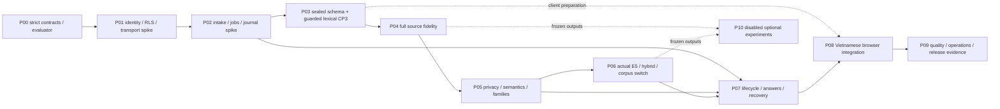

# Dependency order and safe parallelism

The architecture's accepted phase order is preserved. Ticket dependencies are data/interface dependencies,not a requirement to complete later quality benchmarks before building the harness. Preparation may overlap; permanent consumer acceptance follows the phase gates. A01/A02a/A03/A09 precede their dependent permanent integration. All current decisions are pending.

Every edge below is explicit and validated against [plan-data.json](plan-data.json). The table is in a valid topological order. Within a phase,a ticket becomes ready only when its predecessors' interfaces/evidence and applicable consumer gates exist. No dependency points from the lexical checkpoint to completed P07: minimum lifecycle primitives are implemented by026/027 before029.

| Ticket / phase | Objective | Predecessors |
| --- | --- | --- |
| [RAG-001](tickets/RAG-001.md) / P00 | Isolated harness, asset inventory and decision register | none |
| [RAG-002](tickets/RAG-002.md) / P00 | Scalar types, Unicode, hashes and offset algebra | [RAG-001](tickets/RAG-001.md) |
| [RAG-003](tickets/RAG-003.md) / P00 | Canonical evidence and observation schema catalog | [RAG-002](tickets/RAG-002.md) |
| [RAG-004](tickets/RAG-004.md) / P00 | Lifecycle, review, family, serving and ledger contracts | [RAG-003](tickets/RAG-003.md) |
| [RAG-005](tickets/RAG-005.md) / P00 | OpenAPI, generated client DTOs and wire negatives | [RAG-004](tickets/RAG-004.md) |
| [RAG-006](tickets/RAG-006.md) / P00 | Migration ownership and transition verification blueprint | [RAG-004](tickets/RAG-004.md), [RAG-005](tickets/RAG-005.md) |
| [RAG-007](tickets/RAG-007.md) / P00 | Gold bundles, synthetic fixtures and evaluator self-tests | [RAG-003](tickets/RAG-003.md), [RAG-004](tickets/RAG-004.md), [RAG-005](tickets/RAG-005.md) |
| [RAG-008](tickets/RAG-008.md) / P01 | OIDC, live identity registry and Vietnamese API shell | [RAG-005](tickets/RAG-005.md), [RAG-006](tickets/RAG-006.md) |
| [RAG-009](tickets/RAG-009.md) / P01 | Migration 0001 and actual-role pooled authorization | [RAG-008](tickets/RAG-008.md) |
| [RAG-010](tickets/RAG-010.md) / P01 | Actual synchronous transport and singleton fault spike | [RAG-008](tickets/RAG-008.md), [RAG-009](tickets/RAG-009.md), [RAG-004](tickets/RAG-004.md) |
| [RAG-011](tickets/RAG-011.md) / P02 | Durable typed journal and immutable operation outcome spike | [RAG-009](tickets/RAG-009.md), [RAG-004](tickets/RAG-004.md), [RAG-010](tickets/RAG-010.md) |
| [RAG-012](tickets/RAG-012.md) / P02 | Migration 0002 and immutable intake registration | [RAG-011](tickets/RAG-011.md), [RAG-006](tickets/RAG-006.md), [RAG-009](tickets/RAG-009.md) |
| [RAG-013](tickets/RAG-013.md) / P02 | Job leases, fenced checkpoints and cancellation | [RAG-012](tickets/RAG-012.md) |
| [RAG-014](tickets/RAG-014.md) / P02 | Fair scheduler, charged work and admission circuits | [RAG-013](tickets/RAG-013.md) |
| [RAG-015](tickets/RAG-015.md) / P02 | Structural allowlists and clean-scan attestations | [RAG-012](tickets/RAG-012.md), [RAG-014](tickets/RAG-014.md) |
| [RAG-016](tickets/RAG-016.md) / P03 | Migration 0003 canonical and safe-review ownership | [RAG-015](tickets/RAG-015.md), [RAG-006](tickets/RAG-006.md) |
| [RAG-017](tickets/RAG-017.md) / P03 | Migration 0004 observations and review capability policies | [RAG-016](tickets/RAG-016.md), [RAG-006](tickets/RAG-006.md) |
| [RAG-018](tickets/RAG-018.md) / P03 | Complete migration 0004 semantic and family heads | [RAG-017](tickets/RAG-017.md) |
| [RAG-019](tickets/RAG-019.md) / P03 | Migration 0005 representation and complete corpus schema | [RAG-018](tickets/RAG-018.md) |
| [RAG-020](tickets/RAG-020.md) / P03 | Migration 0006 release ownership and publication commands | [RAG-019](tickets/RAG-019.md), [RAG-013](tickets/RAG-013.md) |
| [RAG-021](tickets/RAG-021.md) / P03 | Migration 0007 deletion, retention claims and restore guards | [RAG-020](tickets/RAG-020.md), [RAG-011](tickets/RAG-011.md) |
| [RAG-022](tickets/RAG-022.md) / P03 | Disposable sandbox, trusted broker and watchdog | [RAG-015](tickets/RAG-015.md), [RAG-013](tickets/RAG-013.md) |
| [RAG-023](tickets/RAG-023.md) / P03 | Native PDF canonical evidence vertical path | [RAG-016](tickets/RAG-016.md), [RAG-022](tickets/RAG-022.md), [RAG-002](tickets/RAG-002.md), [RAG-003](tickets/RAG-003.md) |
| [RAG-024](tickets/RAG-024.md) / P03 | Native OOXML canonical path and unsupported coverage | [RAG-016](tickets/RAG-016.md), [RAG-022](tickets/RAG-022.md), [RAG-002](tickets/RAG-002.md), [RAG-003](tickets/RAG-003.md) |
| [RAG-026](tickets/RAG-026.md) / P03 | Minimum singleton mutation, journal and semantic kernel | [RAG-021](tickets/RAG-021.md), [RAG-010](tickets/RAG-010.md), [RAG-011](tickets/RAG-011.md), [RAG-018](tickets/RAG-018.md) |
| [RAG-025](tickets/RAG-025.md) / P03 | Safe previews and exact staged review package API | [RAG-017](tickets/RAG-017.md), [RAG-021](tickets/RAG-021.md), [RAG-026](tickets/RAG-026.md), [RAG-023](tickets/RAG-023.md), [RAG-024](tickets/RAG-024.md), [RAG-015](tickets/RAG-015.md), [RAG-005](tickets/RAG-005.md), [RAG-010](tickets/RAG-010.md) |
| [RAG-027](tickets/RAG-027.md) / P03 | Minimum source publication and complete lexical corpus | [RAG-026](tickets/RAG-026.md), [RAG-020](tickets/RAG-020.md), [RAG-025](tickets/RAG-025.md), [RAG-019](tickets/RAG-019.md) |
| [RAG-028](tickets/RAG-028.md) / P03 | Lexical chunker, safe OR compiler and bounded search | [RAG-023](tickets/RAG-023.md), [RAG-024](tickets/RAG-024.md), [RAG-019](tickets/RAG-019.md), [RAG-007](tickets/RAG-007.md), [RAG-009](tickets/RAG-009.md) |
| [RAG-029](tickets/RAG-029.md) / P03 | Guarded synthetic lexical end-to-end checkpoint | [RAG-027](tickets/RAG-027.md), [RAG-028](tickets/RAG-028.md), [RAG-025](tickets/RAG-025.md), [RAG-014](tickets/RAG-014.md), [RAG-022](tickets/RAG-022.md) |
| [RAG-030](tickets/RAG-030.md) / P04 | Region router, selective OCR and streaming long input | [RAG-029](tickets/RAG-029.md), [RAG-014](tickets/RAG-014.md), [RAG-022](tickets/RAG-022.md), [RAG-023](tickets/RAG-023.md) |
| [RAG-031](tickets/RAG-031.md) / P04 | Complex tables, physical transforms and continuation | [RAG-030](tickets/RAG-030.md), [RAG-023](tickets/RAG-023.md), [RAG-003](tickets/RAG-003.md) |
| [RAG-032](tickets/RAG-032.md) / P04 | Full OOXML fidelity, appendices and signature observations | [RAG-024](tickets/RAG-024.md), [RAG-030](tickets/RAG-030.md), [RAG-031](tickets/RAG-031.md) |
| [RAG-033](tickets/RAG-033.md) / P05 | Type, sensitivity and privacy review policy | [RAG-032](tickets/RAG-032.md), [RAG-017](tickets/RAG-017.md), [RAG-025](tickets/RAG-025.md), [RAG-026](tickets/RAG-026.md) |
| [RAG-034](tickets/RAG-034.md) / P05 | Mentions, normalization and reversible entity links | [RAG-033](tickets/RAG-033.md), [RAG-018](tickets/RAG-018.md), [RAG-002](tickets/RAG-002.md) |
| [RAG-035](tickets/RAG-035.md) / P05 | Typed facts and real published semantic review API | [RAG-034](tickets/RAG-034.md), [RAG-018](tickets/RAG-018.md), [RAG-026](tickets/RAG-026.md), [RAG-005](tickets/RAG-005.md) |
| [RAG-036](tickets/RAG-036.md) / P05 | Complete family membership registration and invalidation | [RAG-035](tickets/RAG-035.md), [RAG-018](tickets/RAG-018.md), [RAG-027](tickets/RAG-027.md) |
| [RAG-037](tickets/RAG-037.md) / P05 | Reviewed applicability, scoped effects and legal composition | [RAG-036](tickets/RAG-036.md), [RAG-031](tickets/RAG-031.md), [RAG-035](tickets/RAG-035.md) |
| [RAG-038](tickets/RAG-038.md) / P05 | Review backlog circuit and adjudication workflow | [RAG-033](tickets/RAG-033.md), [RAG-035](tickets/RAG-035.md), [RAG-036](tickets/RAG-036.md), [RAG-014](tickets/RAG-014.md) |
| [RAG-039](tickets/RAG-039.md) / P06 | Hierarchical, clause and table source-mapped chunks | [RAG-037](tickets/RAG-037.md), [RAG-032](tickets/RAG-032.md), [RAG-019](tickets/RAG-019.md), [RAG-028](tickets/RAG-028.md) |
| [RAG-040](tickets/RAG-040.md) / P06 | Actual local E5 tokenizer, encoder and exact dense oracle | [RAG-039](tickets/RAG-039.md), [RAG-001](tickets/RAG-001.md) |
| [RAG-041](tickets/RAG-041.md) / P06 | Hybrid fusion, fair admission and complete-bundle expansion | [RAG-040](tickets/RAG-040.md), [RAG-028](tickets/RAG-028.md), [RAG-034](tickets/RAG-034.md), [RAG-035](tickets/RAG-035.md), [RAG-037](tickets/RAG-037.md), [RAG-039](tickets/RAG-039.md) |
| [RAG-042](tickets/RAG-042.md) / P06 | Corpus shadow migration, atomic cutover and current rollback | [RAG-041](tickets/RAG-041.md), [RAG-027](tickets/RAG-027.md), [RAG-026](tickets/RAG-026.md) |
| [RAG-043](tickets/RAG-043.md) / P06 | Freeze baseline retrieval and parsing quality evidence | [RAG-007](tickets/RAG-007.md), [RAG-030](tickets/RAG-030.md), [RAG-031](tickets/RAG-031.md), [RAG-033](tickets/RAG-033.md), [RAG-035](tickets/RAG-035.md), [RAG-041](tickets/RAG-041.md), [RAG-042](tickets/RAG-042.md) |
| [RAG-044](tickets/RAG-044.md) / P07 | Evidence sufficiency, deterministic answers and exact citations | [RAG-041](tickets/RAG-041.md), [RAG-037](tickets/RAG-037.md), [RAG-035](tickets/RAG-035.md), [RAG-043](tickets/RAG-043.md), [RAG-026](tickets/RAG-026.md) |
| [RAG-045](tickets/RAG-045.md) / P07 | Revocation, all-route dispatch and bounded original export | [RAG-044](tickets/RAG-044.md), [RAG-026](tickets/RAG-026.md), [RAG-010](tickets/RAG-010.md), [RAG-042](tickets/RAG-042.md) |
| [RAG-046](tickets/RAG-046.md) / P07 | Deletion outcomes, sealed restore and key-rotation recovery | [RAG-045](tickets/RAG-045.md), [RAG-011](tickets/RAG-011.md), [RAG-021](tickets/RAG-021.md), [RAG-036](tickets/RAG-036.md), [RAG-035](tickets/RAG-035.md) |
| [RAG-047](tickets/RAG-047.md) / P07 | Dependency roots, exact GC claims, holds and physical purge | [RAG-046](tickets/RAG-046.md), [RAG-021](tickets/RAG-021.md), [RAG-037](tickets/RAG-037.md), [RAG-042](tickets/RAG-042.md), [RAG-013](tickets/RAG-013.md) |
| [RAG-048](tickets/RAG-048.md) / P07 | Cross-module adversarial lifecycle checkpoint | [RAG-044](tickets/RAG-044.md), [RAG-045](tickets/RAG-045.md), [RAG-046](tickets/RAG-046.md), [RAG-047](tickets/RAG-047.md), [RAG-038](tickets/RAG-038.md), [RAG-042](tickets/RAG-042.md) |
| [RAG-049](tickets/RAG-049.md) / P08 | Enterprise client session and strict response contracts | [RAG-029](tickets/RAG-029.md), [RAG-005](tickets/RAG-005.md), [RAG-008](tickets/RAG-008.md) |
| [RAG-050](tickets/RAG-050.md) / P08 | Vietnamese upload, status and staged-published review UI | [RAG-049](tickets/RAG-049.md), [RAG-038](tickets/RAG-038.md), [RAG-035](tickets/RAG-035.md), [RAG-037](tickets/RAG-037.md), [RAG-025](tickets/RAG-025.md) |
| [RAG-051](tickets/RAG-051.md) / P08 | Vietnamese search, evidence and lifecycle UI | [RAG-049](tickets/RAG-049.md), [RAG-044](tickets/RAG-044.md), [RAG-045](tickets/RAG-045.md), [RAG-046](tickets/RAG-046.md), [RAG-047](tickets/RAG-047.md), [RAG-042](tickets/RAG-042.md) |
| [RAG-052](tickets/RAG-052.md) / P08 | Real browser journeys and existing-demo regressions | [RAG-050](tickets/RAG-050.md), [RAG-051](tickets/RAG-051.md), [RAG-048](tickets/RAG-048.md) |
| [RAG-053](tickets/RAG-053.md) / P09 | Deployment, observability, updates and operator runbooks | [RAG-048](tickets/RAG-048.md), [RAG-052](tickets/RAG-052.md), [RAG-001](tickets/RAG-001.md) |
| [RAG-054](tickets/RAG-054.md) / P09 | Actual-role SQL scale, churn and latency qualification | [RAG-053](tickets/RAG-053.md), [RAG-042](tickets/RAG-042.md), [RAG-045](tickets/RAG-045.md), [RAG-043](tickets/RAG-043.md) |
| [RAG-055](tickets/RAG-055.md) / P09 | Long intake, reviewer capacity and recovery operating drills | [RAG-054](tickets/RAG-054.md), [RAG-038](tickets/RAG-038.md), [RAG-047](tickets/RAG-047.md), [RAG-046](tickets/RAG-046.md), [RAG-030](tickets/RAG-030.md) |
| [RAG-056](tickets/RAG-056.md) / P09 | Representative acceptance, independent review and release packet | [RAG-055](tickets/RAG-055.md), [RAG-052](tickets/RAG-052.md), [RAG-043](tickets/RAG-043.md), [RAG-048](tickets/RAG-048.md), [RAG-053](tickets/RAG-053.md) |
| [RAG-057](tickets/RAG-057.md) / Optional | Synthetic-only legacy lineage and offset converter | [RAG-052](tickets/RAG-052.md), [RAG-047](tickets/RAG-047.md), [RAG-002](tickets/RAG-002.md), [RAG-005](tickets/RAG-005.md) |
| [RAG-058](tickets/RAG-058.md) / P10 | Bounded local cross-encoder E04 comparison | [RAG-043](tickets/RAG-043.md), [RAG-041](tickets/RAG-041.md), [RAG-053](tickets/RAG-053.md) |
| [RAG-059](tickets/RAG-059.md) / P10 | Embedding challenger and quantization E06 comparison | [RAG-043](tickets/RAG-043.md), [RAG-042](tickets/RAG-042.md), [RAG-053](tickets/RAG-053.md) |
| [RAG-060](tickets/RAG-060.md) / P10 | Specialist OCR or VLM hard-subset E10 experiment | [RAG-043](tickets/RAG-043.md), [RAG-030](tickets/RAG-030.md), [RAG-053](tickets/RAG-053.md) |
| [RAG-061](tickets/RAG-061.md) / P10 | Learned type and bilingual NER E08 E11 evaluation | [RAG-043](tickets/RAG-043.md), [RAG-033](tickets/RAG-033.md), [RAG-034](tickets/RAG-034.md), [RAG-053](tickets/RAG-053.md) |
| [RAG-062](tickets/RAG-062.md) / P10 | Generated context, query expansion and HyDE E12 arms | [RAG-043](tickets/RAG-043.md), [RAG-044](tickets/RAG-044.md), [RAG-053](tickets/RAG-053.md) |
| [RAG-063](tickets/RAG-063.md) / P10 | Near duplicates and OCR identifier E13 variants | [RAG-043](tickets/RAG-043.md), [RAG-034](tickets/RAG-034.md), [RAG-041](tickets/RAG-041.md) |
| [RAG-064](tickets/RAG-064.md) / P10 | Local listwise E14 comparison after cross-encoder | [RAG-058](tickets/RAG-058.md), [RAG-043](tickets/RAG-043.md), [RAG-053](tickets/RAG-053.md) |
| [RAG-065](tickets/RAG-065.md) / P10 | Sparse and late-interaction E15 channel qualification | [RAG-059](tickets/RAG-059.md), [RAG-058](tickets/RAG-058.md), [RAG-043](tickets/RAG-043.md), [RAG-047](tickets/RAG-047.md) |
| [RAG-066](tickets/RAG-066.md) / P10 | Local answer, NLI and risk E16 qualification | [RAG-044](tickets/RAG-044.md), [RAG-043](tickets/RAG-043.md), [RAG-053](tickets/RAG-053.md) |
| [RAG-067](tickets/RAG-067.md) / P10 | Late chunking E17 compatible-encoder arm | [RAG-043](tickets/RAG-043.md), [RAG-047](tickets/RAG-047.md), [RAG-053](tickets/RAG-053.md) |
| [RAG-068](tickets/RAG-068.md) / P10 | Visual page retrieval E17 arm | [RAG-043](tickets/RAG-043.md), [RAG-047](tickets/RAG-047.md), [RAG-053](tickets/RAG-053.md) |
| [RAG-069](tickets/RAG-069.md) / P10 | RAPTOR overview E17 arm | [RAG-043](tickets/RAG-043.md), [RAG-047](tickets/RAG-047.md), [RAG-053](tickets/RAG-053.md), [RAG-066](tickets/RAG-066.md) |
| [RAG-070](tickets/RAG-070.md) / P10 | Proposition retrieval E17 arm | [RAG-043](tickets/RAG-043.md), [RAG-047](tickets/RAG-047.md), [RAG-053](tickets/RAG-053.md), [RAG-066](tickets/RAG-066.md) |

## Worktree lanes and integration locks

Separate worktrees are suitable for the following assignments once predecessor contracts are accepted. This describes human/session planning; it does not authorize spawning agents,parallel tools touching shared state or simultaneous migrations.

| Lane | Worktrees that can proceed independently | Shared-file exclusion and merge gate |
| --- | --- | --- |
| P00 after004 |005 OpenAPI/DTOs,006 SQL ownership specification,007 evaluator |001–004 serialize domain schemas.005 owns generated DTOs;006 may consume those schemas but cannot change them concurrently. |
| P01/P02 |010 transport experiment and pure-domain journal-format tests; durable011 integration follows010;013 job logic and015 scanner adapter can prepare after012 |No two live authority processes or shared synthetic DB/journal writers. Each worktree has its own isolated fixture roots. Registration/schema integration remains serial. |
| P03 migrations |016→017→018→019→020→021 integration serial |Never edit0004 simultaneously;017 authors observation/review part then018 completes semantic/family part. All migrations land sealed before traffic. |
| P03 parsers |023 PDF and024 DOCX after022/016;022 can prepare while schema016–021 are reviewed |Canonical/domain contracts frozen. Shared coverage/offset/transform files reserved by canonical owner; adapters have disjoint implementation files.025 then consumes both. |
| P03 lexical |028 can prepare against accepted schema/contracts while026 mutation kernel and025 safe review are integrated |027/029 merge only after complete profile/source/journal/dispatch/root guards exist. No placeholder published reader. |
| P04/P05 |030 OCR,full OOXML adapter preparation,privacy fixture development; actual032 follows030/031;034 entity adapter preparation can use frozen proposals |`canonical/tables`,coverage/schema changes serialize.035 semantic executor then036 membership then037 applicability integrate in that order. |
| P06 |039 source chunks and local040 asset qualification can prepare;041 integrates accepted outputs;042 corpus switch follows |Profiles,chunker/compiler hashes,space registry and lifecycle head code are shared locks; no per-document encoder merge. |
| P07 |044 answer logic,GC fixture/runbook preparation after contracts;045→046→047 lifecycle integration serial |`authz/dispatch_authority`,`lifecycle` transaction/head/journal/root functions and migrations never edited concurrently.048 is the cross-module checkpoint. |
| P08 |049 client may prepare from CP3.050 upload/review components and051 search/evidence components are independent after049 and their API consumers |Generated contracts/API client/session boundary reserved by049;shared design tokens/components edited under one UI owner.052 completes only after048/050/051. |
| P09 |053 runbooks/telemetry preparation,quality annotation under separate data authority,load harness preparation |Actual054/055 target-load/8h/reviewer/restore runs require exclusive reserved hardware and disposable roots; never load the imported workspace.056 accepts after evidence. |
| Optional |057 legacy,058 rerank,059 embedding,060–070 specific arms with their declared dependencies |All disabled until scoped approval/assets/quality/security gates. One model process at a time within host reservation;no speculative fleet. Generated semantic indexes need approved completeness/retraction contract before serving. |

The conflict owner serializes `domain/`,`schemas/`,OpenAPI/generated DTOs,`db/models`,migration order/grants/helpers,authority gate/heads,journal format,root DAG and active profile manifests. Changes to any shared architectural contract go through the approved change process; a worktree avoids file collisions,not semantic conflicts.

## Critical path and size checks

Baseline critical path:001→002→003→004→005/006→008→009→010→011→012→013/014/015→016→017→018→019→020→021→026; with022→023/024→025 and028,then027→029. Full fidelity030→031→032,trust033→034→035→036→037,hybrid039→040→041→042/043,answers044→045→046→047→048,UI049→050/051→052,and053→054→055→056 finish their gates.038 review circuit is mandatory before050/055.007 evaluator self-tests precede gold freeze/043. No conditional optional ticket is an incoming dependency of001–056.

Most tickets target one focused implementation session. Schema inventory004/006,large relational017/018,authority integration026,benchmark/report043,cross-module048 and final operating055/056 can require a second focused session or externally elapsed observation. They are concrete cohesive reviews,not one-hour promises. Before coding any ticket estimated above the session limit,split its numbered steps into child tickets with preserved requirement/dependency/test mappings and an explicit integration gate;review that scheduling-only change without altering architecture.055's8h soak and5 staffed-day forecast are automated/observed windows,not interactive coding time. Preserve the specification's640–1000 engineering-hour provisional envelope plus40–80 security/operations hours,20% integration reserve and unratified annotation effort. Re-estimate after CP3 and actual OCR/review timing.
